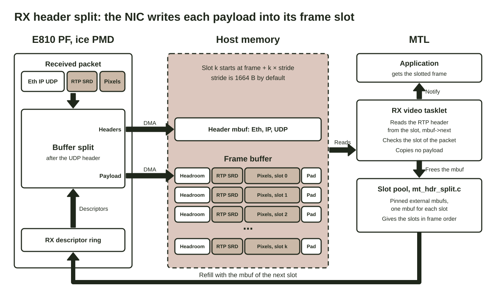

# Header Split Guide

## 1. Background

Header split is a hardware-based feature for RX memory copy offload. The NIC splits each packet after the UDP header. It writes the Ethernet, IP and UDP headers into a small header buffer, and the UDP payload (RTP header, SRD headers and pixels) straight into the frame. The CPU does not copy the payload.

Note: header split is experimental.



See section 6 of [Performance](../performance.md) for where header split helps and how to measure the gain.

## 2. Use cases

Header split helps an application that reads the frame in the transport format and spends its CPU time on the payload copy.

* A recorder that writes the RFC 4175 data of many 1080p or 4K sessions to storage.
* A gateway or a forwarder that sends the received RFC 4175 data again with no change.
* A receiver of many 1080p59 sessions on few cores. On an E810 PF, one RX core received 32 sessions with header split and 16 sessions with the CPU copy, with no loss.
* A host that is bound by memory bandwidth. Header split removes the read of each packet from its mbuf.
* A host with no free DSA device. Header split removes the copy from the CPU and needs no DMA device.

Header split does not help an application that needs a contiguous frame or a `st20p` converter. The application must read each packet from its slot. See section 6.2 of [Performance](../performance.md) for the other limits.

## 3. Requirements

* An E810 PF on the ice PMD. The port must support `RTE_ETH_RX_OFFLOAD_BUFFER_SPLIT`.
* IOVA as VA. The slots of a frame sit at the IOVA of the frame plus an offset.
* The ice bulk alloc RX path: `rx_free_thresh` is at least 32, smaller than `nb_rx_desc`, and divides `nb_rx_desc`. Else MTL drops the header split queues of the port.
* DPDK with the MTL patches in `patches/dpdk/${DPDK_VER}/`. Patch `0012-net-ice-fix-Rx-path-selection-for-per-queue-buffer-s.patch` is necessary: without it, the ice PMD selects a vector RX path for the split queue, and this path leaks payload mbufs.
* `nb_rx_hdr_split_queues` in `struct mtl_init_params`, one queue for each header split session.
* Enough payload mbufs in each header split queue: `hdr_split_slots` in `struct mtl_init_params`. The default, 21600, holds a session of 4 frames of 1080p GPM_SL.

A session needs `(framebuff_cnt + 1) * packets per frame - 1` slots. With BPM and 3 frames, 1080p needs 16459 slots, 4K needs 65831 slots, and 8K needs 263315 slots. Set `hdr_split_slots` to the value of the largest session. With too few slots, `mt_hdr_split_bind()` fails with `-ENOSPC` and MTL does not create the session.

When an application sets `nb_rx_hdr_split_queues`, MTL adds its mempool driver to DPDK before `rte_eal_init()`. DPDK has 16 entries for mempool drivers, and a full shared DPDK build uses all of them. Then the DPDK driver that loads last does not register, and DPDK logs `Maximum number of mempool ops structs exceeded`.

The order of the plugin directory sets which driver that is. If it is `stack`, the default mempool driver of MTL, MTL logs an error.

Once one RX queue of a port splits, the ice PMD uses the scalar RX path for all the RX queues of that port.

While a header split session runs, a rate limit change on the port fails with `-EBUSY`, because ice stops and starts the port to commit it. A TX session with rate limit pacing on that port then gets no queue and fails to create, and a TX session that retrains its rate falls back to TSC pacing. The port keeps rate limit pacing.

If an RX queue fails to give the frames back, the queue stays bound, and this lasts until the process exits.

## 4. Frame layout

The frame is slotted. Each packet has its own slot, and the slot keeps the RTP header and the SRD headers before the pixels. `ST20_RX_FLAG_HDR_SPLIT` in `include/st20_api.h` gives the stride of the slots, 1664 bytes by default. The RX session calculates the slot size from the packing in `st20_rx_ops.packing` (`st20p_rx_ops.transport_packing`), so the TX side must send the same packing.

The NIC writes a slot again one lap later, also when the application still holds the frame.

## 5. Run

```bash
sudo tests/tools/perf_testing/build/perf_testing \
  --p_port 0000:af:00.0 --p_sip 192.168.85.80 \
  --tx --t_port 0000:af:00.1 --t_sip 192.168.85.81 \
  --packing gpm_sl --hdr_split
```

Check the log to see if header split is enabled.

```text
MT: rv_attach(0), hdr_split enabled in ops
MT: rv_init_hdr_split(0), frames (...), 17279 slots, pkt_len 1200 slot 1226 stride 1664, ...
```
