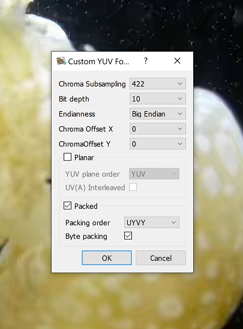

# Run Guide

This guide sets up the host and runs a sample application. Do the [Build Guide](build.md) first, and for an Intel E810 or E830 NIC also the [E800 Series Driver Guide](e800_series_drivers.md).

Do the sections in order:

1. [Enable the IOMMU](#1-enable-the-iommu), one time.
2. [Install the NIC driver](#2-install-the-nic-driver), one time.
3. [Give your user access to VFIO](#3-give-your-user-access-to-vfio), one time.
4. [Bind the NIC ports to DPDK](#4-bind-the-nic-ports-to-dpdk), after each boot.
5. [Set up hugepages](#5-set-up-hugepages), after each boot.
6. [Start the MtlManager](#6-start-the-mtlmanager), after each boot.
7. [Run the sample application](#7-run-the-sample-application).
8. [Check the setup with the tests](#8-check-the-setup-with-the-tests).

The DPDK PMD needs VFIO (IOMMU) and hugepages. It can run as a user that is not root, so it also runs in Docker and Kubernetes.
For an error message, see [Troubleshooting and FAQ](troubleshooting.md#3-run-problems).

## Network Security

Media Transport Library implements the transport layer for SMPTE ST 2110
protocols. It does not provide user or peer authentication, authorization,
traffic encryption, or media-content protection. Deployments must provide these
security controls externally and restrict network access using appropriate
infrastructure, such as trusted media networks, VLANs, firewalls, and
access-control policies.

## 1. Enable the IOMMU

If the IOMMU is already on, go to section 2. To check if IOMMU is enabled, please verify if there are any IOMMU groups listed under the `/sys/kernel/iommu_groups/` directory. If no groups are found, it indicates that IOMMU is not enabled.

```bash
ls -l /sys/kernel/iommu_groups/
```

### 1.1. Enable the IOMMU (VT-d and VT-x) in the BIOS

The steps to enable IOMMU in your BIOS/UEFI may vary depending on the manufacturer and model of your motherboard. Here are general steps that should guide you:

1. Restart your computer. During the boot process, you'll need to press a specific key to enter the BIOS/UEFI setup. This key varies depending on your system's manufacturer. It's often one of the function keys (like F2, F10, F12), the ESC key, or the DEL key.

2. Navigate to the advanced settings. Once you're in the BIOS/UEFI setup menu, look for a section with a name like "Advanced", "Advanced Options", or "Advanced Settings".

3. Look for IOMMU setting. Within the advanced settings, look for an option related to IOMMU. It might be listed under CPU Configuration or Chipset Configuration, depending on your system. For Intel systems, it's typically labeled as "VT-d" (Virtualization Technology for Directed I/O). Once you've located the appropriate option, change the setting to "Enabled".

4. Save your changes and exit. There will typically be an option to "Save & Exit" or "Save Changes and Reset". Select this to save your changes and restart the computer.

### 1.2. Enable the IOMMU in the Kernel

After enabling IOMMU in the BIOS, you need to enable it in your operating system as well.

#### Ubuntu and Debian

Edit `GRUB_CMDLINE_LINUX_DEFAULT` item in `/etc/default/grub` file, append below parameters into `GRUB_CMDLINE_LINUX_DEFAULT` item if it's not there.

```bash
sudo vim /etc/default/grub
```
```text
intel_iommu=on iommu=pt
```

then:

```bash
sudo update-grub
sudo reboot
```

#### CentOS Stream and RHEL 9

```bash
sudo grubby --update-kernel=ALL --args="intel_iommu=on iommu=pt"
sudo reboot
```

For non-Intel devices, contact the vendor for how to enable IOMMU.

### 1.3. Check the IOMMU Groups After the Reboot

```bash
ls -l /sys/kernel/iommu_groups/
```

If no IOMMU groups are found under the `/sys/kernel/iommu_groups/` directory, it is likely that the previous two steps were not completed as expected. You can use the following two commands to identify which part was missed:

```bash
# Check if "intel_iommu=on iommu=pt" is included
cat /proc/cmdline
# Check if CPU flags have vmx feature
lscpu | grep vmx
```

On a host where you cannot turn on the IOMMU, see [Can VFIO Run Without an IOMMU?](troubleshooting.md#45-can-vfio-run-without-an-iommu)

## 2. Install the NIC Driver

| NIC | Guide |
| --- | --- |
| Intel® E810, E830 | [E800 Series Driver Guide](e800_series_drivers.md) |
| Intel® I226-V | [I226-V Guide](i226.md) |
| Other | The guide of the NIC on the [DPDK site](http://doc.dpdk.org/guides/nics/overview.html) |

## 3. Give Your User Access to VFIO

DPDK utilizes the Linux kernel's VFIO module to enable direct NIC hardware access from user space with the assistance of an IOMMU (Input/Output Memory Management Unit).
To use DPDK's Poll Mode Drivers (PMDs), NICs must be bound to the `vfio-pci` driver. Before manipulating VFIO devices, it's necessary to configure user permissions and system rules to allow the current user to access VFIO devices.

This section guides you through creating a dedicated group, granting the appropriate permissions, and setting up udev rules to maintain these settings across system reboots and devices re-creations.

Add a new group named `vfio` with GID `2110` to control the VFIO devices, and add your current user to that group. If GID `2110` is in use, consider using a different one.

```bash
getent group 2110 || sudo groupadd -g 2110 vfio
sudo usermod -aG vfio $USER
```

Re-login and check the group `vfio` successfully added using the `groups` command:
```bash
groups
```
should result with:
```text
(...) sudo docker libvirt vfio
```

Create or edit a udev rules file, for example, `/etc/udev/rules.d/10-vfio.rules`, with your preferred text editor. For instance, using `vim`:

```bash
sudo vim /etc/udev/rules.d/10-vfio.rules
```

Add the following line to set the group ownership to vfio and enable read/write access for the group to any VFIO devices that appear:

```text
SUBSYSTEM=="vfio", GROUP="vfio", MODE="0660"
```

Then reload the udev rules with:

```bash
sudo udevadm control --reload-rules
sudo udevadm trigger
```

## 4. Bind the NIC Ports to DPDK

Note: The VFs do not stay after a reboot. Do this section again after each reboot, see [After a Reboot](#9-after-a-reboot).

For the Intel® E800 Series Ethernet Adapters (E810 or E830), which supports Virtual Functions (VFs) based on Single Root I/O Virtualization (SR-IOV), please refer to [Create Intel® E800 Series VFs](#41-create-intel-e800-series-vfs-and-bind-them-to-the-dpdk-pmd) to learn how to create VFs and bind them to the DPDK Poll Mode Driver (PMD).

For other Network Interface Cards (NICs), please verify if your NIC is supported by DPDK by referring to the following link: <https://doc.dpdk.org/guides/nics/>. If it is, follow the guide provided there for further instructions.

If DPDK has no PMD for your NIC, MTL can send and receive through the kernel instead. This backend is experimental, and its pacing is less accurate. See the [Kernel Socket Guide](../experimental/kernel_socket.md).

### 4.1. Create Intel® E800 Series VFs and Bind Them to the DPDK PMD

Get Device to Bus info mapping:

```bash
lshw -c network -businfo
```

```text
Bus info          Device       Class          Description
=========================================================
pci@0000:af:00.0  ens801f0     network        Ethernet Controller E810-C for QSFP
pci@0000:af:00.1  ens801f1     network        Ethernet Controller E810-C for QSFP
```

Below is the command to create VF for BDF `0000:af:00.0`  (shown above in example), and bind the VFs to DPDK PMD.

```bash
cd $mtl_source_code
sudo -E ./script/mtl_nicctl.sh create_vf 0000:af:00.0
```

To find the VF BDF (Bus Device Function) information, please check the output below. In this example, the VF BDFs range from 0000:af:01.0 to 0000:af:01.5. Remember these VF BDFs as you will need them when running the sample application.

```text
0000:af:00.0 'Ethernet Controller E810-C for QSFP 1592' if=enp175s0f0 drv=ice unused=vfio-pci *Active*
Bind 0000:af:01.0(enp175s0f0v0) to vfio-pci success
Bind 0000:af:01.1(enp175s0f0v1) to vfio-pci success
Bind 0000:af:01.2(enp175s0f0v2) to vfio-pci success
Bind 0000:af:01.3(enp175s0f0v3) to vfio-pci success
Bind 0000:af:01.4(enp175s0f0v4) to vfio-pci success
Bind 0000:af:01.5(enp175s0f0v5) to vfio-pci success
Create VFs on PF bdf: 0000:af:00.0 enp175s0f0 succ
```

`create_vf` makes 6 VFs. To make a different number, give the count as a last argument.
The `create_vf`, `create_tvf` and `create_kvf` commands also give each VF a 512-entry RSS LUT.
A VF with the default 64-entry LUT gets at most 16 queue pairs, so a port has no TX queue for its 16th video session and the session fails with `fail to find free tx queue`.
For VFs made another way, for example with `sriov_numvfs`, run `sudo ./script/mtl_nicctl.sh vf_rss_lut <PF BDF>`, or write the size before the application starts:

```bash
echo 512 | sudo tee /sys/bus/pci/devices/<VF BDF>/rss_lut_vf_attr
```

> **Note:** A VF takes the new LUT at its next reset. DPDK resets the VF when it starts, but a kernel driver does so only at its probe.

And please verify that the newly created VFIO device is correctly assigned to the vfio group as specified by your udev rules from [section 3](#3-give-your-user-access-to-vfio). Use the command:
```bash
ls -lg /dev/vfio/*
```
and below is sample output:
```text
crw-rw---- 1 vfio  235,   0 Dec 12 09:34 /dev/vfio/162
crw-rw---- 1 vfio  235,   2 Dec 12 09:34 /dev/vfio/163
crw-rw---- 1 vfio  235,   3 Dec 12 09:34 /dev/vfio/164
crw-rw---- 1 vfio  235,   4 Dec 12 09:34 /dev/vfio/165
```

If the creation of VF BDFs fails, you can check the kernel dmesg log to find possible reasons for the failure. The dmesg log contains valuable information that can help identify any issues or errors related to the VF creation process. Please review the dmesg log for any relevant messages or error codes that can provide insights into why the creation of VF BDFs was unsuccessful.

```bash
sudo dmesg
```

### 4.2. Bind a PF to the DPDK PMD

If your Network Interface Card (NIC) is not from the Intel® E800 Series, but is supported by DPDK, you have the option to directly bind the Physical Function (PF) to the DPDK Poll Mode Driver (PMD) for Bus Device Function (BDF) 0000:32:00.0 using the command provided below.

```bash
cd $mtl_source_code
sudo ./script/mtl_nicctl.sh bind_pmd 0000:32:00.0
```

## 5. Set Up Hugepages

Note: After rebooting the system, it is essential to configure hugepages again, as the configuration will be lost.

For example, if you want to enable 2048 2M huge pages, which would total to 4GB of memory, you can follow the step below:

```bash
sudo sysctl -w vm.nr_hugepages=2048
```

The number is dependent on the workloads you wish to execute. Consider increasing the value if memory allocation failures occur during runtime.

## 6. Start the MtlManager

Start the MtlManager service before you run more than one MTL process on a host. Start it in a second terminal: it runs until you stop it with Ctrl+C.

```bash
sudo MtlManager
```

Without it, all MTL processes take the same CPU cores. This gives a large performance drop and can make the host unstable.
For the details, see the [MtlManager guide](../../manager/README.md).

## 7. Run the Sample Application

### 7.1. Prepare Source Files

Please note that the input YUV source file for the sample application is in the RFC4175 YUV422BE10 (big-endian 10-bit) pixel group format, which is defined in the ST2110 specification. This project includes a simple tool to convert the format from YUV422 planar 10-bit little-endian format.

#### 7.1.1. Prepare a yuv422p10le File

The following command shows how to decode two frames from the encoder file and convert it from 420 to 422 planar file. Change the 'vframes' value if you want to generate more frames.

```bash
wget https://larmoire.org/jellyfish/media/jellyfish-3-mbps-hd-hevc-10bit.mkv
ffmpeg -i jellyfish-3-mbps-hd-hevc-10bit.mkv -vframes 2 -c:v rawvideo yuv420p10le_1080p.yuv
ffmpeg -s 1920x1080 -pix_fmt yuv420p10le -i yuv420p10le_1080p.yuv -pix_fmt yuv422p10le yuv422p10le_1080p.yuv
```

#### 7.1.2. Convert yuv422p10le to yuv422rfc4175be10

Below is the command to convert yuv422p10le file to yuv422rfc4175be10 pg format(ST2110-20 supported pg format for 422 10bit)

```bash
./build/app/ConvApp -width 1920 -height 1080 -in_pix_fmt yuv422p10le -i yuv422p10le_1080p.yuv -out_pix_fmt yuv422rfc4175be10 -o yuv422rfc4175be10_1080p.yuv
```

The yuv422rfc4175be10 files can be viewed by [YUV Viewer tools](https://github.com/IENT/YUView). Below is the custom layout.


#### 7.1.3. Convert yuv422rfc4175be10 Back to yuv422p10le

Below is the command to convert yuv422rfc4175be10 pg format(ST2110-20 supported pg format for 422 10bit) to yuv422p10le file

```bash
./build/app/ConvApp -width 1920 -height 1080 -in_pix_fmt yuv422rfc4175be10 -i yuv422rfc4175be10_1080p.yuv -out_pix_fmt yuv422p10le -o out_yuv422p10le_1080p.yuv
```

#### 7.1.4. v210 Support

This tools also support v210 format, use "v210" for the in_pix_fmt/out_pix_fmt args instead.

```bash
./build/app/ConvApp -width 1920 -height 1080 -in_pix_fmt yuv422rfc4175be10 -i yuv422rfc4175be10_1080p.yuv -out_pix_fmt v210 -o v210_1080p.yuv
./build/app/ConvApp -width 1920 -height 1080 -in_pix_fmt v210 -i v210_1080p.yuv -out_pix_fmt yuv422rfc4175be10 -o out_yuv422rfc4175be10_1080p.yuv
```

#### 7.1.5. yuv422 12bit Support

```bash
ffmpeg -s 1920x1080 -pix_fmt yuv420p10le -i yuv420p10le_1080p.yuv -pix_fmt yuv422p12le yuv422p12le_1080p.yuv
./build/app/ConvApp -width 1920 -height 1080 -in_pix_fmt yuv422p12le -i yuv422p12le_1080p.yuv -out_pix_fmt yuv422rfc4175be12 -o yuv422rfc4175be12_1080p.yuv
./build/app/ConvApp -width 1920 -height 1080 -in_pix_fmt yuv422rfc4175be12 -i yuv422rfc4175be12_1080p.yuv -out_pix_fmt yuv422p12le -o out_yuv422p12le_1080p.yuv
```

#### 7.1.6. yuv444 10bit Support

```bash
ffmpeg -s 1920x1080 -pix_fmt yuv420p10le -i yuv420p10le_1080p.yuv -pix_fmt yuv444p10le yuv444p10le_1080p.yuv
./build/app/ConvApp -width 1920 -height 1080 -in_pix_fmt yuv444p10le -i yuv444p10le_1080p.yuv -out_pix_fmt yuv444rfc4175be10 -o yuv444rfc4175be10_1080p.yuv
./build/app/ConvApp -width 1920 -height 1080 -in_pix_fmt yuv444rfc4175be10 -i yuv444rfc4175be10_1080p.yuv -out_pix_fmt yuv444p10le -o out_yuv444p10le_1080p.yuv
```

#### 7.1.7. yuv444 12bit Support

```bash
ffmpeg -s 1920x1080 -pix_fmt yuv420p10le -i yuv420p10le_1080p.yuv -pix_fmt yuv444p12le yuv444p12le_1080p.yuv
./build/app/ConvApp -width 1920 -height 1080 -in_pix_fmt yuv444p12le -i yuv444p12le_1080p.yuv -out_pix_fmt yuv444rfc4175be12 -o yuv444rfc4175be12_1080p.yuv
./build/app/ConvApp -width 1920 -height 1080 -in_pix_fmt yuv444rfc4175be12 -i yuv444rfc4175be12_1080p.yuv -out_pix_fmt yuv444p12le -o out_yuv444p12le_1080p.yuv
```

#### 7.1.8. Interlaced Support

ConvApp offers a `frame2field` option to convert a progressive YUV file into an interlaced file. The interlaced YUV file stores the first field followed by the second field, repeating this sequence.

For yuv422p10le:

```bash
./build/app/ConvApp --in_pix_fmt yuv422p10le --width 1920 --height 1080 --i yuv422p10le_1080p.yuv --o yuv422p10le_1080i.yuv --frame2field
```

For yuv422rfc4175be10:

```bash
./build/app/ConvApp --in_pix_fmt yuv422rfc4175be10 --width 1920 --height 1080 --i yuv422rfc4175be10_1080p.yuv --o yuv422rfc4175be10_1080i.yuv --frame2field
```

### 7.2. Run RxTxApp with JSON Config

Before running samples the JSON configuration files must be modified. The "name" tag in "interfaces" must be updated to VF BDF, e.g. 0000:af:01.0. No other changes are required to run samples.

```json
"interfaces": [
        {
            "name": "0000:af:01.0",
            "ip": "192.168.88.189"
        }
```

For the supported parameters in the JSON, please refer to [the JSON Configuration Guide](configuration_guide.md) for details.

Below is the command to run one video tx/rx session with JSON config.

```bash
./tests/tools/RxTxApp/build/RxTxApp --config_file config/tx_1v.json
```

If it runs well, you will see similar log output periodically:

```text
MTL: 2024-04-16 15:38:31, * *    M T    D E V   S T A T E   * *
MTL: 2024-04-16 15:38:31, DEV(0): Avr rate, tx: 2610.119496 Mb/s, rx: 0.001091 Mb/s, pkts, tx: 2465576, rx: 4
MTL: 2024-04-16 15:38:31, SCH(0:sch_0): tasklets 3, lcore 28(t_pid: 106158), avg loop 102 ns
MTL: 2024-04-16 15:38:31, CNI(0): eth_rx_rate 0.001091 Mb/s, eth_rx_cnt 4
MTL: 2024-04-16 15:38:31, PTP(0): time 1713253074859051552, 2024-04-16 15:37:54
MTL: 2024-04-16 15:38:31, TX_VIDEO_SESSION(0,0:app_tx_st20p_0): fps 59.900091, frame 599 pkts 2467208:2466608 inflight 147987:148099
MTL: 2024-04-16 15:38:31, TX_VIDEO_SESSION(0,0): throughput 2611.215061 Mb/s: 0.000000 Mb/s, cpu busy 0.655173
MTL: 2024-04-16 15:38:31, TX_st20p(0,app_tx_st20p_0), p(0:in_transmitting) c(1:converted)
MTL: 2024-04-16 15:38:31, TX_st20p(0), frame get try 600 succ 599, put 600
MTL: 2024-04-16 15:38:31, * *    E N D    S T A T E   * *
```

Then run a RX in another node/port.

```bash
./tests/tools/RxTxApp/build/RxTxApp --config_file config/rx_1v.json
```

If it runs well, you will see similar log output periodically:

```text
MTL: 2024-04-16 15:39:18, * *    M T    D E V   S T A T E   * *
MTL: 2024-04-16 15:39:18, DEV(0): Avr rate, tx: 0.000048 Mb/s, rx: 2602.516773 Mb/s, pkts, tx: 1, rx: 2465849
MTL: 2024-04-16 15:39:18, SCH(0:sch_0): tasklets 2, lcore 29(t_pid: 106309), avg loop 59 ns
MTL: 2024-04-16 15:39:18, CNI(0): eth_rx_rate 0.000000 Mb/s, eth_rx_cnt 0
MTL: 2024-04-16 15:39:18, PTP(0): time 1713253121113848589, 2024-04-16 15:38:41
MTL: 2024-04-16 15:39:18, RX_VIDEO_SESSION(0,0:app_rx_st20p_0): fps 59.999295 frames 600 pkts 2466461
MTL: 2024-04-16 15:39:18, RX_VIDEO_SESSION(0,0:app_rx_st20p_0): throughput 2611.054741 Mb/s, cpu busy 0.505297
MTL: 2024-04-16 15:39:18, RX_VIDEO_SESSION(0,0): succ burst max 96, avg 1.036124
MTL: 2024-04-16 15:39:18, RX_st20p(0,app_rx_st20p_0), p(1:free) c(0:ready)
MTL: 2024-04-16 15:39:18, RX_st20p(0), frame get try 599 succ 599, put 599
app_rx_st20p_stat(0), avrage latency 18.263382ms
MTL: 2024-04-16 15:39:18, * *    E N D    S T A T E   * *
```

This project also provides many loop tests (1 port as tx, 1 port as rx) config files. Please refer to [loop config](../../tests/tools/RxTxApp/script/).

If the sample does not run, see [Run Problems](troubleshooting.md#3-run-problems). To report a problem, collect the status of the host with `mtl_status_report.sh` and attach the `.tar` file.

```bash
./script/mtl_status_report.sh
```

### 7.3. Available Parameters in RxTxApp

```text
--config_file <URL>                  : the json config file path
--ptp                                : Enable the built-in PTP implementation, default is disabled and system time is selected as PTP time source.
--lcores <lcore list>                : the DPDK lcore list for this run, e.g. --lcores 28,29,30,31. If not assigned, lib will allocate lcore from system socket cores.
--test_time <seconds>                : the run duration, unit: seconds
--dma_dev <DMA1,DMA2,DMA3...>        : DMA dev list to offload the packet memory copy for RX video frame session.
--dma_auto                           : Use each Intel DMA device on vfio-pci on the NUMA node of a port, without a --dma_dev list.
--log_level <level>                  : set log level. e.g. debug, info, notice, warning, error.
--log_file <file path>               : set log file for mtl log. If you're initiating multiple RxTxApp processes simultaneously, please ensure each process has a unique filename path. Default the log is writing to stderr.

--arp_timeout_s <sec>                : debug option, set the arp timeout in seconds if using unicast address. Default timeout value is 60 seconds.
--allow_across_numa_core             : debug option, allow the usage of cores across NUMA nodes
--no_multicast                       : debug option, disable the multicast join message, usually for the SDN switch case.
--rx_separate_lcore                  : debug option, if enabled, RX video session will run on dedicated lcores, it means TX video and RX video is not running on the same core.
--rx_mix_lcore                       : debug option, if enabled, it means TX video and RX video are possible to run on the same core.
--runtime_session                    : debug option, start instance before create video/audio/anc sessions, similar to runtime tx/rx create.
--rx_timing_parser                   : debug option, enable timing check for video rx streams.
--pcapng_dump <n>                    : debug option, dump n packets from rx video streams to pcapng files, with NIC RX timestamps (MTL_FLAG_ENABLE_HW_TIMESTAMP).
--rx_video_file_frames <n>           : debug option, dump the received video frames to a yuv file, n is dump file size in frame unit.
--rx_video_fb_cnt<n>                 : debug option, the frame buffer count.
--promiscuous                        : debug option, enable RX promiscuous( receive all data passing through it regardless of whether the destination address of the data) mode for NIC.
--cni_thread                         : debug option, use a dedicated thread for cni messages instead of tasklet.
--sch_session_quota <count>          : debug option, max sessions count for one lcore, unit: 1080P 60FPS TX.
--p_tx_dst_mac <mac>                 : debug option, destination MAC address for primary port.
--r_tx_dst_mac <mac>                 : debug option, destination MAC address for redundant port.
--nb_tx_desc <count>                 : debug option, number of transmit descriptors for each NIC TX queue, affect the memory usage and the performance.
--nb_rx_desc <count>                 : debug option, number of receive descriptors for each NIC RX queue, affect the memory usage and the performance.
--tasklet_time                       : debug option, enable stat info for tasklet running time.
--tsc                                : debug option, force to use tsc pacing.
--pacing_way <way>                   : debug option, set pacing way, available value: "auto", "rl", "tsc", "tsc_narrow", "ptp", "tsn".
--shaping <shaping>                  : debug option, set st21 shaping type, available value: "narrow", "wide".
--vrx <n>                            : debug option, set st21 vrx value, refer to st21 spec for possible vrx value.
--ts_first_pkt                       : debug option, to set the st20 RTP timestamp at the time the first
packet egresses from the sender.
--ts_delta_us <n>                    : debug option, to set the st20 rtp timestamp delta(us) to the start time of frame.
--mono_pool                          : debug option, use mono pool for all tx and rx queues(sessions).
--tasklet_thread                     : debug option, run the tasklet under thread instead of a pinned lcore.
--tasklet_sleep                      : debug option, enable sleep if all tasklet report done status.
--tasklet_sleep_us                   : debug option, set the sleep us value if tasklet decide to enter sleep state.
--app_bind_lcore                     : debug option, run the app thread under a pinned lcore.
--rxtx_simd_512                      : debug option, enable dpdk simd 512 path for rx/tx burst function, see --force-max-simd-bitwidth=512 in dpdk for detail.
--rss_mode <mode>                    : debug option, available modes: "l3_l4", "l3", "none".
--tx_no_chain                        : debug option, use memcopy rather than mbuf chain for tx payload.
--multi_src_port                     : debug option, use multiple src port for st20 tx stream.
--audio_fifo_size <count>            : debug option, the audio fifo size between packet builder and pacing.
--dhcp                               : debug option, enable DHCP for all ports.
--virtio_user                        : debug option, enable virtio_user ports for control plane packets. Linux only, need to set capability for the app before running, `sudo setcap 'cap_net_admin+ep' ./tests/tools/RxTxApp/build/RxTxApp`.
--phc2sys                            : debug option, enable the built-in phc2sys function to sync the system time to our internal synced PTP time. Linux only, need to set capability for the app before running, `sudo setcap 'cap_sys_time+ep' ./tests/tools/RxTxApp/build/RxTxApp`.
--ptp_sync_sys                       : debug option, enabling the synchronization of PTP time from MTL to the system time in the application. On Linux, need to set capability for the app before running, `sudo setcap 'cap_sys_time+ep' ./tests/tools/RxTxApp/build/RxTxApp`.
--rss_sch_nb <number>                : debug option, set the schedulers(lcores) number for the RSS dispatch.
--log_time_ms                        : debug option, enable a ms accuracy log printer by the api mtl_set_log_prefix_formatter.
--rx_video_file_frames <count>       : debug option, dump the received video frames to one yuv file
--rx_audio_dump_time_s <seconds>     : debug option, dump the received audio frames to one pcm file
--dedicated_sys_lcore                : debug option, run MTL system tasks(CNI, PTP, etc...) in a dedicated lcore
--bind_numa                          : debug option, all MTL threads bind to same numa of NIC
--not_bind_numa                      : debug option, MTL threads runs without NIC numa aware
--force_numa <id>                    : debug option, force the NIC port numa id instead of reading from PCIE topology
```

## 8. Check the Setup with the Tests

This project includes many automated test cases based on gtest. Below there is an example command to run. Customize the argument according to your setup.

```bash
./build/tests/KahawaiTest --p_port 0000:af:01.0 --r_port 0000:af:01.1
```

In case the test requires large huge page settings, please expand it to 8GB.

```bash
sudo sysctl -w vm.nr_hugepages=4096
```

## 9. After a Reboot

The VFs, the hugepages and the MtlManager do not stay after a reboot. Do sections 4, 5 and 6 again:

```bash
# replace "0000:a1:00.0" with the port on your setup
sudo ./script/mtl_nicctl.sh create_vf 0000:a1:00.0
# the number of hugepages (2048) depends on the workloads that you run
sudo sysctl -w vm.nr_hugepages=2048
sudo MtlManager        # in a second terminal: it runs until you stop it
```

If the host booted a new kernel, install the NIC driver again before these steps, as section 2 of the [E800 Series Driver Guide](e800_series_drivers.md#2-install-the-driver) shows.

## 10. Optional Setup

You can skip this section if you do not need it.

- **PTP time.** To synchronize the time with a PTP grandmaster, see the [PTP Guide](../features/ptp.md).
- **Automatic NUMA balancing.** See below.

### 10.1. Disable Automatic NUMA Balancing

On timing-critical hosts, disable automatic NUMA balancing. Its periodic scans run on the busy MTL scheduler threads and can stall them for up to a few hundred microseconds:

```bash
sudo sysctl -w kernel.numa_balancing=0
# keep it across reboots
echo "kernel.numa_balancing=0" | sudo tee /etc/sysctl.d/99-mtl-numa-balancing.conf
```

MTL moves scheduler threads that run with the default memory policy to `MPOL_LOCAL`, which only shortens those scans. See also the [sysctl tuning list](../experimental/performance_optimizations.md).

## Troubleshooting

For an error message, see [Run Problems](troubleshooting.md#3-run-problems). For a frequent question, such as how to find a BDF or how to bind a port back to the kernel, see [Frequent Questions](troubleshooting.md#4-frequent-questions).
