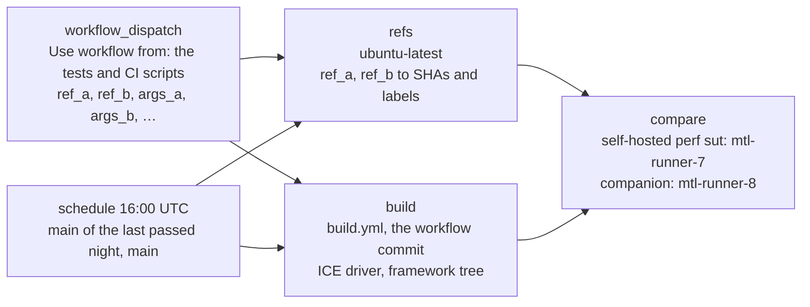

# Performance comparison of two MTL builds (perf-compare)

perf-compare runs two instances of the same end-to-end workload at the same time, one per
MTL build or configuration, and reports the difference between them. An instance is a TX
application on one host and an RX application on the other. Each instance has a PF of its
own on both hosts, CPU cores of its own, L3 cache ways of its own and a build tree of its
own. Both are measured through USDT, including the scheduler counters of
`mtl_sch_get_stats()`.

It answers "is build B slower or faster than build A, and where", for example the nightly
"main today against main yesterday", a branch against `main`, or `v26.09` against `v26.01`.
It also compares one build with two configurations, such as two values of
`--sch_session_quota`. It does not search for a session ceiling; `perf-pytest.yml` does
that.

This page is the design and the plan. Section 9 tracks what is implemented and proved.

## 1. Requirements

| # | Requirement | Where it is met |
| --- | --- | --- |
| R1 | Two instances, each a TX app on one host and an RX app on the other | §3 |
| R2 | Each instance on a PF of its own, on both hosts | §4.1 |
| R3 | Each instance on lcores of its own, isolated from the other | §4.2, §4.3 |
| R4 | The instances must not interfere with each other | §4 |
| R5 | Measure with USDT and the scheduler stats of `mtl_sch_get_stats()` | §5 |
| R6 | Choose a commit, tag or branch per instance; `main` is the default reference | §6 |
| R7 | Every night: `main` of the day before against `main` of the day | §6.3 |
| R8 | Same version, different configuration | §6.1 |
| R9 | Instances as equal as possible | §3.2 |
| R10 | Optionally other frameworks: RxTxApp, FFmpeg, GStreamer | §7 |

## 2. Decisions

| Question | Decision | Why |
| --- | --- | --- |
| Run A and B one after the other, or at the same time? | At the same time, then again with the slots swapped | Concurrent runs share every time-varying disturbance (the shared switch floods up to 47 Gb/s of other runners' multicast, other jobs, thermal state) as common mode, which a sequential run turns into a difference. The swap cancels what differs between the two slots (§4.5). |
| Extend `perf-pytest.yml` or a new workflow? | A new workflow, `perf-compare.yml` | perf-pytest restores one tree and searches a capacity ceiling for hours; perf-compare builds two trees and reports a difference after minutes. One workflow for both would give every input two meanings. Both need the `sut` runner, so GitHub runs them one after the other. |
| A pytest case or a standalone tool? | A pytest case in `tests/acceptance/tests/dual/performance/` | Both builds run under the same harness, the workflow commit's. The case reuses the topology, the VFs on both PFs, the media ramdisk, the RxTxApp config builder and the log layout. |
| Where are A and B built? | In the compare job, one after the other on the SUT, with the workflow commit's build scripts | One host, compiler and set of flags for both, so a difference is the code's; a cached build can come from another toolchain or host. It also builds `v26.01`, which `build.yml` cannot: its scripts install into `/usr/local`. Both take about 80 s. |
| How do two builds that expect the same path run side by side? | Each instance runs in a private mount namespace with its tree bind-mounted over `<mtl>/.local_install` | DPDK bakes `RTE_EAL_PMD_PATH` into `librte_eal` as an absolute path with no override, so a moved tree loads the wrong drivers or none; `v26.01` pins DPDK 25.11 and `main` 26.07. |
| How are the CPUs isolated? | A transient systemd unit per instance whose `AllowedCPUs` (a cgroup v2 cpuset) is the slot, no `--lcores`, app threads off the scheduler CPUs | §4.2. `taskset` isolates nothing: `numa_bind()` in `mtl_init()` widened a `[2,3]` mask to `0-31` on the test host. `isolate.sh` holds one host-wide lock for its one partition, so two instances cannot use it at once. |
| How is the cache shared? | Intel RDT CAT: each slot gets an equal, exclusive set of L3 ways | Without it the instance with the larger footprint evicts the other one, and the slot swap does not cancel that: it follows the instance, not the slot. |
| What is measured? | The MTL stats dump through the USDT probe `sys:log_msg`, the tasklet counters through the new probe `sys:tasklet_stat`, per-thread CPU from `/proc`, memory bandwidth from RDT | §5. `sys:log_msg` fires whatever the log level of the app is and exists in every release since 2024, so `v26.01` is measured the same way as `main`. |
| Which application? | RxTxApp | §7: FFmpeg and GStreamer can run in the same harness, but they measure their own frame copies more than MTL |
| Same NUMA node for both slots, or one node each? | Both on the node of the NICs | Both PFs hang off node 0. A slot on node 1 would reach its NIC and hugepages across the socket link, which no production MTL does; the swap would cancel that in the mean but not in the spread, the noise floor. CAT splits the shared L3 (§4.4). |
| How much does tracing distort? | The primary rows are untraced; the traced window times 1 scheduler loop in 64 where the build can, and its rows compare only between builds timed alike | §5.2, §5.3 |

## 3. Topology and one round

### 3.1. Roles

The SUT (`mtl-runner-7`, the `sut` label) runs the RX application of both instances and
the companion (`mtl-runner-8`) runs the TX application of both. Both hosts are measured.

```text
 companion mtl-runner-8: TX                              SUT mtl-runner-7: RX
┌───────────────────────────────────────┐              ┌───────────────────────────────────────┐
│ CPUs 0-1: OS, CI runner, collectors   │              │ CPUs 0-1: OS, CI runner, collectors   │
│                                       │              │                                       │
│ slot 0  unit mtl-perf-tx0             │  PF 15:00.0  │ slot 0  unit mtl-perf-rx0             │
│         CPUs 2-9, node 0, L3 group 0  │ ──── VF ───▶ │         CPUs 4-11, node 0, L3 group 0 │
│         tree a (round 1), b (round 2) │  unicast,    │         tree a (round 1), b (round 2) │
│                                       │  subnet 0    │                                       │
│ slot 1  unit mtl-perf-tx1             │  PF 15:00.1  │ slot 1  unit mtl-perf-rx1             │
│         CPUs 10-17, node 0, L3 grp 1  │ ──── VF ───▶ │         CPUs 12-19, node 0, L3 group 1│
│         tree b (round 1), a (round 2) │  subnet 1    │         tree b (round 1), a (round 2) │
│                                       │              │                                       │
│ L3 default group: DDIO ways, the rest │              │ L3 default group: DDIO ways, the rest │
└───────────────────────────────────────┘              └───────────────────────────────────────┘
```

The SUT slots are its isolated cores; the companion isolates none yet, so its slots are
the first free cores until it does (§4.6).

### 3.2. Equal instances

Both instances get the same RxTxApp JSON except the interface name and the IPs, the same
number of CPUs, and the same base arguments, `--dedicated_sys_lcore --disable_migrate`,
the settings of the perf-pytest measured app. Migration is off because it changes the
number of cores during the run. `args_a` and `args_b` are appended to the instance they
name; they are the only intended difference besides the build.

### 3.3. One round

```text
      start      steady   warm-up      untraced window          traced window      stop
       │           │     ├────────┤├──────────────────────┤├──────────────────┤      │
RX A,B ┼═══════════════════════════════════════════════════════════════════════════════┼
TX A,B   ┼═══════════════════════════════════════════════════════════════════════════┼
log_msg  ├─────────────────────────────────────────────────────────────────────────────┤ every stats dump
/proc, RDT, clock                 ▲ read 1                ▲ read 2
tasklet_time_sample + tasklet_stat                          ├──────────────────────────┤
                       ▲ move the app threads off the scheduler CPUs
```

1. Start the RX application of both instances on the SUT, then the TX application of both
   on the companion, each as a transient systemd unit (§4). Attach the `sys:log_msg`
   collector to each of the four processes (§5.1).
2. Wait until the last stats dump of every instance shows every session at 99% of its
   frame rate (steady). Move the application threads of each instance off its scheduler
   CPUs (§4.2), then wait the warm-up (30 s).
3. Untraced window (`test_time`): only `sys:log_msg` is attached. `/proc`, the RDT
   counters and the monotonic clock are read at both ends; the window is that span for
   all four processes.
4. Traced window (`test_time / 2`): the tasklet timing and, where the build has it,
   `sys:tasklet_stat` are attached as well. A build with `sys:tasklet_time_sample` times
   1 scheduler loop in 64; an older one times every loop (§5.3).
5. Stop the TX applications, then the RX applications, with SIGINT, and copy the
   application logs and collector records of the round to the pytest log folder.

Two rounds is the default; round 2 swaps the slots. The NIC MAC counters of each PF are
read before and after each round, so a loss on the way between the hosts is told apart
from a loss in the receiver.

## 4. Isolation

One instance on one host, from the outside in:

```text
systemd-run --unit mtl-perf-rx0          AllowedCPUs=4-11 AllowedMemoryNodes=0 (cgroup v2), Nice=-20
└─ unshare --mount --ipc                 its own mount table and SysV IPC
   └─ sh /tmp/mtl-perf-compare/A_rx0.sh
      ├─ mount --bind <slot tree> <mtl>/.local_install     its build, at the path DPDK expects (§4.3)
      ├─ mount -t tmpfs tmpfs /var/run/imtl                no MtlManager; a private lcore table
      ├─ echo $$ > /sys/fs/resctrl/mtl_perf_0/tasks        its L3 ways (§4.4)
      └─ cd <mtl> && exec taskset -c 4 taskset -c 4-11 env LD_LIBRARY_PATH=<its libs> RxTxApp …
                                                           main lcore 4, schedulers on 5-11 (§4.2)
mtl-perf-rx0-log     bpftrace -p <pid>   sys:log_msg, the whole run, on CPU 1
mtl-perf-rx0-trace   bpftrace -p <pid>   the tasklet probes, the traced window, on CPU 1
```

### 4.1. NIC

Each slot uses a VF of its own PF on both hosts: slot 0 is `host.vfs[0]` (PF 0), slot 1 is
`host.vfs_r[0]` (PF 1). The E830 has a PCIe x16 Gen5 link, far above two 100G ports. Each
slot has its own subnet (slot 1 takes the redundant pools of `ip_pools`) and unicast
streams, so no stream of one slot reaches the other.

### 4.2. CPU

`cpu_layout()` in `mtl_engine/perf_compare.py` computes the slots on each host from its
topology:

1. Take the NUMA node of the VF and the first hardware thread of each of its physical
   cores, so no slot uses an SMT sibling of a core of the other slot.
2. Leave the first two cores to the OS (the collectors run on CPU 1).
3. Give each slot 8 cores, from `isolcpus` when the node isolates 16 or more
   (`mtl-runner-7`: `isolcpus=4-20`), else from the cores that are not isolated, so both
   slots of a host are always treated alike.

The unit has `AllowedCPUs=<slot>`, `AllowedMemoryNodes=<node>` and `Nice=-20`, and the
application gets no `--lcores`:

- With `--lcores`, MTL passes `-l 0,<lcores>` to EAL, which pins the main lcore to CPU 0
  and treats a failure to do so as fatal (`rte_eal_init`, "Cannot set affinity"). Every
  instance would need CPU 0.
- Without it, EAL takes its lcores from the affinity mask of the process and the main
  lcore is the lowest CPU, so the cpuset alone places everything.
- The process starts on the first CPU of the slot (`taskset -c <first>`) and its mask is
  then widened to the slot (`taskset -c <slot>`), the start CPU trick of `isolate.sh`.
  EAL reads the wide mask, the schedulers take the other CPUs, and the application and
  control threads start where the main thread runs. The kernel clamps the `numa_bind()`
  of `mtl_init()` to the cpuset.
- Once the instance is steady, every thread that may still run anywhere in the slot (the
  application, pipeline and MTL admin threads) gets the slot's CPUs that no scheduler
  uses. CFS would otherwise move one onto a CPU a scheduler polls.

Measured on the test host for an RX instance on CPUs 8-11: `mtl_sch_0` on 9, `mtl_sch_1`
on 10, both pinned; the EAL control threads on 8; the application threads allowed 8-11
until the move, then 8 and 11. The move took the scheduler preemptions from about 150 to
about 15 a second there.

### 4.3. Software state

`unshare --mount --ipc` gives each instance:

- its own build: the slot tree is bind-mounted over `<mtl>/.local_install`, and
  `LD_LIBRARY_PATH` points into it, so even a tree whose DPDK has other sonames than the
  ones in the linker cache loads its own libraries;
- no MtlManager: a tmpfs over `/var/run/imtl` hides the daemon's socket, so a `v26.01`
  library never talks to a `main` MtlManager. MTL falls back to its SysV shared memory
  lcore table, which is private to the IPC namespace ("clear shm as we are the first
  user" in the log).

DPDK already runs with `--in-memory`, so the instances share no hugepage files.

### 4.4. Cache and memory bandwidth

When `/sys/fs/resctrl` offers L3 allocation and no other user has groups there, the round:

1. creates the groups `mtl_perf_0` and `mtl_perf_1` with `ways / 3` L3 ways each, at the
   end of the mask without the `shareable_bits`: those are the ways the NIC writes into
   (DDIO), which both instances use and which must not belong to one of them;
2. gives the rest of the ways, the DDIO ones included, to the default group, after saving
   its mask to `/run/mtl-perf-compare.schemata`;
3. puts each instance into its group before `exec`, so every thread it creates inherits
   the group.

On the test host (12 ways, `shareable_bits` `c00`) the slots get `00f` and `0f0`, and
the default group `f00`, which holds the DDIO ways. The groups are removed and the default
mask restored at the end of the case, before the next setup, and by
`.github/scripts/ci/cleanup.sh`, which every CI job runs. A host without RDT runs without
it, and the report says so.

The groups also count memory bandwidth (MBM) and LLC occupancy (CMT), reported per
instance.
Memory bandwidth allocation (MBA) is not used: the load is a few GB/s on a host with
hundreds, and MBA throttles by inserting delay, which changes the latency it would
protect.

### 4.5. What still differs, and how it is handled

| Residual effect | Handling |
| --- | --- |
| PF 0 and PF 1, and the two core sets, are not identical | The slot swap: each instance runs once in each slot |
| `mtl-runner-7` isolates cores, `mtl-runner-8` does not | Both slots of a host get the same treatment and the hosts are never compared with each other; §4.6 recommends the same isolation on both |
| Shared memory controller, DDIO ways, socket power budget | Common mode for both instances; the A/A run measures what is left |
| Another job on the companion, which also serves other repositories | The round notes it when `Runner.Worker` ran on the companion |
| Host tasks on the slot cores of a host without `isolcpus` (`mtl-runner-8`), and on the SMT siblings of slot cores | Not prevented: the cpuset bounds the instance, not the host. Tasks on slot cores show as `sch preemptions (/s)`, tasks on siblings only as a longer loop and a wider spread; §4.6 |

An A/A run (`ref_a` = `ref_b`) measures the noise floor of the rig. The nightly run is
one whenever `main` did not move for a day. With equal refs B is a copy of A's build,
so the two instances run the same binaries.

### 4.6. Host isolation of the perf pair

Both hosts should isolate the same cores, so the TX instances get what the RX instances
get. `mtl-runner-7` boots with `isolcpus=4-20 nohz_full=4-20 rcu_nocbs=4-20`;
`mtl-runner-8` isolates nothing, so its kernel ticks, RCU callbacks and any task can land
on the TX slot cores (2 preemptions a second there against 0.3 on `mtl-runner-7`). The
recommendation is the same line on `mtl-runner-8`:

```text
isolcpus=4-20 nohz_full=4-20 rcu_nocbs=4-20
```

```text
          node 0: the NICs, CPUs 0-31 and their SMT siblings 128-159             nodes 1-3
CPUs   0-1          2-3   4-11     12-19    20     21-31, 128-159     32-127, 160-255
       OS,          OS    slot 0   slot 1   idle   OS, CI runner      OS
       collectors         └───── isolated ──────┘
```

- Cores 4-19 are the two slots: `cpu_layout()` takes them when the node isolates 16 or
  more. Core 20 completes the 4-20 range perf-pytest runs on; perf-compare leaves it
  idle.
- No flags (`managed_irq`, `domain`) and no SMT siblings in the list. perf-pytest passes
  the raw `isolcpus=` value to RxTxApp as `--lcores`
  (`test_vf_perf_dualhost.py`), so a flag would make that an invalid lcore list. It also
  keeps CPUs up to the highest isolated one online for turbo, so a sibling list such as
  `132-148` would keep 149 CPUs online instead of 21.
- The siblings of the slot cores stay with the OS. `cpu_layout()` gives no MTL work to
  them, so they only add noise when the host is busy. No row isolates that noise: a task
  on a sibling slows a scheduler without preempting it, so it shows as a longer loop and
  a wider spread.
- With the line on `mtl-runner-8`, perf-pytest's companion also runs on `--lcores 4-20`,
  as its SUT side already does.
- A dynamic alternative without a reboot, a cgroup v2 `isolated` partition per slot as
  `isolate.sh` makes one, removes the cores from load balancing but keeps the ticks.
- The two hosts differ in one more boot parameter: `mtl-runner-8` has `dis_ucode_ldr`, so
  it runs older microcode (0x1000380 against 0x1000405). That does not touch A against
  B, as both instances of a host share it, but it is a TX against RX difference for
  perf-pytest; removing it is a separate decision.

Apply it with the host idle (`pgrep -x Runner.Worker` empty), then reboot:

```bash
sudo cp /etc/default/grub /etc/default/grub.bak
sudo sed -i 's/^GRUB_CMDLINE_LINUX_DEFAULT="\(.*\)"/GRUB_CMDLINE_LINUX_DEFAULT="\1 isolcpus=4-20 nohz_full=4-20 rcu_nocbs=4-20"/' /etc/default/grub
sudo update-grub && sudo reboot
# after the reboot
cat /proc/cmdline /sys/devices/system/cpu/isolated
```

The reboot drops the VFs and the hugepages and may load the stock ICE driver. Check
them, and the `/mnt/media` mount, before the runner takes a job.

## 5. Measurement

### 5.1. Collectors

Each process gets a bpftrace collector by PID, as a transient unit on CPU 1. bpftrace
resolves `usdt::sys:<probe>` through the libraries the process mapped, so it reads the
slot tree of that instance through the mount namespace and needs no path:

- `sys:log_msg` for the whole run: every MTL log line, the stats dump included, with its
  timestamp, whatever the log level of the app is;
- the tasklet timing and `sys:tasklet_stat` for the traced window only: the first makes
  the scheduler time tasklet calls, the second reports the cumulative time and work
  counters of `mtl_sch_get_stats()` at each stats dump. The collector lists the probes of
  the process and takes the cheapest timing it has:

  | The build has | Timing probe | The traced window is |
  | --- | --- | --- |
  | `sys:tasklet_time_sample` | `sys:tasklet_time_sample` | `sampled`: 1 loop in 64 timed, counters scaled (§5.3) |
  | `sys:tasklet_stat`, no sampling | `sys:tasklet_time_measure` | `full`: every loop timed |
  | neither, any release before them | `sys:tasklet_time_measure` | `full, no counters`: every loop timed, no work rows |

The bpftrace programs and the instance scripts are written to files on the host and the
units run those files: systemd expands `$` in `ExecStart=` (`$$` became `$`, and
the RDT join failed), so no script text goes through it.

```text
RxTxApp + libmtl (slot tree)        bpftrace -p <pid>, CPU 1           perf_compare.py, the case
 stats dump, every 10 s ──── sys:log_msg ───▶ "<ns> L <line>"   ─┐
 mtl_sch_get_stats() at a dump ─ sys:tasklet_stat ─▶ "<ns> T <sch> <tasklet> cnt sum wcnt wsum"
 /proc/<pid>/task/*, RDT mon_data, /proc/timer_list ─── read at both ends of the untraced window
                                                                 │
          parse_dumps():  records into dumps, each with its CLOCK_MONOTONIC time
          windows():      untraced = dumps inside the two reads; traced = dumps after the attach
          metrics():      median over dumps; differences of /proc, RDT and the counters
          compare():      mean over rounds, (B - A) / A, noise = spread between rounds
          _report():      perf_compare.md, perf_compare.json, the round logs
```

The untraced dumps are the ones whose whole period lies between the two `/proc` reads,
by the host's CLOCK_MONOTONIC (`/proc/timer_list`, the clock of the bpftrace timestamps),
so all four processes are measured over the same span and no clock is shared between the
hosts. The traced dumps are the ones that hold tasklet time lines; the first of them
started untraced, so it is only the base of the cumulative counters. The last dump of a
run is dropped, as the application was stopping. The collector units are checked with
the applications, and a round whose traced window had the counters but has no work rows
fails.

### 5.2. Metrics

Untraced window, the production view; these are the primary regression signals:

| Metric | Source | Meaning |
| --- | --- | --- |
| `sch_N avg loop (ns)` | `SCH(N:...): ... avg loop X ns` | Time of one pass over all tasklets of scheduler N. More work per packet makes the loop longer at the same load. Always on, no tracing. |
| `video cpu busy (%)` | `RX/TX_VIDEO_SESSION(...): ... cpu busy X` | MTL's own load score of a session, the avg loop over the packet interval |
| `scheduler threads (cores)`, `other threads (cores)`, `process (cores)` | `/proc/<pid>/task/*/stat` | CPU in cores; a scheduler thread is the `t_pid` of its `SCH` line, the others are the app, pipeline and control threads |
| `sch preemptions (/s)` | `nonvoluntary_ctxt_switches` of the scheduler threads | Isolation quality |
| `memory bandwidth (MB/s)`, `LLC occupancy (MB)` | `mon_data` of the RDT group | Memory traffic and cache footprint of the instance |
| `fps (worst session)`, `RX/TX rate (Mb/s)` | `RX/TX_VIDEO_SESSION(...): fps`, `DEV(N): Avr rate` | The workload; a run below 99% of the frame rate is not compared |
| `incomplete frames`, `hw dropped pkts` | `incomplete frames`, `Status: rx_hw_dropped_packets` | Loss in the receiver |

Traced window, the cost of each tasklet:

| Metric | Source | Meaning |
| --- | --- | --- |
| `<tasklet> avg (ns/call)` | `sys:tasklet_stat`; `SCH(N,M): tasklet <name>, avg` without it | Average of all calls |
| `<tasklet> work (ns/call)` | `sys:tasklet_stat` | Average time of the calls that did work |
| `<tasklet> work (% of a core)` | `sys:tasklet_stat` | Work time over the window, summed over the schedulers |
| `RX work (ns/pkt)`, `TX work (ns/pkt)` | `sys:tasklet_stat` and `DEV` packets | Work time of `rvs_pkt_rx`, or of `tx_video_sessions_mgr` and `video_transmitter`, per packet |
| `sch_N avg loop, traced (ns)` | `SCH(N:...): avg loop` of the traced dumps | The always-on loop time with the timing in it; against `sch_N avg loop (ns)` it is the cost of the timing |

`work` counts the calls that returned something other than `MTL_TASKLET_ALL_DONE`. A
polling tasklet is called millions of times a second and nearly all calls are idle, so the
average of all calls hardly moves with the load; the work counters do.

Compare traced rows only between builds timed alike, and the report header names the
mode of each. Timing every loop costs a sampled build tens of percent of its loop (§5.3),
and a build with the cumulative counters of `mtl_sch_get_stats()` makes two more counter
updates per timed call: on the test host its traced loop and `video_transmitter` rows read
3-4% above a build without them, while every untraced row agreed. When A and B were timed
in different modes, the report shows their traced rows as "traced unlike".

### 5.3. Tracing cost

Timing every loop is not free: on the perf pair the traced loop of the RX schedulers was
25% longer than the untraced one (635 against 508 ns) and of the TX scheduler 10% (1215
against 1104 ns). Each timed tasklet call reads the TSC twice; a microbenchmark on
`mtl-runner-7` puts a timed call at 36-47 cycles, nearly all of them the two `rdtsc`.
The conversion to ns in `mt_get_tsc()` adds 1-4 cycles, so counting in TSC cycles would
not help. The options were:

| Approach | Cost | Trade-off |
| --- | --- | --- |
| The untraced rows (loop time, cpu busy, CPU, memory bandwidth) | None | The primary rows; they work for every build |
| Chained timestamps: the end of one tasklet call is the start of the next | About 40% less | The counter updates of one tasklet land in the time of the next |
| Sampling: time 1 loop in N (implemented) | About N times less | The sums and the work count become estimates; `min`/`max` are of the timed calls |
| A PMU sampling profile of the scheduler threads (`perf record` at 1 kHz) | About 0.1%, the same for every build | Shows where the time goes by function, but not which call did work; needs `perf` for the running kernel |

The library samples: while `sys:tasklet_time_sample` is attached, or with
`MTL_FLAG_TASKLET_TIME_SAMPLE`, each scheduler times 1 loop in 64 on average and counts
the calls of that loop for every loop up to the next timed one.

```text
loop      1   2   3   4   5   6   7   8   9  10  11  12  …
full      T   T   T   T   T   T   T   T   T   T   T   T     every call timed, weight 1
sampled   T₅  ·   ·   ·   ·   T₂  ·   T₄  ·   ·   ·   T₇    Tₙ: timed, its calls count n times
```

- The gap is random, 1 to 127 loops (xorshift32, drawn before the loop runs). A fixed gap
  would fall in step with a tasklet whose work repeats every few loops, and the unit
  test with work on every 4th call checks that it does not.
- `time.cnt` counts every call to within one gap. `sum_ns`, `work.cnt` and
  `work.sum_ns` are estimates, from the timed calls, of the totals of the loop as it
  runs, and `min_ns` and `max_ns` are of the timed calls.
- The loop time of `mtl_sch_get_stats()` stays empty while sampled: a timed loop pays for
  its own TSC reads, and the gap would multiply them. `avg_ns_per_loop` and the dump's
  `avg loop` are always measured and carry whatever timing is on: under 1% sampled, and
  38-45% with every loop timed on the test host.
- While nothing is attached the scheduler only tests the flags and the probe semaphores
  of both timings, and the countdown is a local of the scheduler loop, not a field of
  the scheduler.

On the test host (E810, 4 × 1080p50 per instance, TSC pacing, 4 rounds), A a build that
times every loop and B the same build with sampling:

| Row | RX, full | RX, sampled | TX, full | TX, sampled |
| --- | ---: | ---: | ---: | ---: |
| `sch_1 avg loop (ns)`, untraced | 146 | 147 | 250 | 251 |
| `sch_1 avg loop, traced (ns)` | 211 (+45%) | 148 (+0.7%) | 346 (+38%) | 253 (+0.8%) |
| `RX work (ns/pkt)`, `TX work (ns/pkt)` | 324 | 357 | 660 | 870 |
| `video_transmitter work (% of a core)` | | | 51.8 | 68.3 |

The untraced rows of A and B agree within the noise (RX +1.2% against ±3.4%, TX +0.2%
against ±0.8%), so sampling costs nothing measurable while it is off. Timing every loop
does more than lengthen it: the slower loop polls less often, so each RX call finds more
packets and the TX transmitter, whose calls take the same 180 ns in both, gets a smaller
share of the loop. Its work rows read 9-24% below the loop as it runs untraced; the
sampled ones are of that loop.

Every row of the traced window is then an estimate of the untraced cost, and a build
without `sys:tasklet_time_sample` is traced in full (§5.1), so its traced rows show as
"traced unlike" against a sampled one.

### 5.4. Statistics

For each metric and instance the round value is the median of the dumps of its window, or
the window difference for `/proc`, RDT and the cumulative counters. The instance value is
the mean of its rounds, the difference is `(B - A) / A`, and the noise is the larger
spread of one instance between its rounds, which includes the slot effect. A difference
within the noise is reported as `~`. With `fail_pct` set, the case fails when an
`avg loop (ns)`, `process (cores)` or `work (ns/pkt)` row of B is worse than A by more than
`fail_pct` beyond the noise; unset, it only reports.

A round is valid when every instance reached steady state, no application or collector
exited early, the median frame rate of every session in the untraced window was at least
99% of the nominal rate (59.94 for p59) and the collectors saw at least two untraced and
two traced dumps. An invalid round fails the case with the reason; for a candidate that
cannot carry the load that failure is the result. Incomplete frames and dropped packets
do not invalidate a round; they are counted, and the round notes them. A round that
raises, such as one whose application died between two `/proc` reads, ends the rounds:
the report keeps the rounds before it and names the error. A case that finds no SUT or
no VF on two PFs fails rather than skips, and the CI job fails without a report.

### 5.5. Layout effects

A difference can come from where the data sits, not from what the code does. On the perf
pair (16 × 1080p59 per instance, RX on `mtl-runner-7`), `main` built with larger structs
and no other change:

| B: `main` plus | RX `sch_1` avg loop | RX `sch_2` avg loop | TX schedulers |
| --- | ---: | ---: | --- |
| 32 bytes in `struct mtl_sch_impl` | 511 → 514 ns (~) | 503 → 553 ns (+9.9%, noise ±0.4%) | within the noise |
| and 64 bytes in `struct mt_sch_tasklet_impl` | 512 → 510 ns (~) | 504 → 578 ns (+14.7%, noise ±1.0%) | within the noise |

The schedulers sit in one array in `struct mtl_main_impl`, each with its session managers
embedded, so a few more bytes in one move the hot state of every later scheduler, and a
larger tasklet moves every later DPDK heap allocation. Neither change touches what the
loop does, yet one RX scheduler lost 10-15%. `main` lands in the same slow state on its
own now and then, so where the memory of a run falls plays a part too: 593 ns in 1 of its
10 rounds on the pair, with the same binary as the others. The larger structs put it there
in all 6 of theirs.

The counters of `mtl_sch_get_stats()` therefore live in a static table in `mt_sch.c`,
outside both structs and the DPDK heap: every struct, `struct mtl_main_impl` and the heap
are laid out as on `main`. With that, the second RX scheduler read 495-500 ns in all 4
rounds of a run against `main` (496-502 ns, and 593 ns in its slow round). The fragility
itself is `main`'s and a change of its own: cache-aligning `struct mtl_sch_impl`, or
finding the shared line with `perf c2c` and a `perf` that knows the CPU.

When a candidate differs from the reference on one scheduler only, compare the reference
with itself padded to the candidate's struct sizes before putting the difference on the
code, and run enough rounds to see the slow state of the reference.

## 6. CI

### 6.1. Inputs of `perf-compare.yml`

| Input | Default | Meaning |
| --- | --- | --- |
| `ref_a` | `main` | Reference build: branch, tag or SHA, with an optional `~n` or `^` |
| `ref_b` | `main` | Candidate build; equal to `ref_a` it makes an A/A run |
| `args_a`, `args_b` | empty | Extra RxTxApp arguments of each instance: letters, digits, spaces and `._/:=,+-` |
| `sessions` | `16` | Sessions per instance; 16 × 1080p59 is 42 Gb/s per PF |
| `video` | `1080p59` | `1080p59`, `1080p50`, `2160p59`, `2160p50` |
| `test_time` | `120` | Untraced window in seconds; the traced one is half |
| `rounds` | `2` | Rounds; an even number keeps the slot swap balanced |
| `fail_pct` | empty | Fail on a regression beyond this percentage; needs an even `rounds` |

The refs job rejects a bad ref before anything is built, and the case rejects bad
arguments and numbers before it starts an instance. A ref must be a plain name: no option, no `^{/regex}`, no comma and no newline, as it reaches `git`,
`GITHUB_OUTPUT` and the labels. The arguments must not hold shell characters, as they
reach a root shell script on both hosts and the report.

### 6.2. Jobs



1. `refs` resolves both refs to SHAs on a GitHub-hosted runner
   (`task ci:workflow -- perf-compare-refs`).
2. `build` calls `build.yml` for the workflow commit: the tests, the CI scripts, the ICE
   driver and the tree the framework runs (MtlManager, `nicctl.sh`).
3. `compare` runs on `[self-hosted, perf, sut]`:
   1. check out the workflow commit and run `validate-host` with the `build` outputs,
      which restores the workflow commit's build from its cache, aligns ICE and syncs the
      companion;
   2. `task ci:perf-compare -- build`: move the workflow commit's `.local_install` aside,
      build A and then B at `<workspace>/.local_install`, move each to
      `<workspace>/../perf-compare/{a,b}`, and put the workflow commit's tree back;
   3. copy both trees to the same path on the companion, check bpftrace on both hosts and
      export the two paths as `PERF_COMPARE_SLOTS`;
   4. prepare the acceptance virtualenv, the pytest configuration and the perf media,
      then `task ci:pytest-run -- perf-compare`;
   5. append the report to the job summary and upload it with the logs;
   6. stop every unit, undo the RDT groups and remove the trees on both hosts.

```text
<workspace> = the workflow commit                        <workspace>/../perf-compare/
 .local_install (MtlManager, nicctl.sh) ──── mv ───────▶ platform
 git archive SHA_A ────────────────────────────────────▶ src ◀── build_dpdk.sh, common.sh
                                                         of the workflow commit
   build_dpdk.sh with A's versions.env and patches ──▶ .local_install/dpdk
   meson: libmtl ──▶ .local_install/mtl, RxTxApp ──▶ .local_install/mtl/bin
 .local_install ──────────────────────────── mv ───────▶ a
 the same for SHA_B, or a copy of a if SHA_B = SHA_A ──▶ b
 .local_install ◀──────────────────────────── mv ─────── platform
 rsync a, b to the same path on the companion; PERF_COMPARE_SLOTS=<…>/a,<…>/b
```

A slot is what an instance runs: DPDK, libmtl and RxTxApp, built from `git archive <sha>`
with the workflow commit's `build_dpdk.sh`, and with the ref's own `versions.env` and DPDK
patches, so each build gets its own DPDK. The prefix is the workspace's `.local_install`,
the path DPDK bakes its driver path into and the instances bind their slot over. The
trees live next to the workspace, not in `RUNNER_TEMP`: the companion is a runner as well,
and a runner empties its `_temp` whenever it starts a job. The ICE driver is the workflow
commit's; a kernel module cannot differ between two processes.

### 6.3. Nightly

The schedule runs with `ref_a` = the `main` that the last passed night compared as its B,
and `ref_b` = the `main` of this run (`GITHUB_SHA`), so every commit is in exactly one
night's window:

```text
main   ──●───●──●────────●───●──────●───────●──▶
night 1  ├──── A₁ … B₁ ──┤
night 2                  ├── A₂ = B₁ … B₂ ──┤
```

GitHub starts a scheduled run 2 to 7 hours late, by a different amount every night, so a
window counted back from the start would leave commits to no night. A failed night
widens the next one; with no passed night yet, or when the Actions API read fails, A is
`main` of 24 hours ago. The refs job
reads the last passed run through the Actions API (`actions: read`). When `main` did not
move, the night is an A/A run.

### 6.4. Host requirements and the first run

bpftrace on both perf hosts is host image content (`setup_environment.sh` lists it; jobs
install nothing). The job fails at the copy step on a host without it.

Three choices are independent: the workflow ref (the "Use workflow from" field of the
dispatch, which brings the tests and the CI scripts), `ref_a` and `ref_b`. A and B can be
any ref with `tests/tools/RxTxApp`, a `versions.env` and the DPDK patches it names, which
`v25.12-rc1`, `v26.01`, `v26.09` and every later commit have; `v26.01` was built and
compared on the perf pair. The workflow ref needs this workflow, so it is `main` or a later
branch or tag. RxTxApp ignores an option it does not know, so an `args_a` or `args_b`
newer than its build has no effect there.

GitHub dispatches a workflow only when its file is on the default branch, so the first
`perf-compare.yml` run is possible after the workflow lands on `main`. Until then the case
runs by hand (§8).

## 7. Other frameworks

The instance and measurement code runs whatever application command it is given;
nothing in it is RxTxApp specific. Both plugins can be the application: each runs N st20p sessions in one process on one
shared MTL instance (FFmpeg: `mtl_dev_get()` in `mtl_common.c`, with identical device
arguments on every input and output; GStreamer: `common_handle` in
`libgstmtl_common.so`). The cpuset places EAL's lcores without an lcore option (§4.2).
What they would measure, though, is mostly not MTL:

1. Both always convert: no FFmpeg pixel format maps to the RFC 4175 transport, and the
   GStreamer caps are v210 and I422_10LE only. FFmpeg also copies each frame once more and
   allocates an 8 MB packet per frame, so `process (cores)` is the framework's.
2. The GStreamer RX allocates a GstBuffer per frame inside `rvs_pkt_rx`, on the scheduler
   lcore, which puts the allocator into the loop and work rows.
3. Neither can turn off migration (FFmpeg forces it on), set a dedicated system lcore or a
   scheduler quota, so their scheduler layout is not RxTxApp's and their rows are not
   comparable with it.
4. Each slot would need its own FFmpeg or GStreamer plugin build, and the media would be
   new (`yuv422p10le` or v210 instead of the RFC 4175 perf set).

The library code those paths add over RxTxApp is the st20p converter of the pipeline, and
an RxTxApp session whose input or output format differs from the transport exercises the
same converter without the framework around it. That, an RxTxApp profile with
conversion, is the cheaper way to cover it. An FFmpeg or GStreamer comparison is worth
building when the plugins themselves are the code under test.

## 8. Running it by hand

On a dual-host acceptance setup (`gen_config.py` with both hosts and two PCI devices):

```bash
cd tests/acceptance
sudo -E ./venv/bin/python3 -m pytest \
  --topology_config=configs/topology_config.yaml --test_config=configs/test_config.yaml \
  tests/dual/performance/test_perf_compare.py -k "1080p and 59fps" \
  --perf_compare_slots=/srv/mtl/a,/srv/mtl/b --perf_compare_labels=main,my-branch
```

A slot is a `.local_install` tree built at `<mtl>/.local_install` and copied to the same
path on both hosts. `SHA_A=$(git rev-parse <ref>) SHA_B=$(git rev-parse <ref>)
.github/scripts/ci/perf-compare.sh build`
builds both next to the checkout, in `../perf-compare/{a,b}`. Keep the checkout out of a
world-writable directory such as `/tmp`: EAL refuses to load drivers from below one
("directory path /tmp is world-writable and insecure").
`--perf_compare_slots=<mtl>/.local_install,<mtl>/.local_install` is an A/A run of the
current build. The report is `logs/performance/latest/perf_compare.md`, the raw values
`perf_compare.json` next to it, and the logs and collector records of each round
`perf_compare/round<N>/`.

## 9. Status

| Step | State |
| --- | --- |
| Scheduler stats API and the `perf_testing` tool | Done; 17 new unit tests pass; `base_build.yml` builds the tool |
| USDT probe `sys:tasklet_stat` | Done; six arguments, because bpftrace 0.14 reads only `arg0`-`arg5` |
| Release build without USDT | Fixed (the probe stubs evaluate their arguments); `base_build.yml` builds it |
| Instance placement, RDT, collectors, parser, statistics, report (`mtl_engine/perf_compare.py`) | Done |
| pytest case, options, CI scripts, `perf-compare.yml` | Done; the workflow runs once it is on `main` (§6.4) |
| A and B compiled by the compare job, any ref | Done; `perf-compare.sh build` proved by hand with `v26.01` against `main`, the workflow first runs on `main` |
| Proof on one host and on `mtl-runner-7` / `mtl-runner-8` | Done, below |
| Same isolation on `mtl-runner-8` as on `mtl-runner-7` | Recommended (§4.6); new kernel parameters and a reboot |
| Sampled tracing | Done: `sys:tasklet_time_sample`, `MTL_FLAG_TASKLET_TIME_SAMPLE`, the harness picks it per build; proved on one host (§5.3) and on the perf pair (below) |
| Layout of the new counters | Done: a static table in `mt_sch.c`, so the structs and the DPDK heap are as on `main`; the second RX scheduler of the perf pair is at `main`'s level again (§5.5) |
| Layout sensitivity of the RX schedulers | Open, in `main`: a change of its own (§5.5) |
| FFmpeg and GStreamer | Not recommended now (§7) |

The sampling proof on the test host is in §5.3. The proof on one host (E810, kernel 5.15,
bpftrace 0.14) ran `pc.run_round()` with both
instances' TX and RX on one host: A was `main` without `sys:tasklet_stat`, B the
`sys:tasklet_stat` change,
4 × 1080p50 each, TSC pacing, 2 rounds. Both rounds were valid, every untraced row of A
and B agreed within the noise, as two builds with no data path change should, and B
alone had the work rows (`RX work` 316 ns per packet, `TX work` 661 ns per packet).

The first proof on the perf pair compared the tree the last CI job had left in the runner
workspace with the `sys:tasklet_stat` change built on `mtl-runner-7`: two build hosts, so its RX difference
could not be put on the code. That is why the compare job now builds A and B itself.

The second ran the case with both slots built by `perf-compare.sh build` on
`mtl-runner-7` (A `v26.01` on DPDK 25.11, B `main` 2fe5599f9 on DPDK 26.07, 81 s), from a
private checkout with the CI virtualenv and the `perf-pytest.yml` configuration:
16 × 1080p59 per instance, E830 rate limiter pacing, 2 rounds, `test_time` 60. It passed
in 6 min 19 s with both rounds valid; RX ran on isolated cores 4-11 and 12-19, TX on 2-9
and 10-17, and CAT gave each slot 5 of the 16 L3 ways. The spread between the rounds was
0-2% for the loop, CPU and bandwidth rows. Against `v26.01`, `main`'s RX schedulers loop
37% longer (514 against 375 ns) and move 37% less memory (14.5 against 23.1 GB/s), its TX
schedulers loop 19% longer and move 14% less. That is the shape of the non-temporal RX
copy that came after `v26.01`: more time per packet in the loop, much less memory
traffic; at a fixed load it says nothing yet about how many sessions a core carries. The
runners were left as found: no units, no RDT groups and the full L3 mask.

The third ran `main` 2fe5599f9 (A) against this branch (B) the same way, in 6 min 20 s
with both rounds valid. A was timed in full and B sampled:

| Scheduler loop, untraced → traced | A, full | B, sampled |
| --- | ---: | ---: |
| RX `sch_1` | 508 → 644 ns (+27%) | 514 → 518 ns (+0.8%) |
| RX `sch_2` | 500 → 640 ns (+28%) | 586 → 594 ns (+1.4%) |
| TX `sch_1` | 1092 → 1209 ns (+11%) | 1104 → 1106 ns (+0.2%) |
| TX `sch_2` | 256 → 332 ns (+30%) | 260 → 260 ns (0%) |

The untraced rows of A and B agreed within the noise or within 2%, except RX `sch_2`:
586 against 500 ns, +17% in both slots. `main` padded to the struct sizes of B gives
+15% of it (§5.5), so it is the layout of the new counters, not their code. With the
counters moved out of the structs, a fourth run of 4 rounds found it at `main`'s level.
