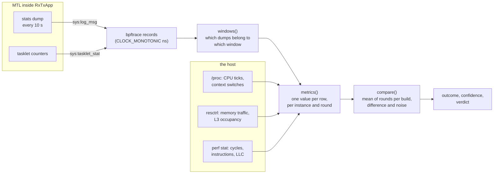
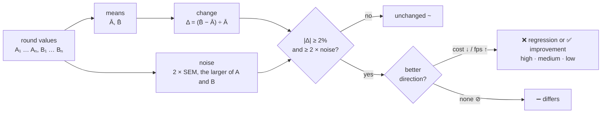

# perf-compare metrics: what each number is, where it comes from, why you can trust it

This is the reference for every row of a perf-compare report (`perf_compare.html` and the
job summary). For each metric it gives **the source**, **the exact calculation**, **the
unit and which way is better**, and **what to watch out for**. The design of the
benchmark itself (isolation, topology, workflow inputs) is in
[perf_compare.md](perf_compare.md); this page is about the numbers.

> [!TIP]
> Short version: every number starts as a counter that MTL, the kernel or the CPU keeps
> anyway. perf-compare reads it in a window where nothing else is measuring, turns the
> window into one value per round, and compares builds A and B only after both ran **at
> the same time**, swapped places every round, and passed every validity gate.

## Contents

1. [How a number is made](#1-how-a-number-is-made)
2. [The data sources](#2-the-data-sources)
3. [The windows of a round](#3-the-windows-of-a-round)
4. [Metric reference](#4-metric-reference)
   - [4.1 Delivery](#41-delivery)
   - [4.2 Scheduler loops](#42-scheduler-loops)
   - [4.3 CPU](#43-cpu)
   - [4.4 Memory and cache](#44-memory-and-cache)
   - [4.5 Tasklets, 1 loop in 64 timed](#45-tasklets-1-loop-in-64-timed)
   - [4.6 Tasklet call times, every call timed](#46-tasklet-call-times-every-call-timed)
   - [4.7 Video session call times, every session timed](#47-video-session-call-times-every-session-timed)
5. [From rounds to a verdict](#5-from-rounds-to-a-verdict)
6. [When a round counts at all](#6-when-a-round-counts-at-all)
7. [Why the numbers can be trusted](#7-why-the-numbers-can-be-trusted)
8. [Known limits](#8-known-limits)
9. [Checking a number yourself](#9-checking-a-number-yourself)

---

## 1. How a number is made



Five steps, the same for every row:

| Step | What happens | Where in the code |
| --- | --- | --- |
| 1. Count | MTL, the kernel or the PMU keeps a counter it needs anyway | `lib/`, `/proc`, `/sys/fs/resctrl`, `perf` |
| 2. Record | bpftrace prints each stats dump line and each tasklet counter with its CLOCK_MONOTONIC time; `/proc`, RDT and perf are read at the edges of the window | `Instance.collect()`, `proc()`, `rdt_counters()`, `pmu_stop()` |
| 3. Window | The dumps are sorted into the windows of the round by their timestamps | `parse_dumps()`, `windows()` |
| 4. Round value | Each row gets one value per instance and round: a median, a sum or a difference over the window | `metrics()` |
| 5. Compare | Each build's rounds give a mean and a noise; B is compared with A | `compare()`, `outcome()`, `confidence()` |

All of it lives in `tests/acceptance/mtl_engine/perf_compare.py`.

---

## 2. The data sources

| Source | What it gives | How it is read | Precision |
| --- | --- | --- | --- |
| **MTL stats dump** | One block of lines per instance every 10 s (`MT_STAT_INTERVAL_S_DEFAULT`, `lib/src/mt_stat.c`), framed by `M T    D E V   S T A T E` and `E N D    S T A T E` | USDT probe `sys:log_msg`, which fires for every log line **at any log level**, so `v26.01` and `main` are read the same way | Loop times 1 ns, call times 0.01 us (the printf formats) |
| **Tasklet counters** | Per scheduler and tasklet: calls, their ns, the calls that did work and their ns, **cumulative** since the tasklet registered | USDT probe `sys:tasklet_stat`, fired once per tasklet per dump | 1 ns |
| **`/proc`** | Per thread: user + system CPU ticks (`/proc/<pid>/task/<tid>/stat`), involuntary context switches (`status`); the host's CLOCK_MONOTONIC (`/proc/timer_list`) | Read twice, at the start and the end of the untraced window | 1 tick (`CLK_TCK`, 100/s) |
| **RDT (resctrl)** | Memory traffic (MBM `mbm_total_bytes`) and L3 occupancy (CMT `llc_occupancy`) of the instance's own resctrl group | Read with `/proc`, at both ends | bytes |
| **`perf stat`** | `task-clock`, `cycles`, `instructions`, `cache-references`, `cache-misses` of the instance's process | `perf stat -x, -p <pid>`, counting over the untraced window | exact counts |
| **NIC MAC counters** | Unicast frames each PF sent or received | `ethtool -S` before and after the round | exact counts (notes only) |

> [!NOTE]
> The `/proc` reads and the bpftrace timestamps use the same clock, the host's
> CLOCK_MONOTONIC. That is what lets perf-compare decide, for every dump, whether its
> whole period lay inside the window. The two hosts are never compared with each other,
> so they need no common clock.

---

## 3. The windows of a round

A round runs both builds at once. Once every session of every instance is steady, the
round measures in four windows, one after the other:

```text
      start  steady  warm-up     untraced window     traced window      timed window    sessions window   stop
       │        │    ├───────┤├───────────────────┤├────────────────┤├────────────────┤├────────────────┤ │
RX A,B ┼══════════════════════════════════════════════════════════════════════════════════════════════════┼
TX A,B   ┼══════════════════════════════════════════════════════════════════════════════════════════════┼
log_msg  ├────────────────────────────────────────────────────────────────────────────────────────────────┤
/proc, RDT, clock             ▲ read 1            ▲ read 2
perf stat                    ├─────────────────────┤
tasklet_time_sample + tasklet_stat                 ├────────────────┤
tasklet_time_measure                                                 ├────────────────┤
sessions_time_measure                                                                  ├────────────────┤
```

| Window | Length | Probes besides `sys:log_msg` | Gives | Which dumps count |
| --- | --- | --- | --- | --- |
| **Untraced** | `test_time` (120 s) | none, plus `perf stat` from outside | the **primary rows**: loops, CPU, memory, cache, delivery | the dumps whose whole 10 s period lies between the two `/proc` reads |
| **Traced** | `test_time / 2` | `sys:tasklet_time_sample` + `sys:tasklet_stat` | the cost and the work of each tasklet | the dumps with tasklet records; the first is only the base of the cumulative counters |
| **Timed** | `test_time / 2` | `sys:tasklet_time_measure` | the time of every tasklet call, with p90/p95/p99 | the dumps with call times, but the first, which started untimed |
| **Sessions** | `test_time / 2` | `sys:sessions_time_measure` | the time of every video session inside its tasklet | the dumps with session times, but the first |

> [!IMPORTANT]
> **The order is deliberate.** The primary rows come from a window in which nothing is
> timed at all: the production view. The sampled window costs the loop 0-1.4%. Timing
> every call costs it 11-30% on the perf pair, so those windows come last, each alone
> (timing the sessions would add to the call times), and **change none of the primary
> rows**. Each
> window after the untraced one gets a dump period more at each end, so it always holds
> whole dumps. The last dump of the run is dropped, as the application was stopping.

---

## 4. Metric reference

Notation used below:

- **per dump**: one value from one stats dump (every 10 s);
- **Δ**: a later reading minus an earlier one;
- **Δt**: the seconds between the two `/proc` reads (≈ `test_time`);
- **median of dumps**: the median over the dumps of the window, which one bad dump
  cannot move;
- ↓ better lower (a cost), ↑ better higher, ⊘ no better direction (shown, never scored).

### 4.1 Delivery

| Metric | Source (MTL line) | Calculation | Unit | Better |
| --- | --- | --- | --- | --- |
| `fps (worst session)` | `RX/TX_VIDEO_SESSION(m,s:name): fps X frames N` | per session, the **median of dumps** (a dump missing the session counts 0); then the **lowest** session | frames/s | ↑ |
| `RX rate (Mb/s)` / `TX rate (Mb/s)` | `DEV(N): Avr rate, tx: X Mb/s, rx: Y Mb/s` | per dump, the sum over the instance's ports; then the median of dumps | Mb/s | ⊘ |
| `incomplete frames` | `RX_VIDEO_SESSION(m,s): incomplete frames N` | the **sum** over the untraced dumps | frames | ↓ |
| `hw dropped pkts` | `DEV(N): Status: rx_hw_dropped_packets N` | the sum over the untraced dumps | packets | ↓ |
| `build timeout frames` (TX) | `TX_VIDEO_SESSION(m,s): build timeout frames N` | the sum over the untraced dumps | frames | ↓ |
| `epoch drop` (TX) | `TX_VIDEO_SESSION(m,s): epoch drop N` | the sum over the untraced dumps | frame periods | ↓ |
| `transmitter mismatch troffset` (TX) | `TX_VIDEO_SESSION(m,s): transmitter mismatch troffset N` | the sum over the untraced dumps | frames | ↓ |
| `transmitter recalculate warmup (/s)` (TX) | `TX_VIDEO_SESSION(m,s): transmitter recalculate warmup N` | the sum over the untraced dumps ÷ (dumps × 10 s) | re-plans/s | ⊘ |

How MTL computes them:

- **fps** is the frames of the session since its previous dump line ÷ the **measured**
  time since then (CLOCK_MONOTONIC), `rv_stat()` / `tv_stat()`. RX counts only complete
  frames. TX counts a frame when its builder finished it, which is not yet when it left
  the wire: a frame sent late shows in the TX late-frame rows, not in fps.
- **The port rate** is the bytes of `rte_eth_stats` since the last dump × 8 ÷ the
  nominal 10 s (`dev_inf_stat()`, `lib/src/dev/mt_dev.c`). It holds every frame of the
  port, video, pads, ARP and PTP, so it has no better direction.
- **incomplete frames** counts frames that MTL had to hand on with fewer bytes than a
  frame (`rv_frame_notify()`), because their slot was needed for a newer timestamp.
  **hw dropped pkts** is the NIC's `imissed`: packets it dropped because no RX
  descriptor was free, that is, the host polled too late.
- **The TX late-frame counters**, all deltas since the previous dump, printed only when
  they moved:
  - `build timeout frames`: the builder finished a frame after its last packet was due
    on the wire (`tv_tasklet_frame()`);
  - `epoch drop`: the frame periods that the builder found already past and skipped
    (`calc_frame_count_since_epoch()`);
  - `transmitter mismatch troffset`: packet 0 of a frame reached the rate limiter's
    transmitter more than two packet times late, or far too early
    (`video_trs_rl_warm_up()`, `video_trs_rl_pre_arm()`, `st_video_transmitter.c`).
- **The re-plans** are the rate limiter re-planning its pads before packet 0, when the
  clock outran the plan. They can differ by slot, which the swap cancels, and releases up
  to `v26.09` count only the warm-up re-plan, so they are shown, not scored.

> [!NOTE]
> The loss and late-frame rows are 0 in a healthy run, so they join the verdict only
> once a build counted any. A count from 0 has no size; it reads `from 0` and scores as
> the mirror of a drop to 0 (§5).

### 4.2 Scheduler loops

| Metric | Source | Calculation | Unit | Better |
| --- | --- | --- | --- | --- |
| `sch_N avg loop (ns)` | `SCH(N:name): tasklets K, lcore L(t_pid: T), avg loop X ns` | the median of the untraced dumps, per scheduler N | ns | ↓ |

How MTL computes it (`sch_tasklet_func()`, `lib/src/mt_sch.c`): the scheduler thread
counts its loops and, every time more than 2 s have passed, sets `avg loop` to the
elapsed time ÷ the loop count. One loop is one pass over all its tasklets, including the
sleep of an idle scheduler. More work per packet makes the loop longer at the same load,
which is why it is the first key row.

The `t_pid` of this line is the Linux TID of the scheduler thread; it is how the CPU
rows tell scheduler threads from the others.

### 4.3 CPU

| Metric | Source | Calculation | Unit | Better |
| --- | --- | --- | --- | --- |
| `video cpu busy (%)` | `..._VIDEO_SESSION(m,s): throughput X Mb/s, cpu busy Y` | per dump, the mean over the instance's sessions; then the median of dumps | score, % | ↓ |
| `scheduler threads (cores)` | `/proc/<pid>/task/<tid>/stat`, the threads named by `t_pid` | Δ(utime + stime) of the scheduler threads ÷ `CLK_TCK` ÷ Δt | cores | ↓ |
| `other threads (cores)` | the same, every other thread of the process | Δ(utime + stime) of the threads present at both reads, minus the scheduler threads ÷ `CLK_TCK` ÷ Δt | cores | ↓ |
| `sch preemptions (/s)` | `/proc/<pid>/task/<tid>/status`: `nonvoluntary_ctxt_switches` | Δ of the scheduler threads ÷ Δt | /s | ↓ |
| `IPC` | `perf stat`: `instructions`, `cycles` | instructions ÷ cycles | ratio | ⊘ |
| `core clock (GHz)` | `perf stat`: `cycles`, `task-clock` | cycles ÷ task-clock | GHz | ⊘ |

> [!WARNING]
> **`video cpu busy` is MTL's load score, not a measured CPU time.** MTL's admin thread
> recomputes it every 6 s from the scheduler's avg loop: `avg loop ÷ 3 packet intervals ×
> 100` for RX, `avg loop ÷ (bulk × packet interval) × 100` for TX
> (`rx_video_session_cal_cpu_busy()`, `tx_video_session_cal_cpu_busy()`). TX forces it
> to 100 after more than 10 build timeouts in an admin period. All sessions of one
> scheduler share its loop, so the row follows the loop rows; it is a key row because it
> is what MTL itself migrates sessions by (above 95).

- **The cores** count what the kernel charged each thread, so a scheduler that polls
  all the time reads about 1 core, one that sleeps when idle less. A build that needs
  more schedulers for the same sessions reads more.
- **The preemptions** are a measure of isolation: a scheduler that keeps its CPU is
  never switched out involuntarily. What the slot swap does not cancel is the build's.
- **IPC and the clock** have no better direction: a polling loop raises IPC with idle
  polls as much as with speed, and a different clock moves every time row. They are
  there to explain the other rows.

### 4.4 Memory and cache

| Metric | Source | Calculation | Unit | Better |
| --- | --- | --- | --- | --- |
| `memory bandwidth (MB/s)` | resctrl MBM: `mbm_total_bytes` of the instance's group, summed over its L3 domains | Δ bytes ÷ Δt ÷ 10⁶ | MB/s | ↓ |
| `LLC occupancy (MB)` | resctrl CMT: `llc_occupancy` | the reading at the end of the window ÷ 10⁶ | MB | ⊘ |
| `LLC hits (M/s)` | `perf stat`: `cache-references`, `cache-misses` | (references − misses) ÷ 10⁶ ÷ Δt | M/s | ⊘ |
| `LLC misses (M/s)` | `perf stat`: `cache-misses` | misses ÷ 10⁶ ÷ Δt | M/s | ↓ |
| `LLC miss ratio (%)` | `perf stat` | 100 × misses ÷ references | % | ⊘ |

- **The resctrl group is the instance's own**: the instance joins it before it starts,
  so the counters hold only its threads. CAT gives each group its own L3 ways (§7).
- **perf counts the instance's process** (`-p <pid>`), so its rates divide by the
  `/proc` span, not by perf's own `duration_time`, which sums the threads of a `-p`
  process. perf runs about 1 s longer than the span, for A and B alike.
- A packet that the NIC wrote into the L3 (DDIO) and that is read before it is evicted
  is a **hit**; misses go to memory. That is why misses are scored and hits are not.
- An event that perf could not count gives no PMU rows rather than wrong ones, and the
  round notes it.

### 4.5 Tasklets, 1 loop in 64 timed

The traced window attaches `sys:tasklet_time_sample`: each scheduler times **one loop in
64 on average**, at random gaps of 1-127 loops (a fixed gap could fall in step with
periodic work), and counts a timed loop as many times as its gap. `cnt` is exact to
within one gap; the sums and the work count are estimates. A build without the probe
(no release up to `v26.09` has it) has no traced window, and these rows read n/a.

| Metric | Calculation | Unit | Better |
| --- | --- | --- | --- |
| `sch_N avg loop, traced (ns)` | the median of `avg loop` over the traced dumps | ns | ↓ |
| `<tasklet> avg (ns/call)` | Δ ns ÷ Δ calls of the tasklet, between the base dump and the last traced dump, summed over its schedulers | ns/call | ↓ |
| `rvs_pkt_rx work (ns/call)` | Δ work ns ÷ Δ work calls | ns/call | ↓ |
| `rvs_pkt_rx work (% of a core)` | 100 × Δ work ns ÷ the ns between the two dumps; summed over schedulers, so it can pass 100 | % | ↓ |
| `RX work (ns/pkt)` | Δ work ns of `rvs_pkt_rx` ÷ the packets the ports received over the same dumps (`DEV` rx pkts) | ns/pkt | ↓ |

- **"Work" is a call that did not return `MTL_TASKLET_ALL_DONE`.** A polling tasklet is
  idle nearly always, so its average call hardly moves with the load while its work
  does. Only `rvs_pkt_rx` tells work by its return: pending when it received packets.
  The paced TX tasklets return ALL_DONE or pending for other reasons, so TX has no work
  rows and compares by its loop, CPU, cache and late-frame rows.
- **`RX work (ns/pkt)` is the cost of a received packet**, the most direct measure of the
  RX path, which is why it is a key row.
- **`avg loop, traced` against `avg loop`** is the cost of the sampling itself.

### 4.6 Tasklet call times, every call timed

Rows `sch_N <tasklet> avg | p90 | p95 | p99 | min | max, timed (us)`, from
`SCH(N,k): tasklet NAME, avg X us max Y us min Z us, p90 P us p95 Q us p99 R us`.

| Stat | Per dump (MTL) | Over the window (perf-compare) |
| --- | --- | --- |
| avg | sum ÷ count of the calls since the previous dump | median of dumps |
| p90, p95, p99 | from a histogram of the calls since the previous dump | median of dumps |
| min | least call since the previous dump | least of the dumps |
| max | largest call since the previous dump | largest of the dumps |

How MTL times a call (`sch_tasklet_func()`): the TSC is read before and after each
tasklet handler; MTL keeps min, max, sum and count, and adds the call to a histogram of
122 buckets, 8 per power of two from 8 ns to 2¹⁸ ns (262 us). A percentile is the
nearest rank, interpolated within its bucket, so it is **within 12.5% of the exact
value**. The counters are reset after every dump, so a dump's line covers its own 10 s.

> [!NOTE]
> No release up to `v26.09` prints the percentiles, so a build without them reads n/a
> there, and the report says which build lacks them. The summary scores the avg and the
> p99 of each tasklet outside the verdict: this window runs slower than production, and
> a tasklet on several schedulers would count several times.

### 4.7 Video session call times, every session timed

Rows `sch_N RX|TX video session avg | min | max, session timed (us)`, from
`RX/TX_VIDEO_SESSION(m,s): tasklet time avg X us max Y us min Z us`.

- **What is timed**: the part of a tasklet call that serves one session. For RX, the RX
  burst on each port, the packet handling and copy, and the DMA submit
  (`rvs_pkt_rx_tasklet_handler()`). For TX, the builder of the session's packets
  (`tvs_tasklet_handler()`); the transmitter has no session time.
- **Over the window**: per scheduler (its sessions are those of its manager, whose
  index is its), over all its sessions and the session-timed dumps: the median of avg,
  the least min, the largest max.

---

## 5. From rounds to a verdict



| Step | Rule | Why |
| --- | --- | --- |
| **Build value** | the mean of the build's valid rounds | every round counts once |
| **Change** | Δ = 100 × (B̄ − Ā) ÷ Ā, the candidate's | the report answers "what does B do to A" |
| **Noise** | twice the standard error of each build's mean, in % of it: 100 × √(4 · s² ÷ n) ÷ \|mean\|; the larger of A's and B's | for two rounds it is their difference; more rounds narrow it, where a range would widen |
| **Print-step floor** | a loop or call time has at least one print step of noise (1 ns, 0.01 us) of the smaller value | calls of 0.13 and 0.14 us tell nothing |
| **A change** | \|Δ\| ≥ 2% **and** \|Δ\| ≥ 2 × noise | a size and a margin over the noise, as LNT and Perfherder also ask for; the factor keeps the rough noise of few rounds from making one |
| **Confidence** | \|Δ\| ÷ noise: high from 5, medium from 3, low below | how far from its noise a change is |
| **From 0** | A at 0 and B above it scores as the mirror of B falling to 0 (100%) and reads `from 0` | (B − A) ÷ A has no value at A = 0 |
| **One round** | no noise estimate: a row 2% or more apart reads n/a | nothing to compare a difference with |
| **Rounds column** | 100 × (Bᵣ − Aᵣ) ÷ Aᵣ for each round r, e.g. `+10% / +8.5%` | A and B ran at once, so each round's difference is a paired one; the swap alternates its sign of any slot effect |

**The verdict** of the summary counts the regressions and improvements of the **key
rows** that both builds have: each scheduler's `avg loop`, `video cpu busy`,
`scheduler threads`, `memory bandwidth`, `LLC misses` and `RX work (ns/pkt)`, plus the
loss and late-frame rows once a build counted any. It names the largest regression and
improvement, the losses, and the rule and the rounds behind it, with a warning under 4
rounds. The key rows are not independent (`video cpu busy` follows its loop), so the
counts are a summary, not votes.

> [!NOTE]
> With `nics: pooled`, each NIC's pair of each round is one sample: the means, the noise
> and the Rounds column count samples, and a single round already gives two.

---

## 6. When a round counts at all

A round enters the comparison only if **every** instance passes **every** gate. A round
that fails one is listed with its problem in the Rounds table and left out, and the case
fails, so a bad round can never move a mean.

| Gate | Rule |
| --- | --- |
| Steady | every session of every instance at **99%** of its frame rate in one dump, within `120 + 3 × sessions` s; then 30 s of warm-up |
| Alive | no application or collector exited during the measurement |
| Whole windows | at least two whole dumps in each window (the traced one only for a build that has it) |
| Every session | every session reported in the untraced window |
| Frame rate | the worst session's median fps at 99% of the nominal rate or more |
| Source in hugepages | no TX read its source through `mmap()` |
| Work counters | a traced RX instance has `rvs_pkt_rx` work |
| DMA engaged | with `dma`, every session of a DMA instance copied packets by DMA |
| Ports | before the rounds: each port's link carries its sessions; `pooled` takes two alike NICs |

**Notes** don't invalidate a round, but they put a fact beside it:
- `N incomplete frames`, `N hw dropped pkts` and the late-frame counts;
- `packets lost between the hosts`, from the PFs' MAC counters, so the wire is told apart from the receiver;
- `a CI job ran on <host>`, since the companion also serves other repositories;
- `the builds pace TX differently`, since a build whose TX fell back from the rate limiter re-plans nothing;
- `app threads not moved`;
- `perf stat did not count every event`.

---

## 7. Why the numbers can be trusted

| Threat to a fair comparison | What perf-compare does |
| --- | --- |
| **Disturbances that change over time**: other jobs, the shared switch's floods, the thermal state | A and B run **at the same time** on the same hosts, so a disturbance hits both: common mode, not a difference |
| **One slot better than the other**: a PF, a core set, a cable | The builds **swap slots every round**, so each runs in each slot equally often; the Rounds column shows each paired difference |
| **A and B disturbing each other** | Each instance has its own cgroup cpuset of isolated cores, its own PF and VF on its own subnet, its own **exclusive L3 ways** (CAT, away from the ways the NIC writes into), its own mount and IPC namespace with its own build, no shared MtlManager, and its own DSA with `dma` |
| **The measurement changing what it measures** | The primary rows come from a window **with no timing at all**; the sampled window costs 0-1.4% of a loop; the costly full timing comes after them, each kind alone |
| **A window edge cutting a dump** | Only dumps whose **whole period** lies inside the window count; the first dump of a newly timed window and the last of the run are dropped |
| **One bad dump** | Per-window values are **medians of dumps**, and fps takes the median per session before the worst session |
| **Counters read at the wrong time** | Cumulative counters are used as **differences** over the window; per-dump counters are **summed**; nothing is extrapolated from a sample of dumps |
| **Too few rounds** | The noise is twice the standard error and narrows with rounds; a change needs 2% **and** twice the noise; confidence says how sure; under 4 rounds the verdict warns |
| **Differences below what MTL can print** | The noise is floored at one print step of the value |
| **A broken round slipping through** | The validity gates of §6, with the problem named in the report |
| **A bug in the harness** | The calculation engine runs without hosts in 75 tests; 388 deliberate mutations of it are each caught by a test; a golden master of recorded real runs pins every report byte; the raw records of every round are kept |
| **How much noise is normal** | An **A/A run**, the same build twice, measures the rig's noise floor; the nightly is one when `main` did not move |

---

## 8. Known limits

> [!CAUTION]
> These do not make the comparison unfair (they hit A and B alike), but they limit what a
> row means on its own.

| Limit | What it means for you |
| --- | --- |
| `avg loop` is MTL's last ~2 s window before the dump, sleep included | it is a sample of the loop, not its 10 s mean; the median of dumps smooths it |
| `video cpu busy` is a score derived from the loop, refreshed every 6 s, forced to 100 on TX after more than 10 build timeouts | read it as MTL's own load view, which moves with the loop rows |
| The port rates divide by the nominal 10 s and carry every frame of the port | unscored; read them as the workload, not a cost |
| TX `fps` counts built frames | late sending shows in the late-frame rows, not in fps |
| Memory bandwidth on these SNC2 hosts: kernel 6.8's resctrl monitoring knows no sub-NUMA clusters (it came with 6.11) | check the memory rows in an A/A run before trusting them |
| The timed and sessions windows run slower than production (the loop 11-30% longer on the perf pair) | they compare the builds, not production; their tails (p95, p99, max) carry less of the cost than the min and the avg |
| Per-scheduler rows pair only while both builds place their tasklets alike | a build with more schedulers has rows the other lacks (n/a) |
| A few bytes more in the scheduler structs moved one RX scheduler 10-15% on the perf pair with no code change | when one scheduler alone differs, compare the reference with itself padded first ([perf_compare.md §4.5](perf_compare.md#45-layout-effects)) |
| A session whose stats lock is busy for 10 us prints nothing in that dump | its next counts cover two periods; sums are unaffected, medians absorb it |
| `RX work (ns/pkt)` divides by every packet the ports received, video or not | the few non-video packets lower it a little, for A and B alike |
| Two `main` TX instances at 36 × 1080p59 count late frames (~210,000 build timeouts a round) | load-dependent and real, not a counter bug; use fewer sessions for a clean A/A baseline |

---

## 9. Checking a number yourself

Every round keeps its raw material in `logs/performance/<time>/perf_compare/round<N>/`:

| File | Holds |
| --- | --- |
| `<label>_<role><slot>` | the application's own output |
| `<label>_<role><slot>.log` | the `sys:log_msg` records: `<ns> L <log line>` |
| `<label>_<role><slot>.trace` | the `sys:tasklet_stat` records: `<ns> T <sch> <tasklet> cnt ns work_cnt work_ns` |
| `<label>_<role><slot>.pmu` | the `perf stat -x,` output |

The dump-based rows can be recomputed offline from those files with the same code the
case uses:

```python
from mtl_engine import perf_compare as pc

records = [l for f in ("A_rx0.log", "A_rx0.trace") for l in open(f) if pc.RECORD.match(l)]
records.sort(key=lambda l: int(l.split(" ", 1)[0]))
dumps = pc.parse_dumps(records)
# t0 and t1, the CLOCK_MONOTONIC ns of the two /proc reads, are not kept: the
# untraced window is the test_time seconds before the first dump with tasklet
# records (or with call times, for a build without the traced window)
t1 = next(d.ts for d in dumps if d.tasklets or d.tasklet_times) - 10**9
t0 = t1 - test_time * 10**9
untraced, traced, timed, sessions = pc.windows(dumps, t0, t1)
m = pc.metrics("RX", (untraced, traced, timed, sessions), proc0, proc1, 100, None, None)
```

`metrics()` also takes the two `/proc` reads (`proc0`, `proc1`), which are not kept
either; with stand-ins, its dump-based rows (loops, `video cpu busy`, fps, rates,
losses, the tasklet and call-time rows) come out as in the report.

The `/proc` and RDT rows are read live, at the edges of the untraced window, and
only the report keeps their values; the `.pmu` file keeps perf's counts.
