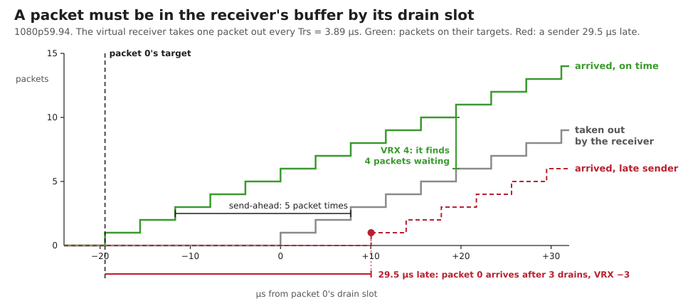
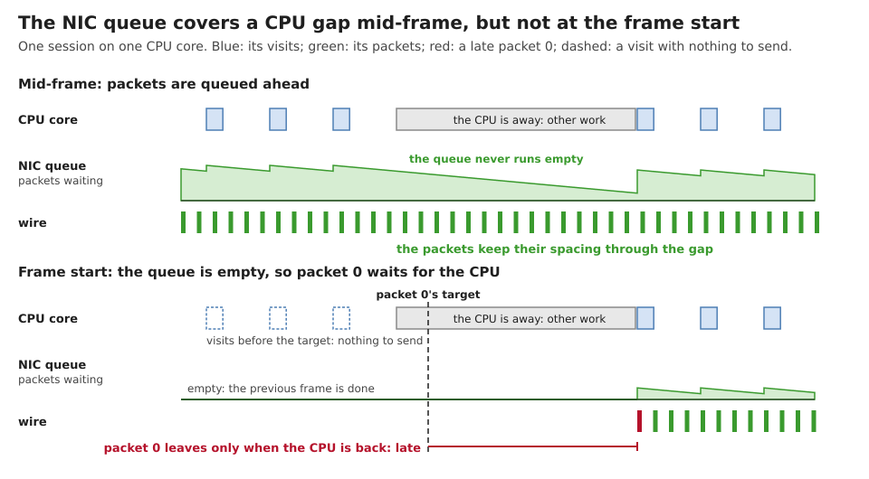
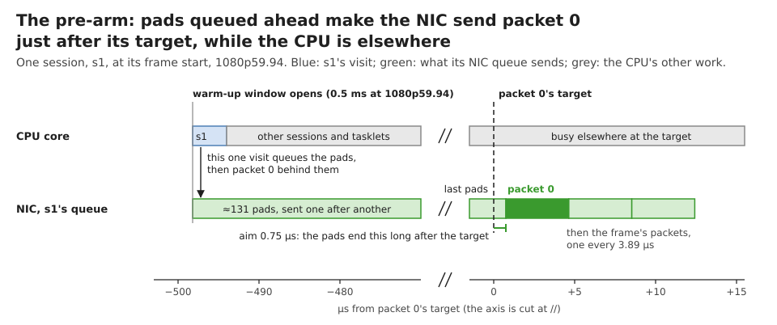
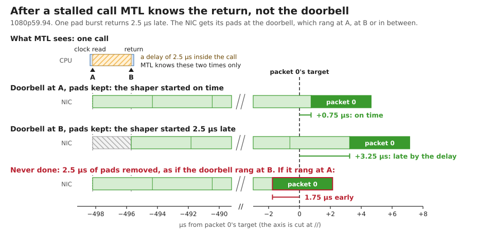
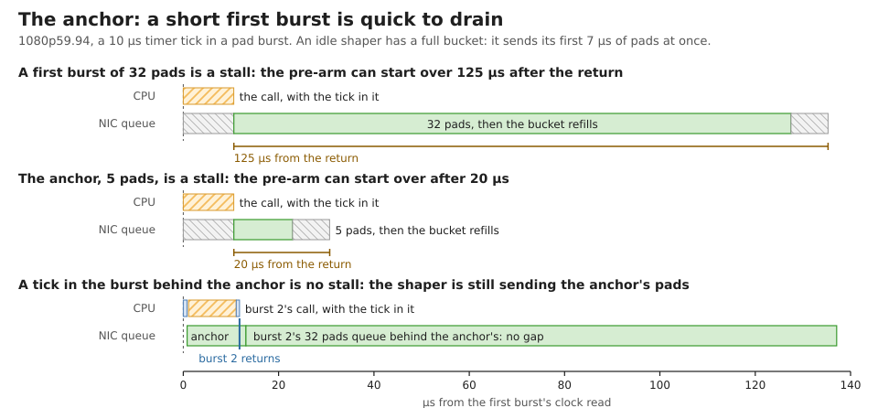
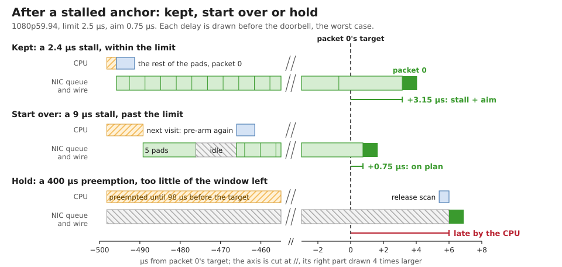
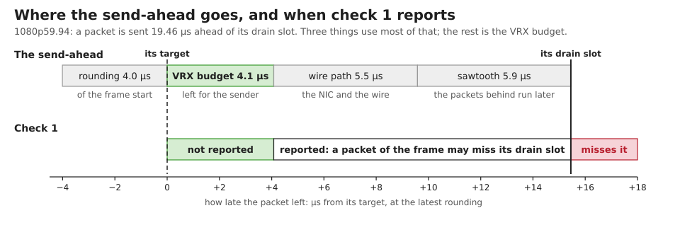
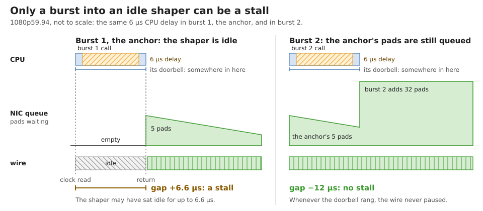
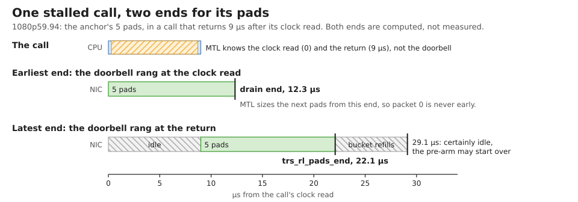

# RL Pacing of ST 2110-20 Video on E810/E830

The Media Transport Library (MTL) can let the rate limiter (RL) of an Intel® E810 or E830 Series Ethernet Adapter space the packets of an ST 2110-20 video stream. This guide explains how that works, what the log tells you, and what to configure.

Part 1, [Using RL pacing](#part-1-using-rl-pacing), is for users and operators, and is complete without Part 2. Part 2, [Developer details](#part-2-developer-details), is for people who change the code.
Every number is for 1080p59.94, 4:2:2 10-bit, on an E810 VF, unless a format is named. The design guide has a shorter account in [ST2110-21 pacing](design.md#432-st2110-21-pacing) and [RTP timestamps of paced video](design.md#82-rtp-timestamps-of-paced-video).

## Part 1: Using RL pacing

### 1. What "on time" means

SMPTE ST 2110-21 judges a sender with a **virtual receiver**. The virtual receiver has a small buffer. Starting at a fixed time after the frame begins, it takes one packet out of the buffer every **Trs**. Trs, one packet time, is the frame's active time divided by its packets: 3.892 µs for the 4115 packets of a 1080p59.94 frame.

The moment at which the virtual receiver takes out packet *j* is that packet's **drain slot**. A packet must be in the buffer by its drain slot. A packet that arrives later finds the buffer short by one packet, and the stream is not compliant.

MTL gives every packet a **target**, the time at which the packet should leave the NIC. The target lies 5 packet times, 19.46 µs, before the drain slot. This distance is the **send-ahead**. It is all the lateness a packet can afford, and chapter 9 shows what uses it. The targets of a frame are one Trs apart.

**VRX** is the number of packets that wait in the buffer ahead of an arriving packet. A packet on its target is the fifth packet in the buffer, so it finds 4. For a packet that arrives after its drain slot the count is negative, which this guide and the log call "VRX below 0". The buffer holds at most 9 packets here, so a packet must not be early either.



### 2. Who times the packets

The **pacing way** says what spaces the packets. It is set once per MTL instance, with `mtl_init_params.pacing` or `--pacing_way` in the sample applications.

| Pacing way | What times the packets |
|---|---|
| `ST21_TX_PACING_WAY_AUTO` (default) | the rate limiter if the driver offers one (`net_ice` on a physical function, PF, of an E810 or E830; `net_iavf` on a virtual function, VF), otherwise the CPU |
| `ST21_TX_PACING_WAY_RL` | the rate limiter, as this guide describes |
| `ST21_TX_PACING_WAY_TSC`, `_TSC_NARROW`, `_PTP`, `_BE` | the CPU, which sends each packet at its time, read from its timestamp counter (TSC) or the PTP clock |
| `ST21_TX_PACING_WAY_TSN` | the NIC launch time on an E830 PF, see [TSN launch-time pacing](design.md#433-tsn-launch-time-pacing) |

With RL pacing each session port has its own **TX queue** on the NIC. The NIC's rate limiter, called the **shaper** in this guide, sends the packets of that queue at a fixed rate.
MTL programs and measures that rate when the session is created, so that one video packet leaves per Trs. The CPU only has to keep the queue filled, so the spacing does not depend on the CPU reaching every packet at its time.

A port does not always get the pacing way that was asked for. A session port that paces by RL prints either `rl plan` or `no rl plan` when the session is created; both mean RL, and chapter 8 tells them apart. A port that does not pace by RL is one of these cases.

| Case | Result | Log line |
|---|---|---|
| AUTO, and the rate limiter fails to set up | the port paces by TSC | `fallback to tsc as rl init fail` or `fallback to tsc as rl root init fail` |
| RL, and the rate limiter is missing or fails to set up | `mtl_init()` fails | `this port not support rl`, `root init error` or `rl init fail` |
| A shared TX queue (`MTL_FLAG_SHARED_TX_QUEUE`) | the port paces by TSC | `use tsc as shared tx queue` |
| The queue rate cannot be programmed at session create | the whole port, and later sessions on it, pace by TSC | `fallback to tsc as rl fail` |
| The rate measurement fails at session create | that session paces by TSC, on both ports of an ST 2022-7 pair | `rl training fail` |
| ST 2110-22 in frame mode (st22p), whose packets per frame vary | the session paces by TSC | none |

### 3. Why the first packet of a frame is the hard one

MTL runs its work on **schedulers**. A scheduler is a CPU core that calls a list of small functions, the **tasklets**, in a loop. A tasklet must return quickly, because the scheduler calls the next one only after it.
Two tasklets serve a video session. The **builder** turns a frame into packets. The **transmitter** moves the packets into the session's TX queue. One transmitter serves all the video sessions of its scheduler in turn, and its turn at one session is a **visit**.

A visit hands the NIC several packets at once. The shaper then sends them one per Trs, while the CPU is busy elsewhere. In the middle of a frame the queue normally holds packets, so a delayed visit changes nothing on the wire.

**Packet 0**, the first packet of a frame, is different. Between two frames the stream pauses, and the queue runs empty. Packet 0 therefore leaves as soon as the CPU queues it. If the CPU is busy at packet 0's target, packet 0 is late, and nothing in the queue hides that.



### 4. The pre-arm

MTL solves this by making sure the queue is not empty when packet 0's target comes. Shortly before the target it queues **pads**. A pad is a padding packet: an Ethernet frame of zeros, as long as a video packet, sent to a reserved link-local address (01:80:C2:00:00:01) that switches do not forward. The shaper spends time on a pad as it does on a video packet.
MTL then queues packet 0 behind the pads. The shaper sends the pads one after another and reaches packet 0 by itself. The CPU is no longer needed at the target.

The pads are queued during the **warm-up window**, here the last 0.50 ms before packet 0's target. MTL calls the pads of one frame start the **pre-arm**. Here the pre-arm is 131 pads.
Inside the frame MTL adds one more pad after about every 246 video packets, because the shaper is programmed slightly faster than the stream. All pads together cost about 3.6 % of the stream's rate, on the link to the first switch only.

MTL chooses the number and the size of the pads so that the shaper finishes them just after the target. It shortens the last pads slightly to hit that time. It aims 0.75 µs after the target, not at it. This distance is the **aim**.
It is there because the shaper works in small time steps and could otherwise release packet 0 slightly early. With the aim, the shaper releases packet 0 between 0.75 µs and 1.4 µs after its target.



### 5. A stall in a pad burst

MTL hands pads to the NIC with a DPDK call, **`tx_burst`**, up to 32 pads per call. One such call is a **pad burst**. Near its end the call writes a NIC register, the **doorbell**. Only then does the NIC see the pads, and only then can the shaper start on them.

Just before each call MTL reads the clock, and it counts on the doorbell following within about a microsecond. Sometimes it does not. An interrupt, a timer tick or another process can take the core in the middle of the call. This guide calls that a **delay**.

A delay matters when the queue is empty, as it is for the first pad burst of a pre-arm, because the shaper then waits for the doorbell. MTL measures such a burst from its clock read to the return of the call. A burst that takes more than 2 µs is a **stall**.

After a stall MTL knows two times, its clock read and the return of the call. It does not know when the doorbell rang between them. The doorbell may have rung on time, with the delay after it (A in the figure). It may have rung at the very end (B). So MTL does not know, within the length of the delay, when the shaper started the pads, and therefore when it will finish them.

MTL could guess, and remove pads to make up for a late doorbell. It never does. If it assumed a late doorbell and the doorbell had in fact rung on time, packet 0 would leave early.
A late packet 0 can use its send-ahead. An early one has nothing: it can overflow the receiver's buffer, and it arrives before the frame's RTP timestamp, which is packet 0's target. The rule that follows from this is **never early**: every decision after a stall may make packet 0 later, and none may make it earlier.



### 6. The anchor

A delay does not make a stall of every pad burst. A burst that arrives while earlier pads are still queued just joins the queue, and the shaper never notices when its doorbell rang. Only a burst that reaches an idle shaper can be a stall, and the first pad burst of a pre-arm always reaches one.

MTL therefore keeps that first burst short. It is the **anchor**: 5 pads here, where a full burst has 32. What 5 pads do depends on one more property of the shaper. A shaper that has been idle has a full **bucket** of credit, and sends the first 7 µs worth of pads at once.
The anchor's 5 pads are 19.4 µs worth, so they keep the shaper busy for 12 µs, and 7 µs after the last pad the bucket is full again. A short anchor helps in three ways.

- If the anchor is a stall, only 5 pads are in doubt. 20 µs after the call returned they have certainly left and the bucket is full, so MTL knows the state of the shaper again. After a stalled burst of 32 pads that takes 125 µs.
- If the anchor is not a stall, the shaper is busy for the next 12 µs. A timer tick takes up to about 10 µs. The second burst therefore joins a queue that still holds pads, even if a tick hits it, and it is not a stall.
- Fewer bursts are stalls at all. A call for 5 pads is over sooner than one for 32, so a tick hits it less often.

The anchor is the smallest number of pads that keeps the shaper busy for 12 µs after what leaves at once, and never more than a full burst. It depends on the format, because a pad lasts longer at a lower bit rate.

| Format | One pad lasts | Leaves at once | Anchor | Shaper known again after a stalled anchor |
|---|---|---|---|---|
| 720p59.94 | 8.73 µs | 15.8 µs worth | 4 pads | 37 µs |
| 1080p59.94 | 3.87 µs | 7.0 µs worth | 5 pads | 20 µs |
| 2160p59.94 | 0.97 µs | 1.8 µs worth | 15 pads | 15 µs |



### 7. After a stall: kept, start over, hold

When a pad burst is a stall, MTL compares its length with the port's **limit**, the longest stall it keeps: 2.5 µs here. One of three things then happens.

| Outcome | When | What MTL does | Packet 0 |
|---|---|---|---|
| **Kept** | the stall is within the limit | It goes on with the pre-arm as planned and queues packet 0 behind the pads in the same visit. | The NIC sends it, late by at most the stall plus 1.4 µs, so at most 4 µs after its target. |
| **Start over** | the stall is past the limit, and enough of the window is left | It queues nothing more. Later visits wait until the pads already queued have certainly left the NIC. Then it does the pre-arm again, beginning with a new anchor. | The NIC sends it 0.75 to 1.4 µs after its target, as without a stall. |
| **Hold** | the stall is past the limit, and too little of the window is left | It queues no more pads and keeps packet 0 back until its target has passed. | The CPU sends it at the first **release scan** after the target. |

The 4 µs in the first row are the **launch share**: MTL lets packet 0 leave the shaper at most 4 µs after its target, which leaves the way to the receiver (chapter 9) its share of 10 µs. The limit is what the launch share leaves for a stall once the aim and the shaper's time step are taken off. At some formats it is a little less, so that check 1 (chapter 9) does not report a kept stall.

A release scan is a check the transmitter makes before every visit and after the last one. It sends every held packet 0 whose target has passed, for any session. A held packet 0 is therefore late by as long as the work that runs at its target still takes, typically a few microseconds.

The last pad burst of a pre-arm carries the shortened pads, 28 of them here. "Enough of the window" means that those 28 pads, 108 µs, still fit before the target. A stalled anchor leaves far more than that, so a stall at the start of the pre-arm is kept or starts over. Holds are left for a stall late in the window, and for a visit that reaches its window very late.

The limit differs per format, because the aim and the shaper's time step grow with the time of a pad.

| Format | Limit | A stall of 2 to 10 µs in the anchor |
|---|---|---|
| 720p59.94 | 0.9 µs | starts over: the limit is below the 2 µs at which a burst is a stall |
| 1080p59.94 | 2.5 µs | kept up to 2.5 µs, starts over above |
| 1080p60 | 1.9 µs | starts over, as at 720p59.94 |
| 2160p59.94 | 3.6 µs | kept up to 3.6 µs, starts over above |



### 8. Ports without a plan

MTL prepares the numbers of the pre-arm when a session is created, per port. Together they are the port's **plan**. A port with a plan logs `rl plan` at session create. A port without one logs `no rl plan, holds packet 0, VRX at risk if late`. It still paces by RL, but it queues its warm-up pads one per call and holds every packet 0.

| Port without a plan | Why | What to do |
|---|---|---|
| SD formats (480i, 576i, 480p, 576p) | the warm-up window is only 8 packet times long, too short for the pads that end on the target | nothing, it is expected |
| 720p at 30 fps and below | the aim and the shaper's time step together exceed the launch share | nothing, it is expected |
| RTP-level ST 2110-22, and wide pacing (`ST21_PACING_WIDE`) without `start_vrx` | there is no warm-up window | nothing, it is expected |
| an application-set pad interval (`pad_interval`, `ST20_TX_FLAG_ENABLE_STATIC_PAD_P`) | the rate is not measured, so the time of a pad is unknown | remove the setting |
| a DPDK-driven ice PF without `rl_burst_size` | the size of the shaper's bucket is unknown | set `mtl_init_params.port_params[i].rl_burst_size`; a VF has 2048 bytes |
| an AF_XDP port under `ST21_TX_PACING_WAY_RL` | the kernel's `tx_maxrate` paces the queue, and MTL does not know its bucket | nothing, it is expected |

### 9. Log lines and what to do

MTL checks its own timing while it streams, and prints the result with the statistics every `dump_period_s` (10 s by default). **Check 1** runs per session. After each burst of video packets it compares the return of the call with the target of the burst's first packet. It reports the frame when that packet left more than the **VRX budget** after its target: 4.1 µs here.
The VRX budget is what three things leave of the send-ahead. The frame's start is rounded to the 90 kHz RTP clock, which can move every target up to 4.0 µs later. The way from the shaper to the receiver, the **wire path**, takes about 5.5 µs.
The packets behind the measured one can run up to 5.9 µs later than their own targets, because of the pads between them; this is the **sawtooth**. 19.46 − 4.0 − 5.5 − 5.9 leaves about 4.1 µs.



**Check 2** runs per scheduler and reports a core that cannot keep up. It has two signs. The **round** is the average time of one loop of the scheduler, and the **round budget** is the longest round in which 4 packets per visit still keep up with the stream, 16.2 µs here. The **lead** is how long before its target a packet was built, and it is negative when the packet was built after it, as told by a clock up to a round, and any sleep, old.

| Line | Level and time | Meaning | What to do |
|---|---|---|---|
| `port P rl plan, pad_ns … bucket_ns … burst size … bps …` | info, at session create | The port has a plan. The line shows its trained numbers. | nothing |
| `port P no rl plan, holds packet 0, VRX at risk if late` | warn, at session create | The CPU sends every packet 0 of this port. | see chapter 8 |
| `port P vrx V leaves no VRX budget, VRX not judged` | warn, at session create | The send-ahead of V packet times, a user `start_vrx`, leaves no VRX budget, so check 1 does not watch this port. | use a larger `start_vrx`, or none |
| `port P vrx V leaves no stall limit, frames may be flagged` | warn, at session create | The VRX budget is so small that no stall is kept, and check 1 can report frames that are on time. | use a larger `start_vrx`, or none |
| `port P rl training fail …, fallback to tsc pacing` | err, at session create | The session paces by TSC for its whole life. | check the ice driver ([E800 Series Driver Guide](e800_series_drivers.md)), then create the session again |
| `N frames may break VRX >= 0, a pkt up to Xus past its target over the Yus budget: packet 0 A mid-frame B; K frames started up to Zus late` | err, per period | Check 1 reported N frames: A at packet 0, B mid-frame, the worst X late; Y is the VRX budget. K more came late from the application. | capture and verify; look for a busy core (A), a scheduler away too long (B), the application (K) |
| `round Xus past the Yus budget, lead -Zus, frames fall behind: move sessions off this scheduler` | err, per period | Check 2: the round X is over the round budget Y, or a packet was built Z after its target, as told by a clock up to a round, and any sleep, old. Either part can be missing. | put fewer sessions on that scheduler (chapter 10) |
| `transmitter recalculate warmup N` | notice, per period | N stalls, whatever their outcome, and a few rarer events of the pre-arm. | a few per period are normal; many point to interrupts or ticks on the core (chapter 10) |
| `transmitter mismatch troffset N` | notice, per period | N frame starts were first visited, or got packet 0 from the builder, 7.8 µs (two packet times) or more after packet 0's target. | the builder or the scheduler ran late; look at check 2 |

The four periodic lines start with `TX_VIDEO_SESSION(m,s):`, or `TX_VIDEO_SESSION(m):` for check 2, where `m` is the scheduler and `s` the session. To see single events, a [USDT](usdt.md) build offers the probe `st20:tx_rl_event(m_idx, s_idx, cause, a0, a1)`.
It fires for every frame in N (cause 0, `a0` ns past the target, `a1` the packet index) and in K (cause 1, `a0` ns late).

### 10. Configuration

RL pacing works with the defaults of MTL. Three things are always required.

- **The DPDK that MTL builds.** `./script/build_dpdk.sh` builds and installs the DPDK version of `versions.env`, 26.07, with the patches of MTL ([Build Guide](build.md#2-dpdk-build-and-install)). With an older DPDK an RL port gets a TX queue of 512 descriptors, not 2048, and MTL does not free sent packets between frames, so more pad bursts are stalls.
- **The ice driver with rate-limiter support.** That is version 2.7.6 or later, or an earlier one with the rate-limit patches of MTL ([E800 Series Driver Guide](e800_series_drivers.md)).
- **Isolated scheduler cores with the timer tick stopped** ([CPU Isolation Guide](isolation.md)). A tick or a preemption inside a pad burst is the usual cause of a stall.

Nothing else needs to be set. The settings below take margin away, and each shows in the log.

| Setting | What it costs | Log line |
|---|---|---|
| more sessions on a scheduler than its core can serve (a larger `data_quota_mbs_per_sch`, or `--sch_session_quota` in the sample applications) | visits come too late, and packets leave after their targets | `frames fall behind` |
| an `nb_tx_desc` set by the application | the TX queue keeps that depth and sent packets are not freed between frames, so more pad bursts are stalls | a higher `recalculate warmup` count |
| a short user `start_vrx` | too little send-ahead: check 1 does not watch the port, or no stall is kept and check 1 can report frames that are on time | `leaves no VRX budget, VRX not judged` or `leaves no stall limit, frames may be flagged` |
| `pad_interval` or `ST20_TX_FLAG_ENABLE_STATIC_PAD_P`, a DPDK-driven PF without `rl_burst_size`, wide pacing without `start_vrx` | no plan: the CPU sends every packet 0 (chapter 8) | `no rl plan` |
| `MTL_FLAG_SHARED_TX_QUEUE` | no RL: the CPU times every packet | `use tsc as shared tx queue` |

### 11. What to expect

With the defaults, the three requirements of chapter 10 and none of the settings of its table, every stream that RL pacing pre-arms is compliant: no packet misses its drain slot, and no packet 0 leaves before its target (a port without a plan holds packet 0 and can be late: chapter 8). When MTL cannot keep a frame compliant, it says so: check 1 or check 2 prints its line (chapter 9).

A stream that is not compliant therefore points to the configuration: scheduler cores that are not isolated, more sessions on a scheduler than its core can serve, another DPDK or driver than the required one, or a setting of chapter 10's table. The action column of chapter 9 says what to do for each line.

The log shows what MTL sees when it hands packets to the NIC. The proof on the wire is a capture analyser such as EBU LIST. EBU LIST counts the arriving packet too, so it shows one more than the VRX of this guide.

## Part 2: Developer details

### 12. The shaper model

MTL never asks the NIC where the shaper is. It computes it from a model, a token bucket, and every pre-arm decision uses that computation.

- **Bucket.** The bucket of chapter 6 holds 2048 bytes of tokens (`ST_TX_VIDEO_RL_VF_BURST_SIZE`; on a PF, `rl_burst_size` as ice rounds it). An idle shaper sends that much at once. The time the shaper needs to earn a full bucket is the **refill time**, 6.28 µs.
- **Timeslot.** The shaper adds tokens once per **timeslot**, so its release times lie on a grid. The ice driver chooses the timeslot so that it adds more than 128 and at most 257 bytes. T is the longest timeslot it can choose for this queue: 227 bytes, 0.66 µs.
  The aim of chapter 4 is the time of 257 bytes, 0.75 µs, so it covers any timeslot. MTL sizes the pads to end one aim after the target, and the grid then releases packet 0 between the aim and aim + T after its target, 0.75 to 1.4 µs, and never before it.
- **`bucket_ns`** is the refill time plus the aim, 7.03 µs. A burst handed to an idle shaper at time *t* is modelled as if the shaper had started it at *t* − `bucket_ns`. The refill time stands for the bytes that leave at once. The aim makes the real shaper finish one aim later than the model.
- **Drain end.** The **drain end** is the modelled time at which the shaper finishes everything queued so far. Each burst of *n* pads moves it:

```text
drain end = max(drain end, t_read − bucket_ns) + n × pad_ns
```

`pad_ns` is the shaper time of one pad, 3.873 µs, and `t_read` the clock read before the call. The pre-arm is complete when the drain end reaches packet 0's target.

The model leaves out everything that only delays a packet: the NIC's fetch of the descriptors, arbitration between queues, the wire. It assumes that the bucket is not larger than stated and that the shaper is not faster than trained. Either would make packet 0 early.
Never early holds only as far as this model does. One exception is known: when a new session's rate is programmed on a VF, the sessions already streaming there can send their next packet 0 up to 1 µs early (measured).

### 13. Training and the plan

At session create MTL measures ("trains") the rate of the session's queue. It programs the queue, fills it with pads, times 71 frames' worth of them at 32 per call, and averages the middle 60 frame times. If the rate is too slow for the stream, it re-programs by the measured ratio once.
The shaper is set slightly faster than the stream. The **pad interval** is the number of video packets after which one pad makes up for that, about 246. From it follows `pad_ns` = Trs × pad interval / (pad interval + 1), scaled by the pad's size over the mean packet size. The result is cached per port, rate and packet mix.

The warm-up window is 80 % of the time from the frame's start to the virtual receiver's first drain, and at most 128 packet times: 0.50 ms here, 0.49 ms at 720p59.94, 125 µs at 2160p59.94.

`tv_rl_plan_init()` then derives the plan (`struct st_tx_video_rl_plan`):

| Field | Meaning | Here |
|---|---|---|
| `pad_ns`, `bucket_ns`, `refill_ns` | the model's numbers, chapter 12 | 3.873, 7.03, 6.28 µs |
| `trim_pads` | the number of pads in the last burst, the **trim pads**. MTL cuts 64 bytes from as many of them as takes out up to one pad, and 8 bytes from a few more. The drain end then lands on the target within one **fine trim**, the time of 8 bytes, and never before it. | 28 pads; fine trim 0.023 µs |
| `anchor_pads` | the anchor, chapter 6: `min(ceil((bucket_ns + 10 µs + 2 µs) / pad_ns), 32)` | 5 |
| `absorb_ns` | the limit, chapter 15 | 2.55 µs |
| `vrx_budget_ns` | check 1's budget, chapter 20 | 4.1 µs |

A port gets a plan only if all of the following holds. It has a warm-up window, a trained `pad_ns` and a known bucket. The aim and T together are at most the launch share. Chapter 8 lists the ports that fail one of these.
Three more conditions hold for the usual formats: packets of at least 128 bytes, so that a pad cut by 64 bytes is still a legal frame; a window whose pads fit half the TX ring and include the trim pads; and a bucket that refills in the pause between frames.

### 14. The pre-arm visit and the stall test

The first visit inside the warm-up window calls `video_trs_rl_pre_arm()`. It queues the whole pre-arm in a loop, here 131 pads in 6 calls of 5, 32, 32, 32, 2 and 28 pads. Before each call it reads the clock, to see whether the shaper has run idle, and sizes the burst from the drain end. The last burst is the cut one. Packet 0 follows in the same visit.

After each call the function computes the burst's **gap**: how much later than modelled the shaper could have started this burst.

```text
gap = (t_return − bucket_ns) − drain end before the burst
```

`t_return` is the clock stamped after `tx_burst` returned. For a burst into an idle shaper the drain end before the burst is `t_read − bucket_ns`, so the gap is simply the duration of the call. For a burst behind queued pads the drain end lies in the future and the gap is negative.
A burst with a gap over 2 µs (`ST_TX_VIDEO_RL_STALL_NS`) is a stall, which is chapter 5's definition in the model's terms. The 2 µs lie above a healthy call, which returns 0.5 to 1.0 µs after its clock read (measured), and at the low end of a timer tick, 2 to 10 µs. A burst of 2 µs or less is not a stall, and packet 0 is then late by up to that time plus aim + T: 3.4 µs here, 5.1 µs at 720p59.94.

This is why the anchor works: it moves the drain end to 5 × 3.873 − 7.03 = 12.3 µs after its clock read. In the figure the second burst returns 7.3 µs after that clock read, with a 6 µs delay inside its call, and its gap is 7.3 − 7.03 − 12.3 = −12 µs.
If the queue does run dry between two bursts, the loop sees an idle shaper again, counts it, and caps the next burst at the anchor size as well. At 4320p59.94 the anchor is a full burst of 32 pads and covers only 7 µs (unit-test plan), so a 10 µs tick behind it is still a stall.



### 15. The limit

A stall is kept when its gap is at most `absorb_ns`, the smaller of two bounds:

```text
absorb_ns    = min(share bound, budget bound)
share bound  = launch share − aim − T − fine trim
budget bound = VRX budget − 2 × aim − fine trim
```

A kept burst is counted as if it had started on plan, so the drain end is not moved. The real shaper started it up to one gap later.

- **The share bound keeps packet 0 inside the launch share.** Packet 0 leaves at most gap + aim + T + fine trim after its target, and with the gap within the share bound that is at most 4 µs (`ST_TX_VIDEO_RL_GRID_LATE_MAX_NS`).
- **The budget bound keeps check 1 quiet.** Check 1 takes a kept packet 0 as late as its pads can end, which is the gap, two aims and a fine trim after its target (chapter 20). Within the budget bound that is at most the VRX budget, so a stall kept at the limit is never reported.

| µs | 720p59.94 | 1080p59.94 | 1080p60 | 2160p59.94 |
|---|---|---|---|---|
| aim | 1.70 | 0.75 | 0.75 | 0.19 |
| T | 1.33 | 0.66 | 0.66 | 0.17 |
| fine trim | 0.05 | 0.02 | 0.02 | 0.01 |
| share bound | **0.92** | 2.56 | 2.56 | **3.64** |
| VRX budget | 15.29 | 4.08 | 3.45 | 19.59 |
| budget bound | 11.84 | **2.55** | **1.93** | 19.21 |

The smaller bound is in bold. At 1080p60 every frame start is rounded 4.63 µs later, where 1080p59.94 has 4.01 µs, so its VRX budget and its limit are smaller. Its limit is below the 2 µs of the stall test, so no stall is kept there.
The numbers are for the default block packing (`ST20_PACKING_BPM`), from hardware-trained plans. Another packing changes the sawtooth and with it the budget bound: with `ST20_PACKING_GPM_SL` the unit tests give 2.2 µs at 1080p60.

The launch share is 4 µs and not more because the send-ahead is not the sender's alone. A limit of 8 µs, which the send-ahead would allow without the wire path, let frames reach the receiver at VRX 0.
MTL plans for packet 0 to reach the receiver 0 to 10 µs after its target, the **launch bound** that the integration tests check (`kNoCtxPacingLateMaxNs`). The launch share is the sender's part of it, and the rest is for the wire path.

### 16. Starting over

Past the limit, keeping would make packet 0 too late, and removing pads could make it early. MTL instead waits until the shaper's state is certain again. For that it keeps a second modelled end of the queued pads, because it knows two times for every call. The real end lies between the two.

| End | Computed from | What it is | Used for |
|---|---|---|---|
| drain end (chapter 12) | the clock read before each call | the earliest the shaper can finish the pads, as no doorbell rings before its clock read | sizing the pads, so that packet 0 is never early |
| `trs_rl_pads_end` | the return of each call: `max(pads_end, t_return − refill) + pads × pad_ns` | the latest the shaper can finish them, as every doorbell has rung by its return | knowing when the shaper is idle again, and check 1 |



After a stall past the limit, `video_trs_rl_pre_arm()` queues nothing more and puts the port back into the state in which it waits for its window. Each later visit therefore calls the function again, and it proceeds only when

```text
now − bucket_ns ≥ trs_rl_pads_end
```

At that moment the queued pads have left even if the doorbell rang at the return, and the bucket is full again. The shaper is idle, as at a first visit, and the pre-arm runs from the top with a new anchor. After a stalled anchor this takes the anchor's time plus the aim after the return: 5 × 3.873 + 0.75 = 20.1 µs.
A start-over cannot make packet 0 early. If the pads left sooner than `trs_rl_pads_end`, the shaper has been idle longer, which the model already assumes.

At the stall and at each waiting visit, `video_trs_rl_fits()` tests whether `ceil((target − trs_rl_pads_end) / pad_ns)` is at least `trim_pads`. If not, no cut burst can fit after the wait, and the port holds at once. A visit that waits also frees sent descriptors (chapter 19) and returns "pending", so the scheduler does not sleep.

Pads that a full NIC ring refused are a second way into a start-over. Normally a later visit retries them ahead of packet 0, and they still end on time, because the pads before them are still queued.
If the idle test above passes before the retry succeeds, the shaper has run idle, and the retried pads would end late by that idle time. MTL then drops them and starts the pre-arm over, even when all other pads and packet 0 were already handed over. The pads that the ring refused of a stalled burst are dropped with the stall, for the same reason.

### 17. Late entry and the tail

A **late entry** is a pre-arm visit, first or started over, that finds fewer than `trim_pads` pad times left before the target. MTL always rounds the number of pads up, because one pad too few would make packet 0 early.
With so few pads the cuts cannot take out the whole excess, so the pads end after the target by the **shortfall**, up to one pad, and packet 0 behind them is late by that much.

MTL can still send those pads and packet 0 in one call, a **tail** (`video_trs_rl_tail_burst()`), or it can hold packet 0. The first rule that applies decides:

| Rule | Then | Why |
|---|---|---|
| 1. Another port, of this session or another on the core, waits to retry refused pads | hold | That port's packet 0 leaves only when its own visit retries, so every call made before that visit makes it later, and a tail is one call more than a hold. |
| 2. One pad is within the limit (0.97 µs against 3.6 µs at 2160p59.94; not at 1080p59.94, 3.87 against 2.5 µs) | tail | The shortfall cannot exceed the limit. |
| 3. The visit is the port's first chance: its window was already this short when the transmitter began this **pass**, its round over all its sessions. The shortfall after the cuts is within the limit. | tail | Nothing MTL did made the port late, as at a stream's start, and the CPU may be busy again at the target. |
| 4. Otherwise | hold | The pass itself made the port late, and a release scan follows soon after the target. |

The tail reads the clock again before its call. If more pads than one last burst are still missing, packet 0 behind the tail's pads would be early, and if the shortfall has grown past the limit it would be too late. In both cases the tail sends nothing and packet 0 is held. A visit that arrives at or after the target queues no pads, and the CPU sends packet 0 at once.

### 18. Hold and the release scans

A port holds when it has no plan, when a start-over does not fit, when a late entry may not tail, or when the queue ran dry in mid pre-arm with fewer than `trim_pads` left. Its packet 0 stays in the transmitter until the target has passed. Sent after the target by the CPU, it cannot be early.
How late it is has no fixed bound: it waits for the work the core is doing when its target passes, a few microseconds as a rule and tens of microseconds under load.

Without help a held packet 0 would wait for its session's next visit, which comes a whole pass and the scheduler's other tasklets later. `video_trs_rl_release()` shortens that. It runs before every visit and after the last one.

- The transmitter keeps the earliest waiting target (`trs->pkt0_tsc`). A scan with nothing waiting reads no clock.
- A scan sends every port whose target has passed, each port at most once per pass, and reads the clock again after each send.
- A port waiting to start over is in the scans too (`video_trs_rl_pkt0_tsc()`). If its target passes while it waits, the scan turns it into a hold and sends packet 0.
- A scan sends nothing for the ports behind a port that waits to retry refused pads, for the reason of rule 1 in chapter 17. They are scanned after that port's own visit. If the NIC never drains, TX hang detection recovers the queue within `tx_hang_detect_ms` (1 s).
- ST 2110-22 takes no part, because its Trs changes per frame.

A scan takes no lock. It skips a session that a control-plane writer holds and keeps its target for the next call.

### 19. Reclaim and catch-up

**Reclaim.** DPDK frees the buffers of sent packets inside later `tx_burst` calls, one **batch** of 32 descriptors per call. A first pad burst that must free a frame's worth of them is a common stall.
So a visit that finds its port waiting for the window or to start over, or the builder's ring empty, makes a zero-length `tx_burst`, which frees one batch (`video_trs_rl_reclaim()`). MTL makes that call only when a batch is due by the shaper's rate. It runs only on the 2048-descriptor queues of chapter 10.

**Catch-up.** After the last release scan, `video_trs_rl_catch_up()` tops up the mid-frame ports whose queue holds less than 200 µs of packets, the longest the scheduler may be away (`mt_sch_schedule_ns()`). It goes round those ports and gives each 4 packets per round.
It starts no round later than two warm-up windows before the nearest target of a packet 0 that still waits, because that packet's window opens within one of them and its pre-arm must not wait for the catch-up.

### 20. The two checks

**Check 1** (`video_trs_vrx_check()`) runs after every burst of video packets. Lateness is the burst's return time minus the first packet's target. For packet 0 it is the later of that and `trs_rl_pads_end` plus the aim minus the target, so a packet 0 behind pads that drained late is reported too. A frame is reported when the lateness exceeds its budget:

```text
budget = vrx × Trs − snap − wire path − sawtooth        5 × 3.892 − 4.01 − 5.5 − 5.87 = 4.1 µs
```

The **snap** is the rounding of the frame's start to the 90 kHz clock. It moves a frame's targets by up to 4.01 µs later, the **snap loss**, or by up to 1.55 µs earlier. The port's budget takes the snap loss, and a frame that was rounded less gets the difference on top, +5.56 µs on every second frame at 59.94 fps.
The sawtooth comes from the pad after every pad interval: (pad interval / 2 + 4) / (pad interval + 1) × Trs + one pad, 5.87 µs.
The return stands in for the doorbell, which rang earlier, so a preemption between the two can report a frame that was in time. The wire path is one constant (`ST_TX_VIDEO_RL_WIRE_NS`): 4.4 to 4.9 µs measured from an E810 VF to an E830, plus margin. On another path check 1 can report too early or too late, and it never sees early packets or jitter on the wire.

Check 1 does not judge ports without RL, ST 2110-22, or a frame the builder started later than its budget; the last is counted as K.
It also does not judge a port whose budget comes out at 0 or below, as with a small user `start_vrx`. Such a port logs `leaves no VRX budget, VRX not judged` at session create. A port with a budget above 0 but no room for the budget bound of chapter 15 logs `leaves no stall limit, frames may be flagged`.

**Check 2** (`tv_lead_visit()`, `tv_behind_err()`) runs per scheduler. At each builder visit inside a frame it takes the lead, the next packet's target minus the start of the scheduler's last transmitter call, and keeps the smallest. It also compares the round with the tightest round budget of the scheduler's sessions, 4 packets × frame time / packets: 4 × 16.68 ms / 4115 = 16.2 µs.
Either finding prints the `frames fall behind` line. Both checks report overload and do not prevent it: whether a core keeps up depends on all that runs on it. The round is not the load of the core: a thread that may not sleep spins, and its rounds are short while most visits find nothing to send. A round at the budget means that every loop builds a bulk for every session, so no reserve is left.

### 21. Rules a change must keep

| Rule | Why | Guarded by |
|---|---|---|
| **Never early.** No path may queue packet 0 behind pads sized from a guess about a stalled doorbell. | An early packet has nothing to use up (chapter 5). | `rl_stall_contract_test.cpp`, `rl_vrx_faults_test.cpp` |
| **Nothing behind an unknown start past the limit.** After a stall past `absorb_ns` no pad and no packet 0 is queued until the idle test of chapter 16 passes or the target has passed. | Otherwise packet 0 is late by the whole stall. | `rl_anchor_test.cpp` |
| **A stall kept at the limit stays inside the launch share and is not reported.** | Both bounds of chapter 15 exist for this. | `AStallAtTheLimitIsKeptUnflaggedAndPastItIsHeld` in `rl_anchor_test.cpp` |
| **The first burst into an idle shaper is the anchor.** | It bounds the wait of a start-over and covers a tick in the next burst. | `rl_anchor_test.cpp` |
| **A hold is bounded by the release scans.** A waiting port must be visible to them. | Else a held packet 0 waits a whole pass. | `rl_release_test.cpp` |
| **No call goes ahead of the retry of refused pads.** | Each such call makes the refused port's packet 0 later (chapter 17). | `LateEntryHoldsBehind…` and `APortBlockedBehindARefusedOne…` in `rl_release_test.cpp` |
| **No visit blocks.** Waiting is done by returning and being visited again. | The scheduler calls the next tasklet only after this one returns (chapter 3). | review; the tasklet rules in the C coding instructions |
| **Every frame that may be late is reported.** A new path that sends packet 0 must reach check 1. | The log is the operator's only signal. | `rl_vrx_detect_test.cpp`, `rl_vrx_faults_test.cpp` |
| **A visit with nothing to send stays cheap.** A waiting port reads the clock once. A port with an empty builder ring reads it only for a batch due when the transmitter call began. It makes a NIC call only for a due batch (chapter 19) or to retry a refused burst. | Most visits find nothing to send, so their cost sets the time of a round (chapter 9). | `rl_idle_cost_test.cpp` |

### 22. Code and test map

| Topic | Code |
|---|---|
| Pacing way selection | `dev_if_select_pacing()` in `lib/src/dev/mt_dev.c` |
| Training, pad interval | `tv_train_pacing()`, `tv_set_measured_pad_interval()` in `lib/src/st2110/st_tx_video_session.c` |
| Plan, limit, anchor size, budget | `tv_rl_plan_init()`, `tv_rl_sawtooth_ns()`, `tv_snap_loss_ns()` in `st_tx_video_session.c` |
| Burst sizing, cuts, constants | `st_tx_video_rl_next_burst()`, `st_tx_video_rl_trim_pads()`, `ST_TX_VIDEO_RL_STALL_NS`, `ST_TX_VIDEO_RL_TICK_NS`, `ST_TX_VIDEO_RL_GRID_LATE_MAX_NS`, `ST_TX_VIDEO_RL_WIRE_NS` in `lib/src/st2110/st_tx_video_rl.h` |
| Pre-arm, stall test, start over, tail, hold | `video_trs_rl_pre_arm()`, `video_trs_pads_end()`, `video_trs_rl_fits()`, `video_trs_rl_pads_drop()`, `video_trs_rl_frame_start()`, `video_trs_rl_tail_burst()`, `_video_trs_rl_tasklet()` in `lib/src/st2110/st_video_transmitter.c` |
| Release scans, catch-up, reclaim | `video_trs_rl_release()`, `video_trs_rl_pkt0_tsc()`, `video_trs_rl_catch_up()`, `video_trs_rl_reclaim()` in `st_video_transmitter.c` |
| Check 1, check 2 | `video_trs_vrx_check()`, `tv_stat_log()`; `tv_lead_visit()`, `tv_behind_err()` |
| Unit tests | `tests/unit/session/st20_tx/`: `rl_anchor_test.cpp`, `rl_stall_contract_test.cpp`, `rl_vrx_faults_test.cpp`, `rl_vrx_detect_test.cpp`, `rl_release_test.cpp`, `rl_idle_cost_test.cpp`, `rl_model_test.cpp`, `pacing_test.cpp` |
| Hardware tests | `tests/integration_tests/noctx/`: `kNoCtxPacingLateMaxNs` in `strategies/st20p_strategies.hpp`, `testcases/st20p_vrx_margin_tests.cpp` |

Terms and the chapter that defines each: aim 4, anchor 6, batch 19, bucket 6 and 12, builder 3, catch-up 19, check 1 and check 2 9, delay 5, doorbell 5, drain end 12, drain slot 1, fine trim 13, gap 14, hold 7, kept 7, late entry 17, launch bound 15, launch share 7, lead 9, limit 7 and 15, packet 0 3,
pad 4, pad burst 5, pad interval 13, pass 17, plan 8, pre-arm 4, reclaim 19, refill time 12, release scan 7 and 18, round and round budget 9, sawtooth 9, scheduler 3, send-ahead 1, shaper 2, shortfall 17, snap and snap loss 20, stall 5, start over 7 and 16,
tail 17, target 1, tasklet 3, timeslot 12, transmitter 3, trim pads 13, Trs 1, visit 3, VRX 1, VRX budget 9, warm-up window 4, wire path 9.
