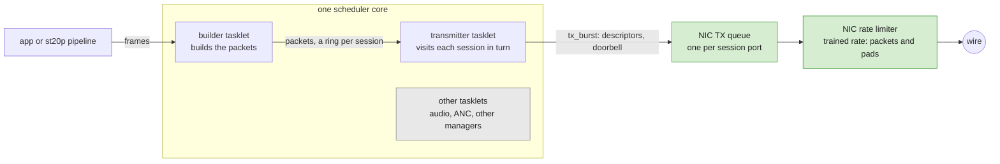
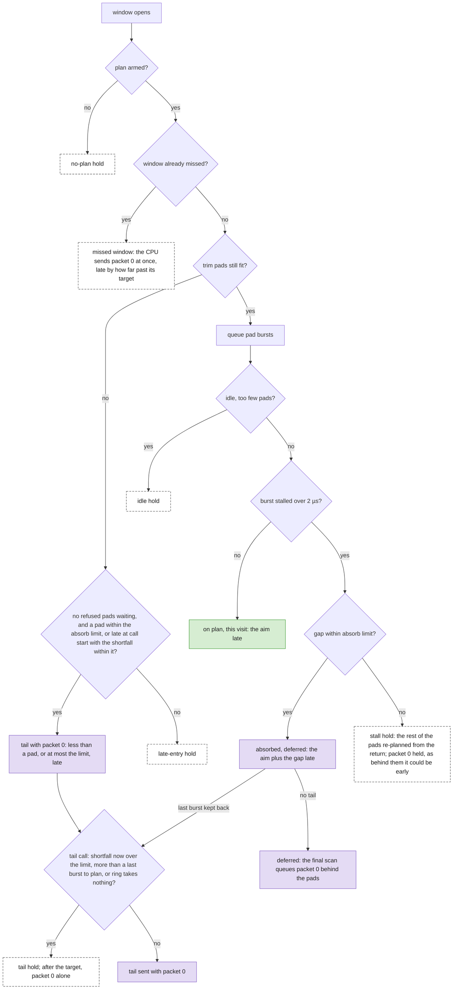

# RL Pacing of ST 2110-20 Video on E810/E830

This guide explains how the Media Transport Library (MTL) paces ST 2110-20 video with the rate limiter (RL) of the Intel® E810 and E830 Series Ethernet Adapters.
The first part, [Using RL pacing](#using-rl-pacing), is for users and operators. The second part, [Developer details](#developer-details), is for developers who change the pacing code.
For the pacing overview and the TX queue depth, see [ST2110-21 pacing](design.md#432-st2110-21-pacing) and [RTP timestamps of paced video](design.md#82-rtp-timestamps-of-paced-video) in the design guide.
The numbers come from 1080p59.94, 4:2:2 10-bit, on an E810 VF, unless noted.

## Using RL pacing

### Summary

- **Packet 0**, the first packet of a frame, is the one most at risk. MTL's rule for it: never early (Section 10.1; one known exception, a VF rate commit, Section 8), and late by a bounded amount.
- On a port with a **plan**, the NIC sends packet 0 behind pads, the aim (0.75 µs) after its target, plus any small stall it absorbed (Sections 3 and 5).
- Otherwise MTL **holds** packet 0, and the CPU sends it at the first **release scan** after its target (Section 3.1).
- While streaming, two error lines report trouble: `frames may break VRX` and `frames fall behind` (Section 6). A quiet log is necessary, not sufficient: verify with a capture analyser such as EBU LIST.

### 1. What ST 2110-21 asks of a sender

ST 2110-21 judges a sender with a virtual receiver. From **TPR0**, the frame epoch plus `TR_offset` (637.7 µs), the receiver drains one packet every **Trs**: the frame's active time (1080/1125 of it) over its packets, 3.892 µs for the 4115 packets of a 1080p59.94 frame. **VRX** is its buffer level: the packets that have arrived minus the packets drained.
A **narrow** sender (`ST21_PACING_NARROW`, a session's default `pacing`) must keep VRX between 0 and **VRX_FULL** = max(8, ⌊packets per frame / (27000 × frame time in s)⌋): 9 at 1080p59.94, 36 at 2160p59.94. A packet that arrives after its drain slot takes VRX below 0.

MTL sends each packet `vrx` packet times ahead of the drain. On RL, vrx is VRX_FULL − 4 (2 packets for the rate limiter's burst, 2 for deviation): 5 (19.5 µs) at 1080p59.94, 32 at 2160p59.94. At heights ≤ 576, vrx is VRX_FULL, 8.
A session's `start_vrx` replaces vrx when it is below the whole packet times in TR_offset (163 here); 163 or more is ignored, with an error. MTL schedules packet *j* of a frame at its **target**:

```text
target(j) = round_to_90kHz(epoch + TR_offset − vrx × Trs) + j × Trs
```

`round_to_90kHz` (the **snap**) moves the start up to about 4 µs later at 1080p59.94. It is skipped with a user timestamp, an RTP timestamp epoch or delta, or an exact user start time.
Tools such as EBU LIST count `drained = ⌊(t − TPR0 + Trs) / Trs⌋` at each arrival, so a packet stays in time up to `(vrx + 1) × Trs` (23.3 µs) after its target, less the snap: 19.3 µs on the frames with the largest snap. Packet 0 has the least room: nothing queued ahead of it can cover a late start.

In the figure, green is MTL, red dashed a sender 29.5 µs late and grey the receiver's drain; VRX in the red band, below 0, means the receiver wanted a packet that had not arrived.


### 2. Pacing ways and when RL is used

The pacing way is set per MTL instance with `mtl_init_params.pacing` (`enum st21_tx_pacing_way`), or `--pacing_way` in the sample apps:

| Way | What times the packets |
|---|---|
| `ST21_TX_PACING_WAY_AUTO` (default) | RL when the driver offers a rate limiter (`net_ice` PF of an E810 or E830, `net_iavf` VF), else TSC |
| `ST21_TX_PACING_WAY_RL` | The NIC's per-queue rate limiter, described in this guide |
| `ST21_TX_PACING_WAY_TSC`, `ST21_TX_PACING_WAY_TSC_NARROW` | The CPU, sending each packet at its TSC time |
| `ST21_TX_PACING_WAY_TSN` | The NIC launch time on E830 PF, see [TSN launch-time pacing](design.md#433-tsn-launch-time-pacing) |
| `ST21_TX_PACING_WAY_PTP`, `ST21_TX_PACING_WAY_BE` | The CPU on the PTP clock; best effort |

- At `mtl_init()` under AUTO, a port whose rate limiter cannot be set up logs `fallback to tsc as rl init fail` (or `... rl root init fail`) and uses TSC, and a driver without one gets TSC with an info line. Under RL each case fails the init instead, with `rl init fail`, `root init error` or `this port not support rl`. An AF_XDP port is accepted under RL (Section 4).
  A port with a shared TX queue (`MTL_FLAG_SHARED_TX_QUEUE`) always gets TSC, with an info line.
- At session create, a queue whose rate cannot be programmed logs the error `fallback to tsc as rl fail` and moves the whole port, later sessions too, to TSC. A session whose training fails logs `rl training fail` and runs on TSC on its own (Section 6); an ST 2022-7 session then runs both ports on TSC and logs the warning `different pacing detected, all set to tsc`.

### 3. How RL pacing works



- A **scheduler** is one CPU core that runs **tasklets** in a loop; a tasklet never blocks. The builder tasklet turns frames into RTP packets on each session's ring.
- The transmitter tasklet **visits** every session in turn and moves its packets to the session's NIC TX queue with `tx_burst`: the CPU writes **descriptors** and rings the **doorbell**.
- A **round** is the time from one visit of a session to its next: every other visit and every other tasklet of that core.
- The NIC rate limiter (the **shaper**) drains each queue at its session's rate. At session create MTL **trains** it (Section 9): one **pad** (a padding packet) every `pad_interval` packets makes the data packets average one per Trs.

Inside a frame the queued packets cover CPU delays. At the frame start the queue is empty, so a packet 0 that the CPU sends late leaves late, and a CPU reaches each session only once a round. So MTL has the NIC time packet 0 too.
When a frame's **warm-up window** opens, 80 % of TR_offset before packet 0's target and at most 128 packet times (0.50 ms here; 8 packets at heights ≤ 576), the transmitter **pre-arms** the queue in one visit, in `tx_burst` calls of up to 32 pads: it queues about 131 pads, sized so that the shaper finishes them one **aim** (0.75 µs) after packet 0's target, and packet 0 behind them (Section 10).
After an absorbed stall, the final release scan of that call queues packet 0 instead (Section 13).

In the figure, s1's visit at the window open queues the pads and packet 0, so it does not matter that the CPU is busy with s3 at the target.


#### 3.1. Hold and the release scan

When the NIC cannot time packet 0 safely (no plan, a long stall, a late entry; Sections 4 and 5), MTL **holds** it: the CPU sends it after its target.
The **release scan** is a short check that the transmitter tasklet runs between session visits: before each session's visit, and once after the last.

- **What it checks:** the ports whose packet 0 is held or deferred and whose target has passed; the scan after the last visit also takes every deferred packet 0, due or not (Section 13).
- **What it does:** it sends that packet 0 at once, whichever session it belongs to. A deferred one goes behind its pads, so the NIC still times it.
- **Its role:** a held packet 0 waits only for the session visit or the other tasklet in progress when its target passes, not for its own session's next visit, a whole round later. So it is late by about one session visit or one other tasklet, plus any releases sent ahead of it in the same scan.
  Behind a port whose pads the full NIC ring refused, it waits for that port's retry in its next visit, up to a round, and at most until hang detection (`tx_hang_detect_ms`, 1 s).

```text
one transmitter call:   R  s1  R  s2  R  s3  R          R = release scan
s1 holds packet 0:                 ^ its target passes during s2's visit
                                      ^ the scan before s3 sends s1's packet 0
```

### 4. When a port has a plan

The per-port numbers of the pre-arm are its **plan**, set at session create. A port gets a plan only if it has warm-up packets, a trained `pad_ns` (the shaper time of one pad), a known bucket depth, its own queue rate and packets of at least 124 bytes (so a pad can be cut by 64).
Also, its window's pads fit half the TX ring (`(window + bucket_ns) / pad_ns + 1 ≤ nb_tx_desc / 2`: 132 against 1024 of 2048 descriptors, or 256 of 512), the window holds the trim pads, the bucket refills before the window opens, and `aim + T ≤ 4 µs`, the TX share (Sections 5 and 10).

These ports have **no plan**:

- SD (480i, 576i), 720p23.98 to 30, 8-bit 720p50 and 8-bit 1080p23.98 to 25: aim + T exceeds 4 µs.
- ST 2110-22, and wide pacing (`ST21_PACING_WIDE`) without `start_vrx`: no warm-up packets. The VRX check never judges ST 2110-22, which sets its Trs per frame (Section 16.1).
- A DPDK-driven ice PF without `rl_burst_size` (unknown bucket depth), a pad interval set by the application (`pad_interval` or `ST20_TX_FLAG_ENABLE_STATIC_PAD_P`: no training, so no `pad_ns`), and an AF_XDP port under `ST21_TX_PACING_WAY_RL` (the kernel's `tx_maxrate` paces it, so MTL has no queue rate of its own).

Every other ST 2110-20 format on an E810/E830 VF has a plan. A port without one sends its warm-up pads one per `tx_burst`, holds every packet 0, and logs a warning at session create, ST 2110-22 too; earlier releases logged it as info (Section 6).

### 5. Staying on time through CPU stalls

Packet 0 ends one of two ways: **the NIC sends it** behind its pads, late by the aim plus at most the absorb limit, or **the CPU sends it** (a hold, Section 3.1). Which way it goes:

- **Stall.** A pad burst that returns more than 2 µs past its plan is a stall. Within the absorb limit the NIC still sends packet 0, late by the aim plus the stall; over it, packet 0 is held.
  A gap under 2 µs is not a stall: the plan is kept, and packet 0 can leave up to that gap late (Section 12).
- **Late entry.** The scheduler reaches the window with too few pads left to put packet 0 on its target. While another port waits on refused pads, packet 0 is held. Else, where one pad fits the absorb limit (1080p119.88, 2160p, 4320p), the pads that fit and packet 0 go in one `tx_burst` (a **tail**), less than a pad late.
  Elsewhere the **stream-start rule** applies: a tail only if the port was already late when this transmitter call began, as at a stream's first frame, and the shortfall fits the limit; otherwise packet 0 is held.
- **Past the target.** A window first reached, or a packet 0 got from the builder, at or past its target: the CPU sends packet 0 at once, late by how far past its target the visit came.

Four numbers bound packet 0. Only the VRX budget has a log check:

| Bound | What it bounds | 1080p59.94 |
|---|---|---|
| Launch bound | MTL's design bound for packet 0 on the wire, from its target | 0..+10 µs |
| TX share | The part of the launch bound kept for the TX side; a plan needs `aim + T` within it | 4 µs |
| Absorb limit | The largest stall a plan may take; it also bounds the tails | 2.6 µs |
| VRX budget | The threshold of `frames may break VRX`: (vrx + 1) × Trs less the worst snap and the pad sawtooth (Section 16.1). Conservative: a packet past it may still keep VRX ≥ 0 | 13.5 µs, 19.1 µs on every second frame |

The absorb limit of the ports with a plan, 4:2:2 10-bit: 3.6 µs at 2160p59.94, 3.3 µs at 1080p119.88, 2.6 µs at 1080p59.94, 2.4 µs at 1080p50, 1.1 µs at 1080p29.97, 0.9 µs at 720p59.94, 0.8 µs at 1080p25 and 0.6 µs at 720p50.
Where it is under 2 µs (every 720p format with a plan, and 1080p30 and slower), no stall is absorbed: every stall holds.

In the figure, each bar maps how long a pad burst stalled to what happens to packet 0: grey, not a stall; green, absorbed; dashed, held; the black tick is the absorb limit.


### 6. Log lines and what to do

MTL checks two things while it streams; the stats dump prints the lines every `dump_period_s` (10 s by default):

- **Check 1, per session:** a packet left more than the VRX budget past its target.
- **Check 2, per scheduler:** the frame builder found its next packet already due (its **lead**, next due time − now, below 0), or, on a scheduler that does not sleep, the average loop is longer than the round budget (16.2 µs here).

| Line | Level, when | Meaning | What to do |
|---|---|---|---|
| `… port P rl training fail …, fallback to tsc pacing` | err, once at session create | The session runs on TSC pacing for its whole life. | Check the ice driver ([E800 Series Driver Guide](e800_series_drivers.md)), then re-create the session. |
| `TX_VIDEO_SESSION(m,s): N frames may break VRX >= 0, a pkt up to Xus past its target over the Yus budget: packet 0 A mid-frame B; K frames started up to Zus late` | err, at most once a period per session | N frames had a burst whose `tx_burst` returned past the budget: A at packet 0, B later. K frames started late. See below. | See below; capture and verify. |
| `TX_VIDEO_SESSION(m): round Xus past the Yus budget, lead -Zus, frames fall behind: move sessions off this scheduler` (either part may be missing; no round part on a scheduler that may sleep) | err, at most once a period per scheduler, and when a session leaves | Scheduler m cannot keep up: a packet was late, or the loop is too slow on average. | Put fewer sessions on scheduler m (Section 7). |
| `… port P rl plan, pad_ns … bucket_ns … burst size … bps …` | info, once at session create | The port has a plan. | None. |
| `… port P no rl plan, holds packet 0, VRX at risk if late` | warn, once at session create | The port holds every packet 0 (Section 4). | Expected for the ports in Section 4: nothing to set, packet 0 is CPU-sent. On a DPDK-driven ice PF without `rl_burst_size`, set it. |
| `TX_VIDEO_SESSION(m,s): transmitter mismatch troffset N` | notice, per period | The warm-up window was first reached, or packet 0 left the builder, two Trs (7.8 µs) or more past its target. | Context; the builder or the scheduler ran late. |
| `TX_VIDEO_SESSION(m,s): transmitter recalculate warmup N` | notice, per period | Rises on every stall, even an absorbed one, and on idle shapers and re-plans of the pre-arm or tail. Without a plan: N times the warm-up pads fell behind. | Context. At integer frame rates, see the timer tick in [RTP timestamps of paced video](design.md#82-rtp-timestamps-of-paced-video). |

In `frames may break VRX`, N counts frames per port (twice on ST 2022-7 if both legs are late), and the return of `tx_burst` is a lower bound of when a packet left. The counts point at the cause:

- **packet 0**: held and sent too late, behind pads that left late, from the builder after its target, or its window first visited late.
- **mid-frame**: a later packet, usually from a queue that ran dry.
- **started late** (K): frames the builder started late, usually because the application delivered them late. MTL re-times such a frame from now, so it is not in N, and only K shows it.

To find out more, read the `SCH(m:…)` and `fall behind` lines, and count the causes with `st20:tx_rl_event` (cause 0: a late packet; cause 1: a late start).

The USDT probe `st20:tx_rl_event(m_idx, s_idx, cause, a0, a1)` fires once per frame and port counted in N (cause 0: a0 the ns past its target, a1 the packet index, 0 for packet 0) and once per frame counted in K (cause 1, START_LATE: a0 the ns the frame started late). It needs a build with USDT support; see [USDT](usdt.md).

```bash
# count the events by cause, and print every VRX event
sudo bpftrace -p "$(pidof RxTxApp)" -e '
usdt::st20:tx_rl_event { @cause[arg2] = count(); }
usdt::st20:tx_rl_event /arg2 == 0/ { printf("m%d s%d pkt %d left %d ns late\n", arg0, arg1, arg4, arg3); }'
```

In the figure, check 1 is at the top: green lateness is not reported, red hatched is reported though VRX may still be ≥ 0, and solid red is reported with VRX < 0. Check 2 is below it: a negative lead fires the `fall behind` line.


### 7. Configuration and requirements

- **Driver.** RL needs the ice driver from version 2.7.6, or an earlier version with the MTL rate-limit patches. See the [E800 Series Driver Guide](e800_series_drivers.md).
- **DPDK-driven ice PF.** Set `mtl_init_params.port_params[i].rl_burst_size`, passed to the ice PF driver as a devarg; without it the port has no plan. Do not set it on a VF: iavf rejects the key.
- **TX queue depth.** Keep the default `nb_tx_desc`: 2048 descriptors and the reclaim (Section 15) on DPDK 26.07 or later for an iavf or ice port paced by RL, TSN or AUTO without a shared queue; 512 and no reclaim otherwise. An `nb_tx_desc` set by the application turns the reclaim off. See [ST2110-21 pacing](design.md#432-st2110-21-pacing).
- **Sessions per scheduler.** Each session's stats lines start with `TX_VIDEO_SESSION(m,s…)`, where `m` is its scheduler; `SCH(m:name): tasklets N, lcore L(t_pid: P), avg loop X ns` gives its core and loop time.
  Placement is decided at session create: `data_quota_mbs_per_sch` in `mtl_init_params` sets how much each scheduler takes (RxTxApp: `--sch_session_quota N` in 1080p59.94 sessions, or `--sch_data_quota`), `lcores` the cores MTL may use (`--lcores`), and `MTL_FLAG_DEDICATED_SYS_LCORE` moves the system tasks to their own core (`--dedicated_sys_lcore`).
- **Isolation.** Isolate the scheduler cores and stop the timer tick on them; a tick or a preemption inside a pad burst is the common stall. See the [CPU Isolation Guide](isolation.md).

### 8. Limits

- **Never early rests on the shaper model** (Section 10.1). A VF rate commit is outside it: a streaming queue's next packet 0 can then leave up to about 0.7 µs early, and MTL does not correct it.
- **The VRX check is a lower bound with a conservative budget.** It can miss late frames and flag compliant ones, cannot see early packets, wire jitter or non-RL pacing, and does not judge the launch bound, so a packet 0 10 to 13.5 µs late (19.1 µs on every second frame) is not reported.
- **An overloaded core is reported, not prevented.** Whether a core keeps up depends on the whole mix on it, which is not known at session create. MTL places sessions by quota, measures while they stream, and reports.

## Developer details

The rules every change must keep: packet 0 is never early within the shaper model (Section 10.1); no visit makes more `tx_burst` calls than a hold would (the **call-count rule**, Section 13); after a stall, keep the plan or hold, never re-plan with packet 0 behind the re-planned pads (Section 11); the release scans (Section 3.1) bound a hold.

### 9. Training and the pad interval

Each session gets its own TX queue and rate. At session create MTL programs the queue, fills the ring with `nb_tx_desc` pads, one per `tx_burst`, then times 71 frames' worth of pads, 32 per `tx_burst`, and averages the middle 60 frame times. Training works up to 4320p59.94 (5.2 GB/s).
If the rate is too slow for the stream, or so fast that the pad interval would be 32 or less, it re-programs the queue by the measured ratio and trains once more; a second miss is a failure.
From the rate it derives the pad interval, and `pad_ns` = Trs × pad_interval / (pad_interval + 1), scaled by the pad's bytes over the frame's mean packet: 3.87 µs here, with a pad_interval of 164. The result is cached per port, rate and pad mix, so later sessions of the same format reuse it.

### 10. The pre-arm plan

In the pre-arm visit the transmitter queues pads in bursts of up to 32, each sized from a fresh clock read so that, in MTL's model, the shaper finishes the last pad at packet 0's target, and queues packet 0 right behind them.
The model counts the 2048-byte bucket that an idle shaper sends at once: the drain starts `bucket_ns` before the clock read. `bucket_ns` carries the aim on top, so the real shaper ends the pads one aim after the target.
The last burst holds the **trim pads** (28 here), cut by 64-byte and then 8-byte steps, so that the modelled drain ends on the target within one 8-byte step, never before.
The **aim** (0.75 µs here) is the shaper time of the most tokens one timeslot can add, at least 257 bytes. The **timeslot T** (0.66 µs) is the time between two token adds: ice sets it from the rate and the NIC scheduler clock, and MTL takes the longest of the four clock rates.
`pad_ns` (3.87 µs) and `bucket_ns` (the 2048-byte bucket's 6.28 µs plus the aim, 7.03 µs) are in the `rl plan` log line. At 1080p59.94, 80 % of the 163 whole packet times in TR_offset is 130, so the cap of 128 applies: 128 × 3.892 µs = 498.2 µs, and (498.2 + 7.03) µs / 3.868 µs ≈ 131 pads.

#### 10.1. Never early, and the shaper model it rests on

Lateness has a known margin, (vrx + 1) × Trs, that MTL can budget. Earliness has none: it can push the receiver over VRX_FULL, and a receiver that checks packet 0 against its RTP timestamp sees it early. So the aim, the cuts that stop at the target, the refused pads retried ahead of packet 0 and the stall handling all round towards late.
The model assumes a **bucket depth** of 2048 bytes on an iavf VF (the ice driver's default; MTL does not read it from the NIC), or `rl_burst_size`, as ice rounds it, on a DPDK-driven ice PF; a larger bucket would launch packet 0 early. It assumes a shaper no faster than the trained `pad_ns`.
It also assumes **stable programming**, which has a known exception: a rate commit for a new queue on a VF can disturb the queues already streaming there, so that their next packet 0 skips about one token wait, up to about 0.7 µs early.
The model leaves out the descriptor fetch after a doorbell, the wire and the arbitration between queues; these only make packets later.

### 11. Frame-start cases and the stall test

A pad burst can be slowed by freeing the previous frame's sent packets, an interrupt or a preemption. Its return shows that it was slow, but not when the doorbell rang. A burst that returns more than 2 µs past its planned drain is a **stall**: the shaper may have sat idle. The two ways to go on err in opposite directions:

| Choice | If the shaper sat idle for the whole gap | If the doorbell rang early in the call |
|---|---|---|
| Plan the rest from the return | on time | the pads end early, and packet 0 behind them would be early |
| Keep the plan | late by about the gap | on time |

So MTL keeps the plan while the gap fits the absorb limit. Past it, it re-plans the pads from the return, which never overfills the ring, and holds packet 0. The flowchart gives every frame-start case:



Green, the NIC times packet 0, queued in this visit; purple, still NIC-timed, sent in one tx_burst with the last pads (a tail) or deferred to the final scan; dashed, held: the CPU sends packet 0 about one visit or other tasklet late (Section 3.1). The idle and stall checks run around every pad burst.

### 12. Absorb

While the largest stall gap of a frame stays within the **absorb limit**, the pre-arm keeps its plan, and packet 0 leaves later by about that gap (3.2 µs for a 2.4 µs stall here). The limit is the smaller of two limits, so an absorbed stall breaks neither:

```text
absorb limit = min( 4 µs − aim − T − fine trim ,
                    vrx × Trs − snap loss − aim − fine trim − sawtooth )
sawtooth     = (pad_interval / 2 + bulk) / (pad_interval + 1) × Trs + one pad
```

At 1080p59.94: 4 − 0.752 − 0.665 − 0.023 ≈ 2.56 µs, against 19.45 − 4.0 − 0.75 − 0.02 − 5.9 ≈ 8.8 µs, so 2.6 µs.
`bulk` is the packets the builder enqueues at a time (4 on RL); the fine trim is the shaper time of one 8-byte cut; the snap loss is the worst 90 kHz snap over the frame phases. The sawtooth is how far the packets behind packet 0 run late of their grid, from the pads between them; the extra pad covers a frame whose pads round up.
A limit ≤ 0 means every counted stall holds. The limit also bounds the late-entry tails and the tail re-check, also where it is under 2 µs. A gap under 2 µs is never compared with it; every frame's first burst has such a gap, from its sizing clock read to its doorbell. At 10-bit 720p50, aim + T is about 3.4 µs, so the absorb limit is 0.6 µs.

### 13. Defer, the tail burst and late entry

An absorbed packet 0 is **deferred**: the visit does not queue it, and the final release scan of the same transmitter call queues it behind the pads, microseconds later. If the visit has already run past the target, packet 0 goes at once, in that visit.

A **tail** is the last pad burst sent with packet 0 in one `tx_burst`, so the frame start makes no more `tx_burst` calls than a hold (the **call-count rule**): each extra call delays every later session's visit.
MTL sends one after a late entry, in the same visit, and after an absorbed stall when finishing the kept plan takes one burst more than a re-plan would: the pre-arm then keeps the trim pads back, and the final scan sends them with packet 0.
A tail call can still end in a hold:
- **Tail re-check.** It sizes its last burst again from its own clock read. If the shortfall is now over the absorb limit, or more than a last burst of pads is left to plan (behind them packet 0 would leave early), packet 0 is held before its target, and goes at once, alone, after it.
- **Ring full.** If the NIC ring takes nothing, the tail drops its pads and holds packet 0 to its target.

A **late entry** is a window first visited with too few pads left to trim packet 0 onto its target. MTL checks, in this order:

- The session's other port, or another session on this scheduler, waits on refused pads: hold, since a tail would add a call ahead of the retry.
- One pad is within the absorb limit (about 1.9 µs against 3.3 µs at 1080p119.88, 0.97 against 3.6 µs at 2160p59.94): tail.
- Otherwise, the **stream-start rule**: tail only if the port was already late at the clock read that starts this transmitter call, and the shortfall is within the limit. A port made late only by this call's earlier visits holds, since a release scan follows them.
- A last burst whose own clock read finds too few pads to cut packet 0 onto its target: tail if the shortfall is within the limit, else hold.

### 14. Hold and the release scans

Section 3.1 says what the release scan is for. These details matter when changing `video_trs_rl_release()`:

- A scan releases a port by running its whole pacing function (tail pads if kept, then packet 0), at most once per port per transmitter call (`trs_released`).
- The clock is read again after each release, so a packet 0 that comes due during a release still leaves in the same scan if its port comes later in scan order. A port that its own release leaves holding a future target stays listed for the next call's scans.
- **A refused port blocks the ones after it**: the scans and the catch-up serve no port after it ahead of its retry. The targets behind it (`trs->blocked_tsc`) are scanned again only after that session's visit, which retries it.
- The call keeps the earliest held or deferred target (`trs->pkt0_tsc`): a scan with nothing held reads no clock, and one with nothing due reads it once. Sessions are taken with a non-blocking try-lock; a scan that finds a session locked, by the stats thread for example, keeps the targets it knew of it for the next scan.
- ST 2110-22 takes no part: only its own visit sends its packet 0, which defers no catch-up; it gets no catch-up or reclaim (Section 15), and a refused ST 2110-22 port blocks no other port.

In the figure, s1's stalled pad burst is part of s1's own visit. In A, packet 0 is deferred, and the final scan, the R after s8, queues it behind the pads. In B, it is held, and the scan before s3 sends it once the target has passed.


### 15. Reclaim and catch-up

**Reclaim.** A first pad burst that must free a batch of the previous frame's sent packets is a common stall. So a visit to a port that waits for its window, or that finds the builder ring empty, frees done descriptors ahead of time with a zero-length `tx_burst`, which the iavf and ice scalar paths use to free one done batch.
It frees at most one batch per batch time (the shaper time of the `rs_thresh / 2` packets in a batch). After a gap it catches up one call a visit, from the batch times before the queue's estimated wire end (`trs_wire_tsc`), never past now.
With chained packets it never runs ahead of the wire: right after a frame's last burst the queue is full of packets still to be sent, and it makes no calls for their batches. Copied packets (`tx_no_chain`) take one descriptor each, so about half its calls before the wire end free nothing. On the iavf/ice scalar TX paths each call still writes the tail register.
It runs only on the 2048-descriptor queues (Section 7).

**Catch-up.** After the visits and the final scan, MTL tops up the RL ports mid-frame whose queue holds less than 200 µs of packets (the scheduler's schedule time, by the last burst's return plus the packets sent times Trs), one bulk per short port per pass, until none is short or a NIC or builder ring stops it.
It is skipped while a packet 0 of a visited port is due within two warm-up windows, so it never delays a release.

### 16. The two checks

#### 16.1. Check 1: frames that may break VRX, per session, counted per port

After every burst of real packets, the transmitter takes how late the burst's first packet left its target: by the burst's return, and for packet 0 by the later of that and the modelled end of its pads plus the aim, so a packet 0 behind pads that drained late is still flagged.
It flags the frame when that exceeds its **VRX budget**, `(vrx + 1) × Trs − snap − sawtooth` with the frame's own 90 kHz snap. The port's budget takes the worst snap, the snap loss (Section 12): 6 × 3.892 − 4.0 − 5.9 ≈ 13.5 µs at 1080p59.94, and 33 × 0.973 − 4.6 − 1.5 ≈ 26 µs at 2160p59.94.
A frame whose snap took less gets the difference, its **room**, on top: at 59.94 every second frame gets +5.56 µs; at 23.98 and 119.88 three frames in four get +2.78, +5.56 or +8.33 µs; at integer rates and 29.97 every frame snaps the same and gets none, and so does a frame with an exact user start time, which is not snapped. The log line prints the budget without the room.
The return stands in for the departure: the NIC fetches the packet after the doorbell, so the lateness is a lower bound. A preemption between the doorbell and the return can only flag a frame that was in time.
A frame counts once per port; the period keeps the worst lateness, at packet 0 or later. Not checked: non-RL ports, ST 2110-22, ports with `vrx` 0, and ports whose budget would be below 0, as with a small user `start_vrx`. A frame that the builder starts more than its budget after packet 0's target counts as started late, since MTL re-times it from now.

#### 16.2. Check 2: frames fall behind, per scheduler

At each visit of the st20 frame builder inside a frame, MTL takes the **lead**: the next packet's due time minus now. Frame gaps are left out, and so is the rest of a frame that once waited for an application's lines.
Only frame-mode st20 is measured, on any pacing way. The line fires when the period's lowest lead is below 0: the next packet left late, which may or may not have taken VRX below 0. It also fires when the scheduler's average loop (`round Xus`) exceeds the tightest round budget of its streaming sessions, `bulk × frame_time / packets`: 4 × 16.68 ms / 4115 = 16.2 µs at 1080p59.94.
With `MTL_FLAG_TASKLET_SLEEP` or `mtl_sch_enable_sleep()` the loop is not judged, since its average holds the sleeps. A session that is freed or migrated reports its lowest lead for the scheduler it leaves.

### 17. Code map

| Topic | Code |
|---|---|
| Pacing way selection | `dev_if_select_pacing()` in `lib/src/dev/mt_dev.c` |
| Pacing parameters, training, pad interval | `tv_init_pacing()`, `tv_train_pacing()`, `tv_set_measured_pad_interval()` in `lib/src/st2110/st_tx_video_session.c` |
| Plan, arming, absorb limit, VRX budget, pad bursts, trim | `tv_rl_plan_init()`, `tv_rl_sawtooth_ns()`, `tv_snap_loss_ns()`; `st_tx_video_rl_timeslot_tokens()`, `st_tx_video_rl_next_burst()`, `st_tx_video_rl_trim_pads()` and the constants in `st_tx_video_rl.h` |
| Pre-arm, stall test, defer, tail, no-plan warm-up, hold | `video_trs_rl_pre_arm()`, `video_trs_rl_frame_start()`, `video_trs_rl_tail_burst()`, `video_trs_rl_warm_up()`, `_video_trs_rl_tasklet()` in `lib/src/st2110/st_video_transmitter.c` |
| Release scans, catch-up, reclaim | `video_trs_rl_release()`, `video_trs_tasklet_handler()`, `video_trs_rl_catch_up()`, `video_trs_rl_short()`, `video_trs_rl_reclaim()`, `mt_txq_reclaim()` |
| Check 1, check 2 | `video_trs_vrx_check()`, `tv_sync_pacing()`, `tv_stat_log()`; `tv_lead_visit()`, `tv_stat_collect()`, `tv_behind_err()` |
| USDT probe; developer rules | `lib/src/mt_usdt_provider.d`; `.github/copilot-docs/mtl-knowledge-base.md`, RL pacing |
