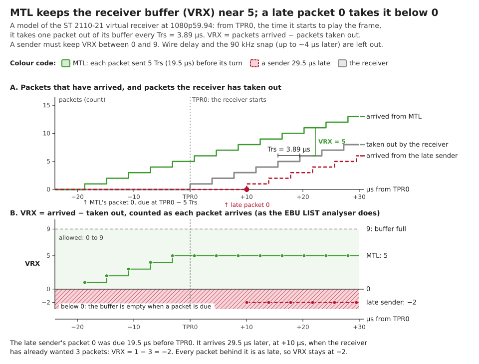
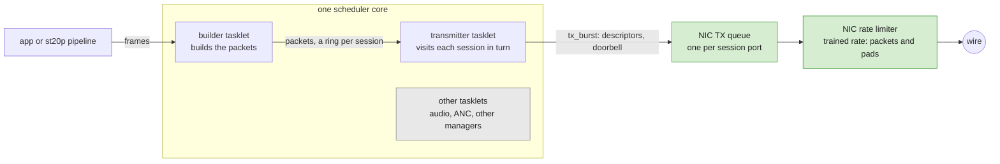
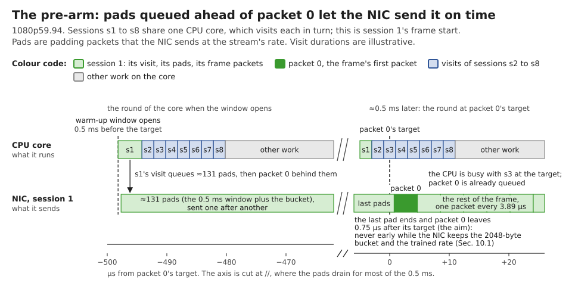
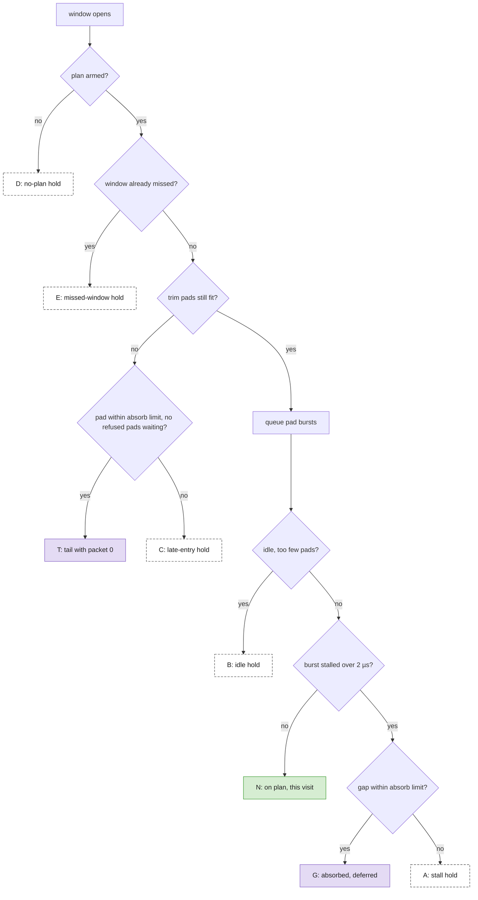
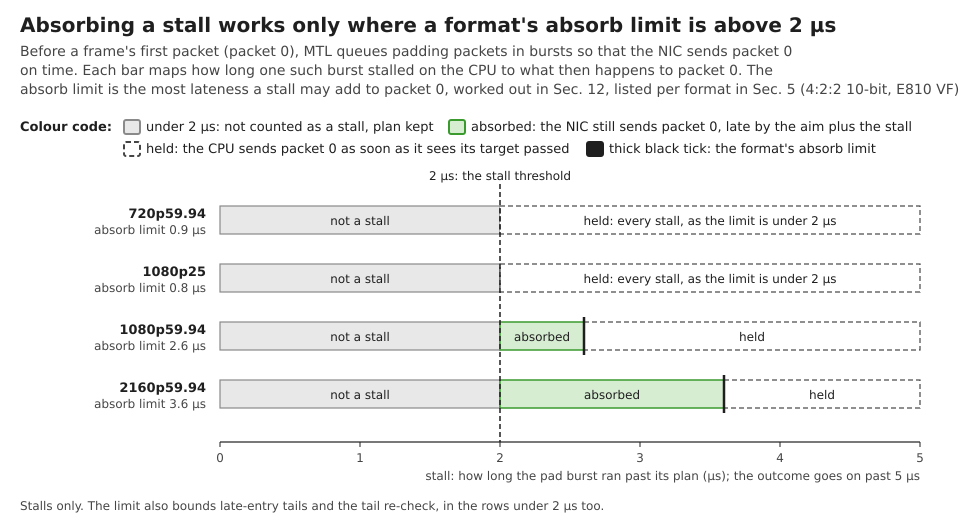
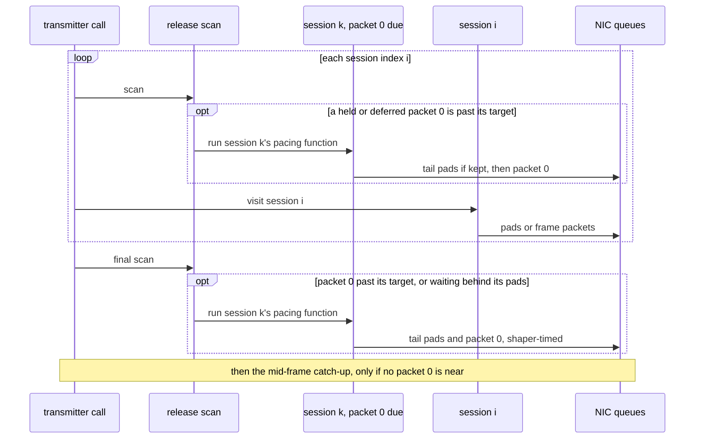
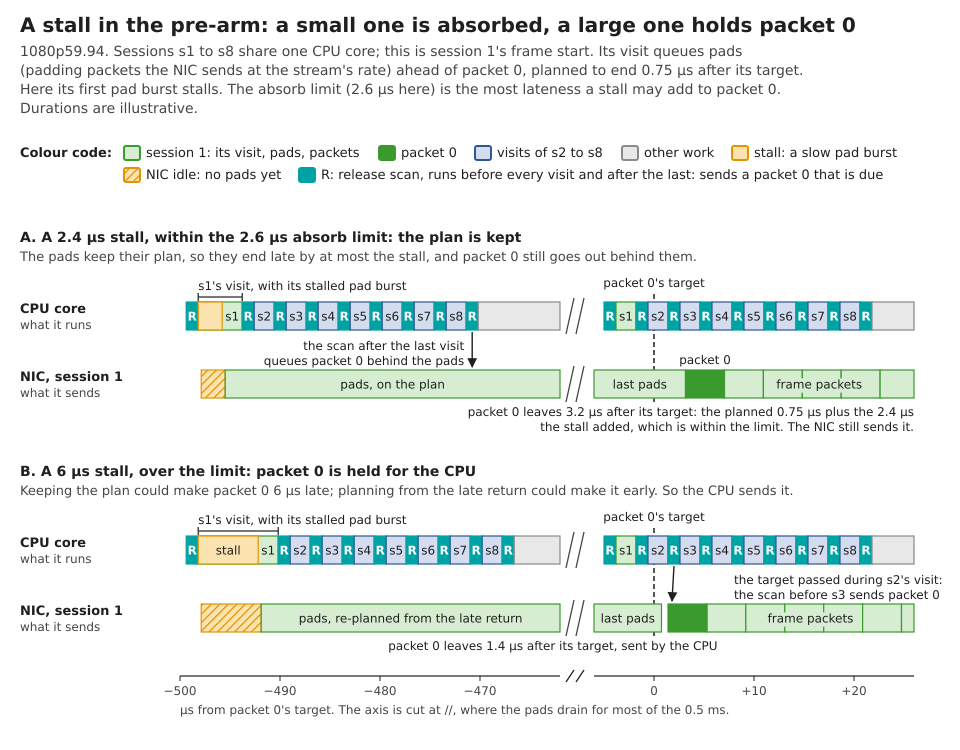
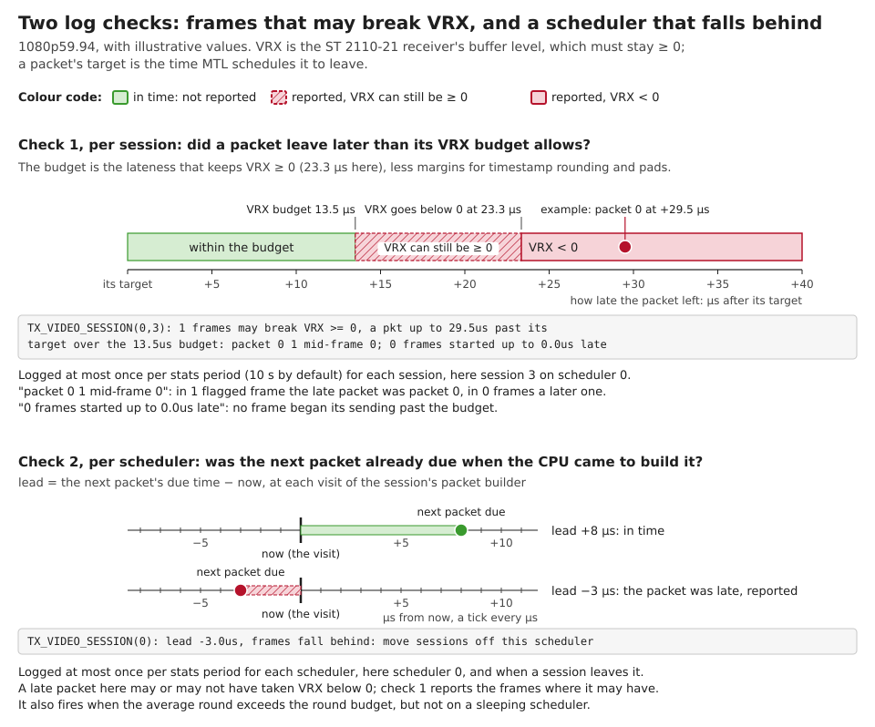

# RL Pacing of ST 2110-20 Video on E810/E830

This guide explains how the Media Transport Library (MTL) paces ST 2110-20 video with the rate limiter (RL) of the
Intel® E810 and E830 Series Ethernet Adapters, and why it works the way it does.
It is written for users who run RL-paced video and need to read its log lines, and for developers who change the
pacing code.
For the pacing overview, the TX queue depth and the frame tolerances, see [ST2110-21 pacing](design.md#432-st2110-21-pacing) and
[RTP timestamps of paced video](design.md#82-rtp-timestamps-of-paced-video) in the design guide.

The numbers in this guide come from 1080p59.94, 4:2:2 10-bit, on an E810 VF (init log values), unless noted.

## 1. What ST 2110-21 asks of a sender

ST 2110-21 judges a sender with a virtual receiver:

- The receiver starts to play a frame at **TPR0**, which is the frame epoch plus `TR_offset` (637.7 µs).
- From TPR0 on, it drains one packet every **Trs** (3.89 µs).
- **VRX** is its buffer level: the packets that have arrived minus the packets drained.
- A **narrow** sender, the MTL default, must keep VRX between 0 and **VRX_FULL** (9 here). A packet that arrives
  after its drain slot leaves the buffer empty when the receiver wants it, so VRX goes below 0.

MTL schedules packet *j* of a frame at its **target**: `epoch + TR_offset − vrx × Trs + j × Trs`, moved to the 90 kHz
media clock.
`vrx` is the lead MTL keeps in the receiver buffer: VRX_FULL − 4 = 5 packets on RL (19.5 µs). Two packets of the 4 cover
the rate limiter's burst, and two are kept for deviation; formats of height ≤ 576 keep the full VRX_FULL.

Tools such as EBU LIST count `drained = ⌊(t − TPR0 + Trs) / Trs⌋` and evaluate VRX at each arrival, counting the
arriving packet. So a packet stays in time up to `(vrx + 1) × Trs` (23.3 µs) after its target.
Packet 0 is the packet with the least room: nothing queued ahead of it can cover a late start.



## 2. Pacing ways and when RL is used

The pacing way is set per MTL instance with `mtl_init_params.pacing` (`enum st21_tx_pacing_way`), or `--pacing_way`
in the sample apps:

| Way | What times the packets |
|---|---|
| `ST21_TX_PACING_WAY_AUTO` (default) | RL when the driver offers a rate limiter (`net_ice` PF, `net_iavf` VF), else TSC |
| `ST21_TX_PACING_WAY_RL` | The NIC's per-queue rate limiter, described in this guide |
| `ST21_TX_PACING_WAY_TSC`, `ST21_TX_PACING_WAY_TSC_NARROW` | The CPU, sending each packet at its TSC time |
| `ST21_TX_PACING_WAY_TSN` | The NIC launch time on E830 PF, see [TSN launch-time pacing](design.md#433-tsn-launch-time-pacing) |
| `ST21_TX_PACING_WAY_PTP`, `ST21_TX_PACING_WAY_BE` | The CPU on the PTP clock; best effort |

With AUTO, a port that cannot set up the rate limiter falls back to TSC with a warning. A port with a shared TX queue
uses TSC.
A session whose RL training fails also falls back to TSC (Section 3.2).

## 3. How RL pacing works

### 3.1. The pipeline



- A **scheduler** is one CPU core that runs **tasklets** in a loop; a tasklet never blocks.
  Sessions are placed on schedulers by quota (Section 7).
- The builder tasklet turns frames into RTP packets and puts them on each session's ring.
- The transmitter tasklet of a scheduler **visits** every session in turn. In a visit it moves packets from the
  session's ring to the session's NIC TX queue with `tx_burst`: the CPU writes **descriptors** (TX ring entries that
  point at packets) and rings the **doorbell**, one register write that hands them to the NIC.
- A **round** is the time from one visit of a session to its next: every other visit and every other tasklet of
  that core.
- The NIC rate limiter (the **shaper**) drains each session's queue at that session's rate. MTL keeps the queue full,
  so within a frame the queue depth is the CPU delay MTL tolerates ([ST2110-21 pacing](design.md#432-st2110-21-pacing)).

### 3.2. The queue rate and the pad interval

Each session gets its own TX queue and its own rate. At session create, MTL **trains** the rate:

1. It programs the queue for the session's packets and sends padding packets (**pads**) for 71 frames' worth,
   32 per `tx_burst`, while it measures what the shaper really delivers.
2. If the measured rate is too slow for the stream, or so fast that the pad interval would fall under 32, MTL
   re-programs the queue by the measured ratio, plus 0.5 %, and trains again.
3. From the measured rate it derives the **pad interval**: the transmitter adds one pad every `pad_interval` packets,
   so the data packets average one per Trs. It also keeps the shaper time of one pad, `pad_ns` (3.87 µs).

A result is cached per port, rate and pad mix, so later sessions of the same format reuse it.
A pad interval set by the application (`pad_interval` in the session ops, or the static profile of
`ST20_TX_FLAG_ENABLE_STATIC_PAD_P`) skips the training, and leaves the port without a measured `pad_ns`, so without a frame-start plan (Section 4.3).
If training fails, the session falls back to TSC pacing and logs an error.

### 3.3. Why the NIC, not the CPU, times packet 0

Inside a frame the shaper keeps the spacing, and the queued packets cover CPU delays.
The frame start is different: the queue is empty after the previous frame, so a packet 0 that the CPU sends late
leaves late, and the shaper cannot make up for it.
A CPU that serves several sessions and other tasklets only reaches a session once per round, so CPU timing of packet 0
is at least as coarse as the round.
So MTL has the NIC time packet 0 too: it queues just enough pads ahead of packet 0 for the shaper to reach packet 0
at its target. Once packet 0 is queued behind them, the CPU's timing no longer moves it.

## 4. Frame start: the pre-arm

### 4.1. The plan

When a frame's **warm-up window** opens, the transmitter **pre-arms** the queue in one visit:

- The window is 80 % of TR_offset in packet times, at most 128 (0.50 ms at 1080p59.94), or 8 packets at heights
  ≤ 576.
- It queues pads in bursts of up to 32, each burst sized from a fresh clock read, so that the shaper finishes the
  last pad at packet 0's target.
- It counts the bucket an idle shaper sends at once: the drain starts one bucket before the clock read.
- The last burst holds the **trim pads** (28 at 1080p59.94). They are cut by 64-byte and then 8-byte steps, so that the
  drain ends on the target within one 8-byte step, never before it.
- It queues packet 0 right behind the pads.



The per-port numbers behind this are the **plan**, set at session create:

| Term | Meaning | 1080p59.94 |
|---|---|---|
| `pad_ns` | Trained shaper time of one pad | 3.87 µs |
| bucket | The shaper's burst bucket in time, plus the aim | 7.03 µs |
| aim | The shaper adds tokens one timeslot apart. MTL aims the most tokens a timeslot can add (at least 257 bytes, more above about 2.95 GB/s) late, so packet 0 is never early | 0.75 µs |
| timeslot T | The timeslot the ice driver programs at the queue's rate, the longest over the psm clocks it may read | 0.66 µs |
| absorb limit | The largest stall a plan may take (Section 5.2) | 2.6 µs |
| VRX budget | How far past its target a packet may leave and keep VRX ≥ 0, in MTL's model (Section 6.1) | 13.5 µs |

### 4.2. Why never early

Lateness has a known margin, (vrx + 1) × Trs, that MTL can budget. Earliness has none: it can push the receiver
buffer over VRX_FULL, and a receiver that measures the first packet against its RTP timestamp, the scheduled time
([RTP timestamps of paced video](design.md#82-rtp-timestamps-of-paced-video)), would see it arrive before its time.
So every choice in the pre-arm rounds towards late: the aim, the cuts that stop at the target, the pads the NIC
refuses (retried ahead of packet 0), and the stall handling of Section 5.

"Never early" holds under this shaper model:

- **Bucket depth.** On an iavf VF MTL assumes 2048 bytes, the default of the ice driver that RL needs; it does not read
  the value from the NIC. On a DPDK-driven ice PF it uses the `rl_burst_size` port parameter, as ice rounds it.
  A larger real bucket would drain the pads faster after idle and launch packet 0 early.
- **Rate.** A shaper faster than the trained `pad_ns` drains the pads early.
- **Stable programming.** Programming the rate of a new queue on a VF can disturb the queues already streaming on that
  VF, so that their next packet 0 leaves up to about 0.7 µs early.

The model leaves out the NIC's fetch of descriptors and data after a doorbell, the wire, and the arbitration between
the queues of a port; these can only make packets later.

### 4.3. When a port has a plan

A port gets a plan only if it has warm-up packets, a measured `pad_ns`, a known bucket depth, its own queue rate and
the trim pads, and all of these hold:

- the window fits half the TX ring: `window / pad_ns + 1 ≤ nb_tx_desc / 2`;
- the window holds the trim pads;
- the bucket refills in the idle time before the window opens;
- `aim + T ≤ 4 µs`, the share of the 0..+10 µs launch bound that MTL keeps for the TX side.

These ports have **no plan**:

- SD (480i, 576i): every ice timeslot at about 30 MB/s is over 4.2 µs.
- 720p25 and 8-bit 1080p25: aim + T exceeds 4 µs.
- ST 2110-22 and wide pacing: no warm-up packets. ST 2110-22 also has `vrx` 0, so the check of Section 6.1 does not
  judge it.
- Any format on a DPDK-driven ice PF without `rl_burst_size`: the bucket depth is unknown.
- A pad interval set by the application: no measured `pad_ns`.
- A queue without its own rate: a shared TX queue, AF_XDP or a kernel socket.

A port without a plan sends its warm-up pads, if it has any, one per `tx_burst` and **holds** packet 0: the CPU sends it once the TSC
reaches its target. Such a port logs a warning at session create (Section 6.3).

## 5. Staying on time through CPU stalls

### 5.1. The stall test

The pre-arm can be slowed while it queues the pads: a cold first burst that frees the previous frame's sent
packets, an interrupt, a preemption. The return of a `tx_burst` call shows that it was slow, but not where in the call
the doorbell rang. A burst whose return is more than 2 µs past its planned drain (the bucket subtracted) counts as a
**stall**: the shaper may have sat idle.

There are two ways to go on, and they err in opposite directions:

| Choice | If the shaper sat idle for the whole gap | If the doorbell rang early in the call |
|---|---|---|
| Plan the rest from the return | on time | the pads end early, and packet 0 behind them would be early |
| Keep the plan | late by about the gap | on time |

Keeping the plan is never early. Its lateness is bounded by the gap, so MTL keeps the plan while the gap fits a
budget, and holds packet 0 otherwise.



Green: the NIC times packet 0, queued in this visit. Purple: still NIC-timed, queued in a later burst. Dashed: held,
so the CPU sends packet 0 at or after its target. The idle and stall checks run around every pad burst.

### 5.2. Absorb

While the largest stall gap of a frame stays within the plan's **absorb limit**, the pre-arm keeps its plan. Packet 0
then leaves late by about that gap; a later gap that the queued pads still cover adds nothing.
The limit is the smaller of two budgets, so an absorbed stall breaks neither:

| Budget | 1080p59.94 |
|---|---|
| The TX launch budget: 4 µs − aim − T − one 8-byte trim | 4 − 0.75 − 0.66 − 0.02 = 2.56 µs |
| The VRX lead: vrx × Trs − 90 kHz snap loss − aim − trim − pad sawtooth | ≈ 8.8 µs |

So the limit is 2.6 µs at 1080p59.94. The same calculation gives about 0.9 µs at 720p59.94, 0.8 µs at 1080p25 and
3.6 µs at 2160p59.94; it depends on the trained rate.

<details><summary>The general formula</summary>

```text
absorb limit = min( 4 µs − aim − T − fine trim ,
                    vrx × Trs − snap loss − aim − fine trim − sawtooth )
sawtooth     = (pad_interval / 2 + bulk) / (pad_interval + 1) × Trs + one pad
```

The snap loss is how far the 90 kHz media-clock rounding moves the target later, worst over the frame phases. The
sawtooth is how far the packets behind packet 0 run late of their grid, from the pads between them; the extra pad
covers a frame whose pads round up. A limit ≤ 0 means every counted stall holds.

</details>



Only a gap over 2 µs is a stall, so absorb acts between 2 µs and the limit, and never where the limit is under 2 µs.
A gap under 2 µs is never compared with the limit: the plan goes on, and packet 0 can leave up to that gap late
without a budget for it. Every frame's first burst has such a gap, from its sizing clock read to its doorbell.

### 5.3. Defer and the tail burst

An absorbed packet 0 is **deferred**: the visit does not queue it, and the release after the last visit of that
transmitter call does (Section 5.4). The pads still end at the target, about 0.5 ms later, so the NIC still times it.
If the visit itself has already run past the target, packet 0 goes at once, in that visit.

Planning from the plan rather than from the late return can need one more pad burst. One more `tx_burst` call in a
visit delays every later session's visit on that scheduler, and with it their packet 0.
So when the plan needs that extra burst, the pre-arm keeps its last burst, the trim pads, back. The call that sends
packet 0 sizes that burst from its own clock read and sends it **together with packet 0 in one `tx_burst`**.
No visit then makes more `tx_burst` calls than a held one.

The same **tail** serves a late entry: when the window is first visited with too few pads left to trim, but one pad
fits the absorb limit, the pads that fit and packet 0 go in one call, under one pad late. This needs a pad shorter
than the limit, as at 2160p59.94 (0.97 µs pads). A first burst whose own clock read finds too few pads, after the
entry check passed, is judged on what those pads cannot cut: within the limit it is a tail, else a late-entry hold.
A late entry found at the window entry also holds while its other port, or another session, waits on pads the full
ring refused, as the tail would be a call the hold does not make. A tail call the ring refuses whole drops its pads
and holds packet 0 to its target.

### 5.4. Hold and the release scans

A **hold** gives packet 0 to the CPU: it waits until its target, then the CPU sends it. The pre-arm holds after a stall
over the absorb limit, when the shaper went idle between bursts with too few pads left, after a late entry the tail
cannot take or that waits behind refused pads, when the ring refuses a tail call whole, when the window was first
reached at or past the target, and on a port without a plan.

A held packet 0 must not wait for the session's next visit, a round later. So the transmitter call runs a **release
scan** before every session's visit, and once after the last:



- Session *k* is whichever session has a packet 0 due; it is usually not the session *i* about to be visited.
- Each scan sends the held or deferred packets 0 whose target has passed. The final scan also sends every packet 0
  that waits behind its own pads, so the other tasklets that run before the next call cannot delay it.
- A scan reads the clock again after each release, so a target that its own sends carry the clock past leaves in
  that scan if its port comes after the releaser in scan order.
- Behind a port whose pads the full NIC ring refused, the scans and the catch-up keep the hold's order: no port after
  it is served ahead of its retry. A release can then wait up to a round, at most until hang detection
  (`tx_hang_detect_ms`, 1 s by default) recovers a ring that never drains.
- The call keeps the earliest target of its held and deferred packets 0, so a scan with nothing due costs one clock
  read. Each port is released at most once per call. Sessions are taken with a non-blocking try-lock.

A held packet 0 whose target passes while the transmitter call runs leaves at the next scan, about one visit late.
If the target passes while other tasklets run, the first scan of the next call sends it.



### 5.5. Reclaim and catch-up

**Reclaim.** A first pad burst that has to free a whole batch of the previous frame's sent packets before its
doorbell is a common stall. So a port that waits for its window frees done descriptors ahead of time, at most once per
batch time. It does so with a zero-length `tx_burst`, which the iavf and ice scalar transmit paths use to free one
done batch. This runs only on the 2048-descriptor queues of [ST2110-21 pacing](design.md#432-st2110-21-pacing).

**Catch-up.** After the visits, an RL port in the middle of a frame whose queue may run dry before the scheduler comes
back gets one more bulk, in turn with the other such ports. "May run dry" is an estimate on the CPU: the last burst's
return plus the packets sent times Trs. The catch-up is skipped while a packet 0 that a visited port has dequeued is
due within two warm-up windows, so it never delays a release.

## 6. Observability

### 6.1. Check 1: frames that may break VRX, per session

After every burst of real packets, the transmitter compares how late the burst's first packet left with the port's
**VRX budget**: `(vrx + 1) × Trs − snap loss − sawtooth`, 13.5 µs at 1080p59.94 and 26.1 µs at 2160p59.94.
For packet 0 it also uses the estimated end of the pads ahead of it.

- The burst's return stands in for the departure. The NIC sends the packet at or after that time, so the lateness is
  a **lower bound**: the check can miss a late frame. It never sees an early packet.
- A frame counts once. The worst lateness of the stats period is kept, and whether packet 0 or a later packet was late.
- The budget is 0, and nothing is judged, for non-RL ports and when `vrx` is 0.
- The frame start is also checked: a frame whose pacing starts more than the budget after its start time counts as
  started late.

### 6.2. Check 2: frames fall behind, per scheduler

At each visit of the st20 frame builder inside a frame, MTL takes the **lead**: the next packet's due time minus
now. Frame gaps and waits for an application's slice are left out.
A lead below 0 means a packet met the wire after it was due: a packet was late. VRX may or may not have gone below 0,
depending on whether the lateness also used up the VRX lead.
The same line fires when the scheduler's average loop exceeds the tightest round budget, `bulk × frame_time /
packets`, of its sessions that streamed, but not on a sleeping scheduler, whose loop average holds its sleeps. A
session that is freed or migrated reports for the scheduler it leaves.



### 6.3. If you see this line

The checks only count on the data path; the stats dump prints the lines, every `dump_period_s` (10 s by default).
A quiet log is necessary, not sufficient: verify compliance with a capture analyser such as EBU LIST.

| Line | Level, when | Meaning | What to do |
|---|---|---|---|
| `… port P rl training fail …, fallback to tsc pacing` | err, once at session create | The session runs on CPU (TSC) pacing for its whole life. | Check the ice driver ([E800 Series Driver Guide](e800_series_drivers.md)), then re-create the session. |
| `TX_VIDEO_SESSION(m,s): N frames may break VRX >= 0, a pkt up to Xus past its target over the Yus budget: packet 0 … mid-frame …; K frames started up to Zus late` | err, at most once a period per session | N frames of session s had a packet past its budget (Section 6.4). | Read scheduler m's `SCH(m:…)` and `fall behind` lines; capture and verify. A flagged frame may still measure VRX ≥ 0. |
| `TX_VIDEO_SESSION(m): round Xus past the Yus budget, lead -Zus, frames fall behind: move sessions off this scheduler` (either part may be missing) | err, at most once a period per scheduler, and when a session leaves | Scheduler m cannot keep up: a packet was late, or the loop is too slow on average. | Put fewer sessions on scheduler m (Section 7). |
| `… port P no rl plan, holds packet 0, VRX at risk if late` | warn, once at session create | The port holds every packet 0 (Section 4.3). | Expected for the formats of Section 4.3. On an ice PF, set `rl_burst_size`. |
| `TX_VIDEO_SESSION(m,s): transmitter recalculate warmup N` | notice, per period | The pre-arm met N stalls, idle shapers or re-plans. | Context for the lines above. At integer frame rates, see the timer tick in [RTP timestamps of paced video](design.md#82-rtp-timestamps-of-paced-video). |

### 6.4. Reading "frames may break VRX"

| Counter | The flagged frame's first packet past its budget |
|---|---|
| packet 0 | Packet 0: held and sent too late, behind pads that left late, got from the builder after its target, or a warm-up window first visited late. |
| mid-frame | A later packet of the frame, usually a queue that ran dry. |

"K frames started up to Zus late" counts frames whose pacing started more than the budget after their start time,
usually a frame that the application or the builder delivered late.

### 6.5. The `st20:tx_rl_event` USDT probe

Each frame counted in Section 6.3's line also fires `tx_rl_event(m_idx, s_idx, cause, a0, a1)`. It needs a build
with USDT support; see [USDT](usdt.md). In bpftrace, `arg0`..`arg4` are m_idx, s_idx, cause, a0 and a1.

| Cause | Event | a0, a1 |
|---|---|---|
| 0 | VRX | ns past its target; packet index, 0 for packet 0 |
| 1 | START_LATE | ns the frame started late; 0 |

```bash
# count the events by cause, and print every VRX event
sudo bpftrace -p "$(pidof RxTxApp)" -e '
usdt::st20:tx_rl_event { @cause[arg2] = count(); }
usdt::st20:tx_rl_event /arg2 == 0/ { printf("m%d s%d pkt %d left %d ns past its target\n",
  arg0, arg1, arg4, arg3); }'
```

### 6.6. Why MTL reports instead of refusing

Whether a core keeps up depends on the per-packet cost of the whole mix on that core, its cache footprint and the
other tasklets. None of that is known when a session is created, before anything streams. MTL places sessions by
quota, measures while it streams, and reports a frame that may break VRX and a scheduler that falls behind.

## 7. Configuration and requirements

- **Driver.** RL needs the ice driver from version 2.7.6 as Intel releases it, or an earlier version with the MTL
  rate-limit patches. See the [E800 Series Driver Guide](e800_series_drivers.md).
- **DPDK-driven ice PF.** Set `mtl_init_params.port_params[i].rl_burst_size`, which MTL passes to the ice PF driver as
  the `rl_burst_size` devarg. Without it the port has no frame-start plan. Do not set it on a VF port: iavf rejects the
  key.
- **TX queue depth.** Keep the default `nb_tx_desc`: on an RL port it gives the 2048-descriptor queue that the reclaim
  needs. See [ST2110-21 pacing](design.md#432-st2110-21-pacing).
- **Sessions per scheduler.** Each session's stats lines start with `TX_VIDEO_SESSION(m,s…)`, where `m` is its
  scheduler; `SCH(m:name): tasklets N, lcore L(t_pid: P), avg loop X ns` gives the core and its loop time.
  Placement is decided at session create:
  - `data_quota_mbs_per_sch` in `mtl_init_params` sets how much each scheduler takes; a session that would exceed it
    goes to a new scheduler. In RxTxApp: `--sch_session_quota N` (N 1080p59.94 sessions) or `--sch_data_quota`.
  - `lcores` lists the cores MTL may use (`--lcores`).
  - `MTL_FLAG_DEDICATED_SYS_LCORE` moves the system tasks to their own core (`--dedicated_sys_lcore`).
- **Isolation.** Isolate the scheduler cores and stop the timer tick on them; a tick or a preemption inside a pad
  burst is the common stall. See the [CPU Isolation Guide](isolation.md).

## 8. Limits

- **Formats without a plan** (Section 4.3) hold every packet 0, so their frame start is CPU-timed; the release scans
  bound the wait to about one visit.
- **No absorb where the limit is under 2 µs**, for example 720p59.94 and 1080p25: every counted stall holds.
- **Gaps under 2 µs are not budgeted**: packet 0 can leave up to 2 µs late. At 720p59.94, where aim, T and trim already
  take about 3.1 µs of the 4 µs, that can exceed the TX budget, though not the 0..+10 µs launch bound.
- **Never early rests on the shaper model** (Section 4.2), including the VF rate-commit effect of up to about 0.7 µs.
- **The VRX check is a lower bound with a conservative budget.** It can miss late frames and flag compliant ones, and
  it cannot see early packets, wire jitter, a shaper slower than `pad_ns`, or non-RL pacing.
- **An overloaded core is reported, not prevented.**

## 9. Code map

| Topic | Code |
|---|---|
| Pacing way selection | `dev_if_select_pacing()` in `lib/src/dev/mt_dev.c` |
| Pacing parameters: Trs, TR_offset, vrx, warm-up | `tv_init_pacing()` in `lib/src/st2110/st_tx_video_session.c` |
| Training, pad interval | `tv_train_pacing()`, `tv_set_measured_pad_interval()` |
| Plan, arming, absorb limit, VRX budget | `tv_rl_plan_init()`, `tv_rl_sawtooth_ns()`, `tv_snap_loss_ns()`; `st_tx_video_rl_timeslot_tokens()` and the constants in `st_tx_video_rl.h` |
| Pad burst planning, trim | `st_tx_video_rl_next_burst()`, `st_tx_video_rl_trim_pads()` in `st_tx_video_rl.h` |
| Pre-arm, stall test, absorb, defer | `video_trs_rl_pre_arm()`, `video_trs_rl_frame_start()` in `lib/src/st2110/st_video_transmitter.c` |
| Tail burst | `video_trs_rl_tail_burst()` |
| No-plan warm-up, hold | `video_trs_rl_warm_up()`, `_video_trs_rl_tasklet()` |
| Release scans, catch-up | `video_trs_rl_release()`, `video_trs_rl_catch_up()`, `video_trs_rl_short()`, `video_trs_tasklet_handler()` |
| Reclaim | `video_trs_rl_reclaim()`; `mt_txq_reclaim()` |
| Check 1 | `video_trs_vrx_check()`; the late start in `tv_sync_pacing()`; the line in `tv_stat_log()` |
| Check 2 | `tv_lead_visit()`, the round budget in `tv_stat_collect()`, `tv_behind_err()` |
| USDT probe | `lib/src/mt_usdt_provider.d` |
| Developer rules | `.github/copilot-docs/mtl-knowledge-base.md`, RL pacing |
