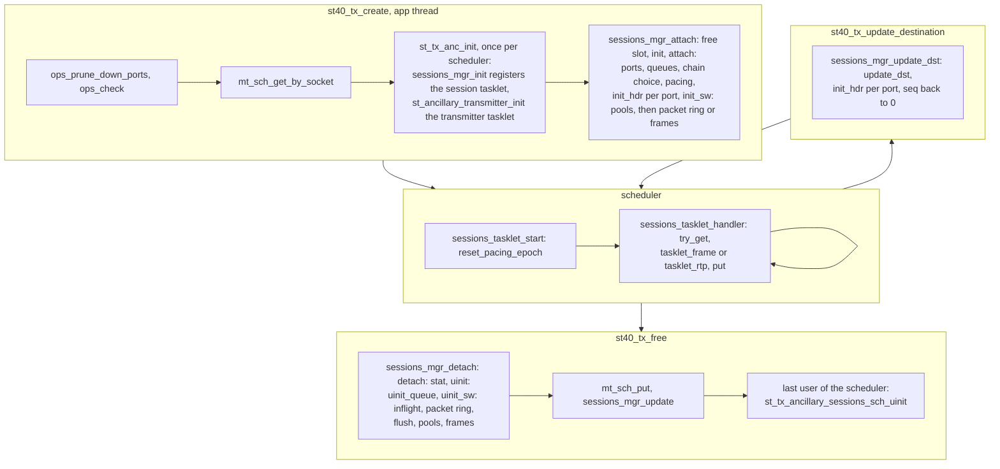
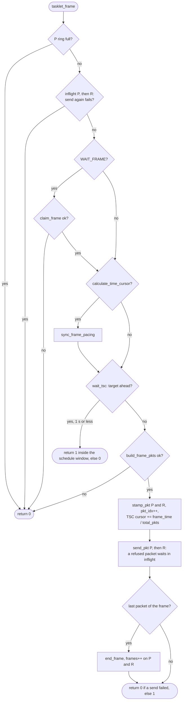
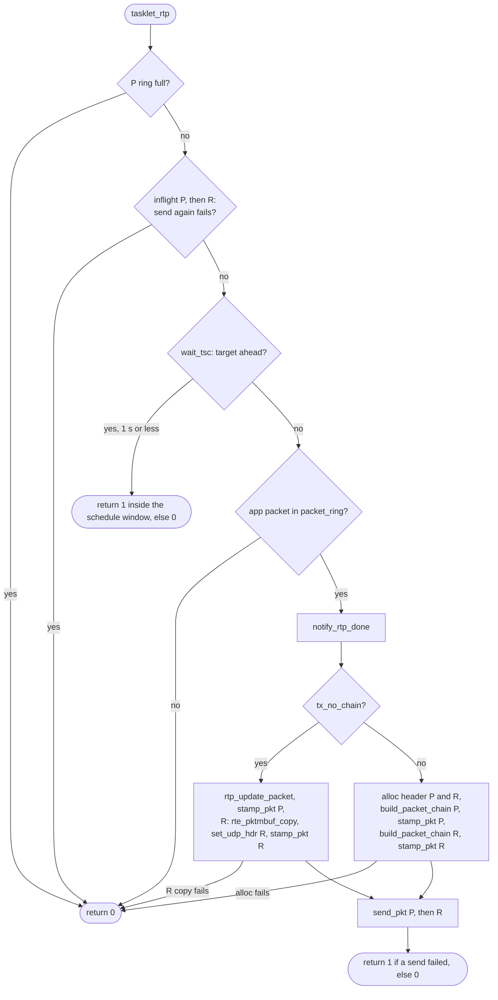
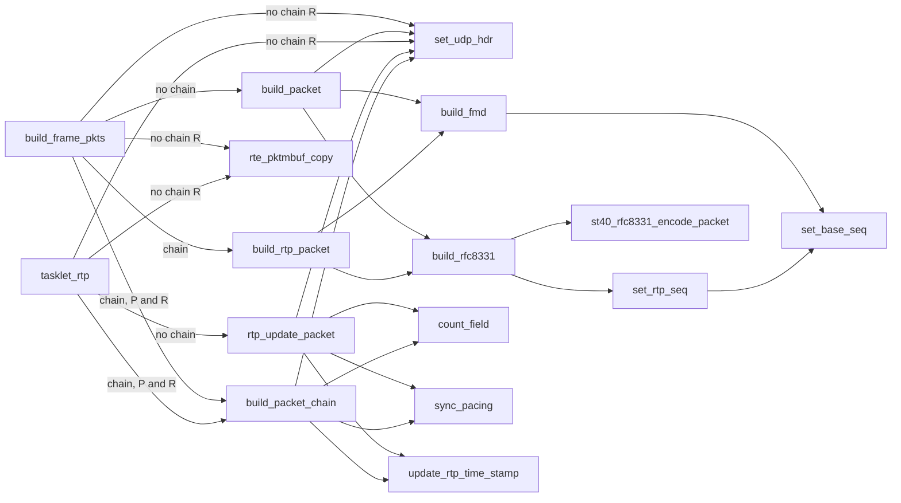
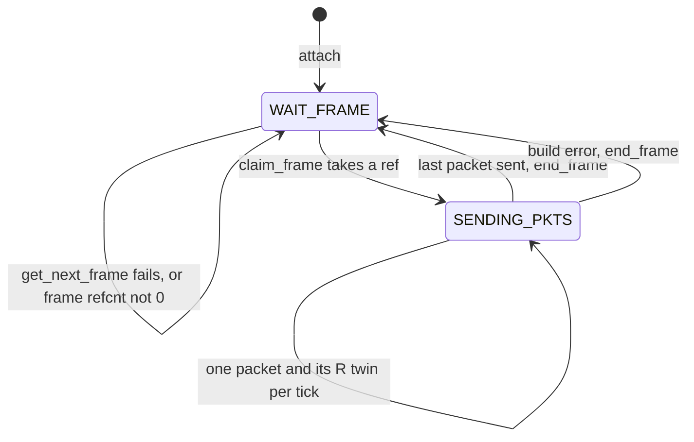

# ST40 TX Session Design

This document describes the ST 2110-40 TX session in `lib/src/st2110/st_tx_ancillary_session.c`: its place in the library, the packet paths, the error codes, the test hooks, and the tests that cover each function.
The diagrams and tables drop the `tx_ancillary_session_` and `tx_ancillary_` prefixes from the function names.

## Place in the library

- **API layers.** The pipeline (`st40p_tx_*`, `lib/src/st2110/pipeline/st40_pipeline_tx.c`) sits on top of this session and always uses the frame level.
  RxTxApp `tx_ancillary_app.c` uses the session API directly.
  The GStreamer and FFmpeg plugins use the pipeline.
- **One tasklet does the work.** Each scheduler has one session manager (`sch->tx_anc_mgr`).
  Its tasklet, `tx_ancillary_sessions_mgr`, runs `sessions_tasklet_handler`, which runs `tasklet_frame` or `tasklet_rtp` for each session.
  That tasklet builds the packets and paces them with a TSC gate.
  There is no builder and transmitter split as for video.
  With a shared queue (the default), packets go to the manager ring `mgr->ring[port]`, and the `ancillary_transmitter` tasklet (`st_ancillary_transmitter.c`) only moves them to the shared TX queue.
  With `ST40_TX_FLAG_DEDICATE_QUEUE`, `send_pkt` writes to the session queue.
- **Frame level and RTP level.** At `ST40_TYPE_FRAME_LEVEL` the app gives a `struct st40_frame` through `get_next_frame`, and the session encodes it.
  At `ST40_TYPE_RTP_LEVEL` the app writes RTP packets into mbufs from `st40_tx_get_mbuf()` and queues them with `st40_tx_put_mbuf()` on `packet_ring`.
  The session keeps the app's seq, marker and payload.
  It changes the RTP timestamp, and a new app timestamp starts a new frame with a new pacing sync.
- **RFC 8331 and fast metadata.** Without a flag the payload is RFC 8331: a 20-byte RTP header with extended seq, length, ANC count and field bits, then the ANC packets, with the marker on the last packet of a frame.
  `ST40_TX_FLAG_SPLIT_ANC_BY_PKT` sends one ANC per packet.
  `ST40_TX_FLAG_FAST_METADATA` selects ST 2110-41: one data item per frame in one packet, a 16-byte RTP header, no extended seq, marker 0, default payload type 115.
- **Chain and no chain.** With chain, a 42-byte eth/ipv4/udp header mbuf goes in front of a payload mbuf from the chain pool.
  The session uses chain when every port supports multi-segment TX (E810 does).
  `MTL_FLAG_TX_NO_CHAIN` (KahawaiTest `--tx_no_chain`), or a port without multi-segment TX (kernel socket, AF_XDP), selects no chain: one mbuf holds the header at offset 0 and the RTP packet at offset 42.
- **The redundant R twin.** With `num_port` 2 (ST 2022-7), each P packet has an R twin with the same RTP bytes, the `hdr[R]` header, and the same mbuf idx and TSC.
  With chain, R is a second header mbuf in front of the same payload (refcnt 2).
  Without chain, R is an `rte_pktmbuf_copy()` of P with the R header written over it.
  P is always built and stamped first.

## Session lifecycle

The tasklet takes the slot spinlock with `try_get` and skips a session that the control plane holds. Create and free hold `sch->tx_anc_mgr_mutex`, then the slot spinlock. A destination update takes only the slot spinlock.

## Frame tasklet

- One tick sends one packet and its R twin. `sync_frame_pacing` runs once per frame, so all packets of a frame have the same RTP timestamp, and they are `frame_time / total_pkts` apart.
- A target more than 1 s ahead is an invalid TSC: `wait_tsc` logs an error and the packet goes at once.
- `end_frame` calls `notify_frame_done`, drops the frame refcnt, sets WAIT_FRAME and makes the next frame sync its pacing again.

## RTP tasklet

- The return values are the opposite of `tasklet_frame`, as in `tx_audio_session_tasklet_rtp`.
- All packets of one app timestamp get the same TSC target, so they go out back to back.
- The gate reads the cursor before the dequeue. The first packet of a new timestamp therefore goes when the cursor of the previous timestamp passes. Its own pacing sync then sets the cursor that the next packets wait for.

## Packet builders

- `build_fmd` and `build_rfc8331` write the RTP part at an offset: 42 without chain, 0 into the chain payload. They return the next ANC index (0 for fast metadata) or a negative code, and the caller stores the code in `stat_build_ret_code`.
- `build_fmd` leaves the mbuf untouched on an error and uses no seq. An RFC 8331 error comes after the seq is written, so it uses one seq.
- `set_udp_hdr` copies `hdr[port]` to the head of the packet, sets the IPv4 and UDP lengths from `pkt_len`, and writes the IPv4 checksum when the port has no checksum offload. `pkt_len` must be final before the call.
- `build_packet_chain` and `rtp_update_packet` sync the pacing only for P at the RTP level, when the app timestamp changes.

## Frame state machine

Only the frame level uses this state. The RTP level keeps `st40_frame_stat` at WAIT_FRAME.

A ring full, an inflight retry, the TSC gate and an alloc failure leave the state as it is. `claim_frame` sets SENDING_PKTS before it plans the packets, so a plan above one packet stays SENDING_PKTS (see [Known defects](#known-defects-kept-on-purpose)).

## Packet paths

| Level | Chain | Port | mbufs | Build | RTP from the session | Frames counted | Unit tests |
|---|---|---|---|---|---|---|---|
| frame | no | P | one from `mbuf_mempool_hdr[P]` | `build_packet` | whole RTP | +1 at the frame end | `PP::Paths/St40TxChainTest.SplitFrameSendsOnePacketPerAnc/NoChain`, `FB::Builders/St40TxFmdBuildTest.*/NoChain` |
| frame | no | R | `rte_pktmbuf_copy()` of P into `mbuf_mempool_hdr[R]` | `set_udp_hdr(R)` | same as P | +1 at the frame end | `PP::St40TxPathTest.RedundantTwinMatchesPrimary` |
| frame | yes | P | header from `mbuf_mempool_hdr[P]`, payload from `mbuf_mempool_chain` | `build_rtp_packet`, `build_packet_chain(P)` | whole RTP | +1 at the frame end | `PP::Paths/St40TxChainTest.SplitFrameSendsOnePacketPerAnc/Chain`, `FB::Builders/St40TxFmdBuildTest.*/Chain` |
| frame | yes | R | header from `mbuf_mempool_hdr[R]`, same payload | `build_packet_chain(R)` | same as P | +1 at the frame end | `PP::St40TxPathTest.RedundantTwinMatchesPrimary` |
| RTP | no | P | app mbuf from `mbuf_mempool_hdr[P]`, RTP at 42 | `rtp_update_packet` | timestamp; the RFC 8331 first chunk is swapped only on the first packet of an interlaced timestamp | +1 on P and R at a new timestamp | `FB::St40TxRtpLevelTest.*NoChain*`, `PP::St40TxPathTest.Rfc8331NoChainSwapsOnlyFirstPacketOfTimestamp` |
| RTP | no | R | `rte_pktmbuf_copy()` of P into `mbuf_mempool_hdr[R]` | `set_udp_hdr(R)` | same as P | counted with P | `PP::Paths/St40TxChainTest.RtpRedundantFrameCounts/NoChain` |
| RTP | yes | P | app mbuf from `mbuf_mempool_chain`, RTP at 0; header from `mbuf_mempool_hdr[P]` | `build_packet_chain(P)` | timestamp; the RFC 8331 first chunk is swapped on every packet | +1 on P at a new timestamp | `FB::St40TxRtpLevelTest.FmdChainLeavesPacketUntouched`, `FB::St40TxRtpLevelTest.Rfc8331Chain*`, `PP::Paths/St40TxChainTest.RtpRedundantFrameCounts/Chain` |
| RTP | yes | R | header from `mbuf_mempool_hdr[R]`, same payload | `build_packet_chain(R)` | same as P | none (defect 2) | `PP::Paths/St40TxChainTest.RtpRedundantFrameCounts/Chain` |

`mempool_init` sizes the rooms: 1494 bytes for a no-chain mbuf, 42 for a chain header, 1452 for a chain payload. `mt_mempool_create_by_socket()` rounds each room up to a multiple of `MT_MBUF_CACHE_SIZE` (128): 1536, 128 and 1536. With `MTL_FLAG_TX_MONO_POOL` every mbuf comes from `mt_sys_tx_mempool()` of the port.

## Error codes of the early returns

`sessions_tasklet_handler` sets `stat_build_ret_code` to 0 before each session. `session_stat` prints it when a stat period sends no frame.

| Tasklet | Condition | `stat_build_ret_code` | Returns | Unit test |
|---|---|---|---|---|
| frame | P ring full | `-STI_FRAME_RING_FULL` | 0 | `PP::Paths/St40TxSendPathTest.RingFullSkipsTick/Frame` |
| frame | inflight P refused again | `-STI_FRAME_INFLIGHT_ENQUEUE_FAIL` | 0 | none |
| frame | inflight R refused again | `-STI_FRAME_INFLIGHT_R_ENQUEUE_FAIL` | 0 | `PP::Paths/St40TxSendPathTest.ParkedRGoesFirst/Frame` |
| frame | `get_next_frame` < 0 | `-STI_FRAME_APP_GET_FRAME_BUSY` | 0 | `PP::Paths/St40TxSendPathTest.ParkedRGoesFirst/Frame` |
| frame | frame refcnt not 0 | `-STI_FRAME_APP_ERR_TX_FRAME` | 0 | `PP::St40TxPathTest.FrameInFlightIsNotClaimed` |
| frame | RFC 8331 plan above one packet, no split | `-STI_FRAME_APP_ERR_TX_FRAME` | 0 | `PP::St40TxPathTest.PlanAboveOnePacketReportsErrorAfterClaim` |
| frame | TSC gate | `-STI_TSCTRS_TARGET_TSC_NOT_REACH` | 1 inside `mt_sch_schedule_ns()`, else 0 | `PP::St40TxPathTest.GateReturnsPendingInsideScheduleWindow`, `PT::St40TxPacingTest.ExactTargetAtOneSecondWaits` |
| frame | no header P mbuf | `-STI_FRAME_PKT_ALLOC_FAIL` | 0 | none |
| frame | no chain payload mbuf | `-STI_FRAME_PKT_ALLOC_FAIL` | 0 | none |
| frame | build error, frame ended | builder code: `-STI_FRAME_ANC_TOO_LARGE`, `-EINVAL`, `-ENOSPC` | 0 | `PP::Paths/St40TxChainTest.BuildErrorAbortsFrame/*`, `FB::St40TxFmdTest.OversizedDataItemAbortsFrame` |
| frame | no R mbuf or copy | `-STI_FRAME_PKT_ALLOC_FAIL` | 0 | `PP::Paths/St40TxChainTest.RAllocFailureFreesPayloadOnce/*` |
| frame | P send refused, not a return | `-STI_FRAME_PKT_ENQUEUE_FAIL` | 0 | none |
| frame | R send refused, not a return | `-STI_FRAME_PKT_R_ENQUEUE_FAIL` | 0 | `PP::Paths/St40TxSendPathTest.ParkedRGoesFirst/Frame` |
| RTP | P ring full | `-STI_RTP_RING_FULL` | 0 | `PP::Paths/St40TxSendPathTest.RingFullSkipsTick/Rtp` |
| RTP | inflight P refused again | `-STI_RTP_INFLIGHT_ENQUEUE_FAIL` | 0 | none |
| RTP | inflight R refused again | `-STI_RTP_INFLIGHT_ENQUEUE_FAIL` (defect 4) | 0 | `PP::Paths/St40TxSendPathTest.ParkedRGoesFirst/Rtp` |
| RTP | TSC gate | `-STI_TSCTRS_TARGET_TSC_NOT_REACH` | 1 inside `mt_sch_schedule_ns()`, else 0 | none |
| RTP | `packet_ring` empty | `-STI_RTP_APP_DEQUEUE_FAIL` | 0 | none |
| RTP | no header P mbuf | `-STI_RTP_PKT_ALLOC_FAIL` | 0 | none |
| RTP | no R copy or no header R mbuf | `-STI_RTP_PKT_ALLOC_FAIL` | 0 | `PP::Paths/St40TxChainTest.RtpRAllocFailureSendsNothing/*` |
| RTP | P send refused, not a return | `-STI_RTP_PKT_ENQUEUE_FAIL` | 1 | none |
| RTP | R send refused, not a return | `-STI_RTP_PKT_R_ENQUEUE_FAIL` | 1 | `PP::Paths/St40TxSendPathTest.ParkedRGoesFirst/Rtp` |

The ring check at the start of the tick leaves room for P, and R has the ring of another port. So only a dedicated queue that sends nothing, or a flush at free time that fills the ring, refuses a P packet. The unit harness has neither, so the P codes have no unit test.

## Test hooks

`st_tx_ancillary_test.h` defines the `TX_ANC_TEST_*` hooks. They do something only when `MTL_SIMULATE_PACKET_DROPS` is defined (every buildtype but release) and `ops.test.pattern` is set. In a release build they are empty. The GStreamer TX element sets the pattern with `tx-test-mode`. A pattern also turns on split mode.

| Hook | Runs in | Does | Unit test | Acceptance case |
|---|---|---|---|---|
| `TX_ANC_TEST_INIT` | `attach`, after `ops` is copied | copies `ops.test`, sets the frame count, forces split | `PP::St40TxTestHookTest.*` (the harness calls it) | every `tx_test_mode` case |
| `TX_ANC_TEST_SEQ_STEP` | `set_base_seq` | seq step 2 once per frame, single port SEQ_GAP | `PP::St40TxTestHookTest.SeqStepTwoAcrossWrapCarriesExt` | `test_st40p_rx_seq_loss_logged` |
| `TX_ANC_TEST_NO_MARKER` | `build_rfc8331`, before the ANC loop | no marker on the last packet | `PP::St40TxTestHookTest.NoMarkerAndBadParityPerAnc` | `test_st40p_rx_missing_marker_no_ready` |
| `TX_ANC_TEST_CLAMP_ANC_IDX` | `build_rfc8331`, before the ANC loop | keeps the ANC index on the last ANC when PACED plans more packets than ANCs | none | none |
| `TX_ANC_TEST_CORRUPT_PARITY` | `build_rfc8331`, after each encode | strips the parity bits of the ANC | `PP::St40TxTestHookTest.NoMarkerAndBadParityPerAnc` | `test_st40p_rx_bad_parity_drops_payload` |
| `TX_ANC_TEST_ACTIVATE_FRAME` | `claim_frame` after the plan; `rtp_update_packet` at a new timestamp | marks the frame active, PACED sets `st40_total_pkts` | `PP::St40TxTestHookTest.*` (frame level only) | every `tx_test_mode` case |
| `TX_ANC_TEST_SEQ_GAP_PLAN` | right after `ACTIVATE_FRAME` | plans the next redundant drop from an 8-step P/R schedule | `PP::St40TxTestHookTest.SeqGapPlanKeptAcrossFramesResetByAbort` | the redundant `*_gap` cases |
| `TX_ANC_TEST_PACING_OVERRIDE` | `tasklet_frame`, after `pkt_time` | PACED packet gap | none | `test_st40p_split_mode_pacing_respected`, `test_st40p_split_padding_alignment_boundary` (they set `tx_test_pacing_ns`) |
| `TX_ANC_TEST_DROP_PKT` | first line of `send_pkt`, so the inflight retries too | drops a planned redundant packet | `PP::St40TxTestHookTest.SeqGapPlanKeptAcrossFramesResetByAbort` | the redundant `*_gap` cases |
| `TX_ANC_TEST_FRAME_DONE` | `tasklet_frame`, after the last `end_frame` | clears the frame flags, keeps the schedule index | none asserts it | every `tx_test_mode` case |
| `TX_ANC_TEST_RESET_STATE` | `build_frame_pkts`, after the build error `end_frame` | clears the frame flags and the schedule index | `PP::St40TxTestHookTest.SeqGapPlanKeptAcrossFramesResetByAbort` (chain and no chain) | none |

The unit hook tests build only without buildtype release (`build_unit_dbg`). In `build_unit` one `St40TxTestHookTest.NeedsNonReleaseBuild` case skips. The acceptance cases are in `tests/acceptance/tests/single/gstreamer/anc_format/test_anc_format.py` and skip unless libmtl reports `MTL_SIMULATE_PACKET_DROPS`.

## Function map

Unit test files (`tests/unit/`):

- `PP` `session/st40_tx/packet_paths_test.cpp`
- `FB` `session/st40_tx/fmd_build_packet_test.cpp`
- `PT` `session/st40_tx/pacing_test.cpp`
- `RG` `session/st40_tx/rtp_gate_snap_test.cpp`
- `ME` `session/multi_essence_sync_test.cpp`
- `FP` `pipeline/st40p_fmd_test.cpp`

All of them reach the file through `session/st40_tx_harness.c`, which includes the `.c` file.
`FT` is the 40 unit tests that run `tasklet_frame`, and `RT` the 8 that run `tasklet_rtp`. In the unit test column, `FT` or `RT` means that some of those tests reach the function, and the named tests assert its result.

KahawaiTest groups (`tests/integration_tests/`):

- `K`: every case that creates an ST40 TX session.
- `KF`: the cases that send from a frame level session: `St40_tx.frame_*`, `St40_tx.mix_*`, `St40_tx.fmd_frame_oversize_aborted`, the `St40_rx.*` streaming cases with a frame level session, the `St40p.*` streaming cases, `TxUserTimestampSync.st20_st30_st40_stay_in_sync`, and the `NoCtxTest.st40i_*` and `NoCtxTest.st40p_*` cases with a TX session.
- `KR`: the cases that send from an RTP level session:
  `St40_tx.rtp_fps29_97_s1`, `St40_tx.rtp_fps50_s3`, `St40_tx.mix_*`, `St40_tx.update_dest_rtp`,
  `St40_rx.frame_fps29_97_fps59_94` (both sessions are RTP level), `St40_rx.mix_s2`, `St40_rx.rtp_fps50_fps59_94_digest`, `St40_rx.fmd_mix_digest`, `St40_rx.fmd_rtp_fps29_97_fps59_94_digest`, `St40_rx.fmd_rtp_annex_a_segments_digest`, `St40_rx.update_source_rtp`, `St40_rx.after_start_mix_s2_r2`.

Which path a case runs depends on the run:

- Chain is the default on E810 VFs. The no-chain functions run only with `--tx_no_chain`.
- The `St40_tx.*` streaming cases set `num_port` to the port count, so they send an R twin when they get two ports. `St40p.redundant_stats` and `St40p.fmd_redundant_loopback` need four ports.
- Only `St40_rx.mix_s2` sets `ST40_TX_FLAG_DEDICATE_QUEUE`.
- Split mode runs only in `NoCtxTest.st40i_split_flag_accepts_and_propagates`, `NoCtxTest.st40i_split_multi_packet_roundtrip` and `NoCtxTest.st40i_split_loopback`.
- Interlaced TX runs in `St40_rx.frame_interlaced_empty`, `St40_rx.fmd_frame_interlaced_fps50_digest`, `NoCtxTest.st40i_smoke`, `NoCtxTest.st40i_split_loopback` and `NoCtxTest.st40p_rx_auto_detect_interlace`, all at the frame level.
- Most `St40_tx.*` streaming cases are `ST_TEST_LEVEL_ALL` and need `--level all`.

| Function | Purpose | Plane | Unit tests | KahawaiTest |
|---|---|---|---|---|
| `tx_ancillary_session_get` | blocking slot lock | control | none | `K` |
| `tx_ancillary_session_try_get` | one try of the slot lock, for the tasklet | data | `FT`, `RT` | `KF`, `KR` |
| `tx_ancillary_session_get_timeout` | bounded slot lock, for the stat dump | control | none | cases that run longer than one stat period |
| `tx_ancillary_session_get_empty` | lock a free slot for attach | control | none | `K` |
| `tx_ancillary_session_put` | release the slot lock | both | `FT`, `RT` | `K` |
| `tx_ancillary_set_base_seq` | write the base seq, then step it (`SEQ_STEP`) and carry a wrap to the ext seq | data | `FT`; `FB::Builders/St40TxFmdBuildTest.SeqWrapsInBaseHeaderOnly/*`, `FB::St40TxFmdTest.Rfc8331KeepsExtSeqAndLength`, `PP::St40TxTestHookTest.SeqStepTwoAcrossWrapCarriesExt` | `KF` |
| `tx_ancillary_set_rtp_seq` | RFC 8331 ext seq, then the base seq | data | `FT`; `FB::St40TxFmdTest.Rfc8331KeepsExtSeqAndLength`, `PP::St40TxTestHookTest.SeqStepTwoAcrossWrapCarriesExt` | `KF` |
| `tx_ancillary_session_is_fmd` | is `ST40_TX_FLAG_FAST_METADATA` set | both | `FT`, `RT`; `FB::Builders/St40TxFmdBuildTest.*`, `FB::St40TxFmdCapacityTest.*`, `FB::St40TxRtpLevelTest.*` | `K` |
| `tx_ancillary_session_end_frame` | end a sent or aborted frame: `notify_frame_done`, refcnt -1, WAIT_FRAME, sync the next frame | data | `FT`; `PP::Paths/St40TxChainTest.BuildErrorAbortsFrame/*`, `PP::Paths/St40TxChainTest.SplitFrameSendsOnePacketPerAnc/*`, `FB::St40TxFmdTest.*Oversized*` | `KF`; `St40_tx.fmd_frame_oversize_aborted` aborts |
| `tx_ancillary_session_free_frames` | drop the in-flight ref, free the frame slots | control | none | `K` |
| `tx_ancillary_session_alloc_frames` | frame slots for `st40_tx_get_framebuffer()` | control | none | `K`; `St40_tx.get_framebuffer*` |
| `tx_ancillary_session_init_hdr` | eth/ipv4/udp/RTP template of a port, payload type, SSRC; seq, ext seq and RTP time back to 0 | control | `FT`, `RT`; `FB::St40TxFmdPayloadTypeTest.*`, `FB::Builders/St40TxFmdBuildTest.FirstByteIsVersion2Only/*`, `FB::Builders/St40TxFmdBuildTest.OpsSsrcIsHonoured/*` (port P with a user MAC only) | `K`; `St40_tx.update_dest_rtp` |
| `tx_ancillary_session_init_pacing` | frame time and the 1 s onward limit from the fps | control | none | `K` |
| `tx_ancillary_session_reset_pacing_epoch` | current epoch from the PTP time | control | none | `K` |
| `tx_ancillary_pacing_time` | epoch to TAI ns, rounded up, saturated | data | `FT`, `RT`; `PT::St40TxPacingTest.AlignedTimestampNearUint64MaxDoesNotSendImmediately`, `PT::St40TxPacingTest.AlignedTimestampAtInt64MaxRemainsInFuture` | `KF`, `KR` |
| `tx_ancillary_pacing_required_tai` | the user TAI under `USER_PACING`, or 0 to fall back | data | `FT`; `PT::St40TxPacingTest.TimestampIsIgnoredWithoutUserPacing`, `PT::St40TxPacingTest.MediaClockUserPacingFallsBackToDefaultPacing`, `PT::St40TxPacingTest.ExactZeroTimestamp*` | `St40_rx.frame_user_timestamp`, `St40p.tx_user_pacing_no_epoch_drop`, `NoCtxTest.st40p_*user_pacing*` |
| `tx_ancillary_validate_user_timestamp` | count a user time in the past or too far ahead | data | `FT`; `PT::St40TxPacingTest.FutureValidationBoundaryIsInclusive`, `PT::St40TxPacingTest.TimestampBeyondFutureBoundaryIsPreservedAndFlagged`, `PT::St40TxPacingTest.RepeatedInvalidTimestampsAccumulateWithoutEpochRecovery` | as `pacing_required_tai` |
| `tx_ancillary_calc_epoch` | next epoch: user TAI, next free epoch, resync past the onward limit, or late drop with `notify_frame_late` | data | `FT`, `RT`; `PT::St40TxPacingTest.SteadyStateAdvancesByOneEpoch`, `PT::St40TxPacingTest.Onward*`, `PT::St40TxPacingTest.RepeatedLateFramesAccumulateExactDropsAndCallbacks` | `KF`, `KR`; `St40p.tx_no_epoch_drop` |
| `tx_ancillary_session_sync_pacing` | one PTP and one TSC read give the epoch and both cursors; the media clock snap unless exact or `USER_TIMESTAMP` | data | `FT`, `RT`; `PT::St40TxPacingTest.DefaultPacingSnapsOffTickGateToMediaClock`, `PT::St40TxPacingTest.ExactUserPacingUsesTimestampVerbatim`, `PT::St40TxPacingTest.ExactTimestamp*`, `RG::St40TxRtpGateSnapTest.*` | `KF`, `KR` |
| `tx_ancillary_update_rtp_time_stamp` | RTP timestamp from the cursor or from `USER_TIMESTAMP`; returns its TAI | data | `FT`, `RT`; `RG::St40TxRtpGateSnapTest.*`, `PT::St40TxPacingTest.FrameTaskletUserTimestamp*`, `ME::MultiEssenceUserTimestampSyncTest.*` | `KF`, `KR`; `TxUserTimestampSync.st20_st30_st40_stay_in_sync` |
| `tx_ancillary_session_init_next_meta` | default meta for `get_next_frame`: next epoch, its TAI, the field | data | `FT`; `PP::St40TxPathTest.InterlacedFramesAlternateFields` (the field) | `KF` |
| `tx_ancillary_session_init` | set the slot index | control | none | `K` |
| `tx_ancillary_sessions_tasklet_start` | reset the epoch of each session at scheduler start | control | none | `K`, when the scheduler starts the tasklet |
| `tx_ancillary_session_set_udp_hdr` | eth/ipv4/udp of a port, lengths from `pkt_len`, checksum without offload | data | `FT`, `RT`; `PP::St40TxPathTest.RedundantTwinMatchesPrimary`, `PP::Paths/St40TxChainTest.RtpRedundantFrameCounts/*`, `FB::Builders/St40TxFmdBuildTest.EmptyFrameSendsZeroItemPacket/*`, `FB::St40TxFmdTest.FullPacketIsFmdHeaderPlusPaddedItem` | `KF`, `KR` |
| `tx_ancillary_session_build_fmd` | ST 2110-41 RTP header and one padded data item at an offset | data | `FT`; `FB::Builders/St40TxFmdBuildTest.*`, `FB::St40TxFmdCapacityTest.*`, `FB::St40TxFmdTest.AncMetaIsIgnored`, `FB::St40TxFmdTest.OversizedDataItemAbortsFrame` | the frame level fast metadata cases of `KF` |
| `tx_ancillary_session_build_rfc8331` | RFC 8331 RTP header and the ANCs that fit (one in split mode) at an offset | data | `FT`; `PP::St40TxPathTest.Rfc8331PacksAncsWhileTheyFit`, `PP::Paths/St40TxChainTest.SplitFrameSendsOnePacketPerAnc/*`, `PP::Paths/St40TxChainTest.BuildErrorAbortsFrame/*`, `PP::St40TxTestHookTest.NoMarkerAndBadParityPerAnc` | `KF` |
| `tx_ancillary_session_build_packet` | no chain: the builder at offset 42, then the P header | data | `FT`; `FB::Builders/St40TxFmdBuildTest.*/NoChain`, `PP::St40TxPathTest.Rfc8331PacksAncsWhileTheyFit` | `KF` with `--tx_no_chain` |
| `tx_ancillary_session_build_rtp_packet` | chain: the builder at offset 0 of the payload | data | `FT`; `FB::Builders/St40TxFmdBuildTest.*/Chain`, `FB::St40TxFmdCapacityTest.ChainRejectsBufferOneByteShortOfPayload`, `PP::St40TxPathTest.Rfc8331PacksAncsWhileTheyFit` | `KF` |
| `tx_ancillary_session_count_field` | +1 on the first or the second field counter | data | `FT`, `RT`; `PP::St40TxPathTest.InterlacedFramesAlternateFields`, `PP::St40TxPathTest.Rfc8331NoChainSwapsOnlyFirstPacketOfTimestamp`, `FB::St40TxRtpLevelTest.Rfc8331NoChainSwapsChunkAndCountsField`, `FB::St40TxRtpLevelTest.Rfc8331ChainInterlacedReadsFieldFromHeaderMbuf` | the interlaced cases |
| `tx_ancillary_session_rtp_update_packet` | RTP level, no chain: a new timestamp starts a frame and syncs the pacing; new RTP timestamp; P header | data | `RT`; `FB::St40TxRtpLevelTest.*NoChain*`, `FB::Builders/St40TxRtpLevelFmdTest.*/NoChain`, `PP::St40TxPathTest.Rfc8331NoChainSwapsOnlyFirstPacketOfTimestamp` | `KR` with `--tx_no_chain` |
| `tx_ancillary_session_build_packet_chain` | header mbuf before the payload; P at the RTP level as `rtp_update_packet` plus a chunk swap; R one more payload ref | data | `FT`, `RT`; `FB::St40TxRtpLevelTest.FmdChainLeavesPacketUntouched`, `FB::St40TxRtpLevelTest.Rfc8331Chain*`, `FB::Builders/St40TxRtpLevelFmdTest.*/Chain`, `PP::St40TxPathTest.RedundantTwinMatchesPrimary` | `KF`, `KR` |
| `tx_ancillary_session_send_pkt` | `DROP_PKT`, then the dedicated queue or the manager ring; a refused packet waits in `inflight` | data | `FT`, `RT`; `PP::Paths/St40TxSendPathTest.ParkedRGoesFirst/*` | `KF`, `KR`; the queue branch only in `St40_rx.mix_s2` |
| `tx_ancillary_session_wait_tsc` | TSC gate and the tasklet result while it waits | data | `FT`, `RT`; `PP::St40TxPathTest.GateReturnsPendingInsideScheduleWindow`, `PP::St40TxPathTest.GateSendsWhenTargetIsOverOneSecondAhead`, `PT::St40TxPacingTest.ExactTarget*` | `KF`, `KR` |
| `tx_ancillary_session_stamp_pkt` | mbuf idx and TSC target, port build, packets and bytes | data | `FT`, `RT`; `PP::Paths/St40TxChainTest.SplitFrameSendsOnePacketPerAnc/*`, `PP::St40TxPathTest.RedundantTwinMatchesPrimary`, `PT::St40TxPacingTest.FrameTaskletUserPacingAlignsFirstPacketTarget` | `KF`, `KR` |
| `tx_ancillary_session_claim_frame` | take the next app frame and a ref, plan its packets, `ACTIVATE_FRAME`, `SEQ_GAP_PLAN`, USDT | data | `FT`; `PP::St40TxPathTest.FrameInFlightIsNotClaimed`, `PP::St40TxPathTest.PlanAboveOnePacketReportsErrorAfterClaim`, `PP::Paths/St40TxSendPathTest.ParkedRGoesFirst/Frame`, `FB::St40TxFmdTest.TaskletSendsOnePacketDespiteStaleAncMeta` | `KF` |
| `tx_ancillary_session_sync_frame_pacing` | once per frame: user TAI, field count, pacing sync, RTP timestamp, written back to `tc_meta` | data | `FT`; `PT::St40TxPacingTest.FrameTasklet*`, `PT::St40TxPacingTest.*CompletionMetadata`, `PP::St40TxPathTest.InterlacedFramesAlternateFields`, `FB::St40TxFmdTest.FrameAfterOversizedItemReportsRtpTimestampSent` | `KF` |
| `tx_ancillary_session_build_frame_pkts` | P and its R twin, chain or no chain; a build error ends the frame, an alloc error does not | data | `FT`; `PP::Paths/St40TxChainTest.BuildErrorAbortsFrame/*`, `PP::Paths/St40TxChainTest.RAllocFailureFreesPayloadOnce/*`, `PP::St40TxPathTest.RedundantTwinMatchesPrimary` | `KF` |
| `tx_ancillary_session_tasklet_frame` | frame level worker | data | `FT` | `KF` |
| `tx_ancillary_session_tasklet_rtp` | RTP level worker | data | `RT` | `KR` |
| `tx_ancillary_sessions_tasklet_handler` | the session tasklet: each session, code to 0, dispatch by type, time it | data | `FT`, `RT` | `KF`, `KR` |
| `tx_ancillary_sessions_mgr_uinit_hw` | free the manager ring and the shared queue of a port | control | none | `K`, at the last free on the scheduler |
| `tx_ancillary_sessions_mgr_init_hw` | shared queue and manager ring of a port, once | control | none | `K` |
| `tx_ancillary_session_sq_flush_port` | push pad mbufs through the manager ring to flush the shared queue | control | none | `K` freed while the transmitter runs with mbufs in use |
| `tx_ancillary_session_flush` | at free, flush the shared queue while a session pool has mbufs in use | control | none | as `sq_flush_port` |
| `tx_ancillary_session_mempool_free` | free the header and chain pools, not the mono pool | control | none | `K` |
| `tx_ancillary_session_has_chain_buf` | does every port support multi-segment TX | control | none | `K` |
| `tx_ancillary_session_mempool_init` | header pool per port and the chain pool, or the mono pool | control | none | `K` |
| `tx_ancillary_session_init_rtp` | the app packet ring, `rtp_ring_size` | control | none | `KR`; `St40_tx.create_expect_fail_ring_sz` |
| `tx_ancillary_session_uinit_sw` | free inflight, packet ring, pools and frames | control | none | `K` |
| `tx_ancillary_session_init_sw` | pools, then the packet ring or the frame slots | control | none | `K` |
| `tx_ancillary_session_uinit_queue` | flush and release the dedicated queues | control | none | `St40_rx.mix_s2` |
| `tx_ancillary_session_init_queue` | a dedicated queue per port | control | none | `St40_rx.mix_s2` |
| `tx_ancillary_session_uinit` | `uinit_queue`, then `uinit_sw` | control | none | `K` |
| `tx_ancillary_session_attach` | fill the session from the ops: ports, flags, queues, chain choice, `max_pkt_len`, pacing, headers, pools | control | none | `K` |
| `tx_ancillary_session_stat` | dump and restart the period stats | control | none | `K` at free |
| `tx_ancillary_session_detach` | stat, uinit, one transmitter client less | control | none | `K` |
| `tx_ancillary_session_update_dst` | new destination of each port and `init_hdr` | control | none | `St40_tx.update_dest_rtp` |
| `tx_ancillary_sessions_mgr_update_dst` | `update_dst` under the slot lock | control | none | `St40_tx.update_dest_rtp` |
| `st_tx_ancillary_sessions_stat` | the periodic stat callback of the manager | control | none | cases that run longer than one stat period |
| `tx_ancillary_sessions_mgr_init` | layout build checks, slot locks, the session tasklet and the stat callback | control | none | `K` |
| `tx_ancillary_sessions_mgr_attach` | free slot, allocate and attach a session | control | none | `K` |
| `tx_ancillary_sessions_mgr_detach` | detach and free a session under its slot lock | control | none | `K` |
| `tx_ancillary_sessions_mgr_update` | recompute `max_idx` | control | none | `K` |
| `tx_ancillary_sessions_mgr_uinit` | stop the stat and the tasklet, detach what is left, free the hardware | control | none | `K`, at the last free on the scheduler |
| `tx_ancillary_ops_prune_down_ports` | remove the down ports from the ops; -EIO if every port is down | control | none | `K`; `St40_tx.create_expect_fail`; no case has a down port |
| `tx_ancillary_ops_check` | validate the ops | control | `FB::St40TxFmdTest.OpsCheck*`, `FB::St40TxFmdTest.Rfc8331OpsCheckAcceptsStaticPayloadTypes`, `FB::Ranges/St40TxFmdDitCheckTest.OpsCheck/*`, `FB::Values/St40TxFmdPayloadTypeCheckTest.OpsCheck/*` | `K`; it rejects in `St40_tx.create_expect_fail*`, `St40_tx.fmd_create_expect_fail_*`, `St40p.fmd_create_expect_fail_*` |
| `st_tx_anc_init` | the manager and the transmitter of a scheduler, once | control | none | `K` |
| `st_tx_ancillary_sessions_sch_uinit` | free the transmitter and the manager of a scheduler | control | none | `K`, at the last free on the scheduler |
| `st40_tx_create` | public create | control | none | `K` |
| `st40_tx_get_mbuf` | RTP level: app mbuf from the P header pool (RTP at 42) or the chain pool (at 0) | data, app thread | none | `KR` |
| `st40_tx_put_mbuf` | RTP level: check the length, add 42 without chain, queue on `packet_ring` | data, app thread | none | `KR` |
| `st40_tx_update_destination` | public destination update | control | none | `St40_tx.update_dest_rtp` |
| `st40_tx_free` | public free | control | none | `K` |
| `st40_tx_get_framebuffer` | address of a frame slot | control | none | `KF`; `St40_tx.get_framebuffer*` |
| `st40_tx_get_session_stats` | copy the stats under the slot lock | control | none | `St40_tx.fmd_frame_oversize_aborted`, the `St40_rx.fmd_*` streaming cases, `St40p.redundant_stats`, `St40p.tx_no_epoch_drop`, `St40p.tx_user_pacing_no_epoch_drop` |
| `st40_tx_reset_session_stats` | zero the stats | control | none | none |

`tests/acceptance/mtl_engine/tests/test_rxtxapp_config.py::test_fast_metadata_rejection_markers_are_the_lib_errors` reads this file and checks two `ops_check` error strings: the reserved DIT and the static payload type. Do not change them.
`st40_tx_get_mbuf()` and `st40_tx_put_mbuf()` have no unit test, but `ut_txa_put_app_rtp()` in the harness copies their pool and offset rule.

## Known defects kept on purpose

The refactor kept these. For items 1 to 6 a test pins the present behavior, and the fix of the defect changes that test.

1. **Chain RTP level, interlaced RFC 8331: the field count reads the header mbuf.** `build_packet_chain` reads F at offset 42 of the header mbuf, where only stale bytes are, and swaps them in place. Only the field counters are wrong: the 42-byte `data_len` keeps those bytes off the wire. `FB::St40TxRtpLevelTest.Rfc8331ChainInterlacedReadsFieldFromHeaderMbuf`.
2. **Chain RTP level, redundant: R counts no frames.** Only P goes into the new-timestamp block of `build_packet_chain`. `PP::Paths/St40TxChainTest.RtpRedundantFrameCounts/Chain`.
3. **No chain RTP level RFC 8331: the first chunk is swapped only once per interlaced timestamp.** `rtp_update_packet` swaps the anc_count and F chunk to network order only on the first packet of a new timestamp, and only when interlaced.
   Chain swaps every packet, so chain and no chain put different bytes on the wire.
   With `--tx_no_chain`, `St40_rx.mix_s2` and `St40_rx.rtp_fps50_fps59_94_digest` fail for this reason, before and after the refactor: RX reads anc_count 0.
   `PP::St40TxPathTest.Rfc8331NoChainSwapsOnlyFirstPacketOfTimestamp`.
4. **RTP level: the R inflight retry reports the P code.** `tasklet_rtp` sets `-STI_RTP_INFLIGHT_ENQUEUE_FAIL` for R; `-STI_RTP_INFLIGHT_R_ENQUEUE_FAIL` is not used. `PP::Paths/St40TxSendPathTest.ParkedRGoesFirst/Rtp`.
5. **No R mbuf: a seq gap and no abort.** At the frame level, `build_frame_pkts` frees P and returns `-STI_FRAME_PKT_ALLOC_FAIL` after the build used a seq.
   The frame stays claimed, and the next tick builds the same ANCs with the next seq.
   At the RTP level the app packet is lost, and without chain the P stats already count it.
   `PP::Paths/St40TxChainTest.RAllocFailureFreesPayloadOnce/*`, `PP::Paths/St40TxChainTest.RtpRAllocFailureSendsNothing/*`.
6. **The RFC 8331 packet plan.** Without split, `claim_frame` plans `total_udw * 10 / 8` bytes, which leaves out the ANC headers, checksum and padding.
   A frame planned as one packet can lose its last ANCs with no error, for example 19 of 20 ANCs of 50 UDW (`PP::St40TxPathTest.Rfc8331PacksAncsWhileTheyFit`).
   A plan above one packet sets `-STI_FRAME_APP_ERR_TX_FRAME` but keeps the frame claimed, and the next ticks send it in that many packets (`PP::St40TxPathTest.PlanAboveOnePacketReportsErrorAfterClaim` pins the first tick).
7. **`update_dst` defaults.** Without a UDP port it uses 30000 + 2 × idx, where attach uses 10200 + 2 × idx, and it ignores the random source port option. No test.
8. **`sessions_mgr_uinit` locks itself.** For a session still attached, it takes the slot lock with `get`, then `sessions_mgr_detach` takes the same lock again, so the thread deadlocks. No case reaches it.
9. **Dead control plane branches.** A new session has no pools, so the "use previous mempool" branches of `mempool_init` cannot run, and the first `mempool_free` of `init_sw` has nothing to free. No test.
