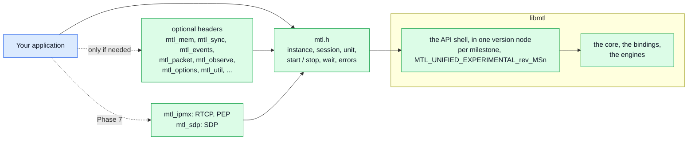
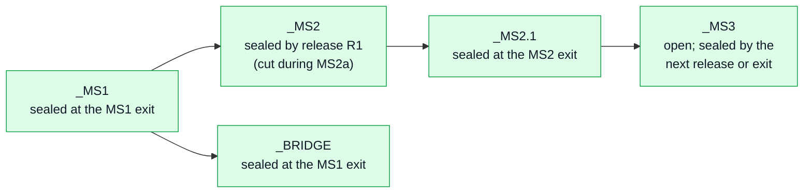
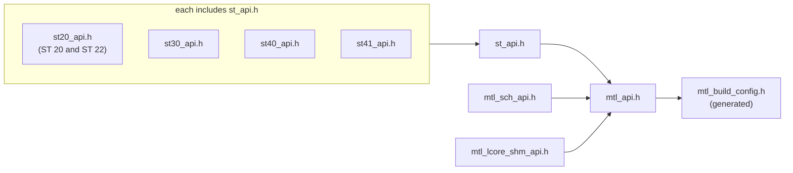
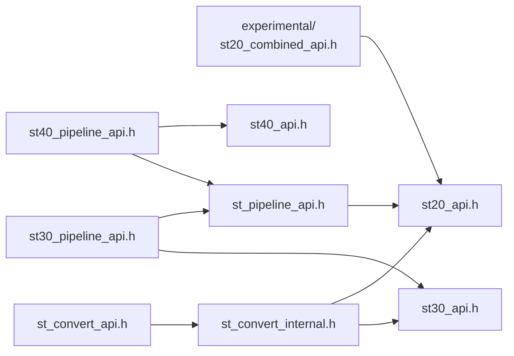
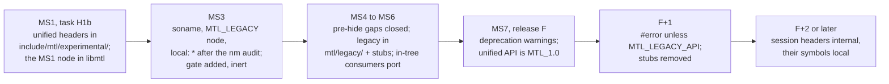

# ABI: the library, its version nodes and the legacy headers

| | |
|---|---|
| Status | The library and ABI plan, the hiding of the legacy headers, and the release and support policy. The headers in [sketch/include/mtl/experimental/](sketch/include/mtl/experimental/) are normative: where this page and a header disagree, the header wins |
| Audience | implementers of the API shell and the export checks, maintainers and release engineers, distributors, and products that ship on the experimental API |

One library, libmtl, exports the unified functions in one symbol version node per milestone. This
page says what today's library promises, how the unified library is versioned and sealed, how a
struct grows, what holds on Windows, how the legacy headers leave the public set, and when each
release stage comes.

**Start here.**

| Job | Sections |
|---|---|
| build or review the export lists, the version nodes and sealing | [§2](#2-the-unified-library), [§3](#3-version-nodes-and-sealing) |
| add a field to a public struct | [§4](#4-struct-compatibility-the-strict-rule) |
| build on Windows | [§5](#5-windows) |
| plan the legacy header stages, or check the pre-hide gate | [§6](#6-hiding-the-legacy-headers) |
| ship a product on the experimental API, or package libmtl | [§7](#7-release-deprecation-and-support-policy), [§2](#2-the-unified-library) |

## 1. Today

There is no ABI promise. `libmtl.so` has no soname version (`lib/meson.build:151-159`: no
`soversion`, `version`, `gnu_symbol_visibility` or version script) and exports everything: 757
dynamic function symbols, 235 of them internal (`mt_*`, `tv_*`, `rv_*`). `ops` structs are copied
with the library's `sizeof` and have no reserved fields, so silent breaks have shipped
(`rl_burst_size` added inside `port_params[]` moved every later field). There are about 30 exported
`_MAX` sentinels and a 64-bit `enum mtl_init_flag`; `mtl_version()` is a string only;
`include/experimental/` has no opt-in; deprecation (`include/mtl_api.h:141-147`) marks fields only.

## 2. The unified library

One library, libmtl, carries both APIs (D-23): the API shell (`lib/src/unified/`) and the core
(`lib/src/st2110/core/`) are compiled into it next to the engines and the legacy wrappers, so
there is no second DSO and no ABI between the core and its callers. pkg-config stays `mtl`.

The picture below is the shape an application sees: it includes `mtl.h`, adds optional headers only
for the jobs it needs, and links libmtl.



`mtl.h` holds the core calls; every optional header includes it (`mtl_util.h` through `mtl_mem.h`
and `mtl_sync.h`) and serves one kind of program ([examples.md §1](examples.md#1-the-headers)), and
no unified header includes a legacy one. The rest is `static inline`: the typed wrappers of the
object verbs `mtl_close`, `mtl_interrupt`, `mtl_wait`, `mtl_reap`, `mtl_read_events`, and of
`mtl_release(s, lease)`, and helpers on public calls. What the version nodes, the exports and the headers
promise is in the table; `sketch/check.sh` prints the functions per header and per milestone.

| Item | Experimental (MS1 to the ABI freeze at MS7) | After the freeze |
|---|---|---|
| library | `libmtl.so`, the API shell and the core inside | the same |
| companion library | `libmtl_sdp.so` (`mtl_sdp.h`), `MTL_SDP_EXPERIMENTAL_<rev>` | its own `MTL_SDP_1.0`, frozen on its own schedule |
| unified symbols | one version node per milestone, `MTL_UNIFIED_EXPERIMENTAL_<rev>_MSn` (MS1: `..._0_2_MS1`), inheriting the previous, continued in parts `_MSn.k`; every node a release carries is sealed; all renamed on every incompatible change ([Sealing](#3-version-nodes-and-sealing)) | `MTL_1.0`; then one `MTL_1.k` per release that adds functions |
| the bridge's symbols | in `_BRIDGE` ([migration.md](migration.md) §6.2) | in `MTL_LEGACY_BRIDGE` |
| exports | a function is exported from the milestone its comment tag and call-class argument name, and the installed header declares the whole design, so a call above `MTL_LEVEL` fails to compile (GCC, Clang ≥ 14) or to link (D-106); a value of an exported call that is not built yet returns `-MTL_ENOTSUP` (`NOT_IMPLEMENTED`) | every function of the frozen set |
| other symbols | today `lib/meson.build:151` has no version script; MS1 (H1b): `lib/src/unified/libmtl.map` holds only the unified nodes, the rest exported as today (no `local: *`), with the export checks; MS3, after an `nm` audit of leaked-symbol users: the soname, the `MTL_LEGACY` node for the legacy headers' functions, then `local: *` (D-108) | `MTL_LEGACY` hidden in stages (§6.3) |
| headers | `include/mtl/experimental/` (`mtl.h` and its optional headers, moved verbatim from `doc/unified-api/sketch/` in MS1; the `MTL_LATER` blocks are installed for design checks only: a call into them fails to compile with GCC and Clang ≥ 14, else to link, and their names may change in any release) | `include/mtl/`; `include/mtl/experimental/<h>` a forwarding stub from F to F+2 (below) |
| debug API | `mtl_debug.h` exists only with `-Denable_debug_api=true`; otherwise `-MTL_ENOTSUP` | same |
| version | `MTL_API_VERSION` (compile time), `mtl_library_version_num()` (runtime), both `MTL_VERSION_NUM(a, b, c)`; today `MTL_VERSION_NUM(0, 2, 0)` | the release |

With the soname of MS3 every consumer relinks once; older binaries bind their unversioned
references to the default versions. Hiding the legacy symbols later removes names from `MTL_LEGACY`
only: a binary that needs one fails at load, and binaries that use only `MTL_1.0` are untouched
(the bridge is in `MTL_LEGACY_BRIDGE`, not `MTL_1.0`), so legacy removal never forces a unified application to relink. On Windows the `.def` is generated
from the exports (`lib/meson.build:122-123`), so hidden visibility shrinks it automatically; legacy
symbols stay exported until F+2. Distribution advice: `libmtl-dev` ships the public headers,
`libmtl-legacy-dev` the legacy headers until F+2 (the DPDK driver-SDK precedent,
`-Denable_driver_sdk`).

**Headers at F.** The unified headers move to `include/mtl/`. `include/mtl/experimental/<h>` stays
as a forwarding stub (`#include "../<h>"`) for every header, `mtl_legacy.h` forwarding to
`../legacy/mtl_legacy.h`, from F to F+2, with a `#warning` (MSVC `#pragma message`) from F+1, and
is removed at F+2; the include guards lose `EXPERIMENTAL_` at F and end in `_` (internal, so not
frozen names) (D-194). `include/meson.build` generates each stub, with the warning lines when
`legacy_stage` ≥ 2; at F itself the stub has none:

```c
/* mtl/experimental/mtl.h - forwarding stub, releases F to F+2: the unified API is
   <mtl/mtl.h> from release F; this path is removed at F+2. */
#if defined(_MSC_VER)
#pragma message("<mtl/experimental/mtl.h> is <mtl/mtl.h> from release F; removed at F+2")
#else
#warning "<mtl/experimental/mtl.h> is <mtl/mtl.h> from release F; removed at F+2"
#endif
#include "../mtl.h"
```

## 3. Version nodes and sealing

Every node a release carries is sealed (`lib/src/unified/exports.<suffix>.list`:
`exports.MS2.list`, `exports.MS2.1.list`, `exports.BRIDGE.list`) and never changes in its
revision. A list's first line is `# <node> rev <rev> sealed <VERSION or "MSn exit">`, then one
name per line, sorted. A release cut while milestone n is open seals its node, and n continues in
`_MSn.1`, `_MSn.2`, …, each part inheriting the node before it (`_BRIDGE` inherits `_MS1`). At most
one part per milestone is open: the last part of milestone `MTL_LEVEL` + 1, where every task adds
its function, and `_BRIDGE` until the MS1 exit. If the last part has a list, the task opens the
next part `.k+1`. A revision change renames every node and merges each milestone's parts into `_MSn`.
`ld.so` checks every version a binary needs at load, also under lazy binding and for `dlopen`, so
it refuses, at load, another revision or a node the library lacks, and a released library never
fails a binary at a call (D-191).

The table below says when a node is sealed.

| Event | What happens |
|---|---|
| milestone exit | the exit commit runs `check_exports.sh --seal`: the open part gets its list; then `MTL_LEVEL` is bumped |
| release | the release commit (the one that sets `VERSION` to `….REL`) runs `check_exports.sh --seal`; `MTL_LEVEL` does not change. A tag also seals by itself: the export check compares HEAD with every tag of the revision |
| revision change | every node is renamed and every list gets the new rev line; the parts of each milestone merge into `_MSn` |
| release F | the `_MSn` nodes merge into `MTL_1.0`, `_BRIDGE` becomes `MTL_LEGACY_BRIDGE`; after F, a release that adds functions ships them in a new `MTL_1.k`, which that release seals (`MTL_LEVEL` 7 + k) |

The table below says what `ld.so` does with a binary.

| Binary linked against | Run on | Result |
|---|---|---|
| release R | R, or a later release of the same revision | loads and runs |
| release R2, using a function of the part `_MS2.1` | release R1, which carries only `_MS2` | refused at load: ``version `MTL_UNIFIED_EXPERIMENTAL_0_2_MS2.1' not found`` |
| any release | a library of another revision | refused at load |
| a `.DEV` build | another build | no guarantee: an open part may lack a function, which then aborts at its first call |

The picture below follows the nodes of one revision through MS1–MS3 with one release cut during
MS2a.



An example `libmtl.map` after release R1 (cut in MS2a), with MS2b work under way. MS1 holds only
the unified nodes, with no `local: *` (D-108):

```text
MTL_UNIFIED_EXPERIMENTAL_0_2_MS1 { global: mtl_last_error; mtl_reason_name; ...; };
MTL_UNIFIED_EXPERIMENTAL_0_2_BRIDGE { global: mtl_instance_from_legacy; } MTL_UNIFIED_EXPERIMENTAL_0_2_MS1;
MTL_UNIFIED_EXPERIMENTAL_0_2_MS2 { global: mtl_session_discard; mtl_log_add_sink; ...; } MTL_UNIFIED_EXPERIMENTAL_0_2_MS1;
MTL_UNIFIED_EXPERIMENTAL_0_2_MS2.1 { global: mtl_session_attach; } MTL_UNIFIED_EXPERIMENTAL_0_2_MS2;
```

No `-z now` is added to `mtl.pc`: sealing makes it unnecessary for releases, and it would impose
bind-now on every consumer's own object (D-191).

## 4. Struct compatibility: the strict rule

- The library reads `min(struct_size, known)` of an input struct; fields beyond the caller's size
  take their defaults, so an old program runs on a newer library.
- `struct_size` 0, or smaller than the first published size, and non-zero bytes beyond the size the
  library knows, are `-MTL_EINVAL` (`NONZERO_TAIL`). Stricter than Win32 `cbSize` on purpose: an
  ignored field the application believes honoured is a silent timing or memory bug. So set a field
  newer than the running library only after checking `mtl_library_version_num()`. An option name the
  running library does not know is `-MTL_EINVAL` (`OPTION_UNKNOWN`) from `mtl_option_find()`, and
  one it knows but does not implement yet is `-MTL_ENOTSUP` (`NOT_IMPLEMENTED`).
- Output structs carry no `struct_size`: the library fills them up to the size argument and zeroes
  what it does not know. Array reads (`mtl_reap`, `mtl_read_events`) take the record size per
  call; their typed wrappers (`mtl_tx_reap`, `mtl_tx_reap_full`, `mtl_session_read_events`) pass
  `sizeof(*r)`.
- Structs grow only at the end; every hole is a named reserved field (`-Wpadded -Werror`); every
  public struct has a C99 size check; enumerated fields are `uint32_t`; flags are plain literals; no
  `_MAX` sentinel is exported.

Why `MTL_INIT(&s)` and not an exported `mtl_<struct>_init(p)` per struct (D-74): an exported init
writes the library's `sizeof` into the caller's object, so on a newer library it zeroes past the
end of an older program's smaller struct (an out-of-bounds write), or, frozen at the old size,
silently ignores new fields. `MTL_INIT` passes the size from the caller's compilation, which is
right across versions. A generic `init(kind, ptr)` is rejected for the same reason: a kind cannot
tell the library the caller's `sizeof`. The zero-default rule leaves nothing to set but the size.
Also rejected: a process-global API-version call (two plugins in one process could not both be
honoured).

## 5. Windows

- **Stance.** The unified headers are one ABI on every OS (D-159). A queue's descriptor is
  a manual-reset event `HANDLE` (from MS2a) in the same `intptr_t`; error codes are `MTL_E*` constants equal to the
  Linux errno values on every OS, also where the UCRT lacks the name (`ESHUTDOWN`, `ESTALE`) or gives
  it another value, so Windows code compares against `MTL_E*` only; values ≥ 1000 are reserved for
  future MTL-only codes. Flags are plain integer literals.
- **Waits (from MS2a).** `WaitForMultipleObjects` takes at most 64 handles; a framework with more
  sessions arms them on one queue, or uses thread-pool waits. Sub-millisecond timeouts round up to 1 ms, and the 15.6 ms tick
  applies unless `timeBeginPeriod` is set.
- **v1 commitment.** A compile-only CI job builds the headers and the examples with MSVC and MinGW.
  Runtime support follows the legacy library's Windows support; two of the eleven open issues at the
  baseline are Windows build failures (#1672, #1301).
- **The ABI on Windows.** `mtl_last_error()` copies thread-local state into caller memory, so no
  `__declspec(thread)` pointer crosses a DLL boundary; `MTL_API` is
  `__declspec(dllexport/dllimport)`. Windows is supported with the DPDK backend only, checked by a
  compile-only CI job. The headers support 64-bit targets only.

## 6. Hiding the legacy headers

Requirement: `include/st20_api.h` and the other session-level headers stop being public, with no
loss of functionality beyond the removals of coverage.md §4.5 (D-83). The deprecation stages run at MS7
(release F) and the two releases after it; the session headers then become internal headers of the
library, which the engines and the core's bindings keep using.

### 6.1 Why they cannot simply stop being installed

They are the vocabulary of every other installed header: `st_pipeline_api.h` includes
`st20_api.h` and uses its types (`st21_pacing`, `st20_fmt`, RTCP ops, detect and timing-parser
meta in `struct st_frame`); the st30 and st40 pipeline headers take `st_tx_port` from it; the plugin
ABI lives in it; GStreamer uses `st20_rx_frame_meta` (`ecosystem/gstreamer_plugin/gst_mtl_st20p_rx.c:140`).
Splitting them is churn on an API slated for deprecation, so the whole legacy set moves as one
tier. The session layer stays the internal engine: the pipelines call `st20_tx_create()`
(`lib/src/st2110/pipeline/st20_pipeline_tx.c:482`), and the core creates its engine sessions the
same way, with the binding's callbacks in the `ops`.

The two pictures below are today's include graph (from [coverage.md §4.1](coverage.md#41-todays-public-header-set),
checked against `include/` at `545a266a`); an arrow means "includes". The first shows the session
headers, which all reach `mtl_api.h`:



The second shows the headers above them, which all reach a session header, so every installed
legacy header reaches `st20_api.h` or `mtl_api.h`:



### 6.2 Three tiers

| Tier | Headers | Installed | Version nodes | Users |
|---|---|---|---|---|
| public | `mtl/experimental/mtl.h` and its optional headers (later `mtl/`) | always; pkg-config `mtl` | `MTL_UNIFIED_EXPERIMENTAL_<rev>_MSn`, then `MTL_1.0` | everyone |
| legacy | today's headers and `mtl_build_config.h`, moved unchanged to `mtl/legacy/` | until F+2; pkg-config `mtl-legacy` adds `-I` and `-DMTL_LEGACY_API=1` | `MTL_LEGACY` (from MS3): `mtl_api.h`, `mtl_sch_*`, the pipelines (`st2xp_*`, `st_frame_*`, plugin ABI v1) and the sessions (`st20_` … `st41_`, `st20rc_`, `st10_*`, per-pair converters) | migrating and in-tree legacy code |
| internal | `lib/include/mtl_internal/`: the session declarations from F+2 | never | none: `local: *`; an `error` attribute unless `MTL_ALLOW_INTERNAL_API` (as DPDK's `__rte_internal`) | the engines, the core's bindings, in-tree tests and tools |

The install layout during the transition puts each tier in its own directory:

| Path | Tier | Version node, or role |
|---|---|---|
| `include/mtl/experimental/mtl.h` and the optional headers | public | `MTL_UNIFIED_EXPERIMENTAL_<rev>_MSn`, then `MTL_1.0` (release F) |
| `include/mtl/legacy/mtl_api.h`, `st_api.h`, `st20_api.h`, … | legacy | `MTL_LEGACY` (from MS3) |
| `include/mtl/legacy/mtl_legacy_gate.h` | legacy | included first by every legacy header; reads `MTL_LEGACY_STAGE` |
| `include/mtl/st20_api.h`, … | stubs | `#include "legacy/st20_api.h"`; removed at F+1 |
| `include/mtl/experimental/mtl_legacy.h` (MS1 to F), `include/mtl/legacy/mtl_legacy.h` (from F) | legacy | `MTL_UNIFIED_EXPERIMENTAL_<rev>_BRIDGE`, `MTL_LEGACY_BRIDGE` from F |
| `include/mtl/experimental/*.h` (F to F+2) | stubs | `#include "../<h>"`; a `#warning` from F+1; removed at F+2 |
| `lib/include/mtl_internal/` | internal | session declarations from F+2; never installed; `local: *` |

One legacy node: `readelf -V` shows that a binary uses the legacy API and `nm -D` which symbols,
which the survey of private users before the freeze can ask for instead of source. The pipelines
may leave later than the session layer: hiding goes by symbol list, not by node.

### 6.3 Stages

The picture below is the order of the stages, from the unified headers of MS1 to the internal
session headers of F+2; the table after it says what each stage changes and what it asks of
consumers.



| Stage | When | Headers and symbols | Consumers |
|---|---|---|---|
| A | MS3 | the soname and the `MTL_LEGACY` node (D-108), then `local: *` after the `nm` audit; the gate and `MTL_LEGACY_DEPRECATED` added but inert; the convert `static inline` wrappers become exported, so `st_convert_internal.h` leaves the installed set | the FFmpeg flag fix (frameworks.md §2.2); gate: legacy KahawaiTest and acceptance pass, no `mt_*` in `nm -D` |
| B | before MS7 | legacy files in `mtl/legacy/` with forwarding stubs (`mtl/st20_api.h` includes `legacy/st20_api.h`) and an extra `-I` in `mtl.pc`; `mtl-legacy.pc`; an in-tree `mtl_legacy_dep` (the unified headers are installed from MS1) | no source change: `<mtl/st20_api.h>` and `<st20_api.h>` still resolve |
| — | MS2–MS6 | the pre-hide gaps closed (coverage.md §4.4); the legacy pipelines become wrappers on the core (st20p MS2, the others MS4); plugin ABI v2 in MS4 | in-tree consumers port (migration.md §9; the framework plugins in MS6) |
| F | MS7 (release F) | `MTL_LEGACY_STAGE 1`: deprecation attributes on every legacy prototype; `#warning` (MSVC `#pragma message`) unless `MTL_LEGACY_API`; the unified API becomes `MTL_1.0`; the unified headers to `mtl/`, `mtl_legacy.h` to `mtl/legacy/` (below) | warnings; release notes map every legacy symbol; every in-tree consumer builds without `MTL_LEGACY_API` |
| F+1 | the next release (its LTS branch, §7) | `MTL_LEGACY_STAGE 2`: `#error` unless `MTL_LEGACY_API`; stubs removed; the unified stubs warn; `mtl.pc` public only | legacy only via `mtl-legacy.pc` |
| ≥ F+2 | two releases and 12 months after F, or later (§7) | `-Dlegacy_headers=false`; session headers to `lib/include/mtl_internal/`; their functions leave `MTL_LEGACY` for `local: *` (a binary needing one fails at load; no soname bump); plugin v1 loader removed; the pipeline headers then or later (set at the MS4 exit) | in-tree code on the internal dependency (libmtl's objects) |

The unified headers and the bridge go through the stages too. At F the unified headers move to
`mtl/`, with forwarding stubs at `mtl/experimental/` (§2, D-194), and `mtl_legacy.h` moves to
`mtl/legacy/` with the gate, its node renamed `MTL_LEGACY_BRIDGE`. From F+1 the unified stubs warn.
At ≥ F+2 the unified stubs are removed, and the bridge (`MTL_LEGACY_BRIDGE`, `mtl_legacy.h`) leaves
with `mtl_init` (D-190).

Removal comes no earlier than two `vYY.MM` releases after deprecation and 12 months after F (D-69, §7). The legacy session
layer is bugfix only from F and is never deleted, only moved to the internal tier; no legacy
struct layout changes before F+2, and from F+2 it is the internal engine interface, free to
change ([core.md §1.1](core.md#11-the-end-state-after-f2), D-178). Stages A and B are not values of `MTL_LEGACY_STAGE`, which is 1 from F and 2 from F+1. The gate is `mtl/legacy/mtl_legacy_gate.h`, included first by
every legacy header: it reads `MTL_LEGACY_STAGE` from `mtl_build_config.h`, is silent inside the
library (`__MTL_LIB_BUILD__`) and for Python (`__MTL_PYTHON_BUILD__`), and is silenced by
`MTL_LEGACY_NO_DEPRECATION_WARNINGS`.

- Every legacy prototype gets `MTL_LEGACY_API_FN` = `MTL_LEGACY_DEPRECATED("…") MTL_API` (the
  export macro of stage A): about 370 prototypes, a scripted, reviewable diff; it and the gate
  include are the only edits inside the legacy headers. `MTL_LEGACY_DEPRECATED` expands to
  `__attribute__((deprecated(msg)))` from release F (`MTL_LEGACY_STAGE 1`), except inside the library, for Python, or with
  `MTL_LEGACY_NO_DEPRECATION_WARNINGS`; bindgen ignores it.
- During the transition `mtl.pc` emits `-I${includedir} -I${includedir}/mtl
  -I${includedir}/mtl/legacy`: the bare `<st20_api.h>` resolves through the legacy directory,
  `<mtl/st20_api.h>` through the forwarding stub. `mtl-legacy.pc` adds `-DMTL_LEGACY_API=1` and
  `Requires:` the engine library, so a consumer opts in once in its build file. The move is an API
  change only for consumers that hard-code `-I…/include/mtl` paths without pkg-config.
- The internal guard `__mtl_internal` is `__attribute__((error("MTL internal API")))` unless
  `MTL_ALLOW_INTERNAL_API`, exactly as DPDK's `rte_compat.h:35-53`; the in-tree internal dependency
  defines it.

**Build and CI.** Meson options `legacy_headers` (default `true` up to F+1) and `legacy_stage`.
CI compiles the public headers with only the public include directory, so no legacy type leaks
in; a legacy-coverage check blocks release F unless every symbol of the `MTL_LEGACY` node is mapped here or
is one of the removals of coverage.md §4.5; an `MTL_LEGACY_STAGE 2` job builds every in-tree consumer without `MTL_LEGACY_API` before
F+1. In-tree legacy code (unit and fuzz tests, `app/perf`, `app/tools`, the frozen trees) uses
`mtl_legacy_dep`, later `mtl_internal_dep`; `lib/src` needs one include-path change.

### 6.4 Pre-hide gate

Every feature reachable only through the session headers needs a unified home, or is one of the
removals of [coverage.md](coverage.md) §4.5, before F. Of the 19 such features, 16 have a home in
the headers and a milestone, 1 has no milestone yet (H-15, under `MTL_LATER`), and 2 are removed;
the gaps, their homes and their milestones are [coverage.md](coverage.md) §4.4.

The alternatives rejected for hiding the legacy headers:

| Rejected | Why |
|---|---|
| `#ifdef` guards in installed headers | anyone can `-D` them; the ABI promise does not shrink |
| splitting `st20_api.h` | churn on an API slated for deprecation ([§6.1](#61-why-they-cannot-simply-stop-being-installed)) |
| a separate `libmtl_legacy.so` | the engine calls the same functions internally, so `lib/src` would need renames; version nodes give the same audit and removal |
| a separate unified library | D-23: a second DSO needs an ABI between the core and its callers |
| shimming session callbacks, slice and RTP modes | latency |

## 7. Release, deprecation and support policy

Tags follow `vYY.MM` (v25.02, v25.12-rc1, v26.01; PR #1768 prepares v26.09).

**Before the freeze.** The unified API ships inside libmtl in symbol version nodes per milestone,
`MTL_UNIFIED_EXPERIMENTAL_<rev>_MSn`, and `_MSn.1`, `_MSn.2`, … when releases are cut while
milestone n is open. All nodes are renamed together on every incompatible change, a new revision.
Nodes are sealed (§3), so `ld.so` refuses at load a binary linked against another revision, or one that needs a
node the library lacks (an older release), and a binary never fails at a call for a missing
function. `MTL_LEVEL` in `mtl.h` names the last milestone whose exit passed. There is no
compatibility promise across revisions and no deprecation period for the unified API before the
freeze. libmtl itself gets a soname and the `MTL_LEGACY` node in MS3.

**Shipping before MS7.** A product may ship on the experimental API. Five rules keep it from
failing in the field:

1. **Link against a release, never a `.DEV` build.** A binary linked against release R loads on R
   and on every later release of the same revision. `ld.so` refuses, at load, an older release or
   another revision. A `.DEV` build carries an open node without that guarantee.
2. **Require that release.** Ship libmtl with the product, or require the package at R or later and
   check the revision in the release notes; a revision change is refused at load, never
   misbehaves.
3. **Build with `MTL_TARGET_LEVEL`** at the release's `MTL_LEVEL`. Use `MTL_LEVEL + 1` only to call
   the open milestone's functions that this release exports; the link fails for those it lacks.
4. **Check at start.** Log `mtl_library_version_num()`. A value of an exported call (a flag, an
   option key) that the running library does not build yet returns `-MTL_ENOTSUP`
   (`NOT_IMPLEMENTED`), so a product checks the values it depends on at start
   (`mtl_session_query` for a configuration), not in the middle of a stream.
5. **Relink at a revision change and at F.** Not on every release. At F the experimental nodes
   become `MTL_1.0` (one relink), and `<mtl/experimental/…>` keeps compiling until F+2 through
   forwarding stubs (§2).

**Targets.** The maintainer publishes, in this section and in the release notes of the MS3
release, the `vYY.MM` of three releases:

| Stage | Release | No earlier than |
|---|---|---|
| F: the `MTL_1.0` freeze (MS7); the legacy APIs deprecated | `<vYY.MM of F>` | `<YYYY-MM>` |
| F+1: the last release that installs the legacy headers through `mtl.pc` | `<vYY.MM of F+1>` | the release after F |
| F+2: the legacy session API leaves the public set (§6.3) | `<vYY.MM of F+2>` | `<YYYY-MM>`, at least 12 months after F ships |

1. **Never earlier.** A published target may move later, announced at least one release ahead;
   it never moves earlier, also when the work is early.
2. **Calendar floor.** F+2 ships no earlier than 12 months after F, however many releases fall
   between; this adds a time floor to the two-release rule of D-69.
3. **Slip rule.** F moves to a later release whenever, at that release's feature freeze, the
   pre-hide gate (§6.4), the legacy-coverage check (§6.3) or the
   external review of MS7 is not green. When F moves, F+1 and F+2 move with it, so that F+1 is a
   later release than F and F+2 keeps its 12-month floor; the new targets are published in the
   release notes of the release that would have been F.
4. **Notice.** The release before F lists every legacy symbol the deprecation covers with its
   unified home (the output of the legacy-coverage check), and asks private users for their
   `readelf -V` and `nm -D` reports.

**Deprecation.** At F the unified API becomes `MTL_1.0`, and the legacy APIs it replaces carry
`MTL_LEGACY_DEPRECATED` and a release-note entry. A deprecated legacy API is removed no earlier
than two `vYY.MM` releases after the one that deprecated it and no earlier than the F+2 floor
above, only when the migration map ([migration.md](migration.md)) covers every in-tree use, and
the maintainer signs off. Removal moves the session headers to the internal tier; no legacy struct
layout ever changes.

**Long-term support.** F+1 gets a `vYY.MM.x` branch, maintained until `<YYYY-MM>`: at least
24 months after F+1 ships and at least 12 months after F+2 ships. The branch pins one DPDK LTS and
one ICE driver in `versions.env`, changed only for a security fix or a build break on a supported
kernel. It never gains a symbol: no `MTL_1.1` node and no new legacy function. After F+2 the legacy
session API is internal, and this branch is its only public maintenance until it ends.

**Backport scope**, on the LTS branch (legacy API and `MTL_1.0` alike) and on the legacy session
layer from F:

- security fixes (MtlManager, deployment.md §1.6; import validation, deployment.md §1.1);
- crashes, hangs and memory corruption;
- data-plane correctness fixes: on the legacy API behind its legacy opt-in flags only, so no
  default changes on the wire (D-24); on `MTL_1.0` as on the main branch, within its documented
  behaviour;
- build fixes for supported compilers and kernels;
- no features and no new symbols.

Every release note lists the legacy opt-in flags the engine work added, and which may become
default at the freeze. From F the legacy session-level APIs (`st20_*`, …) take bugfixes only.
