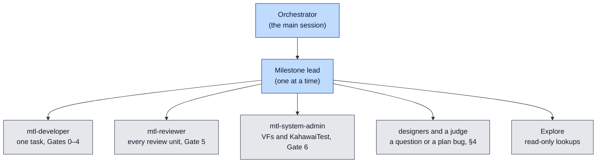

# The autonomous implementation run

| | |
|---|---|
| Status | How the unified API is implemented from MS1 to MS7 by agents, with no maintainer available. Where it differs from the process rules of [implementation-plan.md](implementation-plan.md) (the checkpoints, the stop-and-ask list, the maintainer's approvals), this page wins for the run; the plan's scope, tasks, tests and budgets stand |
| Ledger | [run-status.md](run-status.md) (the run), [ms1-status.md](ms1-status.md) and one `msN-status.md` per later milestone |
| Branch | `unified-api-impl` on the fork remote `sakoram`, from the doc-set commit on `unified-api-design` |

## 1. The goal

The run implements every milestone of [implementation-plan.md](implementation-plan.md) §1.2 in
order (MS1, MS2a, MS2b, MS3, MS4a1, MS4a2, MS4b, MS5, MS6, MS7), with the Kubernetes track
(implementation-plan.md §6.8) beside them. Each milestone ends when its exit criteria pass on this
machine: the unit tier, `UnifiedKahawaiTest` and the frozen `KahawaiTest` on VFs, the acceptance
smoke set, the legacy gate (implementation-plan.md §8.5) and the budgets of implementation-plan.md
§8.4. Phase 7 follows MS7 if the run gets there. The run ends with the unified API implemented and
tested and a final report in [run-status.md](run-status.md) §5.

Nobody answers questions during the run. Every question is answered by the documents, or by the
procedure of §4.

**R0, before MS1: re-pin to the new base.** The documents pin every `path:line` to `main` at the
README's Baseline commit, but `unified-api-design` was rebased onto a later `main`. The commits
since that baseline (`git log <baseline>..main`) include fast metadata becoming an opt-in of the
ST40 sessions (`include/st41_api.h` is gone; this touches MS4a1's fastmeta binding, coverage.md
and migration.md), the blocking-get wake fixes of the pipelines (waiting, the st20p re-base) and
RX video copy changes. One lead (large model) audits those commits against
[legacy-internals.md](legacy-internals.md), [engine.md](engine.md), [pr1610.md](pr1610.md),
[coverage.md](coverage.md), [migration.md](migration.md) and the task cards. A stale fact or
citation is fixed in place. A change that alters the design goes through §4. Then the lead moves
the README's Baseline row to the new base. R0 is one reviewed docs commit (or a short series)
with `sketch/check.sh` green, and its row in [run-status.md](run-status.md) §2.

## 2. Roles



- **The orchestrator** stays thin. It never reads code or whole documents. It starts one
  milestone lead (a `general-purpose` agent with the large model), waits for it, checks the exit
  evidence itself (the exit command in Bash, the ledger rows, `git log`), pushes, updates
  [run-status.md](run-status.md) and starts the next lead. It repairs the host through
  `mtl-system-admin` when a lead reports the host broken.
- **A milestone lead** owns its milestone's ledger. It runs the tasks in the plan's order with the
  task card of implementation-plan.md §5.8, at most two developer tasks in flight. It reviews,
  commits and pushes each review unit (§5), and answers questions by §4. Its reports to the
  orchestrator are short (under 300 words): what landed, the evidence, the decisions taken, and
  what is blocked.
- **The repository's agents** keep their rules (`.github/claude/agents/`, the repository
  `CLAUDE.md`): `mtl-developer` writes the code and its tests, `mtl-reviewer` gives the verdict
  over the saved diff, and `mtl-system-admin` runs KahawaiTest through MCP only. pytest runs from
  the lead's own shell. The lead commits, not the developer.
- **Nobody may wait for a human.** `mtl-planner` and a designer are told in their prompt that there
  is no user: never call `AskUserQuestion`; the guardrails and acceptance criteria are the
  documents and this page, and a question they cannot answer goes back to the lead for §4.
  Designers are `general-purpose` agents unless the work is planning a milestone's task order.
  `mtl-commit`'s "only when asked" and "do not push" are overridden by the standing permission
  of [ms1-status.md](ms1-status.md) §0: the push is the lead's next step after the skill.
- Before MS2a starts, the orchestrator creates `msN-status.md` for the next milestone with the
  shape of [ms1-status.md](ms1-status.md) (§1 tasks, §2 gates, §3 decisions, §4 measurements) and
  links it from [run-status.md](run-status.md) §2.

## 3. What replaces the maintainer

| The plan says | In the run |
|---|---|
| the maintainer approves a review unit, a checkpoint (C0, a milestone exit) or a config diff | `mtl-reviewer` APPROVE on the unit is the approval. A checkpoint also gets one large-model `mtl-reviewer` pass over its whole commit range against the checkpoint's criteria |
| stop and ask (implementation-plan.md §5.8: a public header change, a new D-row, an engine diff above the threshold, a red legacy gate) | a header change or a new D-row goes through §4. A large engine diff is split into a series. A red legacy gate is never committed: fix it, or revert to the last green commit |
| the questions of ms1-status.md §3.1, and the items "to confirm" in §3.2 | each takes its recommendation, or the design as written, and is marked "taken in the run" in the Answer or Confirmed column |
| review units a week, the calendar, the days of a gate | do not apply; the exit criteria end a milestone. The WIP limit is at most two developer tasks in flight |
| nights, a night's run, burn-in | a night is one full run of the job on this machine; burn-in is the plan's count of consecutive green runs. Gate 6 runs and measurements never share the VFs |
| the jobs run on a maintainer's pull request (P1) | the same commands run locally, and their output is the evidence. The run opens no pull request |
| the Claude Code session restarts after P0 | P0's agent rules take effect at the next restart. Until then the lead puts the new rules into each agent's prompt. A Gate 6 that needs a new MCP parameter runs the script that the MCP tool wraps, from the lead's shell |
| any other approval the plan names: the rule-file change of the MS2a black-fill commit, a frozen-tree bugfix, the header batches, P0's config diffs | the lead states in the agent prompts that the approval is granted in the run, `mtl-reviewer` APPROVE on the unit is the approval, and the commit message says "approved in the autonomous run". Header changes are batched per review unit, not weekly |
| a release or a person outside the run: the MS7 external review and the questionnaire, the release targets of OI-75, the deprecation releases F+1 and F+2, the EBU LIST server | goes to [run-status.md](run-status.md) §4 (blocked outside the run). The run prepares everything up to the hand-off, the review package and the commits, and continues with the next item that does not depend on it |

## 4. Questions and plan bugs

A plan item stands unless it is wrong: a contradiction between documents, a test or model that
proves a rule false, a number that does not hold on the hardware, or code that the plan
misdescribes (legacy-internals.md and engine.md cite `path:line` at `main`'s baseline). Taste is
not a bug.

1. **Look it up.** The lead (or an Explore agent) searches the documents. If the plan answers it,
   follow the plan.
2. **Design.** If the plan doesn't answer it, or the item is wrong, start two or three designers
   in parallel (large model). Each gets the same problem, constraints and test oracle, and is told
   the others' directions so their approaches differ. Each must prove its proposal with a failing
   test, a model run or a measurement.
3. **Judge.** One adversarial reviewer (large model) compares the candidates on the same evidence
   and picks one, a merge or none. It then tries to break the pick. The smallest change that
   fixes the bug wins; never widen a milestone's scope.
4. **Record.** The fix lands in the documents in the commit that needs it, with a D-row marked
   "Taken in the autonomous run (date, D-245); to confirm by the maintainer" (decisions.md §1 gives
   the format and the next free ID), and with a row in
   [run-status.md](run-status.md) §3.
5. **Continue.** The lead goes on with the tasks that do not depend on the question while it is
   open.

**Loops end.** A task with two `mtl-reviewer` BLOCKER rounds is split (implementation-plan.md
§5.8). A milestone is marked blocked in [run-status.md](run-status.md) §2, with its evidence in
§4 there, after any of: a second split of the same task, a third failed attempt at a red gate, or
an exit criterion that still fails after two cycles of this procedure. The orchestrator then
starts the next milestone whose dependencies are met; a later one that depends on the blocked
item stays todo. When no milestone can start, the orchestrator writes the final report and stops.

A settled D-row is superseded only when steps 2 and 3 show a better design with evidence; the new
row names the old. The repository's quality rules (`.github/copilot-instructions.md`, the C rules)
never bend for a deadline.

## 5. Git

- **Branch.** All work goes on `unified-api-impl`. A worktree for a second task gets its own
  build directory and never runs `ninja install` (implementation-plan.md §5.8).
- **Commits.** Each review unit is committed through the `mtl-commit` skill once Gate 5 is APPROVE
  and Gate 6 has run where marked, with `git commit -s`. Never add AI attribution or a
  `Co-Authored-By` trailer. Doc fixes, ledger updates and the run's own process changes are
  commits too: commit every important step, so an interruption loses at most one task.
- **Push.** After every commit (task or ledger): `git push sakoram unified-api-impl`. Never
  force-push, never push to `origin`, never push another branch, never open a pull request.
- **Never commit** `standards/` (copyrighted, in `.git/info/exclude`), build trees, logs or
  secrets. Never print an environment variable or a key unmasked.
- **Guards.** Local git hooks enforce these rules on every commit and push, whoever runs git:
  `commit-msg` rejects AI attribution and a missing `Signed-off-by`; `pre-commit` rejects
  `standards/`, build trees, status dumps, files over 2 MB and secret-looking lines, then runs
  `./checkpatch.sh --staged` (the repository's lint, as CI runs it); `pre-push` allows only a
  fast-forward of `unified-api-impl` to `sakoram`. A Claude Code `PreToolUse` hook
  (`.git/autonomous-run/bash-guard.py`, enabled with the denial of `AskUserQuestion` by the
  gitignored `.github/claude/settings.local.json`) blocks bypassing the hooks, force pushes, pull requests
  and printing the environment. A rejected commit is fixed, never forced through: the run never
  uses `--no-verify` or edits the guards. When `checkpatch` reformats a file, review the change,
  stage it and commit again.
- **Docs stay true.** A commit that changes what a document says passes
  `doc/unified-api/sketch/check.sh`, and from H1b the exit command of implementation-plan.md §5.8.

## 6. Agents and models

The maintainer's rule for the run (2026-10-16): **Opus 5.5 does the work.** Every job that needs
logic or judgement runs on Opus 5.5: the leads, the designers and the judges, every
`mtl-developer` and `mtl-reviewer` call, reading code to understand it, and diagnosing a failing
test. Pass `model: "opus"` explicitly on every Agent call, also to `mtl-system-admin`, whose own
setting is `haiku`, when it must interpret a failure. A smaller model is allowed only for a
purely mechanical job with nothing to decide:

| Job | Model |
|---|---|
| everything that needs thinking (the default) | `opus` |
| a grep, a count, a link or anchor check, copying text verbatim, "is X still used" | `haiku`, or Bash yourself |
| running a known `mtl-system-admin` tool and returning its output | its own (`haiku`) |

This overrides the cost rules of the global `~/.claude/CLAUDE.md` (Sonnet for single-file reviews)
for the run. Cost is still saved by scope: give every agent a narrow task, tell it to read by
section (`sed -n`, grep) and not whole files, re-review only the delta since the last verdict
(save an interdiff), and run lints, builds and scripts yourself with Bash.

## 7. Interruptions

- Everything the run knows lives in git, [run-status.md](run-status.md) and the milestone ledger.
  Scratch notes go to `/home/labrat/wip/unified-api-impl/`, never only to `/tmp`.
- **On resume** (a new session, a restart, a reboot): read this page, [run-status.md](run-status.md),
  the current milestone's ledger and `git log --oneline -20`. Then SendMessage the agents that
  [run-status.md](run-status.md) §2 lists as running; start a new lead only for an agent that is
  gone, and tell it to resume from its ledger. The orchestrator records each lead's agent ID in
  §2 when it starts it.
- **Never stop a working agent.** Ask it first for a short report of what it has found, written to
  a file; stop it only after that.
- **An API error** (a refused model, a rate limit, an expired token) is not a failure of the work:
  wait (`sleep` in Bash, doubling from a minute up to ten), then resume the same agent by
  SendMessage. After an hour of errors, record it in [run-status.md](run-status.md) §2 and keep
  retrying hourly.
- **After a reboot**, `mtl-system-admin` runs `setup_after_reboot_auto` before any VF test.

## 8. This machine

The state when the run was prepared (2026-10-16):

| | |
|---|---|
| NIC | Intel E830-CC, PFs `0000:15:00.0` and `0000:15:00.1`, VFs on `0000:15:01.x` and `0000:15:11.x` bound for DPDK; `run_gtest` picks `0000:15:01.0` and `0000:15:01.1`. A second NIC has VFs on `0000:c9:01.x` and `0000:c9:11.x` |
| Memory | 2 MB hugepages configured (`mtl-system-admin` `hugepages_get`); PTP clocks `/dev/ptp0`, `/dev/ptp1` |
| Root | `sudo` works without a password |
| Baseline | `./build.sh` green, `./build.sh unit` 959 passed and 1 skipped, KahawaiTest `St20p*` 44 of 44 on the VFs, all at the doc-set commit |
| MtlManager | this tree's, started by `mtl-system-admin` `manager_start`; the other clones' managers were stopped. Never edit another clone (`/home/labrat/Media-Transport-Library`, `/home/labrat/mtl-3`) |
| Acceptance | `/mnt/media` mounted; `tests/acceptance/venv`; the `.local_install` tree of the repository `CLAUDE.md` |
| Disk | `/` was 89 % full: delete stale build trees of finished worktrees and keep at least 20 GB free |
| Doc tools | `/home/labrat/wip/unified-api-impl/tools/`: `diag/mmcheck.py --dark <files>` renders the mermaid blocks, `linkcheck.py`; markdownlint is `~/.npm/_npx/0eb49c4b924aad8b/node_modules/.bin/markdownlint -c .github/linters/.markdown-lint.yml` |

**One build tree, two prefixes.** `build/` serves both install trees: `./build.sh` installs to its
configured prefix, and the acceptance setup (`.github/scripts/acceptance_setup_base.sh`) rebuilds
it with the `.local_install` prefix, which then sticks. A later `./build.sh` installs `libmtl` into
`.local_install` while `build/tests` keeps compiling against the old headers in `/usr/local`, and
KahawaiTest fails to build or tests stale code. After every acceptance build, run
`meson configure build -Dprefix=/usr/local` before the next `./build.sh`.

Check the host before MS1 starts: `mtl-system-admin` `status_report`, and record the result in
[run-status.md](run-status.md) §1.

## 9. Starting and restarting

The maintainer starts the run from `/home/labrat/mtl-2` on `unified-api-impl`, in a Claude Code
session whose permission mode runs tools without prompting, with this prompt. The same prompt
restarts it after an interruption:

```text
You are the orchestrator of the autonomous unified API run. Nobody will answer questions.
Read doc/unified-api/autonomous-run.md, then doc/unified-api/run-status.md, and follow them
until run-status.md §5 (the final report) is written: resume or start the next milestone lead,
verify its exit evidence yourself, commit and push each step to sakoram unified-api-impl.
Stay thin: never read code or whole documents yourself; delegate. Never stop a working agent.
```
