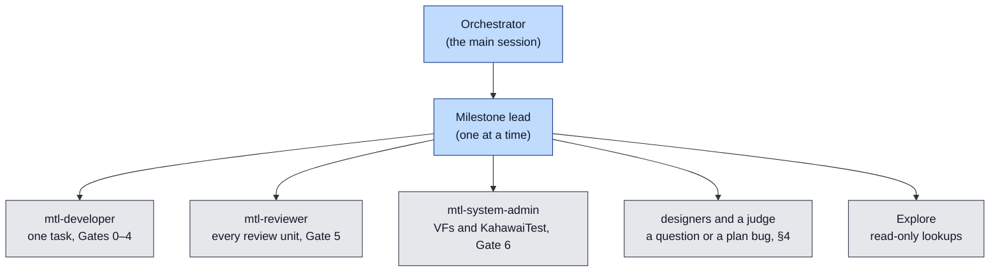

# The autonomous implementation run

| | |
|---|---|
| Status | How the unified API is implemented from MS1 to MS7 by agents, with no maintainer available. Where it differs from the process rules of [implementation-plan.md](implementation-plan.md) (the checkpoints, the stop-and-ask list, the maintainer's approvals, the calendar), this page wins for the run; the plan's scope, tasks, tests and budgets stand |
| Ledger | [run-status.md](run-status.md) (the run), [ms1-status.md](ms1-status.md) and one `msN-status.md` per later milestone |
| Branch | `unified-api-impl` on the fork remote `sakoram`; its base is recorded in [run-status.md](run-status.md) when R0 starts |

## 1. The goal

The run implements every milestone of [implementation-plan.md](implementation-plan.md) §1.2 in
order (MS1, MS2a, MS2b, MS3, MS4a1, MS4a2, MS4b, MS5, MS6, MS7), with the Kubernetes track
(implementation-plan.md §6.8) beside them. Each milestone ends when its exit criteria pass on this
machine: the unit tier, `UnifiedKahawaiTest` and the frozen `KahawaiTest` on VFs, the acceptance
smoke set, the legacy gate (implementation-plan.md §8.5) and the budgets of implementation-plan.md
§8.4. The run ends with the unified API implemented and tested and the final report in
[run-status.md](run-status.md) §5. Nobody answers questions during the run: the documents answer
them, or the procedure of §4 does.

MS7 lands in the run what needs no outside party: the deprecation warnings, every in-tree consumer
built without `MTL_LEGACY_API`, and the package for the external review. The `MTL_1.0` freeze and
the hiding stages need that review (implementation-plan.md §6.6). They are prepared as commits under
`/home/labrat/wip/unified-api-impl/ms7/` and listed in [run-status.md](run-status.md) §4, and MS7
ends "done with exceptions". Phase 7 starts after the freeze, so it is not part of the run.

Two steps come before MS1.

- **R0: re-pin to the new base.** The documents pin every `path:line` to `main` at the README's
  Baseline commit (`545a266a`), but `unified-api-design` was rebased onto a later `main`. The
  commits since include fast metadata becoming an opt-in of the ST40 sessions (`include/st41_api.h`
  is gone; this touches MS4a1's fastmeta binding, coverage.md and migration.md), the blocking-get
  wake fixes of the pipelines (waiting, the st20p re-base) and RX video copy changes. The lead
  maps each citation mechanically, with a script over the `git diff <baseline> <base>` hunks kept
  in `/home/labrat/wip/unified-api-impl/tools/`. It then gives one agent per document only the
  citations inside changed hunks. A stale fact or citation is fixed in place; a change that alters
  the design goes through §4. Every document that names the baseline moves to the new base
  together. R0 is a short series of docs commits, each with `sketch/check.sh` green, reviewed as
  one unit.
- **L0: the legacy baseline.** Run the whole legacy gate (implementation-plan.md §8.5) once at the
  base commit, on the NICs of §8. Record each red or skipped case in [run-status.md](run-status.md)
  §1 as the known-red list. A case on that list is not a regression, unless it fails in a
  different way.

## 2. Roles



- **The orchestrator** stays thin. It reads this page and [run-status.md](run-status.md), never
  code or other whole documents. It starts one lead at a time (§9 has the prompt), waits for it,
  and checks the evidence of each lead's report itself: the ledger rows, `git log`, and at a
  milestone exit the exit command, in Bash. It records the result in
  [run-status.md](run-status.md) and starts the next lead. After every report it reads §2–§5 of
  this page again, because a compacted context drops rules.
- **A milestone lead** is "the main session" of implementation-plan.md: P0, S0, M0, pytest and
  every main-session task are its own work or work of an agent it starts. It owns its milestone's
  ledger and runs the tasks in the plan's order with the task card of implementation-plan.md §5.8,
  at most two developer tasks in flight. It reviews, commits and pushes each review unit (§5) and
  answers questions by §4. Its report to the orchestrator is under 300 words: what landed, the
  evidence, the decisions taken, and what is blocked. The leads of MS1–MS3 also run the
  Kubernetes track in their second developer slot, EK1, EK2, EK6 and EK7 first, with its rows in
  their own ledger. The EK rows still open at the MS3 exit move to the MS4a1 lead.
- **A milestone after MS1** starts with its ledger. Its lead creates `msN-status.md` with the
  shape of [ms1-status.md](ms1-status.md). §1 gets one row per task: the task tables of
  implementation-plan.md §6, and each bullet there without a task as one or more tasks under the
  commit cap (D-107), in dependency order. `mtl-reviewer` checks the rows against the milestone's
  exit criteria and G-ids. The lead commits the ledger, links it from
  [run-status.md](run-status.md) §2, and then starts the first task.
- **The repository's agents** keep their rules (`.github/claude/agents/`, the repository
  `CLAUDE.md`): `mtl-developer` writes the code and its tests, `mtl-reviewer` gives the verdict
  over the saved diff, and `mtl-system-admin` runs KahawaiTest through MCP only. pytest runs from
  the lead's own shell. The lead commits, not the developer.
- **Nobody waits for a human.** Every prompt to a planner or a designer says that there is no
  user: the guardrails and acceptance criteria are the documents and this page, and a question
  they cannot answer goes back to the lead for §4. Designers are `general-purpose` agents.
  `mtl-commit`'s "only when asked" and "do not push" are overridden by the standing permission of
  [ms1-status.md](ms1-status.md) §0: the push is the lead's next step after the skill.
- **Waiting.** The orchestrator starts each lead with `run_in_background: true`, records the
  lead's ID in [run-status.md](run-status.md) §2 and ends its turn; the lead's notification wakes
  it. It never writes the final report while a lead runs. A lead calls its own agents with
  `run_in_background: false` (two in flight are two calls in one message), and never ends its
  turn while one of them runs. A job longer than nine minutes (S0, a nightly, a capacity search)
  runs as a background Bash call with a log under `/home/labrat/wip/unified-api-impl/logs/`. During a
  measurement or a nightly (§3) the lead does only work that needs no build, test or VF
  (reviews, documents, task cards). It checks the job with `sleep 540` and a `tail`, and returns
  only with the job's result.
- **Hand-off.** A lead returns "hand-off: next <task>" after eight review units, or sooner when
  its context grows heavy, after it has updated the ledger, committed and pushed. The orchestrator
  starts a fresh lead for the same milestone with the same prompt.

## 3. What replaces the maintainer

| The plan says | In the run |
|---|---|
| the maintainer approves a review unit, a checkpoint (C0, a milestone exit) or a config diff | `mtl-reviewer` APPROVE on the unit is the approval. A checkpoint also gets one Opus 5.5 `mtl-reviewer` pass over its whole commit range against the checkpoint's criteria |
| stop and ask (implementation-plan.md §5.8: a public header change, a new D-row, an engine diff above the threshold, a red legacy gate) | a header change or a new D-row goes through §4. A large engine diff is split into a series. A red legacy gate is never committed: fix it, or revert to the last green commit |
| the questions of ms1-status.md §3.1, and the items "to confirm" in §3.2 | each takes its recommendation, or the design as written, and is marked "taken in the run". A question with neither goes to §4 when its task reaches it |
| any other approval the plan names: the rule-file change of the MS2a black-fill commit, a frozen-tree bugfix, the header batches, P0's config diffs | the lead says in the agent prompts that the approval is granted in the run; `mtl-reviewer` APPROVE on the unit is the approval, and the commit message says "approved in the autonomous run". Header changes are batched per review unit, not weekly |
| review units a week, the calendar, the day gates and their "If missed" cuts, H1b's day-5 valve, the slip orders of §6 | do not apply: the exit criteria end a milestone, and no task is cut for time. The size valves (a part over the cap) stand. The WIP limit is two developer tasks in flight |
| the stretch tasks A2b, B3 and X, written in MS1 and committed in MS2a | are the first tasks of MS2a |
| the ledger states "committed" (waiting for the maintainer) and "done" (approved) | a task is done once its review unit has APPROVE and is committed and pushed; "committed" is unused |
| M0 and any docs commit the plan puts on `unified-api-design` | lands on `unified-api-impl` |
| nights, a nightly, burn-in | counted in runs, not days: see **Nightlies** below. Gate 6 runs and measurements never run at the same time |
| a measurement on a quiet host | it runs on the E810 and NUMA node 1 (§8), only while no developer task, build or Gate 6 runs. A metric that fails the A/A rule after one rerun goes to the judge of §4, who decides on the evidence how the gate reads it on this host; it is not rerun again |
| a CI job, a nightly workflow, a pull request of the maintainer's (H1b, P1, implementation-plan.md §5.6), a runner or a NIC this host lacks (Arm, Windows, E835) | the same commands run locally, and their output is the evidence; see **Missing here** below |
| the Claude Code session restarts after P0 | the run does not restart; see **After P0** below |
| a release or a person outside the run: the MS7 external review and the questionnaire, the release targets of OI-75, the deprecation releases, the EBU LIST server | goes to [run-status.md](run-status.md) §4. The run prepares everything up to the hand-off, and continues with the next item that does not depend on it |

**Nightlies.** A nightly is one `sudo -E .github/scripts/gtest.sh` with `--api both` (`--api both` from
H1b part 3; there is no `task` binary here) plus one nightly pytest pass over both applications, on one NIC. Burn-in is
ten consecutive nightlies without a "regression" row, on the E830, alternating with the E810 once
`gtest.sh` can select it. MS2a's
"two weeks of nightlies" is 14 consecutive nightlies, blocking and green. A case that resets a
count twice goes to §4 as a flake. A nightly runs alone: `gtest.sh` kills every `KahawaiTest` on
the host at its start, after each failed case and at its end (`gtest.sh` `kill_test_processes`),
and its NoCtx cases isolate CPUs, so no Gate 6, measurement or other test runs beside it.
`gtest.sh` takes no port option and runs the first PF with four vfio-pci VFs, the E830 here. A NIC
option for it is a plan bug for §4 at H1b part 3, which changes `gtest.sh` anyway. Until then the
`gtest.sh` part of a criterion that names the E810 runs on the E830, and the same filters run on
the E810 through `run_gtest`; both results are recorded.

**Missing here.** What only a missing runner, NIC or GitHub can show goes to
[run-status.md](run-status.md) §4. A missing tool is installed under `~/.local` without `apt`
where possible; otherwise it goes to §4 too.

**After P0.** From P0's commit on, every prompt to `mtl-developer`, `mtl-reviewer` and
`mtl-system-admin` starts with: "Read `.github/claude/agents/<name>.md` first; where it differs
from your loaded instructions, it wins." A Gate 6 that needs what P0 adds runs the binary from the
lead's shell (`sudo build/tests/UnifiedKahawaiTest --p_port … --r_port … --auto_start_stop …`) and
quotes its output.

## 4. Questions and plan bugs

A plan item stands unless it is wrong: a contradiction between documents, a test or model that
proves a rule false, a number that does not hold on the hardware, or code that the plan
misdescribes. Taste is not a bug.

1. **Look it up.** The lead (or an Explore agent) searches the documents. If the plan answers it,
   follow the plan.
2. **Design.** If the plan doesn't answer it, or the item is wrong, start two or three designers
   in parallel (Opus 5.5). Each gets the same problem, constraints and test oracle, and is told
   the others' directions so their approaches differ. Each must prove its proposal with a failing
   test, a model run or a measurement.
3. **Judge.** One adversarial reviewer (Opus 5.5) compares the candidates on the same evidence
   and picks one, a merge or none. It then tries to break the pick. The smallest change that
   fixes the bug wins; never widen a milestone's scope.
4. **Record.** The fix lands in the documents in the commit that needs it, with a D-row marked
   "Taken in the autonomous run (date, D-245); to confirm by the maintainer" (decisions.md §1 gives
   the format and the next free ID), and with a row in [run-status.md](run-status.md) §3.
5. **Continue.** The lead goes on with the tasks that do not depend on the question while it is
   open.

A settled D-row is superseded only when steps 2 and 3 show a better design with evidence; the new
row names the old. The repository's quality rules (`.github/copilot-instructions.md`, the C rules)
never bend for a deadline.

**Loops end.** A task with two `mtl-reviewer` BLOCKER rounds is split (implementation-plan.md
§5.8). A BLOCKER that the lead finds wrong goes to a judge (step 3); one the judge rejects does
not count as a round. A task is marked blocked, in its ledger and with its evidence in
[run-status.md](run-status.md) §4, after a second split, a third failed attempt at a red gate, or
two cycles of this procedure that do not fix it. The lead continues with every task that does not
depend on it. A milestone whose remaining tasks are all blocked or depend on a blocked task ends
"done with exceptions", and the next milestone starts. Its lead lists in its ledger the tasks that
need a blocked item and leaves them todo. When no task of any milestone can start, the
orchestrator writes the final report and stops.

## 5. Git

- **Branch.** All work goes on `unified-api-impl`. A second task in flight runs in a worktree on
  a local branch `impl-<task>` from the head, recorded in its ledger row, with its own build
  directory and no `ninja install` (implementation-plan.md §5.8). After APPROVE, and only when the main tree has no uncommitted changes,
  the lead cherry-picks it onto `unified-api-impl` in the main tree and runs the unit tier and its Gate 6
  there before it pushes. Only worktrees the run created are ever removed.
- **Commits.** Each review unit is committed through the `mtl-commit` skill once Gate 5 is APPROVE
  and Gate 6 has run where marked, with `git commit -s`. Never add AI attribution or a
  `Co-Authored-By` trailer. Ledger updates, doc fixes and the run's own process changes are
  commits too (they need no Gate 5): commit every important step, so an interruption loses at
  most one task.
- **One committer at a time.** While a lead runs, only the lead commits; the orchestrator edits
  [run-status.md](run-status.md) and commits it by path
  (`git commit -s -m "…" -- doc/unified-api/run-status.md`) only while no lead runs. The
  pre-commit hook stashes unstaged changes during a commit, so a commit beside a running task can
  disturb its files.
- **Push.** After every commit: `git push sakoram unified-api-impl`. Never force-push, never push
  to `origin`, another branch or a tag, never open a pull request. A failed push (network,
  credentials) is retried with the back-off of §7; the work goes on, and the next push carries
  every commit.
- **Never commit** `standards/` (copyrighted, in `.git/info/exclude`), build trees, logs or
  secrets. Never print an environment variable or a key.
- **Guards.** Local git hooks enforce these rules on every commit and push, whoever runs git.
  `commit-msg` rejects AI attribution and a missing `Signed-off-by` of the configured user, then
  runs gitlint as CI does. `pre-commit` (also `pre-merge-commit`) rejects `standards/`, build
  trees, logs, status dumps, embedded repositories, files over 2 MB and secret-looking lines, then
  runs `./checkpatch.sh --staged`, the repository's lint. `pre-push` allows only a fast-forward of
  `unified-api-impl` to the fork's URL, and checks every pushed commit the same way, so a
  cherry-pick or a rebase that skipped the commit hooks is caught; fix it with
  `git rebase --signoff sakoram/unified-api-impl` before it is pushed. Code taken from another
  commit (T1's PR #1610 commits) is applied with `git cherry-pick -n <sha>` and committed with
  `git commit -s`, its message naming the source commit, so every hook runs and the author is the
  configured user; it is never cherry-picked, `am`-ed or rebased in as is. Before each push,
  `git log --format='%an <%ae> %s' sakoram/unified-api-impl..` shows only the configured user. A Claude Code `PreToolUse` hook
  (`.git/autonomous-run/bash-guard.py`, enabled by the gitignored
  `.github/claude/settings.local.json`) blocks bypassing the hooks, changing the remotes, force
  pushes, any write to GitHub, printing the environment, `AskUserQuestion`, and edits of the guards
  and settings. A rejected commit is fixed, never forced through. When `checkpatch` reformats a
  file, review the change, stage it and commit again. Never run `checkpatch.sh --install-hooks` or
  `pre-commit install`: they replace the guards.
- **A denied call.** A call that a permission rule, the classifier or a hook refuses is not
  retried in another form or through another tool. The agent saves what the call would have done
  under `/home/labrat/wip/unified-api-impl/denied/`, and the lead adds a row to
  [run-status.md](run-status.md) §4 with the call and its purpose, then continues with the next
  item that does not need it. For P0's config files the text goes into the agent prompts instead
  (§3).
- **Docs stay true.** A commit that changes what a document says passes
  `doc/unified-api/sketch/check.sh`, and from H1b the exit command of implementation-plan.md §5.8.

## 6. Agents and models

The maintainer's rule for the run (2026-10-16): **Opus 5.5 does the work.** Every job that needs
logic or judgement runs on Opus 5.5: the leads, the designers and the judges, every
`mtl-developer` and `mtl-reviewer` call, reading code to understand it, and diagnosing a failing
test. Pass `model: "opus"` explicitly on every Agent call except the mechanical rows below, also
to `mtl-system-admin`, whose own setting is `haiku`, when it must interpret a failure.

| Job | Model |
|---|---|
| everything that needs thinking (the default) | `opus` |
| a grep, a count, a link or anchor check, copying text verbatim, "is X still used" | `haiku`, or Bash yourself |
| running a known `mtl-system-admin` tool and returning its output | its own (`haiku`) |

This overrides the cost rules of the global `~/.claude/CLAUDE.md` (Sonnet for single-file reviews)
for the run. Cost is still saved by scope: give every agent a narrow task, tell it to read by
section (`sed -n`, grep) and not whole files, re-review only the delta since the last verdict
(save an interdiff), and run lints, builds and scripts yourself with Bash.

## 7. Interruptions

- Everything the run knows lives in git, [run-status.md](run-status.md) and the milestone ledger.
  Scratch notes go to `/home/labrat/wip/unified-api-impl/`, never only to `/tmp`.
- **On resume** (a new session, a restart): read this page, [run-status.md](run-status.md), the
  current milestone's ledger, `git log --oneline -20`, `git status` and `git worktree list`.
  SendMessage the agents that [run-status.md](run-status.md) §2 lists as running; start a new
  lead only for an agent that is gone, and tell it to resume from its ledger. Uncommitted changes
  belong to the ledger's in-progress task: the new lead saves them with
  `git diff > /home/labrat/wip/unified-api-impl/<task>.patch` and tells its developer to resume
  from them.
- **Never stop a working agent.** Ask it first for a short report of what it has found, written to
  a file; stop it only after that.
- **An API error** (a refused model, a rate limit, an expired token) is not a failure of the work:
  wait (`sleep` in Bash, doubling from a minute up to `sleep 540`), then resume the same agent by
  SendMessage. After an hour of errors, record it in [run-status.md](run-status.md) §2 and keep
  retrying hourly.
- **Never reboot** the host, and never reload a driver to change the host: a reboot ends the
  session and nobody restarts it. If the host reboots anyway, the restarted run has
  `mtl-system-admin` run `setup_after_reboot_auto`, then checks that the VFs of both NICs (§8) are
  on vfio-pci and that MtlManager runs, before any VF test.

## 8. This machine

The state when the run was prepared (2026-10-16):

| | |
|---|---|
| E810 | Intel E810-C, PFs `0000:c9:00.0` (VFs `0000:c9:01.0`–`.5`) and `0000:c9:00.1` (VFs `0000:c9:11.0`–`.5`), NUMA node 1, PTP clock `/dev/ptp1`, patched ICE driver `Kahawai_2.6.7`. The plan's NIC: Gate 6 of data-plane tasks, the measurements (one PF per leg, implementation-plan.md §8.4), and every criterion that names E810 |
| E830 | Intel E830-CC, PFs `0000:15:00.0` (VFs `0000:15:01.0`–`.5`) and `0000:15:00.1` (VFs `0000:15:11.0`–`.5`), NUMA node 0, PTP clock `/dev/ptp0`. Milestone exits run on it as well. `run_gtest` picks it unless given `p_port` and `r_port` (and a `timeout_seconds` above the suite's length). `gtest.sh` has no port option and always runs it (see **Nightlies**) |
| CPUs | 256 threads; node 0 is CPUs 0–63 and 128–191, node 1 is 64–127 and 192–255. Governor `performance`. No boot-time isolation (`isolcpus`, `nohz_full`); THP `madvise` |
| Memory | 2 MB hugepages, 1024 on each NUMA node; no 1 GB pages |
| Root | `sudo` works without a password |
| Baseline | `./build.sh` green, `./build.sh unit` 959 passed and 1 skipped, KahawaiTest `St20p*` 44 of 44 on each NIC, all at the doc-set commit |
| MtlManager | this tree's, started by `mtl-system-admin` `manager_start`. Never touch another clone or worktree (`/home/labrat/Media-Transport-Library`, `/home/labrat/mtl-3`, `/home/labrat/mtl-2-pr1796`, `/tmp/*`) |
| Acceptance | `/mnt/media` mounted (NFS, read-only); `tests/acceptance/venv`; the `.local_install` tree |
| GitHub | the fork's workflows run on pushes to `main` and `maint-**` only, so pushes of `unified-api-impl` start no CI |
| Disk | `/` 55 % full (213 GB free). Remove only build trees of worktrees the run created, and keep at least 20 GB free |
| Doc tools | `/home/labrat/wip/unified-api-impl/tools/`: `diag/mmcheck.py --dark <files>` renders the mermaid blocks, `linkcheck.py`; markdownlint is `~/.npm/_npx/0eb49c4b924aad8b/node_modules/.bin/markdownlint -c .github/linters/.markdown-lint.yml` |

**Measurements.** Runtime settings that need no reboot are allowed for a measurement and recorded
in [run-status.md](run-status.md) §1: THP `never`, turbo off, C1 only (`cpupower idle-set`), and a
cgroup v2 isolated cpuset partition for the node-1 cores of the measured sessions; they are
restored after the measurement, and that is recorded too. Boot-time isolation is a host deviation
recorded in [run-status.md](run-status.md) §1, unless the maintainer set it before the start.

**Two install trees, one build.** Each runner loads a different tree. `build/tests/KahawaiTest`,
which `run_gtest` runs, loads `libmtl` from `/usr/local` (its RUNPATH). `gtest.sh` and pytest run
`.local_install/mtl` whenever it exists (`gtest.sh` puts it first on `LD_LIBRARY_PATH`), and
`build/app`, `build/tests`, `build/manager` and the RxTxApp build install there. The acceptance
setup (`.github/scripts/acceptance_setup_base.sh`) also moves `build/` to the `.local_install`
prefix, which then sticks. So never run an installing `./build.sh` (release, debug, debugonly), or the `build_mtl` or
`mtl_clean_rebuild` tool, alone; `./build.sh unit` installs nothing and runs as usual, also in a
worktree. Instead run `/home/labrat/wip/unified-api-impl/tools/build-both.sh [mode]`. It runs
`./build.sh` with `build/` on `/usr/local`, builds and installs `libmtl` again for
`.local_install/mtl`, sets the prefix back, and records the commit in
`.local_install/mtl/BUILT_FROM`. It does not cover the FFmpeg and GStreamer plugins: rebuild them
before their pytest. Run it after every acceptance setup too, and restart MtlManager (`manager_stop`,
`manager_start`) after a build that changes `manager/`.
Gate 6 evidence from `gtest.sh` or pytest names the `BUILT_FROM` commit; a result without it is
not evidence.

## 9. Starting and restarting

**Before the first start**, the maintainer:

1. creates `.github/claude/settings.local.json` with the guard (the auto-mode classifier refuses
   to let a session write it):

   ```json
   {
     "permissions": { "deny": ["AskUserQuestion"] },
     "hooks": {
       "PreToolUse": [
         {
           "matcher": "Bash|Edit|Write|MultiEdit|NotebookEdit|AskUserQuestion",
           "hooks": [
             { "type": "command",
               "command": "python3 -I /home/labrat/mtl-2/.git/autonomous-run/bash-guard.py || exit 2" }
           ]
         }
       ]
     }
   }
   ```

2. starts Claude Code interactively in tmux, from `/home/labrat/mtl-2` on `unified-api-impl`, with
   `claude --permission-mode bypassPermissions`. Auto mode's classifier may refuse edits of agent
   definitions and settings, which P0 needs, and stall the run. The deny rule and the hooks
   hold in every mode.

The orchestrator's first act is a guard check: `env | wc -l` must be blocked, and so must a
subagent's `git push origin x` and a Write to `.git/hooks/x`. If any of them passes, it records
that in [run-status.md](run-status.md) §1 and stops.

The orchestrator's prompt, which also restarts the run after an interruption:

```text
You are the orchestrator of the autonomous unified API run. Nobody will answer questions.
Read doc/unified-api/autonomous-run.md, then doc/unified-api/run-status.md, and follow them
until run-status.md §5 (the final report) is written: check the guards, then resume or start
the next lead, verify the evidence of its report, record it and push. Beyond those two files
never read code or whole documents yourself; delegate. Never stop a working agent.
```

Each lead (`general-purpose`, `model: "opus"`, `run_in_background: true`) gets:

```text
You are the lead of <milestone> in the autonomous unified API run. Nobody answers questions.
Read doc/unified-api/autonomous-run.md, README.md §1, run-status.md and <ledger>, then
git status and git log --oneline -20, and resume from the ledger. You are "the main session"
of implementation-plan.md. Pass model "opus" on every Agent call that needs thinking (§6), and
wait for your agents (§2 "Waiting"). Commit and push each review unit (§5). Hand off by §2
"Hand-off". Report in under 300 words.
```
