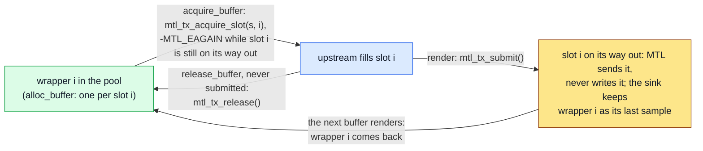
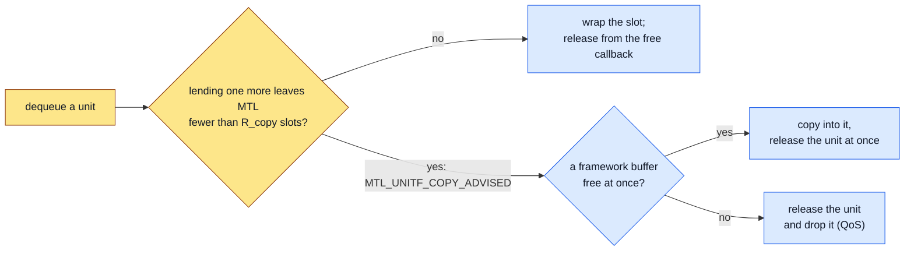

# Frameworks: GStreamer, FFmpeg and OBS on the unified API

| | |
|---|---|
| Status | How framework plugins run on the unified API: the port of today's plugins and the recipes they share. The headers in [sketch/include/mtl/experimental/](sketch/include/mtl/experimental/) are normative: where this page and a header disagree, the header wins |
| Audience | GStreamer, FFmpeg and OBS plugin authors, and any framework that wraps MTL sessions in its own elements |

This page is for code that runs MTL inside a media framework. Porting an application, and the
field and enum maps, are [migration.md](migration.md); the normative behaviour is
[contract.md](contract.md), media time and the live-sink formula [timing.md](timing.md).

**Start here.**

| Job | Sections |
|---|---|
| port today's GStreamer, FFmpeg or OBS plugin | [§2.1](#21-gstreamer-plugin-ecosystemgstreamer_plugin), [§2.2](#22-ffmpeg-plugin-ecosystemffmpeg_plugin), [§2.3](#23-obs-ecosystemobs_mtl); [§3](#3-sharing-one-instance-between-plugins) when several plugins share a process |
| write a live sink (GStreamer `sync=TRUE`, `ffmpeg -re`, an OBS output) | [§1](#1-one-rule-live-sinks-use-tai-whole-timeline-owners-use-index), [§4](#4-live-sinks), [§6](#6-threads), [§7](#7-tx-buffers) |
| play out a file, or process and forward a stream | [§5](#5-whole-timeline-owners-and-processors) |
| write a source | [§9](#9-rx-sources-zero-copy-pool-size-and-latency), [§10](#10-format-changes) |
| route logs, options, ports and stats | [§11](#11-logs-options-ports-and-stats-exporters) |

## 1. One rule: live sinks use TAI, whole-timeline owners use INDEX

One distinction: **live sinks use TAI media mode; whole-timeline owners use INDEX.** A live sink in
INDEX mode turns jittery PTS into `DROPPED` results (`BEHIND`, `DUPLICATE_INDEX`) and a just-in-time producer into a late unit on
every frame. Normative rules: [timing.md](timing.md).

## 2. Porting today's plugins

### 2.1 GStreamer plugin (`ecosystem/gstreamer_plugin/`)

| Today | Unified |
|---|---|
| sources implement only `start`, `negotiate`, `create`: no `unlock`, so flushes wait out the timeout | `unlock()` → `mtl_interrupt(MTL_OBJ_OF_SESSION(s), MTL_INTR_ON, MTL_WAIT_ACQUIRE)` (a sink; a source names `MTL_WAIT_DEQUEUE`), so a reaper of the same session does not spin; `unlock_stop()` → `mtl_session_interrupt(s, 0)`; stop → `mtl_session_close()` |
| st40p RX polls with a 1 ms sleep ("blocking causes preroll timeout", `gst_mtl_st40p_rx.c:499`) | `mtl_rx_dequeue(s, &u, timeout)`, which sleeps until a unit is ready and which `unlock` interrupts |
| a global refcounted instance; the second element's device arguments silently ignored | `MTL_INSTANCE_SHARED` (§3); each element names its own port, and the port registry in `gst_mtl_common.c` opens the union (§11, MS6) |
| RX `GST_BUFFER_PTS` = raw TAI; no clock, no LATENCY answer | reference timestamp meta from `u.media_tai_ns`; LATENCY from `info.latency_min_ns` / `_max_ns`; `mtl_time_convert()` / `mtl_time_now()` with the monotonic sample |
| TX `use-pts-for-pacing` mutates the PTS by `pts-pacing-offset` (`gst_mtl_st20p_tx.c:210-217`) | TAI media mode; `sc.media_time_offset_ns` = the offset |
| RX `query_ext_frame` allocates a `GstBuffer` per frame on the tasklet, never returned at stop (SF-85); `st_frame_fmt_planes(n_planes)` (SF-86) | RX zero copy from MS1: wrap the dequeued library slot (`gst_buffer_new_wrapped_full`) and release from its notify by lease alone, copying the units dequeue flags (§9); `mtl_rx_provide` is not the framework path |
| sources set neither live mode nor format and do not answer LATENCY | `gst_base_src_set_live(TRUE)`, `gst_base_src_set_format(GST_FORMAT_TIME)`, the LATENCY answer of §9.4; the st40p "blocking causes preroll timeout" comment (`gst_mtl_st40p_rx.c:499`) is that missing live flag |
| sinks install their own chain function (`gst_mtl_st20p_tx.c:263`, `st30p_tx.c:245`, `st40p_tx.c:327`), so basesink sync and render-delay never run | `render` (GstVideoSink `show_frame`); `render-delay` = M_sink = `info.latency_min_ns` + margin + TFRAME of [timing.md §10.5](timing.md#105-live-sinks-and-the-programme-phase) (§4) |
| per-plugin format switches (`gst_mtl_common.c:22-83`, which also parse property values such as `YUV422PLANAR10LE`) and hand-written caps (`gst_mtl_st20p_rx.c:110-111`) | caps from `caps_formats` (ex19: `mtl_format_describe`, `MTL_CONVERT_CHECK`), the transport format only on request (off for sources); today's names stay one release cycle in a logged, deprecated alias table (D-222) |
| one log route per element `GST_PLUGIN_DEFINE` (six plugins linking `libgstmtl_common.so`) | one MTL log sink, added once in `gst_mtl_common` (§11) |
| TX ext frames with a parent/child refcount | TX: an exported pool (§7.1); an upstream buffer is the source of a submit with `MTL_SUBMIT_SRC_PLANES` (one copy, or the conversion, during the call; MS1), and from MS2 `mtl_tx_acquire_layout()` sends from it directly |
| `ST40P_RX_FLAG_DISABLE_AUTO_DETECT` (`gst_mtl_st40p_rx.c:515`); ST40 test knobs (`gst_mtl_st40p_tx_test.h`) | `sc.anc.detect = MTL_DETECT_OFF`; `mtl_debug_inject(…, MTL_FAULT_TX_MUTATE, …)` |
| st30p TX re-frames by hand; st40 UDW helpers from `st40_api.h` | `mtl_tx_write()`; `mtl_anc_*` |
| ANC UDW capacity: TX `max_udw_buff_size` = 20 × 255 = 5100 B (`DEFAULT_MAX_UDW_SIZE`, `gst_mtl_st40p_tx.h:50-55`), RX 128 KiB (`gst_mtl_st40p_rx.c:121`) | `sc.anc.max_udw_words` (0 = max(255, 32 × `max_packets`) words, 1 024 by default; the plugin sets both from its properties) |
| only `interleaved` interlace (`gst_mtl_st20p_tx.c:358-362`) | interleaved, alternate and PsF (§8) |
| a second CAPS event is ignored with a warning (`gst_mtl_st20p_tx.c:452-455`, `gst_mtl_st30p_tx.c:457-460`) | stop → `mtl_session_update(s, &sc, MTL_UPDATE_MEDIA, NULL, NULL)` → start, keeping the handle, name, SSRC and counters; a detected RX format change (`MTL_EVENT_RX_FORMAT`) and an MXL grain-count change (`MTL_UPDATE_POOL`) take the same path |

### 2.2 FFmpeg plugin (`ecosystem/ffmpeg_plugin/`)

| Today | Unified |
|---|---|
| a global instance; every context repeats identical device options (`mtl_dev_params_compatible()` compares the whole `mtl_init_params`) | `MTL_INSTANCE_SHARED` (§3), with one legacy instance from MS3 to MS6 (below) |
| a NULL frame → `AVERROR(EIO)`, which ends the run | `-MTL_EAGAIN` → `AVERROR(EAGAIN)`, `-MTL_ESHUTDOWN` → `AVERROR_EOF`, `-MTL_EIO` → error |
| copies both ways (five `/* todo: zero copy */` comments): RX | RX zero copy: `mtl_rx_dequeue()` and `av_buffer_create(addr, unit_bytes, free_cb, opaque, 0)`, with the lease's id as `opaque` (`mtl_rx_release` with a null session, D-226) and a copy of the units dequeue flags (§9) |
| copies both ways: TX | TX video: `mtl_tx_acquire()` and a submit with `MTL_SUBMIT_SRC_PLANES` naming the `AVFrame` planes (one copy, or the conversion, in the call), until per-frame layouts (`mtl_tx_acquire_layout()`) send from them directly; TX audio: `mtl_tx_write()`; on a converting session set `MTL_SESSION_TX_SRC_PLANES` |
| `read_header` sets neither `avg_frame_rate` nor `r_frame_rate`; `fb_cnt` 3, at most 8 | set both rates; `fb_cnt` default 5 (at most `info.max_count`: 8 until E11 in MS2); wrap each unit, and copy the ones dequeue flags into an `av_buffer_pool` (§9): a pool of 5 keeps lending, the library's default of 3 copies every unit |
| RX `pts` = a frame counter; TX ignores `pts` | RX `pts` from `u.media_tai_ns`; TX the PTS rescaled against `start_time_realtime`, TAI media mode |
| `AVFMT_FLAG_NONBLOCK` unused | `read_packet` uses timeout 0 when set, `ff_check_interrupt()` between short timeouts otherwise; `write_packet` may block |
| st30p TX re-frames to 10 ms, ignores `pkt->pts` | `mtl_tx_write()`; `pts` rescaled to the sample index (1/48000), gaps marked `MTL_SUBMIT_DISCONTINUITY` |
| `ptp_get_time_fn` reads `CLOCK_TAI` (`mtl_common.c:39-45`, installed at `:125`) | leave `ip.time_source` 0 (AUTO, [timing.md §2.2](timing.md#22-time-sources), timing.md §2.7). `CLOCK_TAI` named is rejected while the kernel TAI offset is 0; AUTO then picks `SYSTEM_TAI`, ESTIMATED, with a warning (new without ptp4l); from MS3 it moves up without a step once the offset k = U_utc (`time.utc_offset_s`) |
| `-pix_fmt` names chosen per plugin (`mtl_st20p_rx.c:118-160`); `yuv420p` selects the MTL-only YUV420CUSTOM8 passthrough (`:150-158`) | names from `mtl_format_parse()` (D-222): no `_NONSTD` value has an `av_pix_fmt` name, so `yuv420p` selects a compliant format, a change on MTL-to-MTL links; today's names stay one release cycle in a logged, deprecated alias table |
| ST22 `pack_type` (`mtl_st22p_tx.c:81`) | `MTL_OPT_CVIDEO_PACK` (`SLICE` is `-MTL_ENOTSUP`) |
| `ST20_RX_FLAG_DMA_OFFLOAD` on `st20p_rx_ops` (`mtl_st20p_rx.c:176`, wrong namespace) | `MTL_OPT_DMA = MTL_REQ_PREFER`; fixed on the legacy plugin meanwhile (stage A, abi.md §6.3) |
| `GPU_DIRECT`, with `gpu_context` pointing at a stack local (`mtl_st20p_rx.c:207,217`) | `MTL_MEM_DEVICE` of `mtl_mem_open()` (U-117); GPU-pinned host memory works with `mtl_mem_import()` |

From MS3 to MS6, while legacy paths remain, `mtl_common.c` keeps its one legacy instance
(`mtl_init`, `mtl_start`, its clock and PTP flags as today). Each st20p context gets its own
reference from `mtl_instance_from_legacy` on it and closes that reference. The last legacy unref
calls `mtl_uninit` after every reference has closed. MS6 replaces both with
`mtl_instance_open(MTL_INSTANCE_SHARED)` (migration.md §6.2).

### 2.3 OBS (`ecosystem/obs_mtl/`)

Input (st20p RX through a callback and condition variable with a stray unlock,
`linux-mtl/mtl-input.c:86-125`; a per-source `mtl_init`, `:317-338`): `mtl_rx_dequeue(timeout)` on
the source thread, `mtl_time_convert(…, MTL_CLOCK_TAI, MTL_CLOCK_MONOTONIC, …)` for the OBS
timestamp, `MTL_INSTANCE_SHARED` across sources. Output (never finished, `#if TODO_OUTPUT`): the
live-sink recipe (§4). The draft's `tfmt = ST10_TIMESTAMP_FMT_MEDIA_CLK` with an OBS monotonic
timestamp (`linux-mtl/mtl-output.c:224-225`) is latent, not wrong on the wire: the output sets
neither USER_PACING nor USER_TIMESTAMP (`mtl-output.c:154-168`), so st20p discards the timestamp
(`st20_pipeline_tx.c:231-234`) and sends as AUTO. The port converts MONOTONIC → TAI. Per-source
`lcores` and queue counts: `mtl-input.c:330-332`, `mtl-output.c:139-141` (§3).

## 3. Sharing one instance between plugins

FFmpeg, GStreamer and two external projects each re-implement a refcounted singleton, because
`mtl_init` could not be called again after `mtl_uninit` (#1341). `MTL_INSTANCE_SHARED` creates the
process-wide instance on the first open and joins it later; each open returns its own reference,
and the last close shuts it down. After a close, open works again in the process on the same
ports and a subset of the first open's CPUs.

A later open that names a port the live instance lacks, or lcores, time source or options that
differ from it, fails with `-MTL_EEXIST` (`INSTANCE_MISMATCH`), before any device is touched. So elements that share
an instance must agree on lcores, time source and options: keep those in one place. Ports need not
agree: an element may name only its own ports, which the instance must have (§11;
contract.md §2.3). Legacy instance flags that are now session keys
(`pacing`, the source-port modes, `TX_NO_CHAIN`, the migrate flags) need no agreement when each
element sets them on its own sessions; instance options such as `MTL_OPT_RX_SEPARATE_VIDEO_LCORE`
do. A field a later open leaves
zero is not a request, so it never conflicts.

Two in-tree consumers break this rule today, and a literal port fails:

- **OBS** opens one instance per source with that source's `lcores` and its own queue counts
  (input: TX 0, RX 1; output: TX 1, RX 0; `ecosystem/obs_mtl/linux-mtl/mtl-input.c:330-332`,
  `mtl-output.c:139-141`). Mapped to `ip.lcores` and `ports[i].tx_queues` / `.rx_queues`, the
  second MTL source of a scene with another CPU list fails open with `INSTANCE_MISMATCH`, and so
  can an output next to an input.
- **FFmpeg** sets `RX_SEPARATE_VIDEO_LCORE`, `TX_VIDEO_MIGRATE` and `RX_VIDEO_MIGRATE` on every
  context (`ecosystem/ffmpeg_plugin/mtl_common.c:112-114`). Mapped to instance options
  (`MTL_OPT_RX_SEPARATE_VIDEO_LCORE`, `MTL_OPT_MIGRATE` on the instance), an FFmpeg context in a
  process whose instance was opened without them (a GStreamer element, an application) fails open
  the same way, and the other way round.

Today the first `mtl_init` wins and the later contexts' settings are silently ignored (§2.1,
§2.2). The rule for the ports (OI-43, [contract.md §2.3](contract.md#23-shared-instance)):
elements that share an instance leave `lcores` and the port queue counts at 0 and put what is
theirs in session keys, `session.tx_queue` and `session.migrate`. There are no per-session
queue-count keys.

- `lcores` and the separate-lcore setting are instance settings: the plugins leave them zero (the
  pod's CPU mask), which changes behaviour for users who set an OBS CPU list.
- Migration is per session: the FFmpeg plugin sets `MTL_OPT_MIGRATE` on its sessions instead of on
  the instance.
- Queues are per session: each session takes its queue at create (`session.tx_queue` chooses a
  dedicated or a shared TX queue), so the plugins leave `ports[i].tx_queues` and `.rx_queues` zero and queue
  counts no longer take part in the agreement check; a create fails with `-MTL_ENOSPC`
  (`CAPACITY_*_QUEUES`) when queues run out.

## 4. Live sinks

The recipe, with its numbers, is [timing.md §10.5](timing.md#105-live-sinks-and-the-programme-phase): TAI media mode with
snap `MTL_SNAP_NEAREST` (the default), and one formula, `u.media_tai_ns = TAI(ct) + δ`. ct is the
buffer's presentation time, which contains the programme latency L (one per programme), and δ is
the programme's phase (D-221). A sink's minimum is M_sink = `latency_min_ns` + margin + TFRAME,
with TFRAME the frame period and the margin the producer's jitter (1 ms, or more where measured);
L is at least the largest M_sink of the programme's sinks. GStreamer lets basesink wait; FFmpeg,
OBS and applications let MTL's pool wait (ex21). What a framework adds around it:

- **Clocks.**
  - GStreamer: the plugin's GstMtlClock (`gst_mtl_common.c`, MS6), a GstSystemClock on
    `CLOCK_MONOTONIC` calibrated with `gst_clock_set_calibration` from `mtl_time_now(mt, &tai,
    &mono, NULL)` pairs, so that it reads TAI. MTL elements provide it; an application forces it
    with `gst_pipeline_use_clock()` when another element (an audio sink) would provide the
    pipeline's clock. It stays monotonic: a declared backward `TIME_STEP` holds it until TAI
    catches up, and the hold is logged once. On the default GstSystemClock,
    `mtl_time_convert(MONOTONIC → TAI)` is enough. libmtl gets nothing new for this.
  - FFmpeg: the PTS rescaled against `start_time_realtime`. OBS: MONOTONIC → TAI.
  - The GStreamer st40p sink moves to TAI on the epoch, as its video does, so ANC keeps the video
    RTP.
- **Rate.** A collision is a `MTL_TX_DROPPED` result (`SNAP_COLLISION`); a frame time without a
  buffer follows `MTL_OPT_UNDERRUN_POLICY` (`MTL_UNDERRUN_REPEAT` sends the last frame again,
  MS4a1). Frame-rate adaptation is by drop and repeat, never a permanent relock.
- **Seek or `FLUSH_STOP`:** `mtl_session_discard(s, 0, 0)`, which also releases a repeated frame;
  TAI needs no rebase.
- **End of stream.** EOS is not a stop (D-210). The session stays RUNNING: the frame times after
  the last buffer follow the underrun policy (under REPEAT the last frame holds; under SKIP nothing
  is sent while the flow, ARP, IGMP and the grid stay), and a seek afterwards needs no start.
  - A sink with results reaps until at most `pins` buffers are unreported: 0 under SKIP, 1 under
    REPEAT, 2 interlaced (ex21's `sink_end`). The pinned buffers report when the next clip's first
    buffer of their parity finishes, at a seek (discard), or when DRAIN begins. The base class then posts EOS with
    the last buffer on air.
  - A reap that times out ends the wait, because a stalled queue is not an EOS error; close drains
    it.
  - The session stops at PAUSED → READY and closes at READY → NULL. FFmpeg's `write_trailer` reaps,
    then closes, with no stop; an OBS output's stop closes. Close begins with DRAIN, so it releases
    the pins and sends what is queued until its deadline.
- **Pause and "repeat the last frame".** Set `MTL_OPT_UNDERRUN_POLICY` = `MTL_UNDERRUN_REPEAT`
  (video, MS4a1; JPEG XS MS4b). A paused sink submits nothing and every frame time repeats the
  last buffer of its parity (no pin: nothing), on every pool and with conversion. The last
  buffer's result comes when its pin is released (a newer whole buffer of its parity after the pause, or its age), a discard (seek) or a DRAIN; a seek ends the repeat.
- **Audio.** `MTL_OPT_AUDIO_ABSORB_SAMPLES` defaults to one packet in TAI mode, so submissions
  within ± one packet are contiguous; larger deviations keep the packet grid (a gap is filled with
  silence, `samples_padded`; an overlap trimmed, `samples_dropped`); only `MTL_SUBMIT_DISCONTINUITY`
  re-phases ([timing.md](timing.md) §8).

[examples.md §23](examples.md#23-a-live-sink-presentation-time-to-media-time) (ex21) is the
recipe where MTL waits (FFmpeg, OBS, applications), as a compiling sink: the programme's one
latency and phase are added to each media time.

**The basesink render rebase** (GStreamer sinks). Today's sinks install their own chain
function (`gst_mtl_st20p_tx.c:263`, `gst_mtl_st30p_tx.c:245`, `gst_mtl_st40p_tx.c:327`), so
basesink's sync and render-delay never run. The port:

- **Base class.** Video derives from `GstVideoSink` (`show_frame`); audio and ANC from
  `GstBaseSink` (`render`). The chain functions go.
- **At `set_caps`.** Create the TAI-mode session and call `mtl_session_get_info`.
  `gst_base_sink_set_render_delay(sink, M_sink)`, with M_sink = `latency_min_ns` + margin + TFRAME
  ([timing.md §10.5](timing.md#105-live-sinks-and-the-programme-phase)); the setter posts the
  LATENCY message itself when the value changes. Keep `sync=TRUE`, and turn async state changes
  back on (drop `gst_base_sink_set_async_enabled(bsink, FALSE)`), so that preroll, QoS,
  `max-lateness`, `ts-offset` and PAUSED work as they do for any video sink.
- **In `render`.**
  - ct = `gst_element_get_base_time(sink)` + `gst_segment_to_running_time(&segment,
    GST_FORMAT_TIME, GST_BUFFER_PTS(buf))` + `gst_base_sink_get_latency(sink)` +
    `gst_base_sink_get_ts_offset(sink)`.
  - Basesink calls `render` at ct − M_sink, so ct is the presentation clock time and already holds the
    programme latency.
  - Submit `u.media_tai_ns = TAI(ct) + δ`, with δ from the pipeline's programme state
    ([timing.md §10.5](timing.md#105-live-sinks-and-the-programme-phase)), by
    `MTL_SUBMIT_SRC_PLANES` or from the exported pool (§7.1).
- **When `latency_min_ns` grows** (it follows C, the caller's work,
  [contract.md §3.9](contract.md#39-latency-figures)). Set the new render-delay M_sink, about once a
  second at most.
- **Pool.** Units are handed over M_sink early, so `pool_count` = the upstream minimum + 1 (the last
  sample, §7.1) + ceil(M_sink / U) suffices, U the unit period.
- **Other handlers.** `unlock` and `unlock_stop` map to the interrupt (§2.1); EOS to reaping
  (above); `FLUSH_STOP` to discard.
- **Not consumed.** A sink's max is not consumed; `latency_max_ns` (the horizon) is information.

**FFmpeg muxer.**

- In `write_header`, create a TAI session (`media_time_offset_ns` 0;
  [timing.md §10.5](timing.md#105-live-sinks-and-the-programme-phase)).
- The plugin's process state holds L and δ:
  - L = max(`s->max_delay` × 1000, the largest M_sink of the outputs open when the first packet is
    written);
  - an output opened later whose M_sink exceeds L logs one warning, because its units come
    `TOO_LATE`: raise `-muxdelay`.
- In `write_packet`, `u.media_tai_ns` = TAI(`s->start_time_realtime`, or `mtl_time_now` at
  `write_header`) + `av_rescale_q(pkt->pts − first_pts, st->time_base, {1, 1000000000})` + L + δ
  (ex21).
- In `write_trailer`, reap, then `mtl_session_close` (no stop; D-210).

## 5. Whole-timeline owners and processors

- File playout, RxTxApp, an A/V/ANC set: INDEX media mode on the epoch. One process starts its
  sessions as one array, `mtl_session_start(s, n, &when, &t0)` with `MTL_WHEN_ORIGIN` in
  `when.flags`: media index 0 of every session is the start's T0, so a file's frame and sample
  counts are media indices as they are (start arrays: U-121, [timing.md](timing.md) §7). Across
  processes, start without `MTL_WHEN_ORIGIN` and agree on epoch indices (`mtl_epoch_index_at()`)
  or on a programme-grid instant ([timing.md §10.4](timing.md#104-separate-processes)).
  Seek: `mtl_session_discard(s, MTL_DISCARD_REBASE, first_index)` maps the new first index to the
  next feasible index.
- Processors and forwarders: TAI with the input's media time, and `sc.min_tx_delay_ns` = the
  pipeline budget (at least one frame period, as a capture producer; MTL adds its pick-up lead).
  `MTL_SUBMIT_RTP_TS` with media mode AUTO is rejected (`RTP_TS_AUTO`). A forwarder sending from the received slot sets `u.hold` to the RX lease
  (`mtl_tx_send_slot()` with the received unit as template).

## 6. Threads

Set `MTL_SESSION_MT_SUBMIT` whenever two threads can submit (a queue element before the sink that
submits on its own thread, FFmpeg frame threading); acquire is MP-safe without it, so an exported
pool whose only submitter is `render` does not set it (§7.1). With it, a blocking acquire uses a
finite timeout and reaps on `-MTL_EAGAIN`: the ring covers one submit per thread
([contract.md §5.5](contract.md#55-back-pressure)). `mtl_rx_release()` is safe from any thread.

Every session has its own results and events. A thread that serves one session waits on it
(`mtl_session_wait()`, or the WT calls with a timeout). A thread that serves many uses one queue
(`mtl_queue_create()`, MS2a): it arms each session on it (`mtl_queue_arm()`), and the instance
with `MTL_WAIT_EVENTS` for port, time, health and manager events (MS3), and sleeps in
`mtl_queue_wait`; the application's other threads wake it with `mtl_queue_post`. The wait returns
one report per changed object; the thread serves that object with timeout-0 calls (reap, dequeue,
`mtl_session_read_events()`; `mtl_instance_read_events()` for the instance) and arms it again with
what it wants next. A framework's loop takes the queue's descriptor instead and sleeps on it only
after `mtl_queue_wait(q, …, 0)` returned `-MTL_EAGAIN` ([contract.md §7.2](contract.md#72-queues-ms2)).

## 7. TX buffers

### 7.1 Exporting a pool (GstBufferPool over MTL TX slots)

Acquire is MP-safe and `render` is the only submitter (contract.md §5.6), so the session needs
neither `MTL_SESSION_MT_SUBMIT` nor results: each wrapper is bound to one slot and leases it by name.

| GstBufferPool | Unified API |
|---|---|
| `alloc_buffer` | one wrapper per slot i, `i < info.pool_count`, over the planes of `mtl_session_get_slot(s, i, &u)` |
| `acquire_buffer` | take a wrapper i that came back to the pool, then `mtl_tx_acquire_slot(s, i, &u, timeout)`: `-MTL_EAGAIN` while slot i is still on its way out |
| `render` | `mtl_tx_submit()` |
| `release_buffer`, never submitted | `mtl_tx_release()` |
| `release_buffer`, submitted | nothing: the wrapper is free again, and MTL frees slot i once it has left |
| `set_active(FALSE)` | `mtl_session_stop(&s, 1, MTL_STOP_FLUSH, timeout)`; free the wrappers once `mtl_session_close()` returns 0 |

**The last-sample reference.** GstBaseSink keeps the last rendered buffer (`enable-last-sample`,
on by default), so a submitted wrapper comes back to the pool only when the next buffer renders.
Binding each wrapper to its own slot keeps the last sample's bytes intact while the sink holds it:
MTL never writes a TX buffer, and slot i is leased again only after wrapper i has come back. A
pool that took any free slot with `mtl_tx_acquire` would hand the last sample's slot to upstream
while the sink still shows it. The pool size counts that buffer: `pool_count` ≥ the upstream
minimum + 1 (the last sample) + the units in flight.

The picture below is the life of wrapper i and its slot i in an exported pool.

### 7.2 Importing the framework's pool

1. **Negotiation.** `mtl_session_query()` (no allocation) answers ALLOCATION: `size =
   info.unit_bytes`, `min_buffers = req.min_count_direct` (or `req.min_count` off the direct path)
   **plus** the upstream pool's own `min_buffers`, `max_buffers ≤ req.max_count`, a `GstVideoMeta`
   with `req.plane[i].stride` (any stride ≥ `row_bytes` is direct); LATENCY from
   `info.latency_min_ns` / `_max_ns`.
2. **Activation.** Import the upstream arena as **one** region (`mtl_mem_import()`,
   `MTL_MEM_READ`, page aligned; the region budget is small), attach one slot per surface
   (`mtl_session_attach()` with `slot_offset[]`), start.
3. **Teardown.** Stop with FLUSH, reap, `mtl_session_close()`; while it returns 1, call it again
   with a timeout; `mtl_mem_close()`; only then may the framework free the arena.

### 7.3 Copies per unit, by producer

Whether zero copy is possible at all depends on who allocates the buffer. "Copies" counts
full-unit CPU copies by the application or MTL before the NIC, not the packet build of the
copy-only essences.

| Producer | Copies per unit | From |
|---|---|---|
| the application writes a library pool | 0 | MS1 |
| a framework that honours the exported pool (§7.1) | 0 | MS2 |
| an application that wants MTL-placed memory shared by several sessions (Rivermax "one registration for many streams") | 0: `mtl_mem_alloc()` once, attach every session over the region | MS2 |
| a GStreamer upstream pool that ignores `propose_allocation` (most decoders, `videotestsrc`) | 1: a submit with `MTL_SUBMIT_SRC_PLANES` copies (or converts) the buffer into the slot during the call; 0 once it can be imported (page-aligned host memory within the region budget; MS2); on a converting session set `MTL_SESSION_TX_SRC_PLANES` | MS1 |
| FFmpeg decoder frames (`av_buffer_pool`, 64 B aligned) | 1, through `MTL_SUBMIT_SRC_PLANES`; 0 only with an application `get_buffer2` that carves frames from one imported page-aligned arena (MS2) | MS1 |
| FFmpeg TX `AVPacket`s for ST 2110-22 | packet build only: the codestream is always copied into packets (ST22 forces `tx_no_chain`, `st_tx_video_session.c:3413-3416`); `mtl_tx_write()` or a library slot | MS4 |
| audio, ANC, fastmeta, any producer | packet build only; `mtl_tx_write()` needs no slot | MS4 |
| MXL grains, fixed grain count | 0: attached pool, `MTL_SESSION_RX_BY_INDEX` | MS2b |
| MXL flow re-created with another grain count | 0: stop, `mtl_session_update()` with `MTL_UPDATE_POOL`, detach, attach, start (one stop/start gap); or a per-acquire layout, which needs no re-attach | MS5 (update); MS2 (layout) |
| moving cursor over one arena (`app/sample/ext_frame/tx_st20_pipeline_ext_frame_sample.c:147-162`; the sample first copies its file into `mtl_dma_mem_alloc` memory, `:80-99`) | 0: one region and `mtl_tx_acquire_layout()`, or one attached slot per arena frame (`pool_count` = F ≤ `max_count`) | MS2 |
| playout server that mmaps media files | 0 from a hugetlbfs file (direct); a page-cache file (`MTL_BACKING_FILE`) is accepted copy only | MS2 |
| capture SDK without an allocator hook (driver-owned buffers) | 0 if its buffers are stable, page-aligned host memory (attached pool); otherwise 1 | MS2 |
| GPU-pinned host memory (`cudaHostAlloc`, `zeMemAllocHost`) | 0 on the NIC side: `mtl_mem_import()`, RX direct into it, then `cudaMemcpyAsync` host-to-device, the standard GPU ingest path | MS2 |
| VA-API surfaces, CUDA device pools, DMA-BUF | 1: a CPU mapping plus a copy by the application, until `MTL_MEM_DEVICE` of `mtl_mem_open()` (MS6, U-117) | MS1 |
| RX → TX forward over a library RX pool (`app/sample/fwd/rx_st20p_tx_st20p_fwd.c:161-165`); split forward 1 RX → 4 TX (`app/sample/fwd/rx_st20_tx_st20_split_fwd.c:263-265`, each TX slot a sub-rectangle) | 0: `mtl_session_get_pool_region()`, TX slots over it, `u.hold` (split forward: partial packet copies counted) | MS2 |

To be importable, a framework allocates its pool from one page-aligned arena
(`posix_memalign(4096)`, a GstAllocator with `align = 4095`, a custom `av_buffer_pool` allocator).
Per buffer at steady state: from the exported pool, submit; from an importable upstream pool with
`max_buffers` ≥ `req.min_count_direct` + 1, send from the imported arena (MS2,
`mtl_tx_acquire_layout()`); otherwise submit an acquired unit with `MTL_SUBMIT_SRC_PLANES` naming
the buffer's planes (the copy or the conversion happens during the call) and unref the buffer at
once.

**Early source release (later, no header symbol yet; D-56).** A zero-copy framework sink
keeps its upstream buffer until the unit's result: wire time plus `completion_latency_ns`. Upstream
pools negotiated with `min_buffers = 2` (`videotestsrc`, `v4l2src`) then block in their own acquire;
today's GStreamer sink has the same exposure, holding the reference until `notify_frame_done`
(`gst_mtl_st20p_tx.c:547-597`). On copy and convert paths MTL stops reading the source long before
transport ends, so an opt-in session option posts an early "source released" result as soon as MTL
stops reading, flagged "more coming", and the terminal result follows (two completions, the io_uring
zero-copy send model). The results ring then grows by one entry per unit. A direct session rejects
the option (`-MTL_ENOTSUP`): the NIC reads the memory until completion. The sink then drops the
buffer one conversion time after submit instead of one completion latency. Without it: copy into an
acquired slot and drop the buffer at once (v4l2 mmap pools with a small fixed count).

## 8. Interlaced

The unit is a field; a field layout has `rows = height / 2`. GStreamer `interleaved` is two field
slots over one surface (plane offset 0 or one row, `stride = 2 × row_bytes`); `alternate` is one
field per buffer; PsF is `MTL_PSF` (paced as interlaced, one RTP timestamp and one index per
frame). Halve the legacy `fps` (migration.md §5.1). Today `st_fmt.c:611` halves the frame size for
interlaced, and the GStreamer sink maps interleaved caps onto half-height field buffers
(`gst_mtl_st20p_tx.c:358-363`); an interleaved buffer becomes two submissions that both hold the
same GstBuffer, with no weave copy. RX works the same way: two field slots over one frame-sized
region deliver a woven frame directly.

## 9. RX sources: zero copy, pool size and LATENCY

The recipe for every framework source (D-228). MTL owns the pool; the framework borrows units.

### 9.1 Lending the buffer

- **GStreamer** (`create`): dequeue (the timeout of §6; `unlock` interrupts it). Then:
  - `buf = gst_buffer_new_wrapped_full(0, u.plane[0].addr, unit_bytes + MTL_RX_TAIL_BYTES, 0,
    unit_bytes, (gpointer)(uintptr_t)u.lease.id, notify)`; `notify(p)` calls
    `mtl_rx_release(MTL_NULL(mtl_session_h), (mtl_lease_h){(uint64_t)(uintptr_t)p})`: the lease
    names its session (D-226), so nothing is allocated per frame. The cast keeps the 64-bit id on a
    64-bit host only. On a 32-bit host the pointer names entry `u.slot` of a table of `pool_count`
    leases, written at dequeue (the slot is not dequeued again before its release). The table
    belongs to the session, not to the element: allocate it with the session and free it only
    after the session retires, from the last release once `mtl_session_close` has returned 1, or
    at close when it returned 0.
  - A unit dequeued with `MTL_UNITF_COPY_ADVISED` is copied instead ([below](#92-the-copy-fallback)).
  - `unit_bytes` is `info.unit_bytes`, or with detection Σ `stride × rows` of the unit's planes.
  - Leave the memory writable: a leased slot is the application's.
  - Add `gst_buffer_add_video_meta_full()` when the layout differs from the `GstVideoInfo` default
    ([contract.md](contract.md) §9.1). In `decide_allocation`, without `GST_VIDEO_META_API_TYPE`
    downstream, copy.
  - Field units: `interlace-mode=alternate` with the `format:Interlaced` caps feature and the
    per-buffer `TOP_FIELD`/`BOTTOM_FIELD` flags.
- **FFmpeg** (`read_packet`): dequeue (timeout 0 with `AVFMT_FLAG_NONBLOCK`, else short timeouts
  between `ff_check_interrupt()` calls). Then:
  - `pkt->buf = av_buffer_create(u.plane[0].addr, unit_bytes, free_cb,
    (void*)(uintptr_t)u.lease.id, 0)`, `pkt->data = pkt->buf->data`, `pkt->size = unit_bytes`;
    `free_cb` releases the lease with a null session (on a 32-bit host through the session's
    per-slot table above); a flagged unit is copied instead.
  - The tail meets `AV_INPUT_BUFFER_PADDING_SIZE`. rawvideo outputs without a copy
    (`rawdec.c:227`, `:248`) in the packed layout (`:353`). For `AV_CODEC_ID_BITPACKED` (RFC 4175
    4:2:2 10-bit, `codec_tag` UYVY, `bits_per_coded_sample` 20) give the transport format.
- **Lifetime.** The callback's pointer is the lease: nothing of the element or the
  `AVFormatContext`, which may be gone when a downstream holder frees the buffer. Stop and
  `read_close` call `mtl_session_close(s, 0)` and return; 0 and `MTL_RETIRING` are both success.

**Timestamps and live mode.**

- GStreamer: in `start`, `gst_base_src_set_live(src, TRUE)` and `gst_base_src_set_format(src,
  GST_FORMAT_TIME)`.
  - `GST_BUFFER_PTS` = the pipeline clock's value of `u.media_tai_ns` − `base_time`: on
    GstMtlClock the value itself; on GstSystemClock `mtl_time_convert(TAI → MONOTONIC,
    u.media_tai_ns)`; with another pipeline clock, use GstMtlClock (§4). A refusal
    (`u.media_tai_ns` NONE) gives `GST_CLOCK_TIME_NONE`. `GST_BUFFER_DURATION` = the unit period.
  - On PAUSED → PLAYING, call `mtl_session_discard(s, 0, 0)` (MS2a): a live basesrc does not
    produce in PAUSED.
- FFmpeg: `pts = dts` = `u.media_tai_ns` (time base 1/1 000 000 000; `MTL_TIME_NONE` is
  `AV_NOPTS_VALUE`, so no code); `avg_frame_rate` =
  `r_frame_rate` = `raster.fps`, set in `read_header`.
  - With both rates, probing stops after the first packet (`demux.c:2632-2660`).
  - Without them, the default `probesize` (5 000 000 B) still stops after one 1080p 10-bit frame
    (5.18 MB, `demux.c:2665-2681`). At 720p it reads up to 3 frames, which the copy covers.

### 9.2 The copy fallback

The library decides when to copy (D-227). Dequeue sets `MTL_UNITF_COPY_ADVISED` on a unit when
lending one more would leave MTL fewer than R_copy = ceil(`latency_min_ns` / U) + 1 slots, U the
unit period ([contract.md §5.3](contract.md#53-rx)). The source copies a flagged unit into a buffer of
a framework pool and releases it at once: in GStreamer the pool `decide_allocation` chose (GL,
DMA-BUF or system memory, so the copy is the upload), in FFmpeg an `av_buffer_pool`. Every other
unit is wrapped.

- Take the copy's buffer without waiting (`GST_BUFFER_POOL_ACQUIRE_FLAG_DONTWAIT`); with none
  free, release the unit and drop it (QoS). Never block `create()` on downstream.
- For the flagged copies the source keeps no count, measures nothing and computes nothing, at a
  LATENCY event or at a format change.
- Holders downstream cost a copy, never a lost unit: a sink's last sample, an aggregator pad's
  current buffer (`GstVideoAggregatorPad` keeps it until a newer one arrives), a `queue`, the
  ffmpeg CLI's thread queues (8 + 8, `fftools/ffmpeg_sched.h:241,246`), decoder frame threads.
- `rx.units_copy_advised` counts the flagged units claimed while others were lent, so a pool that
  is too small shows.

The picture below is the decision dequeue makes for each unit, and what the source does with it.

### 9.3 Pool size

One formula. With H wrapped units out at once at steady state, no unit is flagged when

`pool_count` ≥ R_copy + H = ceil(`latency_min_ns` / U) + 1 + H.

- H is 1 for the buffer being rendered or aggregated, plus 1 per element on the path that keeps
  it after use: a sink's last sample, an aggregator pad's current buffer. One sink or one
  aggregator gives H = 2; a tee to both gives 3.
- The library's own bound is the case H = 0: the `MTL_INFO_LATENCY_INFEASIBLE` remedy
  ceil(`latency_min_ns` / U) + 1 ([contract.md](contract.md) §3.9).
- At the library's default pool (3 on one leg, D-204) every unit is flagged and copied, so a
  source that wants zero copy sets `pool_count` = R_copy + H, as the defaults below do.
- Defaults, from the formula (`latency_min_ns` of a session without conversion):

  | Case | `latency_min_ns` | R_copy | H | `pool_count` |
  |---|---|---|---|---|
  | 1080p and 2160p59.94, one leg | 18.33 ms | 3 | 2 | **5** |
  | the same, two legs (F, the skew budget `rx.skew_budget_ns`, 10 ms) | 27.33 ms | 3 | 2 | **5** |
  | 119.88p, two legs | 18.67 ms (U 8.34) | 4 | 2 | 6 |
  | 59.94p, class B skew (F 50 ms) | 67.33 ms | 6 | 2 | 8 (= `max_count` until E11) |

- GStreamer `pool-count` defaults to 5, and the source raises it to the formula's value at
  create when `info.max_count` allows.
- FFmpeg `fb_cnt` defaults to 5. The ffmpeg CLI's queues (H up to 16) mostly take the copy:
  size to 8 to copy less.

### 9.4 LATENCY

GStreamer `query` for `GST_QUERY_LATENCY` ([contract.md](contract.md) §3.9):

- `live` = TRUE;
- `min` = `info.latency_min_ns`, the caller's work C included (D-225). Before create, the dry run
  (`mtl_session_query`) gives the same value, with C from create's calibration. A source that
  copies every unit (no `GST_VIDEO_META_API_TYPE` downstream) measures its copy of one unit, c,
  at create and again at each format change, and adds it; a flagged copy adds nothing, because basesink's `processing-deadline`
  (20 ms by default in live pipelines) absorbs it;
- `max` = `info.latency_max_ns`, and `GST_CLOCK_TIME_NONE` for `INT64_MAX` (`RX_LATEST`). There is
  no H: when downstream holds more, the source copies.

Post `gst_message_new_latency()` when either value changes:

- after `mtl_set_options` of an S key;
- at a format change (§10), with c measured again;
- when `latency_min_ns` grows.

`MTL_INFO_LATENCY_INFEASIBLE` means max < min for the library itself: raise `pool_count`.

FFmpeg has no latency negotiation. The demuxer exports `latency_min_us` and `latency_max_us` as
`AV_OPT_FLAG_EXPORT | AV_OPT_FLAG_READONLY` options, set in `read_header` and at each format
change.

### 9.5 Redundant inputs

With two legs `latency_min_ns` includes `rx.skew_budget_ns` (10 ms by
default), the time a unit waits for the late leg. A plugin exposes it as a property
(`skew-budget`, ns) and sets `rx.skew_budget_ns` from it at create: a red/blue pair inside one
facility with sub-millisecond skew sets 1 ms and saves 9 ms per hop. `leg.observed_skew_ns{window=60s}`
shows the skew the receiver sees; the plugin never derives `min` from it, so the latency it
announces holds through a failover of the leading leg.

## 10. Format changes

With `video.detect` ON every format within the maximum arrives in-band. The first unit of each
carries `MTL_UNITF_FORMAT_CHANGED`, and `mtl_rx_get_detail` gives its `raster`, `packing`,
`fps_approx` ([timing.md](timing.md) §11.9) and `format_seq`. `format_seq` restarts at 1 at every
start. Reconfigure on that unit, never from stats.

- **Waiting for the first format.** GStreamer `negotiate` (or the first `create`), and FFmpeg
  `read_header`, dequeue with short timeouts until the first unit:
  - GStreamer through `unlock` → `mtl_interrupt`;
  - FFmpeg between `ff_check_interrupt()` calls, bounded by the plugin's `timeout_s`.

  `MTL_STATUS_RX_DETECTING` means measuring; `MTL_STATUS_FORMAT_CHANGED` means the stream does
  not fit. FFmpeg keeps the first unit as the first packet. Colorimetry comes from the
  configuration.
- **FFmpeg.**
  - Fill `codecpar` from the first unit: width, height, `avg_frame_rate` = `r_frame_rate` =
    `raster.fps`; field units as half-height frames at the field rate.
  - On a later first unit, when width or height changed and the codec is rawvideo (an
    `app_format` that is a pix_fmt, or `MTL_YUV422_8` as UYVY):
    - `sd = av_packet_new_side_data(pkt, AV_PKT_DATA_PARAM_CHANGE, 12)`;
    - `bytestream_put_le32(&sd, AV_SIDE_DATA_PARAM_CHANGE_DIMENSIONS)`, then the width and the
      height.

    rawvideo has `AV_CODEC_CAP_PARAM_CHANGE` (`rawdec.c:499`; `decode.c:82-130` applies it; the
    CLI re-initialises filters with `-reinit_filter`).
  - A rate change needs nothing in-band: update the `latency_*_us` export options.
  - `AV_CODEC_ID_BITPACKED` and `V210` lack the capability, so with them a size change ends the
    input with `AVERROR_INPUT_CHANGED`. Use rawvideo output when sources change size.
- **GStreamer.** On the first unit of a new `format_seq`, before returning its buffer:
  1. build caps from `raster`: width, height, `framerate` = fps num/den, `interlace-mode` =
     progressive (PsF frames too), or alternate for field units with the `format:Interlaced`
     feature, plus the configured colorimetry;
  2. `gst_base_src_set_caps(src, caps)`;
  3. `gst_base_src_negotiate(src)` (GStreamer ≥ 1.18), so ALLOCATION and the `GstVideoMeta`
     decision rerun;
  4. `gst_message_new_latency()`: the period changed;
  5. push the buffer.
- **Above the maximum.** No units arrive. Raise the maximum with stop,
  `mtl_session_update(..., MTL_UPDATE_MEDIA, ...)` and start (MS3; until then close and create),
  or wait.

## 11. Logs, options, ports and stats exporters

- **Log.** One sink per process, not per element or plugin.
  - GStreamer: in `libgstmtl_common.so` (`gst_mtl_common.c`), added under a once guard by the
    first element that opens the instance. The six `GST_PLUGIN_DEFINE`s all link it, so a
    `plugin_init` sink would print every line six times.
  - FFmpeg: in the plugin's process-wide module (`mtl_common.c`).
  - Route by `r->origin`. Session origins go to the element that owns the session: a map from
    session ID to a `GWeakRef` (GStreamer; `g_weak_ref_get`, then
    `GST_CAT_LEVEL_LOG_OBJECT(cat, level, obj, ...)`), or to the `AVFormatContext` under a mutex
    that `read_close` also takes before freeing the context (FFmpeg). Other origins go to the
    plugin's category, or `av_log(NULL, ...)`.
  - Prefix each line with `r->origin_name`. Map severities with this table:

    | `enum mtl_severity` | GStreamer | FFmpeg |
    |---|---|---|
    | CRIT | `GST_LEVEL_ERROR` | `AV_LOG_FATAL` (8) |
    | ERR | `GST_LEVEL_ERROR` | `AV_LOG_ERROR` (16) |
    | WARNING | `GST_LEVEL_WARNING` | `AV_LOG_WARNING` (24) |
    | NOTICE | `GST_LEVEL_INFO` | `AV_LOG_INFO` (32) |
    | INFO | `GST_LEVEL_INFO` | `AV_LOG_INFO` (32) |
    | DEBUG | `GST_LEVEL_DEBUG` | `AV_LOG_DEBUG` (48) |

- **Severities.** At add, set `min_severity` from the category threshold
  (`gst_debug_category_get_threshold`) or `av_log_get_level()`. When that changes, add the new
  sink first, then remove the old one.
- **Options.** GStreamer `options` (`GST_TYPE_STRUCTURE`) and FFmpeg `mtl_opts`
  (`AV_OPT_TYPE_DICT`), each entry through `mtl_option_parse()`, routed by its return
  ([contract.md](contract.md) §12.5). Instance keys must agree across the elements of a process
  (§3); keep them in one place.
- **Ports.** The element recipe, three rules:
  1. the instance's ports come from one place before the first open (D-211): `MTL_PORTS`, or, in
     GStreamer, the plugin's process registry in `gst_mtl_common.c` (MS6):
     - each element adds its ports (normalised by `mtl_port_parse()`) at NULL → READY and removes
       them at READY → NULL; the first element to reach READY → PAUSED opens the shared instance
       with the union;
     - inside one pipeline the element order never matters, because a `GstBin` takes every child
       through NULL → READY before any child goes READY → PAUSED;
     - two elements naming one port with different addresses fail at NULL → READY with the detail
       of [contract.md §2.3](contract.md#23-shared-instance);
     - an element that reaches NULL → READY after the open (a second pipeline, an element added
       to a running bin) joins by contract.md §2.3, and fails with the detail when its port is
       missing.

     FFmpeg opens its inputs before its outputs, so it lists every port the process uses in
     `MTL_PORTS`;
  2. an element's `ports` property (GStreamer) or `-mtl_ports` option (FFmpeg) names only its own
     ports, in the `MTL_PORTS` grammar, through `mtl_port_parse()` into
     `mtl_instance_params.ports` of a shared open, which joins when they are a subset of the live
     instance's ([contract.md §2.3](contract.md#23-shared-instance)); a port the instance lacks is
     `INSTANCE_MISMATCH`, and its detail names the port;
  3. for each of its ports, `mtl_port_find(mt, spec.name, &p)` gives the instance's index, and the
     element sets `flows[i].port = MTL_INDEX(p)`.

  Without a property, the open reads `MTL_PORTS`.

**Stats exporters.** Telegraf or Prometheus: `mtl_instance_list_sessions()`, `mtl_session_get_info()` for the name,
`mtl_stat_list()` once and `mtl_stat_read()` per scrape (DP, lock-free; `-MTL_ESTALE` after a schema
change: list again). Rates come from the exporter's previous snapshot. This replaces
`stat_dump_cb_fn`.
