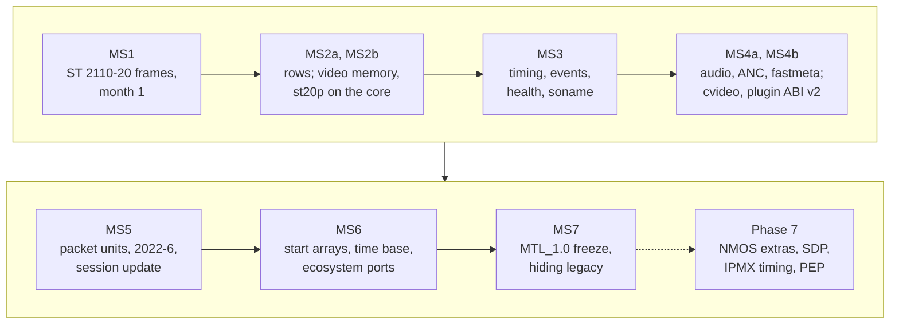
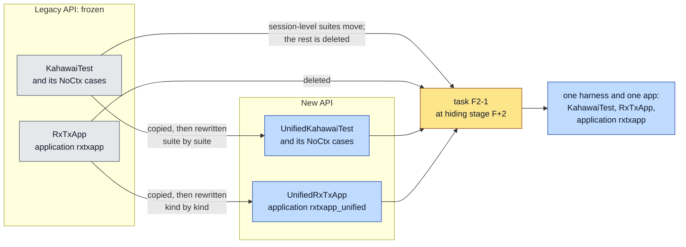
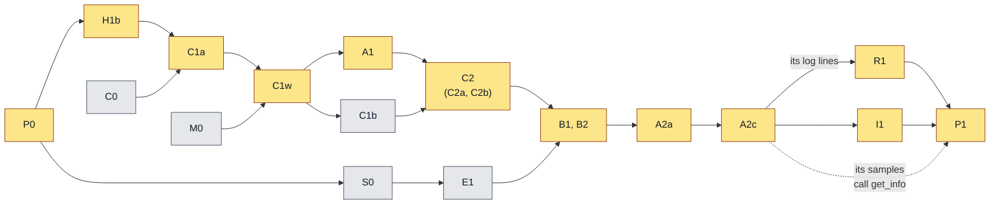
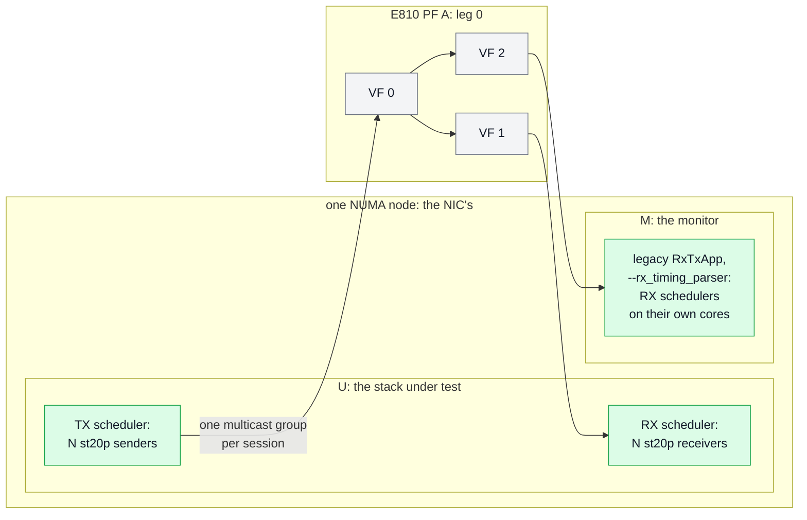

# Implementation plan

| | |
|---|---|
| Status | Plan of record. Nothing is implemented. The decisions it rests on are in [decisions.md](decisions.md) (D-99…D-112 shape it) |
| Baseline | `main` @ `545a266a`; the headers in [sketch/include/mtl/experimental/](sketch/include/mtl/experimental/) |

The headers are normative. Every API name in this plan is a header name; names inside the
library (the core, the bindings) are indicative.

**Start here**, by role:

| You are | Read |
|---|---|
| the implementing session | [README §1](README.md#1-for-the-implementing-session), then §1, §2 and §5 |
| a task's agent | the task's row in §5.2.1 and the reading list of §5.2.2 for that task |
| the maintainer | §1.2 (milestones), §5.6 (MS1 exit), §9 (risks), §10 (calendar) |

`[I]` marks an estimate. The ID families (D-, OI-, G-, U-, the task IDs) are explained in
[README §3](README.md#3-reading-the-ids); the assumptions A1–A10 of §1.1 are cited as "assumption
A1", so they do not collide with the tasks A1, A2a–A2c.

The milestones are **MS1…MS7** (§1.2, §5, §6), MS2 in two parts and MS4 in three (MS4a1, MS4a2,
MS4b), followed by Phase 7. The Kubernetes fixes run as a parallel track (§6.8).

**Related documents:**

- the architecture picture and the parts of the design: [core.md](core.md) §1; the engine
  change list: [engine.md](engine.md) §6;
- what each spike measures: [engine.md](engine.md) §6.1;
- the goals, non-goals and personas, and the full text and sources of each requirement:
  [requirements.md](requirements.md);
- every guarantee's text, tier, milestone and test method: [guarantees.md](guarantees.md); the
  oracle compared with the contract document:
  [timing.md](timing.md) §16.2;
- the row-by-row inventory, each feature's milestone, and the features reachable only through the
  session headers: [coverage.md](coverage.md); the feature × media matrix of today:
  [legacy-internals.md](legacy-internals.md);
- the function counts per header, per call class and per milestone: `sketch/check.sh`;
- the open items Phase 7 inherits from the IPMX verification: [nmos-ipmx.md](nmos-ipmx.md) §23;
- the decisions this plan rests on (D-99…D-112): [decisions.md](decisions.md);
- the state of MS1: `doc/unified-api/ms1-status.md` (ms1-status.md §1).

## 1. Assumptions, goal and milestones

### 1.1 The assumptions

Set by the maintainer; every choice below follows from them.

| # | Assumption | Consequence |
|---|---|---|
| A1 | AI agents (Claude Opus 5.5) write the code and the tests | effort is no longer the limit; the maintainer's review is (§10) |
| A2 | something works within one month | MS1 is a usable vertical slice: ST 2110-20 frames TX and RX on the new API, a test pool, a new-API RxTxApp and acceptance on it (§5) |
| A3 | every feature of today's API stays, except the capabilities D-112 removes ([coverage.md](coverage.md)) | no other cut (D-112) |
| A4 | slice mode is required (users exist) | rows units are in MS2a (D-101) |
| A5 | the decisions of [decisions.md](decisions.md) and the accepted resolutions of the open issues hold | their end states hold; where MS1 ships an interim (no command acks; libmtl without a soname, an `MTL_LEGACY` node or hidden internals) the milestone that reaches the end state is named (D-103, D-108) |
| A6 | elegant means small | one core under every API (D-99), one library with version nodes (D-23), the export list that `sketch/check.sh` prints (D-104), no layer that exists only for the transition |
| A7 | the current API keeps its validation while the new one gets its own, side by side | the legacy integration gtests (`KahawaiTest`, NoCtx) and RxTxApp are **frozen**; copies rewritten on the new API build to `UnifiedKahawaiTest` and `UnifiedRxTxApp`; the scripts run either or both (§4.1, D-109, D-110) |
| A8 | the FFmpeg and GStreamer plugins are rewritten completely on the new API | rewritten in place, path by path, with no legacy copy; from a path's rewrite its acceptance tests validate the new API (§4.1) |
| A9 | the double validation is temporary | at hiding stage F+2 (D-83) task F2-1 moves the session-level cases of `KahawaiTest` (the engine's internal test on `mtl_internal_dep`, the D-24 gate) into the unified harness and deletes the old harness, the pipeline-level cases, the legacy RxTxApp and their script options; the unified binary and app take the legacy names (§4.1) |
| A10 | the samples show the new API only, and all of it | the legacy samples are not kept: new samples in `app/sample/` replace them and together call every exported function (§4.2, D-138, G-114) |

### 1.2 The milestones

Port first (D-98): every milestone up to MS7 ports what MTL does today, plus the Kubernetes
lifecycle. The picture below is the order of the milestones and the headline of each; the table
after it has their full scope and calendar, and §5 and §6 their tasks.

| Milestone | Scope | Calendar [I] |
|---|---|---|
| **MS1** ST 2110-20 frames | the core, the video and null bindings, the API shell inside libmtl for ST20 frames TX and RX, a test pool at four tiers, `UnifiedKahawaiTest` and `UnifiedRxTxApp` for `st20p` beside the frozen legacy ones, the acceptance smoke set on both apps (§5) | weeks 1–4 |
| **MS2a** ST 2110-20 rows and completeness | the nightly comparison (§8.8); the wake checks S1a and S1b; queues for event loops (ex03); the `tick`, command acks, discard; **rows (slice)**; RX fill of library pools (video black), due time and `RX_LATEST`; the direct open of PCI and `native_af_xdp:` ports; `mtl_log_add_sink`; C-FPS, C-GRANT, C-BRIDGE; the MS1 stretch tasks (§6.1) | month 2 |
| **MS2b** video memory and the st20p re-base | attach, by index with the video RX `media_index`, per-acquire layouts, holds, split-forward, converter plugins; then, last, st20p re-based on the core once the nightly comparison has burned in (§6.1) | month 3 |
| **MS3** timing and observability | the ST20 timing subset (INDEX, start at TAI or index, `mtl_tx_get_next`, E1–E3); events, per-scheduler stats blocks, health; `mtl_session_update` on a stopped session, and FLOWS on a running one (G1); the libmtl soname, the `MTL_LEGACY` node and hidden internals; debug call-class checks; the FFmpeg plugin's st20p path on the new API (§6.2) | month 4 |
| **MS4a1** audio, fastmeta and A/V sync | audio (st30p re-based), fastmeta (st41 frames), A/V on one epoch timeline (media mode AUTO; audio TAI and INDEX MS6); video `MTL_UNDERRUN_REPEAT` (T-REP); fastmeta at any frame rate; DSCP on their bindings; their `UnifiedRxTxApp` kinds and `UnifiedKahawaiTest` cases (§6.3) | month 5 |
| **MS4a2** ANC | ANC (st40p re-based) at any frame rate, DSCP on its binding, its `UnifiedRxTxApp` kinds and `UnifiedKahawaiTest` cases, EBU LIST (tasks N1–N8, §6.3); its files are disjoint from MS4a1's, so it runs beside MS4a1 | month 5 (run after MS4a1, it moves MS4b and later by about 4 weeks) |
| **MS4b** compressed video and plugins | cvideo (st22p re-based; codec plugins on the transform state) and its rates (JPEG XS n and n·1000/1001), cvideo REPEAT (JPEG XS), plugin ABI v2, `mtl_convert`'s conversions, its CHECK since MS2a (§6.3) | month 6 |
| **MS5** packets and operators | packet units on every essence over today's RTP paths (one shared chunk expander, PE1–PE8), the generic `MTL_RTP` essence and ST 2022-6 (PE7); E5a (linear NL and W, D-143); `mtl_session_update` at an instant (legs, launch delay); RTCP sender reports on TX (their names leave `MTL_LATER`); the link monitor, capacity query, manager reconnect (§6.4) | month 7 |
| **MS6** synchronisation and the ecosystem | start arrays, ANC and fastmeta following their video, sample-accurate audio, E5b–E13, the published time base with FREERUN (E9; its name leaves `MTL_LATER`); recovery on library workers; the GStreamer, OBS, Python and Rust ports and the rest of the FFmpeg plugin (§6.5) | months 8–9 |
| **MS7** freeze and hide | the external review with the named consumers; the `MTL_1.0` freeze; the hiding stages F, F+1, F+2 (D-83) (§6.6) | month 10, then the deprecation releases at the targets of abi.md §7 |
| Phase 7 | NMOS extras, SDP, IPMX timing and the RTCP MIB, encryption, PEP ([nmos-ipmx.md](nmos-ipmx.md)), declared under `MTL_LATER` until then (D-98); a Phase 7 name leaves `MTL_LATER` in the milestone that implements it (RTCP sender reports MS5, FREERUN MS6) | after MS7 |

"MS4a" alone means MS4a1 and MS4a2 together. Created timelines are not in v1: they stay under
`MTL_LATER` in the headers.
Every session runs on the epoch timeline, and `mtl_wait`, `mtl_queue_arm` and `mtl_read_events`
take an instance as well as a session.

The calendar assumes about three to four reviewed tasks a week (D-107). It is an estimate; the
exit criteria, not the dates, end a milestone.

## 2. The architecture

### 2.1 One core, bindings, an API shell

The picture, the parts and their rules are in [core.md](core.md) §1; in short:

- **The core** (`lib/src/st2110/core/`, in libmtl) is the unit session: a slot table with one
  64-bit slot word per slot ([core.md](core.md) §3.1), an
  order ring of 64-byte submission
  descriptors that is the pick-up, result and reap order, the nine session states (D-08), one
  event word per object with one `mt_wake()` (D-158), the handle table (R4) and the transform state for conversion and codecs
  (D-100). It reaches its environment (allocation on a socket, the clock, the wake flush, the
  scheduler ID) through an instance-context interface, never through `struct mtl_main_impl*`.
- **A binding** per essence and direction (plus `packet` and `null`) implements the callbacks the
  engines already call (`get_next_frame`, `notify_frame_done`, `query_frame_lines_ready`,
  `query_ext_frame`, `notify_frame_ready`, `notify_slice_ready`, `notify_detected`) and the binding
  ops of [core.md](core.md) §2.1, and is the only code that builds engine `ops`. It runs on the
  tasklet under the session spinlock and is wait-free: a CAS, a release store of PUBLISHED, one RMW
  of the event word, and no syscall (the queue push of MS2a is lock-free). The few other engine
  entry points it uses are listed in one engine accessor header, `st_engine_core.h`.
- **The API shell** (`lib/src/unified/`, compiled into libmtl, exported in the nodes
  `MTL_UNIFIED_EXPERIMENTAL_<rev>_MSn`) validates the typed config and the options against the
  option table and stores them (the bindings build the engine `ops`, [core.md](core.md) §2.1),
  maps reasons and enforces call classes. It holds no data-path state.
- **The legacy pipelines** `st*p_*` become wrappers on the core as soon as their essence is on it
  (st20p MS2b, the others MS4a and MS4b); the legacy session API stays as the engines' interface.
- The core has the lease-table shape from MS1, so packet units, attached pools and holds add
  bindings and slot fields, never a second core. The module list is [core.md](core.md) §8; the
  seams are core.md §2 and engine.md §2.11.

### 2.2 Frames, rows and packets in one slot model

| Unit | `progress` | Binding |
|---|---|---|
| frame TX | all rows, set at submit | `get_next_frame` takes the descriptor at the pick cursor whose slot word is QUEUED with the descriptor's generation, makes the launch decision and fills the engine meta from the descriptor |
| rows TX (MS2a) | raised by each re-submit | the session is created `ST20_TYPE_SLICE_LEVEL`; `query_frame_lines_ready` returns `progress` |
| frame RX | — | `query_ext_frame` hands the engine a core-allocated slot; `notify_frame_ready` publishes it in `pub_seq` order |
| rows RX (MS2a) | rows received | `notify_slice_ready` stores `progress` and wakes `mtl_rx_wait_rows` |
| packets TX (MS5) | packets in the chunk | the same FIFO; one shared chunk expander attaches the chunk's buffers and feeds the engine's RTP ring; one completion per chunk |
| packets RX (MS5) | packets copied | the chunk is formed at dequeue from the engine's RTP ring |

### 2.3 Scope

The scope is [coverage.md](coverage.md): the operating-mode catalogue
([legacy-internals.md](legacy-internals.md)) and the use-case inventory of every public header,
rows U-001…U-420, give each feature's milestone, and the ST 2110-20 scope by milestone (today's
surfaces, the use cases, the easily forgotten modes, the backends and the rest by area) is
[coverage.md §6](coverage.md#6-st-2110-20-by-milestone), where a U-row wins over those tables. The
coverage gate D-87 holds: every legacy capability has a unified home and a milestone, or is removed
(D-112). The rows that still need a home (U-348, U-402; OI-40, OI-42) are in
[coverage.md](coverage.md).

### 2.4 Time sources in MS1

MS1 ships `MTL_TIME_SOURCE_AUTO` chosen at open (from MS3 it moves up without a step, to
CLOCK_TAI, and in MS6 to a PHC; D-229); `MTL_TIME_SOURCE_PTP_BUILTIN` on a VF
reached through the bridge (on a direct open it needs the PCI open of MS2a), with today's software
time base; and on a bridged instance (`UnifiedKahawaiTest` and `UnifiedRxTxApp` on VFs until MS2a,
§4.1) the legacy time base, which unified sessions on it read; a wrapper whose clock reads UTC as
TAI logs one WARNING (D-235). The sources, the bridge clock and
what each later milestone adds are [timing.md §2.2](timing.md#22-time-sources); `ptp_get_time_fn`
maps to `MTL_TIME_SOURCE_USER` ([migration.md](migration.md)). `MTL_REASON_CLOCK_NOT_OWNED` is
only for a request to steer a PHC MTL does not own (OI-7).

The tests: `--ptp`, the NoCtx PTP cases and the nightly-pytest `ptp` group
(`.github/workflows/nightly-pytest.yml:40`, `tests/acceptance/tests/single/ptp/`) pass on both apps
and both binaries, and the legacy gate runs the `tests/unit/ptp/` suite, which pins the software
time base (§8.5).

## 3. Prerequisites

### 3.1 Build rules of MS1

The implementation starts from these rules ([decisions.md](decisions.md) carries their
rationale):

- **One core:** the core with bindings under every API; the legacy `st*p_*` become wrappers on it
  (D-99).
- **One library:** libmtl carries the unified API, with `lib/src/unified/` compiled in, in one
  version node per milestone, `MTL_UNIFIED_EXPERIMENTAL_0_2_MSn` (the headers' revision 0.2); the
  version script, the frozen node lists, the soname and the `MTL_LEGACY` node are in
  [abi.md](abi.md) §2 (D-23, D-108).
- **Deferred wake (W2):** a completing context never makes a syscall: `mt_wake()` marks the
  object (`fired` lanes, a bit in the loop's bitmap), and the scheduler loop (`sch_tasklet_func`,
  after the handler loop) wakes a bounded number of marked objects and queues per iteration, one
  futex wake or one `write()` each, the rest round robin (D-142); an application thread that
  completes wakes directly. D-170's dense patterns, a slack gate, then the notifier thread (D-165)
  are built only by D-142's rules, which spikes S1a and S1b check in MS2a (D-68, D-102).
- **Export what is implemented:** a function is exported in the milestone that implements it, in
  that milestone's version node; its comment ends with the milestone tag, for example `(MS1)`, and
  its call-class macro carries the same number (`MTL_API_DP(1)`). The installed header declares the
  whole design (the `MTL_LATER` blocks for design checks only); a call to a function above
  `MTL_LEVEL` fails to compile naming its milestone with GCC and Clang 14 or later, else at link
  time; experimental headers carry no promise before MS7. `MTL_LEVEL` changes at the exits of
  MS1, MS2b (2), MS3, MS4b (4), MS5, MS6 and MS7 only. Every version node a release carries is
  sealed: a release cut while a milestone is open seals that milestone's node, which continues in
  a new part `_MSn.k` ([abi.md](abi.md) §3, D-191). A later value of an exported call (a flag, an enum value, an option key, a port prefix, a `when`
  kind, a wait mask, an update part) returns `-MTL_ENOTSUP` with `MTL_REASON_NOT_IMPLEMENTED`
  until its milestone.
  No stub generator and no header filter (D-106).
- **Tooling first:** task P0 (§5.2.2) is the first change of MS1.
- **Git authority:** [ms1-status.md](ms1-status.md) §0.

Two open items of this plan are settled as MS1 rules ([decisions.md](decisions.md), OI-59 and
OI-60):

- **OI-59, frame memory under the video bindings.** TX library pools use the engine's own
  framebuffers in MS1; from MS2b every TX slot is an ext frame that carries its page table (PA mode
  builds page tables only for engine-allocated frames, `st_tx_video_session.c:245-266`), so library
  and attached pools are one code path. RX uses `query_ext_frame` with core-allocated slots from
  MS1, so RX has one path from the start.
- **OI-60, where conversion runs in MS1.** In the caller (submit converts, dequeue converts) for
  the formats st20p converts internally today; with `MTL_SUBMIT_SRC_PLANES` submit reads the
  caller's planes during the call. Converter plugins join in MS2b with the transform claim and done
  (D-100).

### 3.2 Code that must land first

- **PR #1770** (open, 38 commits): of its rows MS1 needs SF-05/MF1 (an ext buffer is reported done
  before its `refcnt` is decremented, `tv_frame_free_cb`, `st_tx_video_session.c:134-135`), SF-08,
  SF-09 and SF-23. If it is not merged by the end of week 1, the MF1 hunk is taken into task E1a. The
  PR also fixes the video `update_destination` that writes the source UDP port into the destination
  port (`st_tx_video_session.c:3829-3830`); task G1a (MS3) takes that hunk if the PR is not merged.
- **PR #1610's legacy st20p parity tests**, folded into main's harness
  (`tests/unit/pipeline/st20p_tx_harness.c`, `st20p_harness.c`) before any engine change of MS1, so
  they pin today's behaviour (task T1). Its eventfd and poll loop in `mt_session_event.c` and
  `mt_session_video_common.c` seed `mt_wake` and `mtl_wait`, with credit (D-27); its event ring
  does not. What else of the PR each task can take, and what not, is in
  [pr1610.md](pr1610.md) §3 and §5.

### 3.3 When the spikes run

The question each spike answers is in [engine.md](engine.md) §6.1.

| Spike | Needed by |
|---|---|
| S0 baseline | MS1 week 1 (the §8.4 budgets; the capacity by MS2a's exit); E1 before it merges |
| S1 waker | MS2a |
| S6 idle cleanup | MS1 task E1b |
| S8 queue stop and start | MS3 (the stalled-queue close, attached memory after recovery) |

## 4. Where the code goes

| Item | Path | Notes |
|---|---|---|
| public headers | `include/mtl/experimental/*.h`, installed to `${includedir}/mtl/experimental/` | moved from the sketch in task H1b, one copy holding the full design, each function tagged with its milestone; a call above `MTL_LEVEL`: §3.1 (D-106); the `MTL_LATER` blocks are installed, for design checks only |
| the core | `lib/src/st2110/core/` (`st_core.h`, `st_core_slot.c`, `st_core_session.c`, `st_core_wait.c`, `st_core_handle.c`, `st_core_xform.c`; names indicative) | in libmtl, because the legacy wrappers use it too (MS2b); `st_core.h` is task C0 |
| engine accessor header | `lib/src/st2110/st_engine_core.h` | every engine entry point a binding uses besides the callbacks ([core.md](core.md) §3) |
| bindings | `lib/src/st2110/core/bind_{video_tx,video_rx,null}.c` in MS1; the other essences and `packet` later | each implements the binding ops ([core.md](core.md) §2.1) and its engine's callbacks |
| API shell | `lib/src/unified/`, compiled into libmtl; the data tables of README §4 (`reasons.def`, `mtl_options.def`, `availability.def`, `codes_per_call.def`; X-macro rows, below) | exported in the nodes `MTL_UNIFIED_EXPERIMENTAL_<rev>_MSn` (`lib/src/unified/libmtl.map`; a sealed node's names in `exports.<suffix>.list`); pkg-config stays `mtl` (D-23) |
| libmtl ABI | `lib/meson.build:151`: no soname or version script today | H1b: `libmtl.map` with nodes per milestone part (MS1, `_BRIDGE`), sealed at each exit and release, every other symbol exported as today; MS3: the soname, `MTL_LEGACY` and `local: *` after an `nm` audit; MS7 deprecates the legacy symbols, which leave `MTL_LEGACY` from F+2 ([abi.md](abi.md) §2; D-83, D-108) |
| meson | `enable_unified` (default **true**, so CI catches breakage; there is no ABI promise before the freeze), `enable_debug_api` (default false; `./build.sh unit` sets it true) | in `meson_options.txt` |
| in-tree level | libmtl and `mtl_internal_dep` (H1b); one `add_project_arguments('-DMTL_TARGET_LEVEL=(MTL_LEVEL+1)', …)` line in `tests/meson.build` and `app/meson.build` (H1b) and in `tests/tools/UnifiedRxTxApp/meson.build` (R1's rewrite; the copy stays verbatim) | the in-tree consumers build against the milestone under way; never in `mtl.pc` (below) |
| unit tests | U: `tests/unit/unified/` → `UnifiedUnitTest`, which links libmtl and runs on `null:1`. UB: they `#include` production `.c` files, so they build into `UnitTest` (`mtl_internal_dep`) next to the harness they use (`tests/unit/session/`, `tests/unit/pipeline/`) | built and run by `./build.sh unit` |
| integration tests | `tests/unified_integration_tests/` → the `UnifiedKahawaiTest` binary | the harness and the ported suites of `tests/integration_tests/`, copied and rewritten on the new API (§4.1); `tests/integration_tests/` stays frozen as `KahawaiTest` |
| RxTxApp | `tests/tools/UnifiedRxTxApp/` → `UnifiedRxTxApp`, installed beside `RxTxApp` | the framework and the ported kinds of `tests/tools/RxTxApp/`, copied and rewritten on the new API, with the same CLI and JSON; `tests/tools/RxTxApp/` stays frozen (§4.1, D-110) |
| samples | `app/sample/`, on the new API only | §4.2: they replace the legacy samples and together call every exported function (G-114) |
| acceptance | `tests/acceptance/mtl_engine/`: a `UnifiedRxTxApp` adapter beside `RxTxApp`; the `application` fixture (`conftest.py:1404`) gains `rxtxapp_unified` | `--app rxtxapp\|rxtxapp_unified\|all` (default `all`) selects (§4.1) |
| doc test | `doc/unified-api/sketch/check.sh` reads the headers from `include/` after task H1b | in CI through `.github/path_filters.yml`; it prints the function counts per header, per call class and per milestone tag, which no document repeats, and runs `gen_api_doc.py --check` (the marked tables), the availability lint and the number lint (README §1) |
| status ledger | `doc/unified-api/ms1-status.md` | ms1-status.md §1 |

A row of `mtl_options.def` holds the key's number, name, type, range, default, when, scope, tier,
applicability and owner, its milestone and the task that built it. The in-tree level is never set
in `mtl.pc`, so an external build keeps the default `MTL_LEVEL`; its line names the languages
`['c', 'cpp']` (`tests/`: `'cpp'`); a plugin rewritten on the new API sets it in its own build in
its rewrite (FFmpeg MS3, GStreamer MS6), and a call to a function of the open milestone not yet
exported then fails at link.

### 4.1 Two validation stacks

Until the legacy API is removed, each API is validated by its own suites (assumptions A7–A9).

| | Legacy API (frozen) | New API |
|---|---|---|
| integration gtests | `tests/integration_tests/` → `KahawaiTest`, its NoCtx cases | `tests/unified_integration_tests/` → `UnifiedKahawaiTest`, its NoCtx cases |
| RxTxApp | `tests/tools/RxTxApp/` → `RxTxApp` | `tests/tools/UnifiedRxTxApp/` → `UnifiedRxTxApp` |
| acceptance | the application `rxtxapp` | the application `rxtxapp_unified`; FFmpeg and GStreamer from their rewrite |
| unit | `UnitTest` | `UnifiedUnitTest`; the UB cases stay in `UnitTest` (§8.1) |

**Frozen** means that the legacy test cases and the legacy RxTxApp's code get no new case, no
rewrite and no deletion. The changes allowed are the run option of the table below, what keeps
them building against libmtl, what a legacy bugfix needs (D-24), a harness bugfix (a crash, hang
or flake in the gtest harness, `test_util.*`, or RxTxApp's framework: arguments, JSON parser, app
core, never what a case asserts), and the agent rules of P0
(the `tests/integration_tests/CLAUDE.md` change and a new `tests/tools/RxTxApp/CLAUDE.md`), each
approved by the maintainer; `mtl-reviewer` treats any other diff in `tests/integration_tests/`
and `tests/tools/RxTxApp/` as a BLOCKER (P0). So the frozen suites check the legacy API as users
see it, also after the pipelines become wrappers on the core (st20p MS2b, the others MS4).

**The copies.** Each new tree starts as a copy, in one mechanical commit: `UnifiedKahawaiTest`
copies the harness (`tests.cpp`, `tests.hpp`, `test_util.*`, meson) and the st20p files,
`UnifiedRxTxApp` the RxTxApp framework (args, JSON parser, app core) and the st20p files. Other
suites and kinds enter when they are ported, rewritten on the new API in the milestone that ports
them:

- `UnifiedKahawaiTest` keeps the suite and case names of the cases it ports
  (`St20p.digest_1080p_s1` in both binaries), so one `--gtest_filter` selects the twins in both
  and the nightly pairs them by name (§8.8). A suite not yet ported is not in the binary. Its own
  cases have new names: `St20p.tx_idle_last_result`, `St20p.close_while_streaming`, the suite
  `Cross`.
- `UnifiedRxTxApp` keeps RxTxApp's CLI, JSON schema and output lines, so the pytest configs and
  parsers serve both (D-110). A JSON kind not yet ported is refused at start ("kind <x> is not on
  the unified API yet"), and the `rxtxapp_unified` adapter skips those tests with that reason.
  Every key it adds beyond the legacy schema (rows, attach, update, …) is marked unified-only in
  its parser's key table; a config that uses one must carry `"api": "unified"` at the top level,
  else `UnifiedRxTxApp` exits with a JSON error naming the key. The `rxtxapp` adapter skips a
  config with `"api": "unified"` ("unified-only config"), so the legacy app never runs a config
  whose keys it would ignore (R1; the adapter: P1).
- Both use the new API only, with two exceptions. On VFs before MS2a they bring the instance up
  through the bridge (one legacy `mtl_init` wrapped by `mtl_instance_from_legacy`;
  [contract.md §2.8](contract.md#28-legacy-bridge),
  [examples.md §26](examples.md#26-from-the-legacy-api)), because
  `mtl_instance_open` opens PCI ports from MS2a. The suite `Cross` uses the legacy API on purpose,
  as the peer of a unified session in the same process, so it keeps the bridge after MS2a, as the
  `from_legacy` sample does (§4.2).

**Running either or both.** One option in each place that starts them:

| Where | Option | Default |
|---|---|---|
| `build.sh` | builds and installs both binaries and both apps (the new ones with `enable_unified`) | both |
| `.github/scripts/gtest.sh` | `--api legacy\|unified\|both` (env `MTL_TEST_API`); `UNIFIED_TEST_BINARY` beside `KAHAWAI_TEST_BINARY` | `both` |
| `tests/integration_tests/noctx/run.sh`, `run_pf.sh` | `--api legacy\|unified` selects the binary | `legacy` |
| MCP `run_gtest`, `run_noctx_tests`, `run_noctx_pf_tests` | `binary`: `legacy` or `unified` (P0) | `legacy` |
| pytest | `--app rxtxapp\|rxtxapp_unified\|all`, a filter on the params of the `application` fixture | `all` |

**FFmpeg and GStreamer** are rewritten in place (A8): a path's rewrite replaces its legacy code,
its acceptance tests then run the new API, and the legacy pipelines are validated by the frozen
suites alone. The FFmpeg plugin's st20p path is rewritten in MS3, the rest of FFmpeg and
GStreamer in MS6 (§6.2, §6.5). From then the cross-app tests (`tests/single/cross_app/`) pair a
new-API plugin with either RxTxApp.

**Removal** (A9). At hiding stage F+2 task F2-1 (§6.6) leaves one harness with one name: the
session-level suites of `KahawaiTest` (`St20_tx`, `St20_rx` and the other suites over the session
API, the engine's internal test and the D-24 gate) move into the unified harness, which then
builds where `mtl_internal_dep` is available, as `UnitTest` does; the pipeline-level cases, the old
harness (`tests.cpp`, `tests.hpp`), its NoCtx cases, the legacy RxTxApp, the `rxtxapp` application
and the `--api` and `binary` options are deleted, and so is `lib/src/unified/compat_log.c`; and the
unified binary, app and application take the names `KahawaiTest`, `RxTxApp` and `rxtxapp`
([abi.md](abi.md) §6.3, migration.md §9.2; [coverage.md](coverage.md)).

**Cost.** While both exist, the integration tests and RxTxApp are kept twice [I: about 7 k lines
of RxTxApp framework and 1.8 k of gtest harness copied in MS1, with the st20p files, then every
ported suite and kind]. The copies are mechanical commits, outside the commit cap (D-107); the
rewrites are ordinary tasks.

### 4.2 Samples

`app/sample/` holds samples on the new API only (A10). Each is a complete program that expands
one example of [examples.md](examples.md), the one it is named after; one program, `fastmeta`,
has none, and the C++ file is the `cpp` program. A program adds what a runnable program needs:
arguments, `common.c`'s ports and test pattern, a run time, and the options of the last column,
into which the planned programs of the same pattern fold. It replaces the legacy samples of its
row. In MS1 the samples `tx_video` and `rx_video` run on `null:1` in CI, `from_legacy` and the
TX → RX pair (`tx_video` to `rx_video`) on `kernel:lo`; they run on VFs from MS2a, when
`mtl_instance_open` opens PCI ports. `from_legacy` calls the legacy `mtl_init`, so it runs on
`kernel:lo`, not on `null:1`, and it keeps the bridge after MS2a. A
legacy sample is deleted in the commit that adds its replacement, and the links to it
(`doc/design.md`, `doc/dma.md`, `doc/gpu.md`, `doc/doxygen/programmers_guide.md`,
`app/sample/README.md`) move to the new sample in the same commit. Legacy samples whose feature
is cut (D-112), `ext_frame/rx_st20p_hdr_split_gpu_direct.c` (CUT-1), go in MS1, and so do
`sample_test.sh` and `redundant_sample_test.sh`, which CI's sample run replaces.

**Coverage** (G-114). Together the samples call every unified function libmtl exports, except the
functions of `mtl_debug.h`, and every essence and direction has a TX and an RX program (`fastmeta`
is the one program without an example, so that fast metadata has both). The samples call the
typed inline wrappers (`mtl_session_close`, `mtl_tx_reap`), not the exported verbs by name, so the
check in CI reads the undefined symbols of the sample objects (`nm -u`) and compares them with the
unified symbols libmtl exports (`nm -D --with-symbol-versions`, the `MTL_UNIFIED_EXPERIMENTAL_`
nodes): a function exported without a calling sample fails the build. The examples call every
function too, and `sketch/check.sh` checks it the same way, with `nm -u` of the compiled examples
against `check.sh --tags`, so an example set that drops a function fails before a program does.
So the long-term `app/sample/g114_exempt.txt` is empty; until a function's first calling program
ships, its line names the function and the milestone by which a program calls it (P1), and the
check fails on a stale or expired line.
A sample enters `app/sample/meson.build` in the milestone that exports its functions. CI runs
every built sample for 10 s on `null:1` (`from_legacy` on `kernel:lo`); from MS2a the nightly
runs the TX and RX pairs on VFs. In MS1 ex01, ex02 and ex20 on `null:1` complement the three
samples. `from_legacy` expands ex24 with `--clock tai|legacy` (default `tai`, ex24's
`ptp_get_time_fn`) and prints the flags of `mtl_time_now` every second. CI runs it once with each
value for 10 s on `kernel:lo`, so the MS1 direct-clock rows of G-126 (`legacy`) and the
`-MTL_ENOTSUP` of a user clock (`tai`) are both exercised.

**Shared code.** One small `app/sample/common.c` with `common.h`, written anew: ports and
addresses from program arguments or `MTL_PORTS`, SIGINT and SIGTERM to `mtl_interrupt`, a test
pattern and a file source. The legacy `sample_util.*` is deleted with the last legacy sample.

| Sample | Example | Milestone | Replaces | Options |
|---|---|---|---|---|
| `tx_video` | ex01 | MS1 | `tx_st20_pipeline_sample.c`, `legacy/tx_video_sample.c` | results on, DSCP, an application format |
| `rx_video` | ex02 | MS1 | `rx_st20_pipeline_sample.c`, `legacy/rx_video_sample.c`, `experimental/rx_st20_redundant_combined_sample.c` | one or two legs, an application format |
| `event_loop` | ex03 | MS2a | — | interrupt targets; events from MS3 |
| `timed_start` | ex04 | MS3 | — | `--now` or `--at <t_start>`, `--depth`; media modes INDEX and TAI |
| `exact_launch` | ex05 | MS3 (EXACT MS2a) | — | `--exact` or `--not-before` |
| `live_tx` | ex06 | MS3 | — | a test source that runs late or stalls on demand |
| `live_rx` | ex07 | MS2a (`--timing-parser`, B3), MS3 | `rx_st20p_timing_parser_sample.c`, `rx_st20p_auto_detect_sample.c`, `dma/dma_sample.c` (its user DMA engine is cut, CUT-5) | `--monitor` (RX_LATEST, format detection; on a format above the maximum a stop, `MTL_UPDATE_MEDIA` and a start), `--timing-parser`, `--dma` (`MTL_OPT_DMA`) |
| `rows` | ex08 | MS2a, MS3 (INDEX and `mtl_tx_get_next`) | `low_level/tx_slice_video_sample.c`, `low_level/rx_slice_video_sample.c` | `--tx` or `--rx` |
| `rtp_packets` | ex09 | MS5 | `low_level/tx_rtp_video_sample.c`, `low_level/rx_rtp_video_sample.c` | `--send` or `--forward`, `--st2022-6` |
| `zero_copy_tx` | ex10 | MS2b | `ext_frame/tx_st20_pipeline_ext_frame_sample.c`, `ext_frame/tx_video_split_sample.c`, `gpu_direct/tx_st20_pipeline_gpu_direct.c` | `--layout` (a buffer per acquire), `--device` (`MTL_MEM_DEVICE`, MS6) |
| `rx_into_memory` | ex11 | MS2b | `ext_frame/rx_st20_pipeline_dyn_ext_frame_sample.c`, `gpu_direct/rx_st20_pipeline_gpu_direct.c` | `--mxl` or `--record` (`mtl_rx_provide`), `--device` (MS6) |
| `split_forwarder` | ex12 | MS2b | `fwd/rx_st20_tx_st20_split_fwd.c`, `fwd/rx_st20p_tx_st20p_split_fwd.c`, `fwd/rx_st20p_tx_st20p_merge_fwd.c`, `legacy/rx_st20_tx_st20_fwd.c` | `--merge` (four HD into one 4K, by copy) |
| `audio` | ex13 | MS4a1 | `tx_st30_pipeline_sample.c`, `rx_st30_pipeline_sample.c` | `--tx` or `--rx` |
| `fastmeta` | — | MS4a1 | — | `--tx` or `--rx` (the copy path of ex13, which names the fast metadata fields) |
| `anc` | ex14 | MS4a2 | `tx_st40_pipeline_sample.c`, `rx_st40_pipeline_sample.c` | `--tx` or `--rx` |
| `cvideo` | ex15 | MS4b | `tx_st22_pipeline_sample.c`, `rx_st22_pipeline_sample.c`, `legacy/tx_st22_video_sample.c`, `legacy/rx_st22_video_sample.c` | `--plugin <so>` |
| `pod_service` | ex16 | MS2a (health and the shutdown report MS3) | — | |
| `telemetry` | ex17 | MS2a (A2b; events MS3, `mtl_session_capture` MS4b, from the C++ bench) | — | `--capture <path>` |
| `nmos_node` | ex18 | MS3 (immediate, the TX hand-over), MS5 (scheduled) | — | |
| `framework_setup` | ex19 | MS2a | — | |
| `rx_to_framework` | ex20 | MS2a | — | |
| `live_sink` | ex21 | MS2 | — | |
| `av_playout` | ex22 | MS6 | — | |
| `processor` | ex23 | MS2b (video by copy), MS4b (`mtl_convert`, to ST 2110-22), MS6 | `fwd/rx_st20p_tx_st20p_fwd.c`, `fwd/rx_st20p_tx_st20p_downsample_fwd.c`, `fwd/rx_st20p_tx_st20p_downsample_merge_fwd.c`, `fwd/rx_st20p_tx_st22p_fwd.c` | `--to-cvideo` (ex15's plugin), a converter plugin |
| `from_legacy` | ex24 | MS1 | — | `--clock tai\|legacy` |
| `cpp` | `examples_cpp.cpp` | MS2a | — | |

Beside `app/sample/`: the MSVC project `app/sample/msvc/` builds `tx_video` and `rx_video` from
MS2a, with the compile-only Windows CI (U-103); `app/v4l2_to_ip` moves to video TX over an
attached pool (MS2b, [migration.md](migration.md) §9.3); `app/perf` and `app/tools/convert_app`
time and drive `mtl_convert` instead of the per-pair converters (MS4b); `app/tools/lcore_shmem_mgr`
is a MtlManager tool and stays.

## 5. MS1: ST 2110-20 frames in a month

### 5.1 Scope

**In:**

- **Headers and build:** the headers in `include/mtl/experimental/`; libmtl exports the MS1
  functions in `MTL_UNIFIED_EXPERIMENTAL_<rev>_MS1` and nothing else of the unified API; later
  values of those calls follow the export rule (§3.1); at the exit the
  node equals the functions tagged MS1, after any retag of a slipped function, and the exit
  commit seals the open MS1 part and `_BRIDGE` (`check_exports.sh --seal`) and sets `MTL_LEVEL`
  to 1 (G-51).
- **Core:** handles (process-wide, never freed, generations, R4); `mtl_last_error` (written only
  by failing calls), reasons, `MTL_INIT` and `struct_size` (R3); the slot table (one 64-bit word per
  slot), the descriptor ring, the result reservation, the hold (D-209); stop against submit (exactly one wins); the
  nine-state table (ARMED only through a start `when`, which MS1 rejects); the event word and the
  calls with a timeout (D-158), `mtl_wait`, with the count-bounded flush (D-142); no descriptor
  (queues are MS2a, D-159); sticky interrupts with a wait-target mask; deferred, idempotent close.
- **Instance:** `mtl_instance_open` over `mtl_init` for `kernel:` and `null:<n>` (a null-only
  instance does not call `mtl_init`: it initialises EAL itself with
  `--no-huge --no-pci --in-memory`, or accepts an initialised EAL, and runs a library thread as its
  loop); `MTL_PORTS`, `MTL_INSTANCE_TASKLET_THREAD`/`_SLEEP`, time source AUTO; the bridge
  `mtl_instance_from_legacy`, through which PCI BDFs and `native_af_xdp:` reach unified sessions;
  `mtl_close` on an instance (0, 1 or `-MTL_EIO`); re-open after close on `null:`; the wrapper's
  direct clocks and the `mtl_uninit` guard (OI-72); the UTC WARNING of the wrapper's clock (D-235).
- **Session:** `create`, `query`, `get_info` (with `wire_bps`), `start` (n = 1, `when` NULL or
  NOW) on the session's index grid (D-233), `stop` (DRAIN, FLUSH, arrays), `close` (1 while retiring, 0 once retired; a repeated close
  polls), `get_status` (state, `blocked_on`, legs).
- **Data path:** `mtl_tx_acquire`, `mtl_tx_submit` (with `MTL_SUBMIT_SRC_PLANES`), `mtl_release`,
  `mtl_rx_dequeue`, `mtl_reap` with the typed `mtl_tx_reap` and `mtl_tx_reap_full`, `mtl_wait`;
  the `used` rules of video frame units; the meta area with its terminator,
  `mtl_meta_put`, `mtl_meta_find`; the 64 B tail after each RX library slot, zeroed at dequeue
  (D-151).
- **Results:** `MTL_SESSION_RESULTS` with the records in `seq` order; ON_TIME (`MTL_TXR_DEFERRED`
  when AUTO moved the unit), DROPPED (the launch decision's `SNAP_COLLISION`, `BEHIND`, `TOO_LATE`;
  the recovery verdict), FLUSHED; cookie verbatim; reservation at acquire; `margin_ns` and
  `sent_tai_ns` read `MTL_TIME_NONE` until MS3 (D-215). In copy mode (no chain:
  kernel socket, AF_XDP, NICs without multi-segment) a result means built, not sent, until MS2a.
- **Video:** `MTL_VIDEO`, `MTL_UNIT_FRAME`, TX and RX, one or two legs (ST 2022-7, one `sc.ssrc`
  and `sc.payload_type` for both), progressive and interlaced (a field per unit), library pools
  (OI-59), `app_format` conversions in the caller (OI-60), `MTL_META_USER`, packing, sender type,
  `mtl_flow.dscp` into the TX builders' TOS, the options RxTxApp and KahawaiTest set; rates of the
  legacy `enum st_fps` (interlaced: frame rates whose field rate is one), `FIELD_RATE` above 30,
  interlaced TAI parity; sender types passed as legacy does, with NL, off-format N and interlaced or
  PsF N flagged `MTL_INFO_NON_COMPLIANT` (D-143).
- **TX timing:** the launch decision, the core's `st_core_admit` called by the video TX binding at
  `get_next_frame` with its grid, with exact math: AUTO
  takes the next feasible index (a late unit is ON_TIME with `MTL_TXR_DEFERRED`; interlaced fields
  alternate in submission order and a defer skips whole frames), AUTO + `NOT_BEFORE` the first index
  whose first-packet time is ≥ t, TAI the nearest index with timing.md §4.3's hysteresis and
  `tx.snap_tolerance_ns` at most half the unit period (D-234; `SNAP_COLLISION`, `BEHIND`, `TOO_LATE` as DROPPED); it drives the engine with `USER_PACING | RTP_TIMESTAMP_EPOCH` and `required_tai = N·T`,
  so RTP comes from the frame epoch (D-10) with today's rounding. `notify_frame_late` never fires
  for core sessions. `RTP_TS`, and a TAI unit whose `NOT_BEFORE` or `EXACT` launch lands in another
  slot than its media time, are `-MTL_ENOTSUP` until E1 (MS3). B1 uses the pick-up lead of
  [timing.md §6.1](timing.md#61-the-pick-up-deadline-and-the-submit-lead), which MTL adds itself to a positive
  `min_tx_delay_ns` (D-218, C2b's launch steps); the playback and capture launch delays are
  [timing.md §5.2](timing.md#52-min_tx_delay_ns-and-the-launch-rule).
- **RX:** incomplete units delivered with their status (the default
  `rx.incomplete = MTL_RX_DELIVER`; the bytes of lost ranges are unspecified until the fill of
  library pools ([contract.md §9.8](contract.md#98-rx-placement)) lands in MS2a, and the result says so with `MTL_RX_INCOMPLETE`),
  `MTL_OPT_RX_INCOMPLETE = MTL_RX_DISCARD`; delivery in the completer's `pub_seq` order; two legs
  with the out-of-order window of `rx.skew_budget_ns`.
- **Observe:** the D-110 log lines from `compat_log.c`; the latency fields with the caller's work
  C held in `latency_min_ns`, and `convert_ns` (D-225).
- **Options:** the option table: every key known, the ST20 ones implemented.
- **Test substrate:** the null binding with null loopback (an RX session receives the TX units
  whose destination IP and port it matches), the test clock (completions run synchronously inside
  `MTL_FAULT_CLOCK_ADVANCE`), `mtl_debug_inject` (`FORCE_ERROR`, `DROP_PKTS`) with
  `-Denable_debug_api=true`.

**Stretch:** A2b (stats, RX detail, port spec, session list), B3 (RX DMA, two RX threads, the
RX timing parser, per-packet conversion, `MTL_SUBMIT_EXACT`), X (E2, exact `floor` RTP). They are
written in week 4 only if the gates allow, and committed in MS2a (§5.2.3); what is not written moves
to MS2a (A2b, B3) or MS3 (X, with E2).

**Out**, the non-goals of MS1. Each is in a named later milestone (the export rule: §3.1).

- other essences (MS4a, MS4b); packet units (MS5); rows units (MS2a);
- attached or imported memory, holds, per-acquire layouts (MS2b for video);
- `mtl_session_update` (MS3, also FLOWS while running with `when` NULL or `MTL_NOW`; MS5 at an
  instant), `mtl_session_discard` (MS2a);
- queues for event loops (`mtl_queue_*`, ex03; MS2a);
- media mode INDEX, start at a TAI or an index, `mtl_tx_get_next`, `MTL_SUBMIT_RTP_TS` (MS3);
  start arrays (MS6);
- events, health, shutdown report (MS3);
- command acks, RX due-time force-complete, the fill of lost ranges in library pools (MS2a;
  [contract.md §9.8](contract.md#98-rx-placement));
- the direct open of PCI ports and `native_af_xdp:` (they reach unified sessions through the
  legacy bridge in MS1), `mtl_log_add_sink` (MS2a);
- video rates outside the legacy `enum st_fps`; sender-type grants and their reports;
  `mtl_time_now` on a wrapper with a user or built-in PTP clock (all MS2a);
- the samples `event_loop`, `rx_to_framework`, `pod_service` (MS2a);
- RX DMA, two RX threads, the RX timing parser, per-packet conversion and `MTL_SUBMIT_EXACT`:
  MS2a (the stretch task B3);
- the legacy pipelines re-based on the core (MS2b for st20p).

No ported feature regresses for legacy users: the legacy API is untouched in MS1 except for
bugfixes, and the legacy gate (§8.5) passes at every milestone. The built-in PTP client on a VF
keeps working with its software time base (§2.4).

### 5.2 Tasks

Each task is one review unit on the work branch (§5.8): one commit, or a short series of commits,
each under the commit cap of [D-107](decisions.md) with its tests (mechanical copies, moves and
deletions exempt), owned by `mtl-developer` for Gates 0–4 (P0 and S0: the main session), reviewed
by `mtl-reviewer` (Gate 5), and run on VFs by `mtl-system-admin` where marked (Gate 6). Sizes are
estimates [I].

#### 5.2.1 The task table

| # | Task | Depends on | Size (lib + tests) | Gate 6 | Exit |
|---|---|---|---|---|---|
| P0 | tooling, main session (below): `run_gtest` options and `binary`, frozen-tree rules, `CLAUDE.md` files, acceptance rules for `UnifiedRxTxApp`; the iteration histogram (`mtl-developer`) and the S0 scripts | — | 300 + 150 + 300 | `run_gtest`, `St20p*`, TSC, also on `kernel:lo` | both runs green; each config diff approved; `mt_hist_test` green; the session restarted |
| M0 | docs, main session, no review slot (below): `wait_flush.py`'s queue entry and `wake_k` cases, `final_model.py`'s joint and epoll-mode cases, `check_labels.py`, `run_models.py`, `stress.c`'s mutants; the ring models in the model job | — (before week 2) | ≈ 400 | — | `run_models.py` gives every expected result; `check_labels.py` passes on wait-protocol.md and `final_model.py` (the M0 card) |
| S0 | baseline measurement, owned by the main session (detail below): the S0 loads, RL and TSC, through `.github/scripts/perf/` | P0 | — | — | the medians and A/A spreads of the §8.4 metrics per load in ms1-status §4, every A/A rule met or a revision asked for as a D-row; legacy's capacity C per load by MS2a's exit |
| T1 | PR #1610's legacy st20p parity tests on main's harness: the 9 TX cases of `a693810c` and the 4 RX cases of `f23158c1` (pr1610.md §3) | — | 600 test | — | they pin today's behaviour and pass; Gate 2: each test fails with the line it pins reverted locally |
| H1b | series of four (below): 0 the tables; 1 the headers moved, with the inline-helper U tests and G-148; 2 the API shell, nodes `_MS1` and `_BRIDGE`, the seal checks, `st_avail_check`, `st_api_ret`; 3 the run options | P0 | ≈ 1.45 k (1.0 k data); 3.6 k moved + 0.39 k; 1.05 k + 450; 150 | — | the four parts' exits (below) |
| E1a | engine fixes, TX completion: MF1 (unless PR #1770 landed), MF7, the TX recovery verdict with the two alternating `sh_info` and the use generation in `fcb_opaque` (engine.md §5), storing no W (D-209); the verdict part of `st_engine_core.h` | T1; S0's at-quota data before its commit | 230 + UB | yes | the legacy gate on a VF, TSC and RL; UB for MF1, MF7, the verdict |
| E1b | idle descriptor cleanup, only in `WAIT_FRAME`: on dedicated queues, and on shared queues by a rewrite of `mt_tsq_done_cleanup` that takes `tx_mutex` by trylock (lock on the recovery path, never `tsq_lock`), frees at most `tx_rs_thresh` per visit and skips AF_XDP (D-213) | E1a | 160 | yes | the legacy gate; UB G-147 |
| E1c | RX: incomplete delivery always on, SF-45 (the hook never refuses); the RX put and per-leg arrival time of `st_engine_core.h` | T1 | 90 + UB | yes | the legacy gate; UB `rx_incomplete_status` |
| E1d | SF-49, the ST30P and ST40P user timestamps, OI-3 teardown order, the wrapper count and the `mtl_uninit` guard | T1 | 130 | yes | the legacy gate; `tests/unit/session/st30_tx/pacing_test.cpp`, `multi_essence_sync_test.cpp` unchanged |
| C0 | `st_core.h`: the slot word (D-118), the descriptor ring, line A and the in-flight line's `intr` (`alink`, line C reserved), the loop bitmap, the binding ops and core calls (core.md §2, §2.1), grant and grid (core.md §3.2), the instance context; the register | — | ≈ 710 | — | a TU with `st_core.h` builds; `check_register.sh` passes; `pahole` in the commit; checkpoint 1 (below) |
| C1a | series of two: handles (line A, the in-flight line, `owner`, `hw`, per-node chunks, `lease_base`), the state table and `st_core_states.def`, deferred and idempotent close, closed-by-instance, the orphan list, RETIRE per D-168, the lint `core_no_essence` | C0, H1b | 1.0 k + 0.51 k | — | U: G-07, G-29, G-49 (from the `.def`), G-65, G-71 (core part); `CoreClose.orphan_freed_at_next_cp` |
| C1w | the object path of wait-protocol.md §2–§6 (D-158, D-167, D-168): EVENT, M1, K1, FLUSH with `wake_k`, WT T1–T9, DP, WAIT0, INTERRUPT, WALK, CLOSE, Y1, raw syscalls, hooks, USDT, `st_core_dump()` of line A; the model copied | C0, C1a, M0 | 350 + 480 | yes (legacy gate: flush line) | the model job; its hook tests (below); G-52, G-95, G-142; core parts of G-30, G-39, G-64, G-111 |
| C1b | series of three or four (below): the slot table, the descriptor ring, results, the reservation, the hold, `st_core_tx_pick`, readiness predicates and attempts, completions through EVENT, three stats blocks, the slot dump | C0, C1a, C1w | ≈ 2.08 k | yes (legacy gate) | U: G-01, G-02, G-04, G-05, G-09, G-72 (core part), G-143, G-144, G-149, G-155, the cases below; `UnifiedPerf.dp_calls` |
| A1 | series of two: the instance (null-only EAL, the port table of core.md §2.4, the bridge in its node with OI-72, D-235, the MS1 port detail, the second-wrap `-MTL_ENOTSUP`, `log_level`, the clocksource check); errors, reasons, options with `NOT_APPLICABLE`; OI-2, OI-7, OI-49 | H1b, C1a, C1w, E1 | ≈ 1.59 k | — | U: G-33, G-70, G-73, G-77 (MS1), G-111, G-112, G-141; the five tests below |
| C2 | series of two (below): C2a the null binding, loopback, the test clock, faults; C2b `st_rate.h` rows A and B, `st_core_raster_check`, `st_core_admit` in `st_core_tx_pick` | C1b, A1 | ≈ 0.8 k; ≈ 0.85 k | — | U: G-92, G-93, G-123, G-151, `Admit.*`, `Tai.interlaced_parity`, `Rx.loopback_frame`, `Fault.*` with `dump_state`, G-49 on `null:1` |
| B1 | video TX binding: frames, legs, interlace, its grid, the frame for the core's N, DSCP, conversion, `SRC_PLANES`, `info.*`, MS1's flag, `LEGS_SHARE_PORT` | C1b, E1, C2 | 0.9 k + 0.53 k UB | legacy `St20*` (TOS) | UB: G-08, G-20, `submit_carries_meta`, `slot_decision`, `ready_delay_video_grid`, G-125, `internal_bytes_counts_pools`, `SharePortFlag` |
| B2 | video RX binding: `query_ext_frame` slots, one allocation per slot with the tail, the incomplete policy, legs and the two-leg default pool, the V210 check, `convert_ns`, the RX min and the copy budget, `info.raster`, TSC arrival per burst | C1b, E1, C2 | ≈ 1.21 k | — | UB: `rx_hold_release`, `rx_order_pub_seq`, `rx_incomplete_status`, two legs, `arrival_tsc_per_burst`; G-149, G-155 |
| A2a | series of two (below): the API shell, part 2: session calls, data path, reap, `mtl_wait`, `mtl_interrupt`, every return through `st_api_ret`; then D-216, D-226, D-233 | A1, C2, B1, B2 | ≈ 1.70 k | — | U: G-31, G-46, G-47, G-88, G-103, G-107, G-70 (dequeue), G-150, the public forms of G-01, G-49, G-71 and of the wait tests; ex01, ex02, ex20 on `null:1` |
| A2c | series of two (below): the API shell, part 3: `get_info`, `get_status` with the latency fields, `convert_ns`, `internal_bytes`, `mtl_session_get_slot`; the RX tail; then `mtl_format_describe`, the `MTL_PORTS` grammar, `compat_log.c` | A2a | ≈ 1.57 k | — | U: G-130–G-132, G-136, G-153, `Compat.log_lines`, `PoolDefaultTwoLegs`, `DequeueWorksOutsideLock`; ex20 under ASan |
| I1 | `UnifiedKahawaiTest` (§4.1): the copy of §4.1 (week 2, no dependency), its instance through the bridge (`tests.cpp:805`), the `St20p` cases of §5.3, the suite `Cross`, `kernel:lo`; the rewrite after A2a | A2a | 4.2 k copied + 1.3 k | yes | `St20p*` green through `run_gtest` with `binary=legacy` and `=unified` (Gate 6), and through `gtest.sh --api both` in CI once P1 lands |
| R1 | `UnifiedRxTxApp` (§4.1, §5.4): the copy of §4.1 (week 2, no dependency), then `st20p` TX and RX on the new API, the other kinds refused, SIGTERM → `mtl_interrupt`; unified-only JSON keys need `"api": "unified"`; the in-tree level line; the rewrite after A2a | A2a, A2c | 8 k copied + 1.03 k | — | the local loopback JSON runs on `UnifiedRxTxApp` with the output lines of `RxTxApp` |
| P1 | acceptance: the `rxtxapp_unified` adapter, `--app`, its skip of unified-only configs, the smoke set on both apps; the baseline CI; the samples `tx_video`, `rx_video`, `from_legacy` (ex24) with `Needs:` lines, `g114_exempt.txt`, D-138 | I1, R1, A2c | 0.45 k + 0.55 k | main session runs pytest | the same pass list on both apps; the CI jobs; the samples in CI; G-114 green |
| A2b | stretch: stats, `mtl_rx_get_detail`, `mtl_port_get_spec`, `mtl_instance_list_sessions`, `stats_keys.def`; committed in MS2a, so these six keep `MTL_API_*(2)` in the MS2 node | A2a | 0.75 k + 0.45 k | — | U: G-42, the G-88 listing, `Stats.catalogue`; RxTxApp's stats lines |
| B3 | stretch: RX DMA, two RX threads, the RX timing parser, per-packet conversion, `MTL_SUBMIT_EXACT`; the RX packet lcore wakes its one session | B1, B2 | 815 + 300 UB | yes | G-26 (the binding's checks); G-150's launch case; `digest_1080p_packet_convert_s2` ported |
| X | stretch: E2, exact `floor` RTP, for core sessions only | — | 400 | yes | the oracle unit tests; legacy rounding tests unchanged |

#### 5.2.2 Task cards

One card per task, in the order of the table, under the task's ID: what the task holds beyond its
row, its pre-decided split (each keeps its review unit, so no review slot is added), its tests
beyond its G-ids, the design its agent reads and the code it opens first. Its engine fixes are its
rows of §7.

**What each task reads.** Give the agent of a task only these sections, plus the repository's
own rules it loads anyway (`CLAUDE.md`, `lib/CLAUDE.md` with the C rules, `tests/*/CLAUDE.md`).
Every task also reads §1 and §2 of this plan, the header it implements, its row above, and the
§8.2 rows of the G-ids in its exit. For C0, C1a, C1w and C1b there is no public header: the header is
`st_core.h` and the contract sections listed; for A1 it is the `---- Instance` section of
`mtl.h` and `mtl_legacy.h`. Section numbers are those of the documents in this
directory. Where PR #1610 has code for a task (P0, T1, C1a, C1w, C1b, B1, B2, A2a, R1, P1, A2b, B3), the
agent also reads that task's row of [pr1610.md](pr1610.md) §3 and the rules
of pr1610.md §5, and opens the PR's code with `git show pr1610:<path>`: about 1.1 kLOC is worth adapting,
the rest is a checklist or a trap.

##### P0

**P0** (the main session, not `mtl-developer`). Each config diff (agent definitions, the MCP
server, skills, instructions) needs the maintainer's approval before it is committed, and the
Claude Code session restarts after P0 so the new MCP parameters and agent prompts load. The parts:

- `.github/claude/agents/*.md` together with their Copilot mirrors `.github/agents/*.agent.md`,
  and `.github/instructions/mtl-system-setup.instructions.md` (the tool inventory);
- `run_gtest` in `.github/mcp/mtl_mcp_server.py`: `pacing_way`; the whitelisted extra arguments
  `--pacing_way`, `--level`, `--rss_mode`, `--iova_mode`, `--multi_src_port`, `--p_sip`;
  `kernel:lo` ports, which need `--p_sip` (`.github/scripts/gtest.sh:376`) and a `kernel:<if>`
  branch in `_validate_bdf`;
- `mtl-developer` may edit `tests/tools/UnifiedRxTxApp/`, `tests/unified_integration_tests/`,
  `tests/acceptance/mtl_engine/` and `tests/acceptance/conftest.py` (the new application only,
  P1), `.github/`, `build.sh`, `meson_options.txt`, `doc/unified-api/`;
- the frozen trees of §4.1 in the agent rules, `tests/integration_tests/CLAUDE.md` and a new
  `tests/tools/RxTxApp/CLAUDE.md`: `mtl-reviewer` treats a diff there as a BLOCKER unless it is
  the run option, a build fix, or a legacy or harness bugfix the maintainer approved. These two
  `CLAUDE.md` edits are themselves allowed edits to the frozen trees (§4.1);
- a new `tests/unified_integration_tests/CLAUDE.md`, which imports
  `.github/instructions/mtl-gtest.instructions.md` as `tests/integration_tests/CLAUDE.md` does
  and names `UnifiedKahawaiTest` and `binary=unified`;
- the rule "never edit `conftest.py`, `common/` or `mtl_engine/`"
  (`.github/instructions/mtl-acceptance-tests.instructions.md:44`) is lifted for P1's new
  application only: the `rxtxapp_unified` adapter and its entry in the `application` fixture;
- the `.local_install` checks report `UnifiedRxTxApp` beside `MtlManager` and `RxTxApp`
  (`.github/scripts/acceptance_setup_base.sh:117-121`,
  `.github/scripts/lib/mtl_acceptance_discover.sh:153`, `:161`), and require it once R1 installs
  it;
- `run_gtest`, `run_noctx_tests` and `run_noctx_pf_tests` gain `binary` (`legacy` or `unified`,
  §4.1);
- the `mtl-build` skill item of [pr1610.md](pr1610.md) §3;
- a KB routing row for the reviewer: `lib/src/st2110/core/`, `lib/src/unified/` and
  `include/mtl/experimental/` → core.md, engine.md §1 and contract.md §1, in
  `.github/instructions/mtl-kb-routing.instructions.md` or wherever the reviewer's Gate C reads
  routing;
- reviewer rules for MS1 core and binding code: RX gaps are unspecified until MS2a (§5.1): until
  then "RX frame buffers must be zero-initialized" does not apply to them; from MS2a the unified
  fill of library pools writes video: the format's black; audio, cvideo and fastmeta: zero; ANC
  units are never filled (D-242); per-milestone exports
  and `-MTL_ENOTSUP` for later values are required, not dead code; the prefixes `st_core_` and
  `bind_`, and `mtl_` only for exported symbols; the core reads no essence (lint
  `core_no_essence`) and only `bind_*.c` builds engine `ops` (core.md §2.1); a
  `ST_CORE_LEGACY_*` mode or a legacy branch in `lib/src/st2110/core/` without a row in
  migration.md §6.5 is a BLOCKER;
- the stale claims of the repository `CLAUDE.md`: `.clang-format` is a real file, not a link to
  `.github/linters/`, and pre-commit pins mirrors-clang-format v22.1.8, not clang-format-14; the
  same claim is in `.github/skills/mtl-build/SKILL.md:30` and
  `.github/instructions/mtl-c-coding.instructions.md:97`;
- **the scheduler iteration histogram**, P0's one library change, in the table below;
- **the perf scripts** of S0 in `.github/scripts/perf/`: `s0_load.py` writes the JSON of U and
  of the monitor M for a load, a session count and the legs (one multicast group per session;
  the interface names as `tests/tools/RxTxApp/script/loop_json/change_port.sh` writes them; no
  file in the frozen tree), `s0.sh` runs a configuration with the runs of §8.4 for one or both
  stacks, `s0_report.py` turns the logs into the medians and spreads of every §8.4 metric and
  checks the placement from the `mt_sch_add_quota` lines (the expected count of sessions on each
  scheduler).

| Item | Setting |
|---|---|
| Owner and size | written by `mtl-developer` and reviewed like a code task (about 70 lines and an 80-line test, `tests/unit/sch/mt_hist_test.cpp`) |
| Where | `struct mt_hist` and `mt_hist_add()` in `lib/src/mt_util.h` beside `mt_stat_u64` |
| Buckets | 896 log-linear buckets of ns (exact below 64 ns, then 32 per power of two, so a bucket is at most 3.1 % wide; 2^32 ns and more in the last) |
| Instances | two per scheduler (current and base) |
| Allocated | by `mt_sch_mrg_init` on the scheduler's node only when `MTL_FLAG_TASKLET_TIME_MEASURE` is set |
| Fed | in `sch_tasklet_func` with the iteration's `delta_ns` that the flag already computes (`mt_sch.c:224-227`), about 2 ns per iteration |
| Base | taken at the first `sch_stat` 30 s after the scheduler started |
| Output | every later `sch_stat` (`mt_sch.c:452-470`) prints `SCH(%d): time p50 %.2fus p99 %.2fus p99.9 %.2fus p99.99 %.2fus, %" PRIu64 " loops` after the `time avg` line, each percentile its bucket's upper edge |
| Without the flag | nothing changes; with it legacy users see one more line |

| Design to read | Code to open first |
|---|---|
| §3.1, §5.8; README.md §1; pr1610.md §3 (row P0) | `.github/mcp/mtl_mcp_server.py` (`run_gtest`, `_validate_bdf`), `.github/scripts/gtest.sh:376`, `tests/integration_tests/tests.cpp:61-86`, the agents of `.github/claude/agents/` and `.github/agents/`, `mtl-system-setup.instructions.md`; for the histogram `mt_sch.c:155-242`, `:452-470`, `mt_util.h:330-342`, `tests/unit/sch/` |

##### M0

**M0** (the main session, docs on the design branch, before week 2; no review slot).
`design/models/final_model.py` exists already, with its `NOT_MODELLED` list. M0 adds
`wait_flush.py`'s queue entry and its `wake_k` 1 and 4 cases; to `final_model.py` a joint case
(a call with a timeout and a queue attachment on one object) and ONESHOT and ET variants of q5
and q9 ([design/wait-tests.md](design/wait-tests.md) §1); `check_labels.py` (the label sets of
[wait-protocol.md](wait-protocol.md) §3, §5, §6 and §7, the model and, once it exists, `st_core_wait.c`, minus the model's
`NOT_MODELLED` list); `run_models.py` (the one entry point of the model job) and `stress.c`'s
mutants. `run_models.py` also runs the ring models of `design/models/` (`ring_bound.py`,
`pin_ring.py`, `trace_d207.py`, `w_noe2.py`; [design/README.md](design/README.md)), with their
tables as its expected results, `pin_ring.py`'s mixed `BEHIND` rows of D-212 included. The ring
models are in `design/models/` already, so M0 adds only their entries (about 40 lines [I]);
`w_noe2.py` is the one home of the check that a W store skipping E2 loses a wake-up (D-209,
G-143), so `final_model.py` gets no copy of it as a mutant. C1w copies the result.

| Design to read | Code to open first |
|---|---|
| §8.2 "The wait evidence"; wait-protocol.md §3, §5, §6, §7; [design/wait-tests.md](design/wait-tests.md) | `doc/unified-api/design/models/` |

##### S0

**S0** (the main session). A release `./build.sh` (not `debugonly`) that includes P0's
histogram, on the host of §8.4 "Topology". `.github/scripts/perf/s0.sh` runs each load below
once per pacing class (`--pacing_way auto`, which grants RL on the E810, then `tsc`) with
`--tasklet_time --test_time 640`, the monitor M beside it, and the runs of §8.4 "Runs and
noise":

| Load (st20p, 4:2:2 10-bit, no conversion) | Legs | Sessions on one TX and one RX scheduler | Why this count |
|---|---|---|---|
| 1080p59.94 | 1 | 12 | the default quota, `ST_QUOTA_TX1080P_PER_SCH` (`st_header.h:23`) |
| 1080p59.94 | 2 | 6 | the quota counts every leg (`st_tx_video_session.c:4434`) |
| 2160p59.94 | 1 | 3 | the quota |
| 2160p59.94 | 2 | 1 | a second session exceeds the quota |
| 4320p59.94 | 1 | 1 | above the quota: a scheduler of its own (`mt_sch_add_quota` admits a first session of any size) |
| 4320p59.94 | 2 | 1 | the same |
| audio, 1 ms units (from MS4a1) | 1 | 512 TX and 512 RX | the per-scheduler limit (`st_header.h:48-50`): the dense-audio reference load |

In week 1 S0 runs the legacy stack only: the 12 video configurations, 3 runs each, about 6.6 h,
unattended at night. It records in ms1-status §4 the medians and the A/A spread of every §8.4
metric, and the largest p99.99 of the TSC loads for the pick-up lead (timing.md §6.1, D-218). The legacy
capacity search of §8.4 runs on the next nights; MS2a's exit needs it. From R1 on, every gate run
measures both stacks the same night. E1 merges after the at-quota data. A budget revision is a
D-row, so ask first.

| Design to read | Code to open first |
|---|---|
| §3.3, §8.4; engine.md §6.1 | `tests/tools/RxTxApp/src/args.c` (`--tasklet_time`, `--sch_session_quota`, `--rx_timing_parser`, `--lcores`); `lib/src/mt_sch.c:155-242`, `:452-470`; `st_rx_timing_parser.c:234`; `.github/scripts/perf/` |

##### T1

**T1.** If `pr1610` is missing: `git fetch origin pull/1610/head:pr1610`; the line numbers are
pinned to `14a1f80c`, so if the PR has moved, `git branch -f pr1610 14a1f80c` (keep the fetched
head under another name).

| Design to read | Code to open first |
|---|---|
| §3.2, §5.3; pr1610.md §2, §3 (row T1), §5 rule 9 | `tests/unit/pipeline/st20p_tx_harness.c`, `st20p_harness.c`; `git show pr1610:tests/unit/pipeline/st20p_tx_test.cpp` |

##### H1b

**H1b** is a series of four commits reviewed as one unit (§5.8), in this order, each with its own
Gate 2:

0. *The tables*: `gen_api_doc.py` gains the marked regions, the cross-checks and `--check`
   (README §1); `lib/src/unified/reasons.def`, `mtl_options.def`, `availability.def` and
   `codes_per_call.def`, imported once from the headers and the marked tables (a one-off
   script quoted in the commit message; a disagreement is a stop-and-ask); the regenerated
   `reason-enum` and `option-enum` blocks of the sketch headers and the `reasons`,
   `codes-per-call` and `options` regions of contract.md; `check.sh` runs `gen_api_doc.py
   --check` and the availability lint, and drops the temporary reasons lint. The imported
   rows include `MTL_UNDERRUN_REPEAT` = 5 with value 2 retired, `MTL_UNITF_COPY_ADVISED` and
   `MTL_OPT_UTC_OFFSET_S` (2212, MS3); lint 12 (one "no value", `retired.txt`) keeps passing.
   Exit: `check.sh` green; a hand edit of a generated region and a duplicate value each make it
   fail.
1. *The headers* (was H1a): moved verbatim to `include/mtl/experimental/` (`./format-coding.sh`
   leaves them unchanged), with a CI job and path filters. The same commit updates every path that
   names the headers: `sketch/gen_api_doc.py` (`HDR` at `:18`, the links at `:77`), the `inc=`
   line of `check.sh`, the 29 `sketch/include` links of the documents, the README "Normative" row
   and sketch/README; and it removes `doc/unified-api/sketch/include`. The headers keep
   `/* clang-format off */`: formatting would move the milestone tags off the comment's last line
   (check.sh lint 5). There is no header filter: the installed header declares the whole design,
   `MTL_LATER` blocks included (§3.1, D-106). The CI job runs `check.sh` with gcc and a
   clang ≥ 14, so the availability probes run. The G-73 field lint is a header lint in `check.sh`.
   The headers carry every design decided before MS1, ANC included, so H1b ships no name MS4a
   would change, and the per-call concurrency words of D-223 (about 12 comment lines over 8
   functions, moved text). The part also carries the U tests of the inline helpers: the legacy
   enum converters of `mtl_legacy.h`, each checked against the legacy headers by a table-driven
   test in `UnitTest`, which includes both sets (R1 uses them for the JSON's legacy enum fields);
   `Sync.grid_offset` and `Legacy.raster_from_legacy` (G-124, G-128 helper; about 120 lines);
   and G-148's tests in `UnifiedUnitTest` (its `mtl_epoch_index_at` clause waits for MS3's
   `Sync.epoch_index_at`), built with `-fsanitize=undefined
   -fno-sanitize-recover`.
2. *The API shell* (was H1b): it exports exactly the MS1 functions it implements:
   `mtl_last_error`, `mtl_reason_name`, `mtl_library_version`, `mtl_option_list`,
   `mtl_option_find`, in the node `MTL_UNIFIED_EXPERIMENTAL_0_2_MS1` of the version script
   `lib/src/unified/libmtl.map`, which each later task extends in the node of the function's
   milestone (A1 adds `mtl_instance_from_legacy` to `MTL_UNIFIED_EXPERIMENTAL_0_2_BRIDGE`).
   The meson test `unified_exports` (`lib/src/unified/check_exports.sh`, no git) proves the
   version script `lib/src/unified/libmtl.map` against `check.sh --tags`, `MTL_LEVEL`,
   `VERSION` and the sealed lists `lib/src/unified/exports.<suffix>.list` (checks (a)-(d) below).
   `check_exports.sh --seal` writes the list of every node without one and is run by the
   release commit and by each exit commit. `lib/src/unified/check_frozen_lists.sh` (git; in
   CI with the tags fetched, `fetch-depth: 0`, and in every exit command) proves (e), (f) and the legacy row:

   | Check | Proves |
   |---|---|
   | (a) | each unified function libmtl exports is in exactly one node: one of its milestone's parts (`_MSn`, `_MSn.k`), or `_BRIDGE` for the functions of `mtl_legacy.h`; none is unversioned, none is above `MTL_LEVEL` + 1 |
   | (b) | every function of a milestone ≤ `MTL_LEVEL` is exported |
   | (c) | a node with a list exports exactly its list |
   | (d) | a node without a list is the last part of milestone `MTL_LEVEL` + 1, or `_BRIDGE` before the MS1 exit; in a tree whose `VERSION` ends in `.REL` no node is without a list ("seal the open node: check_exports.sh --seal") |
   | (e) | a list never changes after the commit that added it, unless its revision line changed in the same commit |
   | (f) | for every tag `v*` whose `lib/src/unified/libmtl.map` has HEAD's revision, every node of that map is at HEAD a node with a list holding exactly the tag's names, so a node a release carried is continued only in a new part, also when the release forgot its seal or sealed it on a release branch (G-51); without the tags (f) passes vacuously, so the check prints the number of tags it read |
   | (legacy) | the legacy exported symbol set is unchanged (an `nm -D --defined-only` diff against the baseline) |

   The meson test `unified_seal_probe`
   builds a tiny probe DSO twice, from version scripts with nodes {N1, N2} and {N1}, and links a
   binary against the first; run against the second, the binary must fail at load, with lazy
   binding, naming N2: the evidence for "at load, never at a call". libmtl (`mtl_c_args`) and
   `mtl_internal_dep` (`compile_args`, so `UnitTest`, `UnifiedUnitTest` and the fuzz harnesses
   inherit it) compile with `-DMTL_TARGET_LEVEL=(MTL_LEVEL+1)`. So do the in-tree consumer
   projects `tests/` and `app/`, by one line each in their `meson.build` (§4, the row "in-tree
   level"); R1 adds the line to `UnifiedRxTxApp`. H1b also owns `enable_unified` in
   `meson_options.txt` and `--reconfigure` for `build_unit` at `build.sh:93`, so
   `-Denable_debug_api` applies to an existing build directory. It builds the option table (with
   every key's three applicability masks and its owner), `mtl_reason_name()`, `st_avail_check()`
   and the debug return check `st_api_ret()` from the tables of part 0, and sets `by` = `H1b` on
   the five functions' values; `UnifiedOptions.EnumNamesPairs` (G-135's MS1 part) checks every
   `enum_names`; key 401 is present and keys 2210, 704 and 705 are retired rows.
3. *The run options* (was CI1a): `build.sh`, `gtest.sh --api`, `noctx/run.sh`, `run_pf.sh` (§4.1).

Exit: the four parts' exits together. The tables: part 0's exit. The headers: `check.sh` green
over `include/` locally; `actionlint` and `.github/scripts/ci/check-path-filters.py` pass; CI is
confirmed on the maintainer's pull request. The shell: the node exports exactly the five
functions above, `unified_exports` and `unified_seal_probe` pass; `check_frozen_lists.sh` read
at least 1 tag once a tag of the revision exists; `./build.sh unit` runs
`UnifiedUnitTest`. The run options: each option selects its binary or app; without
`UnifiedKahawaiTest`, `gtest.sh --api both` runs the legacy entries unchanged. Its pre-decided
splits are below.

**H1b**: if part 0 is over the cap at Gate 4, `availability.def` becomes its own commit of the
series; if part 2 is, the seal probe and the tag rule of `check_frozen_lists.sh` (about 90)
move into part 3; if the series' review cannot finish by day 5, part 3 (the run options) moves
into I1, its first user, with its exit.

| Design to read | Code to open first |
|---|---|
| §4, §4.1, §5.1; README.md §4; sketch/README.md; contract.md §1, §8, §12; abi.md §2, §3; D-23, D-104, D-106, D-108, D-154; G-51, G-74; the gtest instructions | `check.sh`, `gen_api_doc.py`, `include/`, `path_filters.yml`, the workflows, `check-path-filters.py`; `lib/meson.build`, `meson_options.txt`, `build.sh`, `tests/unit/meson.build`; `gtest.sh`, `noctx/run.sh`, `run_pf.sh` |

##### E1 (E1a to E1d)

**E1**: E1a–E1d are written in order and reviewed together as one unit, the series E1 (§5.8);
"E1" elsewhere means the series: B1 and B2 depend on E1a and E1c, A1 on E1d.

**E1d** gains the wrapper's lifetime (contract.md §2.8): the `impl->wrappers` count
under `impl->wrapper_mutex`; `mtl_uninit` `-EBUSY` while it is non-zero; about 10 + 20 lines; A1
calls the increment and the decrement.

| Design to read | Code to open first |
|---|---|
| engine.md §2, §5, §6, §7.1 (MF1, MF7, SF-45, SF-49); §7 of this plan; the E1 bullet above; D-213 | `st_tx_video_session.c`, `st_video_transmitter.c`, `st_rx_video_session.c`, `datapath/mt_queue.c`, `datapath/mt_shared_queue.c`, `mt_sch.c`, `st30_pipeline_tx.c`, `st40_pipeline_tx.c`, `mt_main.c` (`mtl_uninit`) |

Engine fixes: the rows of §7 whose task is E1a, E1b, E1c or E1d.

##### C0

C0's checkpoint 1: the maintainer approves `st_core.h` against core.md §2, §2.1 (every op and
core call with its context, milestone and optional mark; the grant and the grid; no essence read by
the core) and the register, on the answer line of ms1-status §3; the commit waits for it. The
register carries the slot word with the hold bit W and the pin bit (D-118), the seq of each slot's
last submit, `lent` on its own line, the caller's work C (D-225) and the copy budget B (D-227) on
`.app`, and `lease_base` in the entry header (core.md §4.8). In C0's
commit `numbers.txt` makes `st_core.h` the slot word's home (no document states the layout), and
D-118 links it.

| Design to read | Code to open first |
|---|---|
| core.md §1–§3, §4.1–§4.5, §4.8, wait-protocol.md §2–§6, §8, core.md §8 (the files); engine.md §1.4; contract.md §4.1, §5.4, §6.2; decisions.md D-118, D-121, D-124, D-126, D-171–D-174, D-180 | `mtl.h`; `lib/src/mt_handle_guard.h` (the counter-pattern; not reused) |

##### C1a

**C1a**: series of two, because its size reaches the cap.

| Design to read | Code to open first |
|---|---|
| core.md §2.1, §4.7, wait-protocol.md §5, §6, §9, core.md §7; contract.md §1 (R4, R6), §4, §7.3, §7.4; D-226 | the core header of C0; `lib/src/mt_handle_guard.h` (the counter-pattern; not reused) |

##### C1w

**C1w**: the WaitHook tests of its row on `TestBinding` (WH2, WH3,
WH10–WH12, WH14b–WH16, WH21, WC1–WC3, WC5; [design/wait-tests.md](design/wait-tests.md) §6); the model files of
`doc/unified-api/design/models/` copied into `tests/unit/core/wait_model/` (exempt); the job
`wait_model` (§8.2, "The wait evidence"). No pre-decided split: C1w is about 0.83 k, and MS1
builds no descriptor (D-159).

| Design to read | Code to open first |
|---|---|
| engine.md §1.2–§1.5, core.md §2, §4.2, §4.3, §4.7, wait-protocol.md §2–§6, §8, §9; contract.md §1 (R2, R6), §4.2, §5.6, §7.1, §7.3–§7.5; decisions.md D-68, D-102, D-142, D-158–D-163, D-167–D-169; §8.2 "The wait evidence" | `lib/src/mt_sch.c:155-242`; `lib/src/mt_handle_guard.h:48-53` (the comment); `tests/unit/sch/mt_sch_harness.c`; the model files |

##### C1b

**C1b** is a series of three or four commits, in this order, with their sizes [I] (lib + tests,
2.08 k in all):

1. the slot table, the descriptor ring, results and the reservation at today's size,
   `st_core_tx_pick`, the readiness predicates (loads before the reaper lock) and attempts,
   completions through EVENT, `Core.stats_blocks_at_create`: about 1.0 k;
2. the W test of core.md §4.2 step 3 for every TX completer (flush, discard, D-121's own flush,
   drops, the verdict), every publish with E2, acquire's W test, the debug check;
   `Results.out_of_order_holds_slot` (G-143): about 40 + 190;
3. D-208's constant, G-04 adjusted and `Results.reap_before_submit_never_blocks` (G-144), which
   needs that constant: about 10 + 20;
4. `CoreResults.guards_by_status`, three stats blocks, the slot dump, the NONE writes of D-215
   (G-149 for TX), `lent` and the flag of D-227 (`Core.lent_exact_concurrent`, G-155), the slot
   words seeded from `lease_base` (`CoreHandle.lease_base_after_reuse`, D-226): about 0.8 k.

Three commits means (2) and (3) merged (about 0.26 k), never (3) alone or before (2): D-208's
constant must not land without the hold. Every prefix of the series is live, because the hold
alone repairs D-207, and each commit passes the legacy gate.

| Design to read | Code to open first |
|---|---|
| core.md §3.1, §2.1, §8 (the files), §4, wait-protocol.md §2–§6, §8; contract.md §5, §6, §7.1; D-208, D-209, D-214, D-215, D-226, D-227 | the core header of C0; `lib/src/mt_sch.c:155-242` |

Engine fixes: the rows of §7 whose task is C1b.

##### A1

**A1**: series of two, because its size reaches the cap.

A1's tests besides its G-ids: `Bridge.tai_refresh_step_bound`, `Bridge.second_wrap_enotsup`,
`UnifiedInstance.pci_port_ms1_detail`, `Instance.clocksource_check`, `Bridge.utc_warning` (the
WARNING of D-235).

**A1** gains the UTC WARNING of D-235 and its test, and the option-range checks of D-216 (5
lines; `mtl_epoch_index_at` stays MS3). It carries two conditions of the wrapper's MS1 clock
(conditions 1 and 3; timing.md §2.2):
the C0 clock member on a wrapper is `mt_get_ptp_time(impl, MTL_PORT_P)`, and the wrapper's U tests
run over a fake `struct mtl_main_impl`, in C2. It also carries `mtl_instance_params.log_level`
(process-wide, the mismatch rule, written to the legacy global level). **I1 and R1** carry
condition 2: a case that needs "now" uses `mtl_ptp_read_time` or its own clock, never
`mtl_time_now` on a wrapper, until MS2a; and G-126's note (condition 4): the MS1 direct-clock rows
are exercised by U tests and the `from_legacy` sample only, because both harnesses install user
functions.

| Design to read | Code to open first |
|---|---|
| contract.md §1, §2, §8, §12; core.md §2.6 (options), engine.md §2.10, core.md §2.4; migration.md §4.2, §4.3, §6.2; decisions.md OI-2, OI-7, OI-49, D-153; contract.md §2.8; the A1, I1 and R1 bullets above (the four conditions) | `mtl.h`, `mtl_options.h`, `mtl_reasons.h`, `mtl_legacy.h`; `lib/src/mt_main.c`, `lib/src/dev/mt_dev.c` (init), `lib/src/mt_util.c` (port-name parsing, `:964-967`) |

Engine fixes: the rows of §7 whose task is A1.

##### C2

**C2** is a series of two commits. **C2a**: the null binding with loopback and its grid, the
test clock and the loop's flush, `DROP_PKTS`, `FORCE_ERROR`, `DUMP_STATE`, `Fault.dump_state`
(every register field name appears once), the wrapper U tests (`Bridge.time_direct_clocks`,
`Bridge.uninit_with_open_wrapper`, `Bridge.c_key_ebusy`, `Bridge.tai_refresh_step_bound`), the
null-loop flush, loop parking and ADVANCE's FLUSH (WH11 ERROR, WH17, WH19, WH20). **C2b**: the
rate rules (`st_rate.h` rows A and B, `st_core_raster_check` with `FIELD_RATE`) and
`RateRules.*` (G-123); `st_core_admit` and its table test, with the launch steps
(`st_core_launch_steps(d + C, grid)`, d the readiness delay and C the caller's work;
`Admit.ready_delay`, G-151, D-218), the create WARNING for
a delay that is n frames plus at most the lead, NEAREST's hysteresis and the `snap_tolerance`
range (D-234, the `Admit.table` rows of §5.3), and the drop behind a unit in flight
(`Admit.late_drop_behind_inflight`), all through the core's W test (D-209).
`st_rate_to_st_fps` and the ST 2110-21 §6.3.1 predicate go with B1, their one MS1 user; the tests of two
inline header helpers, `Sync.grid_offset` and `Legacy.raster_from_legacy`, are H1b part 1's.

| Design to read | Code to open first |
|---|---|
| core.md §1 (null backend), engine.md §1.7, core.md §2.1, §3.2, §2.4; contract.md §2.1, §2.2; `mtl_debug.h`; contract.md §3.3–§3.6; timing.md §3.3, §4.3, §5.2, §6.2; D-218, D-234 | the core header of C0; the null port parsing of A1 |

##### B1

**B1** carries the `convert_ns` calibration (one conversion, or one unit copy), about 30 lines, as in B2.
B1's `sc.tsmode` and its grid's TAI parity (1 ns tolerance); `MTL_TXR_DEFERRED` and
`SNAP_COLLISION` are `st_core_admit`'s (C2). B1's `info.internal_bytes` includes the TX
mempools and the core's allocations (`internal_bytes_counts_pools`: the reported value equals
the pools the harness created plus the core's allocations, and the query is within 1 % of it).
B1 adds `ready_delay_video_grid` (UB, 30 lines, G-151).

| Design to read | Code to open first |
|---|---|
| §5.7 of this plan; core.md §2.3, §2.1, §3.2, engine.md §2.1–§2.3, §2.12; contract.md §3, §5.2, §6, §9.9; timing.md §3.3, §4.1–§4.3, §5, §6.1, §6.3, §6.2; migration.md §4.4, §4.6; pr1610.md §2; D-143, D-225 | `st20_pipeline_tx.c` (the template to port, `tx_st20p_if_frame_late` at `:115-179`), `st_tx_video_session.c` (`get_next_frame` and `notify_frame_done` call sites), `st20_tx_harness.c` |

Engine fixes: the rows of §7 whose task is B1.

##### B2

The `convert_ns` calibration (one conversion, or one unit copy), about 30 lines, as in B1.
B2's one allocation per slot, `round_up(unit_bytes + MTL_RX_TAIL_BYTES, 64)`, and the V210 width
check. B2 adds the RX min function and the copy
budget B (D-227, 130 lines with the flag's UB test), the NONE fields of an RX unit (30, G-149 for
RX), and the caller's work C, the high-water mark of D-225: an atomic on `.app` raised by
CAS-max and reset at a start or format
change (about 10; the two-window rise lands with the measurement in MS2a).

| Design to read | Code to open first |
|---|---|
| §5.7 of this plan; core.md §2.3, §2.1, §2.2, engine.md §2.4, §2.5; contract.md §5.3, §6.5, §9.8; timing.md §11.5, §11.7; migration.md §4.5, §4.7; contract.md §9.1; decisions.md D-151, D-225 (C, `convert_ns`), D-227 | `st20_pipeline_rx.c` (template), `st_rx_video_session.c` (`notify_frame_ready`, `query_ext_frame`) |

Engine fixes: the rows of §7 whose task is B2.

##### A2a

**A2a** is a series of two commits. (1) `-MTL_ENOTSUP` for later wait bits; the public wait and
interrupt (the public forms of the wait tests: the SIGTERM shape of ex16); every return through
`st_api_ret`. (2) The input rule of D-216 (G-150), the release with a null `s` shared with
`u.hold` (D-226: `UnifiedRx.ReleaseByLeaseAlone`, `CoreClose.release_null_after_retire`; about
15 + 90 lines), and the single start on the session's index grid (D-233: `Start.single_grid`,
the NOW cases); about 0.2 k with their tests.

| Design to read | Code to open first |
|---|---|
| contract.md §3.8, §3.9, §4, §5, §6, §7; core.md §4.7 (release by lease); D-216, D-226, D-233 | the core header of C0; `examples/ex01_tx_video.c`, `ex02_rx_video.c` and the other examples of its exit |

##### A2c

**A2c** is a series of two commits. (1) The tail at dequeue; the latency fields reading the
caller's work C
(D-225), `convert_ns`, `MTL_INFO_LATENCY_INFEASIBLE`; `get_info`, `get_status`,
`internal_bytes`; `status.format_reason` = 0 and `provide_gen` = 1; G-130, G-131, G-132.
(2) `mtl_format_describe` with the name rule of D-222 (G-153, `Format.names_one_value`); the
`MTL_PORTS` grammar of contract.md §2.2 in an internal `mt_port_parse` (exported in MS2a), G-136
(through open); `compat_log.c` and `Compat.log_lines`, whose regex table stays the valve into R1.

`UnifiedRx.DequeueWorksOutsideLock` (two threads on one converting session: with thread A paused
by a pause hook inside its conversion, thread B's dequeue of the next unit returns) is A2c's.

| Design to read | Code to open first |
|---|---|
| contract.md §2.2, §3.8, §3.9, §4.10, §5.3, §9.1; core.md §1 (the log-line rule); decisions.md D-154, D-222, D-225 | the shell of A2a; `lib/src/mt_util.c` (port-name parsing); `examples/ex20_rx_to_framework.c` |

##### I1

Conditions 2 and 4 of the wrapper's MS1 clock: the A1 card.

| Design to read | Code to open first |
|---|---|
| §4.1, §5.3; `.github/instructions/mtl-gtest.instructions.md` | `tests/integration_tests/st20p_test.cpp`, `tests.hpp`, `tests.cpp`, `meson.build`; `tests/meson.build` |

##### R1

Conditions 2 and 4 of the wrapper's MS1 clock: the A1 card.

| Design to read | Code to open first |
|---|---|
| §4.1, §5.4; migration.md §4.4, §4.5, §9.1 | `tests/tools/RxTxApp/src/tx_st20p_app.c`, `rx_st20p_app.c`, `rxtx_app.c`, `args.c`, `parse_json.c`, `meson.build` |

##### P1

**P1** is three parts in one commit: the acceptance adapter and `--app` (§4.1); the baseline CI
entries `St20p*` on `UnifiedKahawaiTest` with a `kernel:lo` case and the debug + ASan unit job
(was CI1b; its exit: the jobs run on a pull request of the maintainer's, and `gtest.sh --api both`
runs `St20p*` in both binaries); the samples `tx_video`, `rx_video`, `from_legacy` (with
`--clock`, §4.2), `common.c`/`.h`, README and the G-114 CI check (§4.2's rules for the three); per
D-138 it deletes the legacy samples `tx_video` and `rx_video` replace, and those of cut features,
with their doc links. Each sample's first comment carries `Needs: MSn`, as the examples do, and
`check.sh` compiles `app/sample/*.c` at that level (the example loop, plus `-I app/sample`).

| Design to read | Code to open first |
|---|---|
| §4.1, §4.2, §5.3, §5.5, §8.8; examples.md (ex01, ex02, ex24); concepts.md; the acceptance and gtest instructions | `conftest.py:1404`, `mtl_engine/RxTxApp.py`, `rxtxapp.py` (`validate_results`), `const.py:30-31`; `gtest.sh` (`generate_test_cases()`), `.github/workflows/`; `app/sample/meson.build`, `app/meson.build`, `sample_util.c`, `app/sample/README.md`, the documents that link samples |

##### A2b

| Design to read | Code to open first |
|---|---|
| contract.md §11; engine.md §1.8; `mtl_observe.h` | `lib/src/mt_stat.c`; the stats calls of `tests/tools/RxTxApp/src/rx_st20p_app.c` |

##### B3

| Design to read | Code to open first |
|---|---|
| engine.md §2.5; contract.md §9.7, §9.8; timing.md §5.4, §6.1; migration.md §4.5, §4.7; legacy-internals.md §3.6 | `st_rx_video_session.c` (DMA, threads), `st_rx_timing_parser.c`, `st20_pipeline_rx.c` (per-packet conversion) |

Engine fixes: the rows of §7 whose task is B3.

##### X

| Design to read | Code to open first |
|---|---|
| timing.md §3.3, §4.2, §16; §8.6 of this plan | `tests/unit/session/st20_tx/rtp_timestamp_rounding_test.cpp` |

Engine fixes: the rows of §7 whose task is X.

#### 5.2.3 Order, calendar and gates

**Order and calendar** [I]:

| Week | Written | Committed and approved | Checkpoint |
|---|---|---|---|
| 1 (days 1–5) | P0 (days 1–2, with the histogram), S0 (nights from day 2), T1, H1b (series), E1 (series, after T1, with S0's at-quota data), C0; M0 | P0, T1, H1b, E1 | day 5: C0 approved (checkpoint 1), H1b approved, E1 committed |
| 2 (days 6–10) | C1a, C1w, C1b, A1; the I1 and R1 copies; I1 drafted | C0 (approved at checkpoint 1; not counted, below), C1a, C1w, C1b, A1; the I1 and R1 copies (verbatim; not counted, below) | day 10: C1a, C1w, C1b and A1 committed and approved |
| 3 (days 11–15) | C2, B1, B2, A2a, A2c; R1 drafted | C2, B1, B2, A2a | day 15: first unified frame on a VF (I1's cross TX case) |
| 4 (days 16–20) | I1, R1, P1, fixes; A2b, B3, X written if the gates allow, committed in MS2a (week 4 holds four reviews) | A2c, I1, R1, P1 | day 17: feature freeze; the exit run (§5.6) on days 18–20 |

Review units awaiting the maintainer: **4, 4, 4, 4**, 16 in all, as before; the commits behind
them are 29 or 30 (H1b 4, E1 4, C1b 3 or 4, C1a, A1, C2, A2a and A2c 2 each, the others 1). Not
counted: C0, approved before
it is committed (checkpoint 1), the I1 and R1 copies of week 2, which the reviewer checks only as
verbatim copies (`diff -r` against the frozen trees, §4.1), and M0, a docs commit on the design
branch. If the maintainer counts the copies, they land inside their rewrite commits, I1 or R1 in
week 4 (the copy is exempt from the cap), and the count stays 4, 4, 4, 4. The stretch tasks A2b,
B3 and X are written in week 4 only if the gates allow and are committed in MS2a.

The lines a review unit carries grow: week 1 about 5.4 k (P0 0.75 k, T1 0.6 k, H1b 3.5 k of
which 1.0 k is imported data, E1 0.61 k + UB; plus 3.6 k moved), week 2 about 6.0 k, week 3 about
6.0 k, week 4 about 4.9 k (copies excluded). Weeks 2 and 3 carry the most, on the critical path
C1b → C2 → A2a; week 1 grew the most (about +2.2 k: the tables and the histogram) and carries
checkpoint 1 (§5.7). Every pre-decided split is used or replaced by a series, so weeks 2–4 keep
no slack but the valves of §5.2.3. Commits at or near the cap: H1b part 0 (1.45 k, of which 1.0 k is
imported data; its valve makes `availability.def` its own commit), H1b part 2 (1.05 k + 450; its valve moves the seal probe into part 3) and A2a (1)
(about 1.5 k; its overrun moves the public forms of the wait tests into A2a (2), which has about
0.2 k).

**The valves beyond H1b's**, in this order: (1) `Compat.log_lines`' regex table moves into R1
(its first user) if A2c's second commit is over the cap; (2) an overrun of A2a (1) moves the
public forms of the wait tests into A2a (2); (3) in weeks 2 and 3 (6.0 k each, on the critical
path), a task still over the cap at Gate 4 after its series moves the tests that neither its
exit nor §5.6 names to MS2a. After those, any further overrun at Gate 4 goes straight to stop
and ask (ms1-status §3). A unit that misses its week takes the next week's first review
slot, and the day-10 and day-15 rules of the gates apply.

The critical path (amber), with the chains beside it (grey):

A2c comes before R1 (its log lines) and P1 (its samples call `get_info`).

**Gates.** Each is checked on its day by the main session against the ledger:

| Day | Gate | If missed |
|---|---|---|
| 5 | C0 approved against core.md §2, §2.1 and the register; H1b committed and approved; E1 committed | stop core coding and resolve the blocker; if E1 is not approved by day 5 it takes week 2's first review slot and every later task moves one slot: the cap holds, and the day-10 and day-15 rules apply |
| 10 | C1a, C1w, C1b and A1 committed and approved | cut B3, A2b and X; I1's non-cross cases move to MS2a |
| 15 | first unified frame on a VF (I1's cross TX case) | P1's smoke set shrinks to `kernel_lo_st20p` plus `test_fps` p29; its CI entries and the samples `tx_video`, `rx_video`, `from_legacy` stay |
| 17 | feature freeze | after it, only fixes for the exit criteria land |

### 5.3 The test pool

Four tiers. The U tier runs on every change on ordinary runners; the I and A tiers run on NIC
runners.

**U, `tests/unit/unified/` (`UnifiedUnitTest`) on `null:1` with the test clock:**

| Case | Proves |
|---|---|
| `Instance.open_close_reopen` | 200 cycles, no leak (ASan): G-112 |
| `Instance.close_timeout` | close returns within its timeout and only 0, 1 or `-MTL_EIO`, with sessions RUNNING and leases out: G-107 |
| `Api.null_handle_table` | every function with handle 0 gives `-MTL_EBADF`, every close 0, except `mtl_release`, whose null session takes the lease's: G-71 |
| `Api.struct_size_tail` | `MTL_INIT` defaults; a non-zero tail is `NONZERO_TAIL`: G-33, G-73 |
| `Api.error_codes`, `Api.not_implemented` | one meaning per code; every row of `availability.def` and `mtl_options.def` without `by` is `-MTL_ENOTSUP` with `NOT_IMPLEMENTED` naming it, every row with `by` is accepted, an undeclared value is `-MTL_EINVAL`; every return of every test is checked against `codes_per_call.def` (debug builds): G-70, D-106 |
| `Api.option_table` | `mtl_option_list` returns exactly the rows of `mtl_options.def` with `by` set, with their type, range, default, when, scope, tier and applicability; a non-applicable key on a session is `NOT_APPLICABLE` |
| `Api.reap_rec_size` | records smaller and larger than the library's, at pitch `rec_size`; the typed wrappers pass `sizeof(*r)`: G-72 |
| `CoreClose.orphan_freed_at_next_cp` (C1a) | a release after the instance's close pushes one orphan; the next control-plane entry frees it through its free function, counted on the test binding: G-131 |
| `Tx.state_call_table`, `Rx.state_call_table` | every state and the closed-by-instance column × every verb, from `st_core_states.def`; every transition of the file, faults in DRAINING and FLUSHING included: G-49 |
| `Tx.roundtrip`, `Tx.exactly_once_random` | exactly one outcome per accepted submit over random submit, release, stop and close: G-01, G-31 |
| `Tx.invalid_submit_returns_slot`, `Tx.stale_foreign_lease`, `Tx.verb_on_rx_session`, `Tx.pool_count_max` | G-02, G-07, G-46, G-103 |
| `CoreHandle.lease_base_after_reuse` (C1b) | a stale lease after its entry's reuse is `-MTL_ESTALE` and leaves the new slot untouched (D-226): G-07 |
| `UnifiedRx.ReleaseByLeaseAlone`, `CoreClose.release_null_after_retire` (A2a) | a release with a null `s` reaches the lease's session, also after its retire (D-226): G-71 |
| `Tx.stop_drain_flush`, `Tx.stop_submit_race` | DRAIN completes, FLUSH gives `FLUSHED`; of a racing stop and submit exactly one wins: G-31 |
| `Session.interrupt_sticky`, `Session.interrupt_targets`, `Session.stop_close_wake`, `Session.close_leases_out`, `Session.close_idempotent`, `Session.close_race` | G-30, G-64, G-65, G-29 |
| `Session.names` | names copied and unique per instance (the listing: MS2a, A2b): G-88 |
| `Wait.no_lost_wakeup`, `Wait.per_target` | the arming litmus test; waiters never steal: G-52, G-95 |
| `Rx.loopback_frame`, `Rx.release_any_order`, `Rx.dequeue_nothing_ready` | TX to RX on `null:1`; G-56; G-70 |
| `Results.order_cookie`, `Results.backpressure` | `seq` order, cookie verbatim; unread results block acquire with `BLOCKED_RESULTS`, nothing lost: G-09, G-47, G-04 |
| `Results.out_of_order_holds_slot` (C1b) | a unit done before an older one holds its slot (W) until the older ones are done; a waiter in `mtl_tx_acquire(MTL_FOREVER)` gets a slot at the older unit's completion: G-143 |
| `Results.reap_before_submit_never_blocks` (C1b) | with a reap of every ready result before each first submit, no acquire waits on RESULTS, for `pool_count` 1…8; one entry beyond D-208's bound blocks: G-144 |
| `Results.status_table` (C1b), `UnifiedRx.none_fields` (B2) | the TX status table of contract.md §6.4 on `null:1`, `margin_ns` and `sent_tai_ns` NONE before MS3; an MS1 RX unit's `media_index` and a one-leg unit's second arrival NONE: G-149 |
| `Core.lent_exact_concurrent` (C1b) | `lent` is exact under concurrent dequeuers and foreign-thread releases, a TX completer included; the flag follows the copy budget B (D-227): G-155 |
| `Determinism.replay` | the suite twice on the test clock, result records equal byte for byte: G-92 |
| `Debug.inject_gated` | every MS1 fault reaches its outcome; the release-configured B job sees `-MTL_ENOTSUP`: G-93 |
| `Fault.force_error` | queued units FLUSHED and waiters `-MTL_EIO` |
| `Stats.counters` (A2b) | counters equal outcomes and never fall: G-42 |
| `WaitHook.*` (C1w, C2) | the pause-hook tests WH2, WH3, WH10–WH12, WH14b, WH15, WH17, WH19–WH21, WC1–WC3 and WC5 on `TestBinding` and `NullBinding` ([design/wait-tests.md](design/wait-tests.md) §6), each failing with the step it pins reverted: G-52, G-95 and parts of G-30, G-64, G-92, G-111 |
| `WaitFlush.*` (`UnitTest`, `mt_sch_harness.c`) | WH16 `WaitFlush.count_bound`: one iteration's flush wakes at most `wake_k` entries whose wake makes a syscall (D-142): G-142 |
| the `wait_model` job | the model cases of §8.2 ("The wait evidence"), each with its expected result, every mutant killed: G-52, G-95, G-142 |
| `RateRules.*` | one validation order for a raster rate; `info.raster` reduced: G-123 |
| `Admit.table` | every row of timing.md §6.2 through `st_core_admit` with the video, audio and null grids; NEAREST at phase U/2 with ±100 µs jitter (U the unit period): 0 collisions, 0 gaps; a unit 5/8 U late takes the expected slot; `snap_tolerance` > U/2 is `OPTION_RANGE` (D-234); `Tai.interlaced_parity`: interlaced first fields on even indices (G-128) |
| `Admit.ready_delay`, `Admit.late_drop_behind_inflight` (C2b) | the launch steps of D-218 (G-151); a late drop behind a unit in flight stores W (D-209) |
| `Start.single_grid` (A2a) | a single start lands on the session's index grid (D-233): the NOW cases; the `MTL_AT_*` cases in MS3 |
| `Format.names_one_value` (A2c) | every format name parses back to one (value, kind): G-153 |
| `Compat.log_lines` | the create and stat lines of `compat_log.c` match the regexes of `RxTxApp.py:973-976`, `rxtxapp.py:349`, `:401` and `application_base.py:424-426` (D-110) |
| `Legacy.raster_from_legacy` | every legacy (fps, interlaced) pair: G-124 |
| `Sync.grid_offset` | `mtl_grid_offset` exact and in [0, TFRAME): G-128 (the helper) |
| `Bridge.*` (the MS1 cases) | `time_direct_clocks`, `time_enotsup_user_ptp`, `tai_refresh_step_bound`, `uninit_with_open_wrapper`, `c_key_ebusy`, `utc_warning` (D-235) over a fake `struct mtl_main_impl`: G-126, G-127 (MS1 parts) |
| `UnifiedRx.*` (the MS1 cases) | RX library slot layout and the zero tail at dequeue; a release after close retires: G-130, G-131 |
| `UnifiedInfo.*` | the latency fields and `MTL_INFO_LATENCY_INFEASIBLE`; the caller's work C held once in `latency_min_ns` (a converting session, TX, a start resets C; D-225): G-132 |
| `UnifiedLog.InstanceLogLevel`, `.BridgedLevelKept` | `mtl_instance_params.log_level`: G-141 (MS1 part) |
| `UnifiedPorts.*` | the `MTL_PORTS` grammar through open: G-136 (MS1 part) |
| `UnifiedOptions.EnumNamesPairs` | every `enum_names` as `name=value` pairs: G-135 (MS1 part) |

**UB, the real engine through the bindings, without a NIC (plus T1's parity tests), in `UnitTest` next to their harness (`tests/unit/session/`, `tests/unit/pipeline/`):**
`done_once_{derive,convert,copy}`, `submit_carries_meta` (media time, user meta and `seq`
reach the engine frame: the boundary where PR #1610 lost user pacing,
[pr1610.md](pr1610.md) §2), `order_is_submit_order` (G-08),
`flush_reclaims_queued` (G-31), `no_reacquire_before_done` (G-05), `slot_decision` (the engine
sends at the N `st_core_admit` chose: AUTO, AUTO + `NOT_BEFORE`, TAI), `recovery_verdict`,
`rx_hold_release`, `rx_order_pub_seq`, `rx_incomplete_status`, `rtp_epoch_default` (G-20 with
today's rounding), `RateMath.split_vs_oracle` (the split formulas of timing.md §3.3),
`Grant.ms1_non_compliant_flag` (G-125, MS1 part), `ready_delay_video_grid` (G-151, B1), and E1b's
idle cleanup on a shared queue (G-147: a video session's last frame completes without a later
unit, a discard with a full queue completes, one visit frees at most `tx_rs_thresh` descriptors).

**I, `UnifiedKahawaiTest`, the `St20p` cases rewritten from `KahawaiTest` with the same names (§4.1):**
`tx_create_free_single`, `rx_create_free_single`, `tx_create_expect_fail`,
`rx_create_expect_fail`, `tx_create_expect_fail_fb_cnt`, `rx_create_expect_fail_fb_cnt`,
`digest_1080p_s1`, `digest_1080i_s2`, `digest_user_meta_s2`, `tx_put_frame_abort`; the new
cases `tx_idle_last_result` (G-03) and `close_while_streaming` (G-107 on the real engine); and
the suite `Cross` of three cross-API cases, `tx_unified_rx_legacy_1080p`,
`tx_legacy_rx_unified_1080p` and the two-leg `redundant_tx_unified_rx_legacy_1080p`. In the two cases with a legacy
receiver the legacy RX timing parser is on and asserts an RTP offset in [−1, 59] ticks and a
latency in [0, 1 ms]. The digest helper also checks the RTP: consecutive deltas equal the frame
period (1501 and 1502 alternating at 59.94), sequence numbers continuous, no packet lost. The
same filter runs on `kernel:lo` through the existing `st20p_kernel_loopback` case of
`.github/scripts/gtest.sh` and the case P1 adds. If the day-10 gate is missed, only the cross
cases and the `_single` create cases stay in MS1.

**A, the acceptance smoke set (§5.5).**

Nothing legacy changes in MS1: `KahawaiTest` and RxTxApp are frozen and keep running (§4.1), and
the legacy pipelines are still what FFmpeg and GStreamer use. Legacy validation ends with the
legacy API (D-109).

### 5.4 RxTxApp on the new API

`UnifiedRxTxApp` is a copy of RxTxApp (§4.1). Until MS2a it keeps the one `mtl_init` of the copy
(`src/rxtx_app.c:451`) and wraps it with `mtl_instance_from_legacy`; from MS2a it opens the
instance with `mtl_instance_open`. Every session it creates is on the new API, and a kind not yet
ported is refused. MS1 ports
the JSON `"st20p"` arrays (`parse_json.c:2865` TX, `:3310` RX); MS2a ports `"video"` with
`"type": "frame"` and `"slice"`; `"rtp"` waits for packet units (MS5).

- In the copy, `tx_st20p_app.c` and `rx_st20p_app.c` are rewritten on the new API behind the same
  public functions; the dispatch stays at `st_app_tx_st20p_sessions_init` /
  `st_app_rx_st20p_sessions_init` (`rxtx_app.c:534`, `:597`), with the stat, result and completion
  calls; the wrapper closes before `mtl_uninit`. The other kinds' files are not in the copy; they
  enter, rewritten, in their milestones.
- Selection: the executable. The pytest framework runs it as the application `rxtxapp_unified`
  (P1, D-110).
- **The output must not change.** The acceptance engine counts `app_rx_st20p_result(<n>), OK`
  lines (`rx_st20p_app.c:356-371`), and it greps lines that **libmtl** prints:
  `st20p_tx_create(<n>), transport fmt …, input fmt: …` (`st20_pipeline_tx.c:1175`) and the RX twin
  (`st20_pipeline_rx.c:1104`); `TX_st20p(<n>), frame get try X succ Y, put Z, drop D`
  (`st20_pipeline_tx.c:680`, parsed by `tests/acceptance/mtl_engine/application_base.py:424-426`);
  performance mode greps `TX_VIDEO_SESSION(...:app_tx_st20p_N): fps`. The API shell prints the
  same libmtl lines from `compat_log.c` ([core.md](core.md) §1), and the unified app names its
  sessions `app_tx_st20p_%d`. This is an exit criterion of A2c and R1.
- SIGTERM: today RxTxApp handles SIGINT only (`src/rxtx_app.c:462`); R1 adds SIGTERM with
  `mtl_interrupt` in the handler (the ex16 pattern).

The JSON and CLI mapping (field details: [migration.md](migration.md) §4.4–§4.7):

| RxTxApp input | Today (st20p ops) | Unified |
|---|---|---|
| `interface[i]`, `ip`/`dip[i]`, `start_port` | `port.port[i]`, `dip_addr[i]`, `udp_port[i]` | `mtl_flow_ipv4(&sc.flows[i], ...)`; `flows[i].port` = `mtl_port_find(mt, inf->name, &p)`, then `MTL_INDEX(p)` |
| `mcast_src_ip`, `payload_type` | `mcast_sip_addr[i]`, `payload_type` | `flows[i].source_filter`, `sc.payload_type` |
| `width`, `height`, `fps`, `interlaced` | same ops fields | `v.raster.width`, `.height`, `.fps` (`mtl_fps_rational(st_fps + 1)`), `.scan` |
| `transport_format` / `video_format`, `pg_format` | `transport_fmt` / `fmt` | `v.format` (`st20_fmt` + 1) |
| `input_format` / `output_format` | `input_fmt` / `output_fmt` | `v.app_format` (+ 1; 0 when it is the transport layout) |
| `pacing`, `packing` | `transport_pacing`, `transport_packing` | `v.sender_type`, `v.packing` (same values) |
| `tr_offset` (`"video"` only) | session default or none | `sc.video.troffset_us` 0 for both `"default"` and `"none"`: legacy RxTxApp parses the value and never uses it, and TROFFSET 0 cannot be signalled (ST 2110-21 §8.2); any other value is a JSON error |
| `device` | `device` | `MTL_OPT_VIDEO_CONVERT_DEVICE` |
| `enable_rtcp` | `*_FLAG_ENABLE_RTCP` | `MTL_OPT_RTX = 1` |
| `user_pacing` | `USER_PACING` + `frame->timestamp` | `sc.media_mode = MTL_MEDIA_TAI`, `unit.media_tai_ns` from `st_app_user_time()` (MS1) |
| `exact_user_pacing` | `EXACT_USER_PACING` | `MTL_SESSION_EXACT_LAUNCH` at create, `MTL_SUBMIT_EXACT` + `unit.launch_tai_ns` per unit (B3, else MS2a) |
| `user_timestamp` | `USER_TIMESTAMP` | `MTL_SUBMIT_RTP_TS` + `unit.rtp` = the user's TAI in ticks, rounded to nearest, with TAI media mode (MS3): byte-identical legacy RTP; until then `unit.media_tai_ns` (TAI), the snapped RTP of the nearest frame time |
| `drop_when_late` | `DROP_WHEN_LATE` | `MTL_OPT_LATE_POLICY = MTL_LATE_DROP` |
| `display`, `measure_latency`, URLs, `user_time_offset` | application side | unchanged |
| `--pacing_way` | `mtl_init_params.pacing` | `MTL_OPT_PACING` on each session (values in [migration.md](migration.md)) |
| `--ptp` | `MTL_FLAG_PTP_ENABLE` on the legacy instance | unchanged: the bridged instance keeps its time base (§2.4) |
| `--tx_ts_epoch` | `RTP_TIMESTAMP_EPOCH` | nothing: the unified default |
| `--tx_ts_delta_us` | `rtp_timestamp_delta_us` | `tx.rtp_trim_ns` (× 1000; MS3) |
| `--tx_start_vrx`, `--pad_interval`, `--tx_static_pad`, `--tx_no_bulk` | ops fields and flags | `MTL_OPT_VIDEO_START_VRX`, `MTL_OPT_VIDEO_PAD_INTERVAL`, `MTL_OPT_VIDEO_STATIC_PAD_P`, `MTL_OPT_VIDEO_DISABLE_BULK` |
| TX destination MAC | `tx_dst_mac`, `USER_P_MAC`/`USER_R_MAC` | `flows[i].dst_mac`, `MTL_FLOWF_USER_MAC` |
| `framebuff_cnt = 2` | ops | `sc.pool_count = 2` |
| SHA-256 check | `frame->user_meta` | an `MTL_META_USER` record in the meta area |
| `BLOCK_GET` | flag + block timeout | the `timeout_ns` of `mtl_tx_acquire` / `mtl_rx_dequeue` |
| `notify_event` | callback | `mtl_session_read_events` in the session thread (MS3; VSYNC as `MTL_EVENT_EPOCH_TICK`) |
| RX wire counters after the result line | `st20p_rx_get_session_stats` (`rx_st20p_app.c:379`) | `mtl_stat_get` keys (A2b, else MS2a; until then the unified app skips these diagnostic lines) |
| RX DMA, multi-thread, timing parser | RX flags | `MTL_OPT_DMA`, `MTL_OPT_RX_THREADS = 2` (one leg only), `MTL_OPT_RX_TIMING_PARSER` (B3, else MS2a) |
| `--hdr_split` | `HDR_SPLIT` | removed (D-112); not in `UnifiedRxTxApp` |

### 5.5 The acceptance smoke set

The RxTxApp parameterisations, run on both applications (`--app all`): `rxtxapp_unified` must pass
what `rxtxapp` passes. The FFmpeg and GStreamer variants keep running on the legacy API until
their rewrite (§4.1).

| Test | Why |
|---|---|
| `tests/single/st20p/test_resolutions.py::test_st20p_resolutions[Penguin_1080p-…rxtxapp…]` | carries the `smoke` marker |
| `tests/single/st20p/test_fps.py::test_st20p_fps` (p29, rxtxapp) | carries `smoke` |
| `tests/single/kernel_socket/kernel_lo_st20p/test_kernel_lo_st20p_refactored.py` (replicas 1 and 4) | needs no VF |
| `tests/single/st20p/test_integrity.py` | frame integrity |
| `tests/single/st20p/test_interlace.py` | the field path |
| `tests/single/st20p/test_multisession.py` | several sessions on one instance |

Stretch for MS1: all of `tests/single/st20p/` with the same pass list as on `rxtxapp`.
`test_drop_when_late.py` belongs to MS1 only if the drop-when-late mapping holds (B1); the `ptp`
subcase of `test_pacing_way.py` and `test_redundant.py` follow the time-source and two-leg work
of B1 and B2 and may slip to MS2a.

### 5.6 Exit criteria

1. **Build:** `./build.sh` builds libmtl with the unified API in `MTL_UNIFIED_EXPERIMENTAL_<rev>_MS1`;
   the exit commit sets `MTL_LEVEL` 1, seals the open nodes with `check_exports.sh --seal`, and
   `unified_exports` and `check_frozen_lists.sh` pass (G-51);
   `check.sh` runs in CI.
2. **Unit:** `./build.sh unit` green, with the U cases and the UB cases of §5.3 and T1's parity
   tests, also in the debug + ASan job.
3. **Integration:** `St20p*` green in `UnifiedKahawaiTest` on E810 at mandatory level, with default
   pacing and with `--pacing_way tsc`, in the same `gtest.sh --api both` run as `KahawaiTest`; cross-API SHA-256 in both directions at
   1080p59.94 and 1080i59.94, and with two legs; the same filter on `kernel:lo`.
4. **Acceptance:** the smoke set passes on `rxtxapp_unified` with the same list as on `rxtxapp`.
5. **Legacy gate** (§8.5): unchanged, and the frozen trees have no diff but the run options.
6. **Performance:** the §8.4 rows measured for both stacks at the S0 loads, the same night, and
   recorded in ms1-status §4: the session visit cost, the iteration tail, the outcome and the DP
   calls (best effort in MS1, a gate from MS2a, as the capacity row is).
7. **Process:** every task has an `mtl-reviewer` APPROVE, its Gate 6 run where marked, and its
   row in the ledger.
8. **Examples and samples:** ex01, ex02 and ex20 run on `null:1`; the samples `tx_video`,
   `rx_video` and `from_legacy` run in CI on `null:1` (`from_legacy` on `kernel:lo`) and
   `tx_video` to `rx_video` on `kernel:lo`; ex24 is the `from_legacy` sample; every function of
   the MS1 node but those of `mtl_debug.h` is called by one of them or by ex01, ex02 or ex20 on
   `null:1`, and the rest is listed in `app/sample/g114_exempt.txt` (G-114).

### 5.7 Risks of MS1

| Risk | Mitigation |
|---|---|
| the core's slot layout is wrong for a later unit kind | C0 is reviewed at checkpoint 1 against rows, packets and holds (§2.2); the slot word, generation, `seq`, `progress`, result and hold count are in C0; the fields exist from C1b |
| the deferred wake costs a pinned core more than expected, or adds jitter on isolated cores with many armed objects and queues | S1 (S1a and S1b) measures it in MS2a against ST1–ST9; the count bound is on from MS1 (D-142); D-170's patterns, the slack gate, then the notifier (D-165) |
| the acceptance engine's log greps break | D-110 is an exit criterion of B1, B2 and R1 |
| ext frames in PA mode | MS1 uses the engine's own framebuffers for TX library pools (OI-59) |
| a stop waits up to 1 s for a unit's launch (`st_video_transmitter.c:188-191`) | accepted in MS1; the `tick` and command acks of MS2a bound it (D-103) |
| two APIs in one process: teardown order, behaviour before `mtl_start()` | the wrapper closes before `mtl_uninit` (SP-01); U and I tests of the bridge; RxTxApp already calls `mtl_start` before it creates sessions (`rxtx_app.c:480`, `:534`); OI-2 |
| review capacity | tasks under the commit cap (D-107), `mtl-reviewer` first, the WIP limits of §5.8; the gates of §5.2.3 cut stretch work first |
| MS1 has 16 review units in 16 slots (4 a week) | C0, M0 and the two copies are not counted (else the copies land inside I1 and R1); I1's non-cross cases are the first to move to MS2a |
| week 1 carries about 5.4 k lines for review, M0's about 0.4 k of docs beside them, and checkpoint 1 approves the binding ops and the register with C0 | the valves of §5.2.3: H1b part 3 moves into I1, `availability.def` becomes its own commit, M0 is outside the review budget, and S0's capacity search runs on later nights (only MS2a's exit needs it) |
| the wrapper's lifetime | `mtl_uninit` returns `-EBUSY` while it is open (MS1); the time thread arrives in MS2a and is joined by the wrapper's close |
| C1b, C2, A2a, A2c and H1b near the cap | A2a is already split (A2c); H1b, E1, C1a, C1b, A1, C2, A2a and A2c are series; the valves of §5.2.3 in their order (R1's regex table, A2a (1) into A2a (2), the weeks 2–3 tests to MS2a), then stop and ask |
| weeks 2 and 3 carry about 6.0 k each, on the critical path C1b → C2 → A2a, with no pre-decided split left | valve (3) of §5.2.3 (unnamed tests to MS2a), then stop and ask; the day-10 gate cuts B3, A2b and X first |

### 5.8 How MS1 runs

- **Git.** [ms1-status.md](ms1-status.md) §0.
- **Ledger.** [ms1-status.md](ms1-status.md): its head (the resume rule) and §1 (one row per
  task).
- **Task card.** Each `mtl-developer` call gets: goal, files, dependencies, the sections to read
  (§5.2.2's reading list, plus the §8.2 rows of its G-ids), the test names, the exit command, the
  commit cap, the Gate 6 filter and the documents to update. From H1b on, every exit command
  includes `meson test -C build unified_exports` and `lib/src/unified/check_frozen_lists.sh`, so
  the export invariants hold at every commit, not only at the push head CI sees; a milestone's
  exit command also fails while a row of the data tables with `ms` ≤ the new `MTL_LEVEL` has no
  `by` (`check_exports.sh`).
- **WIP limits.** The WIP limit counts tasks committed but not yet approved: at most three (week 1
  may have up to four). At most two developer tasks are in flight. A task that gets two
  `mtl-reviewer` BLOCKER rounds is split.
- **Review units.** A task is reviewed once, as a unit: one commit, or a series of at most four
  commits that are independent fixes or steps (E1a–E1d, H1b parts 0–3). Each commit of a series
  builds, passes `./build.sh unit` and, for an engine change, its Gate 6 legacy gate on a VF, so it
  can be bisected and reverted alone; `mtl-reviewer` gives one verdict over the series
  (`git log -p base..head`), and the maintainer reviews it in one slot. A series never grows a
  task: its total stays the task's size in §5.2.1, and each commit stays under the cap (D-107). The
  WIP limits count review units.
- **One tree.** Code tasks run one at a time in the main tree; a second one runs in a worktree
  only with its own `build_unit/`, and never runs `ninja install`.
- **Headers.** Changes to the public headers are batched once a week.
- **Stop and ask** the maintainer before a public header change, a new D-row, an engine diff above
  1 k lines, or a red legacy gate. The exit commit's header change (`MTL_LEVEL`, the retags of
  slipped functions) is approved with the exit review and needs no separate stop. Stop-and-ask items go to ms1-status §3, and the session
  continues with the next task that does not depend on them.

## 6. MS2–MS7

Each milestone ends with its exit criteria, the legacy gate green, its samples of §4.2 in
`app/sample/` with G-114 green, and the review gates of the repository. The detail of each item is
in §8, coverage.md §6 and the design documents; the engine items are in [engine.md](engine.md) §6.

The core carries the rules of [timing.md](timing.md) for its sessions, by milestone: MS1 the ST20
frame path with `MTL_MEDIA_AUTO` and `MTL_MEDIA_TAI` through the core's launch decision
(`st_core_admit`, timing.md §6.2) with NEAREST's hysteresis (timing.md §4.3), the MS1 clock
(timing.md §2.2), DSCP, and `info.tolerated_skew_ns` (E2 with the stretch task X, committed in
MS2a); MS2 the RX due time in the `tick` hook (E8's deadline part), the RX relock rule
(timing.md §11.5) and rows (timing.md §6.8), in MS2a any rational video frame rate and the sender
grants, and in MS2b the RX video `media_index` (timing.md §11.2); MS3 the ST20 timing subset
(INDEX, starts at TAI or index, `mtl_tx_get_next`, `tx.rtp_trim_ns`, E1, E2, E3 reporting) and
AUTO's move to `CLOCK_TAI` (timing.md §2.7); MS4 the other essences with E6 and E7 and their rates,
E10 with cvideo (MS4b); MS5 E5a; MS6 start arrays with `MTL_WHEN_ORIGIN`, ANC and fastmeta
following their video, sample-accurate audio, the step rule, AUTO's move to a PHC (timing.md
§2.7), E5b, E9 and E13.

### 6.1 MS2: ST 2110-20 complete

**MS2a: rows, completeness and the nightly.**

- **The nightly:** both binaries and both applications with the comparison of twins (§8.8);
  `UnifiedKahawaiTest` and `UnifiedRxTxApp` switch from the bridge to `mtl_instance_open` on PCI
  ports; the suite `Cross` and the `from_legacy` sample keep the bridge. The samples' TX and RX
  pairs run on VFs.
- **Waking:** spikes S1a and S1b on the deferred wake against ST1–ST9, with the decision rules
  SR1–SR3 and SR6 (D-142); D-170's dense patterns, the slack gate, then the notifier thread
  (D-165), only by those rules; queues for event loops (wait-protocol.md §7; D-159–D-162, D-169, D-170, D-206; tasks C1q1 and
  C1q2 below), with ex03 and the `event_loop` sample on them; weak memory: herd7 (`aarch64.cat`)
  on the store-buffering shape of the queue interrupts, or GenMC on the pause-hook schedules, else
  `WaitHook.*`, `QueueHook.*` and `design/models/stress.c` on an Arm runner; the `stress.c` smoke
  test; the gauges and counters `wait.*`, `wq.*` and `sched.wake_k`/`marked`, and
  `queue.gauge{state}` moved from MS3 (one scan of the slot words).
- **Windows waits:** the shim (`WaitOnAddress` with a QPC loop, a manual-reset event,
  `-lsynchronization`, `#ifndef WINDOWSENV` around the signal mask, the documented limits), built
  in the Windows job; the Windows build and its shim land together, else a queue with a
  descriptor is `-MTL_ENOTSUP` (`NOT_IMPLEMENTED`) there; a queue's Windows descriptor (a
  manual-reset event) is task C1q2's. G-74's compile-only Windows job compiles ex03, which
  calls no OS function.
- **Commands:** the `tick` hook in each video tasklet handler with `ctl`/`ack` (D-103): TX in
  `tvs_tasklet_handler` (the builder; the transmitter calls nothing), RX in
  `rvs_pkt_rx_tasklet_handler`; `CMD_TIMEOUT`; `mtl_session_discard`; the "last packet handed" hook
  for copy mode (`st_tx_video_session.c:2130-2134`, `:2655-2659`).
- **Rows (slice):** `MTL_UNIT_ROWS` TX (re-submit raises `progress`, `used` counts rows and 0 is
  legal) and RX (`mtl_rx_wait_rows`, `MTL_OPT_RX_ROWS_STEP`); the unit deadline is
  `mtl_tx_row_deadline(k, 0)`; an engine return code from `query_frame_lines_ready` that ends a
  frame early for TRUNCATE; interlaced rows kept; `sc.video.troffset_us` beyond today's default, with
  the cap VRX0 ≤ floor(TROFFSET / TRS) for every sender type; `MTL_OPT_ROWS_LATE`; the slice gtests
  (`st20_digest.cpp:584-695`, `st20_detect.cpp:289`) ported; RxTxApp `"video"` with `"slice"`;
  row waits gate on `progress.want` (RW1–RW2, D-163; WC4). Gateway latency needs MS3's INDEX and
  TAI and `mtl_tx_get_next`.
- **RX completeness:** the fill of lost ranges in library pools as [contract.md §9.8](contract.md#98-rx-placement) states it
  (video: the format's black, D-242), in the caller's dequeue outside the reaper lock (tests
  `Fmt.black_pgroup_table`, `UnifiedRx.FillBlackPerFormat`, `UnifiedRx.FillOnlyMissingRanges`,
  which asserts black, `UnifiedRx.FillOutsideLock`, `bind_video_rx.bitmap_only_incomplete`, and
  the bench within 1.2× of `memset`; about 95 + 170 lines; OI-26: the engine's packet bitmap
  reaches the binding). The black-fill commit also changes the repository rule files
  `.github/claude/CLAUDE.md` and `.github/instructions/mtl-c-coding.instructions.md`, with the
  maintainer's own approval in that commit: "RX frame buffers must be zero-initialized at
  allocation. Lost-packet gaps: the unified fill of library pools (MS2a,
  `doc/unified-api/contract.md` §9.8) writes video: the format's black; audio, cvideo and
  fastmeta: zero; ANC units are never filled; legacy sessions keep today's behaviour." Then the RX
  due time and
  force-complete (E8 deadline part, G-82), `missed_before`, `MTL_SESSION_RX_LATEST`, the per-unit
  timing in `mtl_rx_get_detail`.
- **Instance:** `mtl_instance_open` on PCI BDFs (with `PTP_BUILTIN`) and on `native_af_xdp:`, with
  asynchronous signals blocked around `rte_eal_init` and in MTL's threads; `MTL_INSTANCE_SHARED`
  (U-004, G-77) with the join rule of contract.md §2.3 (port subsets with the instance's indices)
  and the wrapper as the shared instance (a second wrap is a reference; about 150 + 250 lines),
  landing with `mtl_port_get_spec` (A2b), so a joining component finds its ports; the log sinks
  (D-153: `mtl_log_add_sink`, removal by `mtl_close`, one log thread, CP lines synchronous without
  sinks; on a bridged instance the sinks set the legacy level) over the per-scheduler rings,
  checked (threshold, per-site token bucket, ring entry) before formatting.
- **Helpers:** `mtl_media_ticks`, `mtl_media_tai`, `mtl_format_parse` (one answer per name),
  `mtl_time_set_reference` (a negative user pair is `FIELD_REQUIRED`, G-150), and `mtl_convert`
  exported with `MTL_CONVERT_CHECK` only (D-222; U `Convert.check_matches_sessions`, G-154).
- **Capacity:** the capacity gate of §8.4, against S0's capacity C per load (§8.8's exit).
- **TX memory:** `MTL_SESSION_TX_SRC_PLANES`, a converting TX library pool without its
  app-format planes (`UnifiedTx.SrcPlanesNoAppPlanes`: no app planes in `req`, null plane
  addresses at acquire, `-MTL_EINVAL` without the submit flag).
- **Text helpers and conversions:** `mtl_option_parse` and `mtl_port_parse` exported (D-154);
  `instance.identity`; `convert_ns` measured, and the caller's work C rises with it: after two
  1 s windows above C,
  to the window rounded up to 250 µs (D-225), with G-132's MS2a case; E15 (row-wise V210); the
  samples call the new exports (G-114); G-133, G-134, G-135, G-136.
- **Rates, grants and the bridge:** the three tasks below.
- **Samples:** `event_loop`, `rx_to_framework` (ex20: release by lease, flagged copies, the model
  oracle, no wait in stop; about 200 lines; `UnifiedRx.LendModel`, `Lend.model`, G-156) and
  `pod_service`, moved from MS1 (§4.2).
- **RX parsing fixes** (legacy bugfixes too): RTP header extensions and CSRCs on video RX (RXHDR,
  SF-68; the other essences in MS4a); the timing parser against RP 2110-25 (TPARSER, SF-81) if B3
  did not land; the third-SRD and second-SRD placement fix (SF-76). Details in engine.md §6, §7.
- **MS1 stretch:** A2b and B3, written in MS1's week 4 if its gates allowed, are committed here;
  X with them if written, else it goes to MS3 with E2.
- **Tests:** waves 2a (rest) and 2b of §8.7.

| # | Task | Depends on | Size | Gate 6 | Exit |
|---|---|---|---|---|---|
| C-FPS | the internal rate entry for video TX and RX (engine.md §2.15) | B1, B2 | 200 + 200 | yes | UB `Fps.any_rate_engine`; G-99 legacy wire identical |
| C-GRANT | the sender grants (D-143) with their reports, OI-76 and OI-77 included | B1, A2b (stats) | 220 + 260 | yes | U `Grant.table`; UB `Grant.w_bound_vrx_model`, `Grant.n_model_interlaced` (G-125) |
| C-BRIDGE | the wrapper's time thread and snapshot, `time_kind`, `master_results`, `classify()`, option mapping and legacy-derived defaults; the 1 Hz recognition of a CLOCK_TAI or CLOCK_REALTIME `ptp_get_time_fn` (D-235) | A1 | 370 + 360 | yes (legacy gate: `tests/unit/ptp/`, the `ptp` group) | U G-126, G-127, `Bridge.time_recognised_flags`; I `Bridge.time_on_vf` |
| C1q1 | the queue path, part 1: the queue table entry, `mtl_queue_create` (both kinds), `qword`, PUSH, U1–U2, QWAIT A1–A11 with the generation check of A3, `owed` and K2 in the flush, the loop registration of M1, E4, QCLOSE, Y2; POST (PS1–PS4, D-206) | C1w, A2a | 420 + 610 | yes (legacy gate: flush line) | `QueueHook` QW1–QW5, QW7, QW10–QW12, QW14, QW18, QW20–QW22; the model job |
| C1q2 | the queue path, part 2: `mtl_queue_arm`, STATE reports, the delivery count, the kept descriptors, the Windows descriptor, ex03 (below) | C1q1 | 330 + 420 | — | `QueueHook` QW6, QW8, QW9, QW13, QW15–QW17, QW19, WH14; the queue parts of WH15 and WH21; ex03 on `null:1`; G-52 (queues) |

C1q2 in detail: `mtl_queue_arm` (J1–J10 with J2's generation check, the slots, `want`, the return
1); STATE reports and A5's state check; the delivery count (DV1–DV3); X3 and Y1's slots; V2's and
N6's queue branches; the descriptors kept for the process's life; the Windows descriptor
(`SetEvent`, `ResetEvent`, `WaitForSingleObject`); ex03's public form, with a test source that
posts from two threads and a signal handler, two threads on one queue and a one-off poller. The generation checks, the delivery count and the kept descriptors add
about 60 + 120 lines to C1q1 and C1q2 together.

**MS2b: video memory, then the st20p re-base.**

- **Video memory:** `mtl_session_attach`, `mtl_tx_acquire_slot`, `MTL_SESSION_RX_BY_INDEX` (MXL)
  with the video RX `media_index` (timing.md §11.2's inverse, G-76; one function with the
  interlaced frame rule and the binding's write, about 50 + 100 lines [I], moved from MS3; ex11
  keeps "Needs: MS2b"),
  `mtl_tx_acquire_layout` (cookie pre-filled) and `mtl_rx_provide` (GStreamer per-frame ext
  frames; D-152, with the binding's DMA drain at hand-back; G-137, with `design/models/provide_model.py` copied
  into `tests/unit/core/`), holds and
  `mtl_tx_send_slot` (split-forward, ex12), ext frames with their page table (OI-59), the pool cap
  of 8 lifted (E11).
- **Converter plugins:** on the transform claim and done (D-100).
- **The st20p re-base on the core:** last, after the nightly comparison has burned in: `get_frame`
  = acquire seen as `st_frame`; `put_frame`/`put_ext_frame` = submit; `put_frame_abort` = release;
  `BLOCK_GET` = the core's wait (fixes SF-15, SF-16); one notifier thread of the instance, on an
  internal queue, calls the legacy notifier once per published unit (`pub_seq`), exactly once (R2).
  Auto-detect, user meta, timing-parser meta and drop-when-late live in the video bindings. Safety
  net: the 44 `St20p` cases, the pipeline unit tests and T1's parity tests. Its tasks are below,
  with the ledger (migration.md §6.5) as their input.
- **Tests:** waves 2c and 3a of §8.7; WC6 (`WaitHook.slot_beside_acquire`, design/wait-tests.md).

| # | Task | Depends on | Size | Gate 6 | Exit |
|---|---|---|---|---|---|
| RB0 | the st20p ledger: every st20p row of migration.md §6.5 decided (keep or change; a change is a D-24 bugfix or a D-row; the open rows are OI-81), each kept row with its mechanism and a pinning test written and green on today's st20p | the MS2a nightly burn-in | 300 test + doc | — | the maintainer's approval of the ledger (a checkpoint); the new UB tests green on legacy st20p |
| RB1 | st20p TX re-based on the core: `get_frame` = acquire, `put_frame`/`put_ext_frame` = submit, `put_frame_abort` = release, `BLOCK_GET` = the core's wait, one notifier (R2); the `ST_CORE_LEGACY_*` modes of the ledger, no other | RB0 | ≤ the cap | yes | the frozen `St20p` TX cases, T1, the RB0 tests green; `check.sh` lint 8 green |
| RB2 | st20p RX re-based on the core | RB0, RB1 | ≤ the cap | yes | the frozen `St20p` RX cases, T1 RX, the RB0 tests green |

Exit: every ST20 legacy capability of coverage.md §6 has a unified path except packet units (MS5) and the
timing subset of MS3; the legacy st20p suites green on the core; ex10, ex11, ex12 run (ex08
needs `MTL_MEDIA_INDEX`, MS3); the `ptp` group green on both applications.

### 6.2 MS3: timing and observability

- **The ST20 timing subset:** media modes INDEX and TAI with snapping (`MTL_OPT_SNAP_MODE`),
  `MTL_SUBMIT_DISCONTINUITY`, `MTL_SUBMIT_RTP_TS`, `sc.media_time_offset_ns` (in TAI mode the
  producer's latency), `tx.rtp_trim_ns`, start `MTL_AT_TAI` and `MTL_AT_INDEX` (ARMED),
  `mtl_tx_get_next`; E1 (media time and launch carried apart, so a launch may land at another
  index), E2 (exact `floor`), E3 reporting (margins at pick-up); `mtl_epoch_index_at`'s ceil
  (`Sync.epoch_index_at`, D-232), G-105 extended, `Start.single_grid`'s `MTL_AT_*` cases (about
  1 + 120 lines). The RX `media_index` of video is MS2b's (§6.1).
- **Format detection:** E14 with the RX rate detector of timing.md §11.9, within the joint rule of
  D-155; detection rewrites the copy budget B (D-227); G-129, G-138.
- **Events, stats, health:** `mtl_read_events` with the session and instance events
  (`mtl_events.h`), the stats registry's per-scheduler blocks, `mtl_instance_get_health`,
  `mtl_instance_shutdown` with its report, the stalled-queue close after S8
  (attached memory completes only after the queue stop and start); `shortfall_ns` and
  `suggested_min_tx_delay_ns` by D-219, and a G-57 trigger row (about 10 lines).
- **AUTO moves up** (D-229), a commit of its own inside the time-events item (`mtl_read_events`
  with `TIME_STATE`), which is then a series of two, so MS3 stays 14 units: from SYSTEM_TAI to
  CLOCK_TAI without a step when the kernel TAI offset equals `time.utc_offset_s`; the poll on its
  own 1 s admin-thread timer; no time state changes sending (D-230); about 140 + 300 lines, U
  `TimeAuto.*`, `Time.auto_late_tai_offset`, `Time.holdover_sends_unchanged`; G-157, G-158.
- **Update in CREATED and STOPPED** (D-193, amended by D-236): `mtl_session_update` exported;
  FLOWS without a port change applies in place in STOPPED too and continues the RTP sequence; MEDIA, POOL, a changed set of
  legs or a port change apply during the call through the binding's re-create of its engine
  session (core.md §5): the core keeps the handle, name, counters and SSRC, and the RTP sequence
  restarts at 0 with `info.seq_restarted` unless OI-62's seed lands; all or nothing across legs
  (re-create failure restores the old engine session); `status.update_*` NONE and APPLIED; in
  ARMED and RUNNING, FLOWS is task G1 (below), MEDIA and POOL `-MTL_EBUSY` (D-237's MEDIA fields at `when`
  from MS5), the rest `-MTL_ENOTSUP` until MS5; video bindings
  here, each later essence's binding with its milestone (MS4); the `live_rx` sample calls it
  (`--monitor`); G-87; about 600 + 500 lines.
- **Update while running** (D-236), task **G1**, one review unit as a series of two: G1a, the core
  and TX (the template swap in the builder's `tick` at `WAIT_FRAME`; PR #1770's port fix if the PR
  is not merged; about 270 + 200 lines), and G1b, RX (make-before-break rules, one switch instant for every
  changed leg, core.md §5.4; the slot reset only when every enabled leg changes;
  about 290–330 + 250 lines). `MTL_UPDATE_FLOWS` with `when` NULL or `MTL_NOW` on ARMED or RUNNING,
  leg by leg, with the state rows of [contract.md §4.7](contract.md#47-update);
  G-159, G-160, G-161, G-163 (SKIP), G-75's NOW case. The `nmos_node` sample switches to running
  updates.
- **ABI hygiene:** after an `nm` audit of the users of leaked symbols: the libmtl soname, the
  `MTL_LEGACY` node for the legacy headers' functions, then `local: *` (hidden internals) as a
  separate step; call-class enforcement in debug builds (D-05); the fork rule of R8.
- **FFmpeg:** the plugin's st20p path rewritten on the new API, replacing its legacy path (A8):
  wrapped library slots, copying flagged units (frameworks.md §9), both rates, `fb_cnt` 5,
  PARAM_CHANGE (frameworks.md §10), `latency_*_us` exports, `mtl_opts`, the log sink in `mtl_common.c`
  (frameworks.md §11); `mtl_common.c` holds both paths on one legacy instance: its `mtl_init` as today, and
  one `mtl_instance_from_legacy` reference per st20p context (frameworks.md §2.2); a test with an
  st20p and an st30p context in one `ffmpeg` process (`-f mtl_st20p -i … -f mtl_st30p -i …` on
  `kernel:lo`), both receiving for 10 s and exiting with `mtl_uninit` returning 0, in the
  plugin's acceptance tests on both applications; G-139. EOS is `write_trailer` = reap and close,
  with no stop (D-210; G-145's SKIP case). The ecosystem CI checks the plugins' format names
  (`gst_*_format_from_string`, `av_get_pix_fmt`, `avcodec_descriptor_get_by_name`) against D-222's
  rule, with a logged alias table for one cycle (about 40 lines). Its acceptance tests then run
  the new API. With the stats registry the stat dump also prints each session's `tx.units_dropped`
  (contract.md §11); a main-session task, approved by the maintainer as P1's adapter was, moves
  the drop count of `application_base.py` to it for `rxtxapp_unified` and the rewritten plugins,
  so `compat_log.c` can leave at F+2.
- **Tests:** gtest waves 3b, 3c and 4 (NoCtx) of §8.7, and the `update_*` cases of video (§8.7);
  ex04, ex05, ex06, ex07, ex08, ex16, ex18 and ex21 run.
- **Exit:** the tests above, and an immediate activation on a running 1080p59.94 2022-7 TX and RX
  (G-161).
- **Capacity:** about 14 units and 11.5 k lines, 3.5 weeks at four units a week (§10), only with
  T-REP in MS4a1. The slip order is G1b, then AUTO's CLOCK_TAI move (§9):
  - G1b slips to MS4a1: MS3's exit keeps G1a's TX half of G-161, G-160 and G-159's TX rows;
    G-161's RX half and G-159's RX rows move to MS4a1, and FLOWS on a running RX session stays
    `-MTL_ENOTSUP` (`NOT_IMPLEMENTED`) until then; the `nmos_node` sample's receiver keeps stop,
    update and start.
  - AUTO's move slips to MS4a1 as well: G-157 and G-158 move with it, and through MS3 AUTO stays
    the source chosen at open (D-229's MS3 clause moves with them).
- **Maintainer action (OI-75):** in the MS3 release notes, publish the no-earlier-than target
  releases of MS7 (F), F+1 and F+2 and the end of the LTS branch on F+1, under the policy of
  [abi.md](abi.md) §7 (D-69, D-83). The implementing session asks for them at the
  MS3 exit and records the answer in decisions.md OI-75.

### 6.3 MS4: every essence

**MS4a1**: audio (st30p re-based (its ledger rows decided first, as RB0); E6 carry buffer; E17,
the uncached TX pools), RX header extensions on these essences (RXHDR), fastmeta (a frame binding
over the st41 session; RX frames on core slots through `st41_rx_set_unit_sink`, E16, as ANC's);
A/V sync on the epoch timeline; fastmeta at any rate, through the rate entry of C-FPS
(until then a rational outside the legacy table is `-MTL_ENOTSUP`); DSCP on these bindings; the
essence members of `mtl_session_config`; RxTxApp kinds `st30p` and `"fastmetadata"` with
`"type": "frame"` in `UnifiedRxTxApp`; their suites copied into `UnifiedKahawaiTest` (D-109);
their acceptance directories on both applications; ex13 runs (ex14 at the exit of MS4a2, ex15
at that of MS4b). **T-REP** (D-239, D-240, D-212): video `MTL_UNDERRUN_REPEAT`, about 1.25 k
lines with the pin cases, one review unit under the commit cap, the Gate 6 legacy gate on TSC
and RL, its files disjoint from audio and fastmeta; G-164, G-165, G-166, G-143's, G-145's and
G-163's REPEAT cases. The fastmeta SKIP refusal (a create check, about 5 lines). Each essence
binding of MS4a1, MS4a2 and MS4b brings its running FLOWS path with its `tick` (about 40 lines
each), and its `update_*` gtests are ported. The dense-audio reference load is
measured in the three shapes of D-170 (OI-80); D-164 and D-166 are built only if a budget of §8.4
fails.

**MS4a2**: ANC (st40p re-based; E7 RTP from media time; E17 for the ANC TX pools; the ST 2110-40 window and keep-alive; UDW,
SF-78/SF-79: 10-bit user words and per-packet error skipping), RXHDR on ANC, ANC at any rate
through the same rate entry, DSCP on its binding; RxTxApp kinds `st40p` and `"ancillary"` in
`UnifiedRxTxApp`, the `St40*` suites copied into `UnifiedKahawaiTest`, the ANC acceptance
directories on both applications. Its files (the ANC bindings, the st40 engine,
`st40_pipeline_*`) are disjoint from MS4a1's, so it runs beside MS4a1; run after it, MS4b and
later move by about 4 weeks. Until MS4a2 lands, st40p runs on its legacy path with only SF-87 and
SF-88. Each task is one review unit (§5.8), each commit under the commit cap (D-107) with its
tests, through `mtl-reviewer`; N6a and N6b split the st40p rewrite (1 570 lines, deletions counted) under the cap:

| Task | Content | Depends | Lines (lib + tests) | Exit |
|---|---|---|---|---|
| N1 | the planner, the launch rule with the link term, the system table and the raster map, as pure functions (`st_ancillary.c`); the `st_engine_core.h` declarations | — | 350 + 450 | UB: planner and schedule parts of G-116, G-117 |
| N2 | engine TX: the unit source (wire records, header and payload copy, burst 16), the carrier, RTP from the meta, the transmitter drain, SF-87 and SF-88 for legacy, no per-frame `st40_frame` | N1 | 400 + 350 | UB: G-115 (wire), G-121; legacy gate with G-99 and G-122 |
| N3 | engine RX: the unit sink, payload copy and records in sequence order, the sized bitmap, the gap wait, drops, the PsF end rule, no `udw_buf` | N1 | 350 + 350 | UB: G-118 (wire part) |
| N4 | the TX binding and API shell: config and create checks (the window check), the slot layouts and wire areas, submit (check and encode in one pass, launch offsets), pick-up and the late policy, the keep-alive cursor, results, info and requirements; `anc.max_packets` (below) | N2, core MS1–MS3 | 750 + 550 | U: G-119, G-120, `UnifiedAnc.*` (below); UB: G-61, G-116, G-117 |
| N5 | the RX binding: the sink over core slots, publication, dequeue decode, flags and status on the finished unit, `mtl_rx_detail` counts; the fuzz harness `tests/fuzz/unified/anc_rfc8331_fuzz.c` and its corpus replayed by a `UnifiedUnitTest` case | N3, N4 | 500 + 550 | U and UB: G-118 at the API; the fuzz corpus replay green |
| N6a | st40p TX re-based on the core with the legacy codec (encode at `put_frame`) | N4, the st40p ledger rows (migration.md §6.5) | about 750 | the frozen `St40p*` TX cases green; G-122 |
| N6b | st40p RX re-based (decode at `get_frame`) | N6a, N5 | about 750 | the frozen `St40p*` RX cases green; G-122 |
| N7 | `UnifiedRxTxApp` kinds, the `St40*` copies in `UnifiedKahawaiTest`, ANC acceptance on the unified app | N5 | copies + 400 | I and A green |
| N8 | EBU LIST on CTM and LLTM per pacing class; PsF against a third-party receiver | N7 | — | G-117 BE → P |

N4's `anc.max_packets` is 1–65 535 (OI-78), default 32, with the word sum check
(`UnifiedAnc.DefaultCapacity`: P 32, W 1 024, 2 240 B per slot in `req.internal_bytes`;
`UnifiedAnc.WordSumLimit`: Σ `udw_count` > W is `-MTL_EINVAL`, field `"used"`). N4 encodes with
the exported `mtl_anc_rfc8331_encode` and N5 decodes with `mtl_anc_rfc8331_decode`
(`mtl_packet.h`), both in one file, `lib/src/unified/mt_anc_rfc8331.c`, with no DPDK include. The
reference body of both functions is the inline code they replaced:
`git show e945bf4b:doc/unified-api/sketch/include/mtl/experimental/mtl_util.h`, lines 298–482
(checked by `check.sh` at that commit), plus decode's two new argument checks (a `word_mode`
above `MTL_ANC_WORDS_RAW`, or RAW without `raw_hdr`: `-MTL_EINVAL`, `info` zeroed). N5's fuzz
harness decodes arbitrary bytes, then encodes every decoded entry and decodes it again, which must
give the same table, under ASan; the `UnifiedUnitTest` replay of its corpus runs in CI while the
libFuzzer build is off. N5's commit also adds the target `anc_rfc8331_fuzz` to the list in
`doc/fuzzing.md` ("the exported RFC 8331 decode and encode of the unified API, a pure function: no
EAL").

**MS4b**: cvideo (st22p re-based; its ledger rows first; ST 2110-22 codec plugins on the transform state, the
`video.*` keys apply; E10: ST22 CBR and the synchronous oversize check), cvideo REPEAT (JPEG XS,
D-239), plugin ABI v2 with `mtl_plugin_open` (the `latency_ns` parameter of `create_session`, the
timed unit and its WARNING, D-220; U: a device declaring 4 ms and one declaring nothing; about
40 + 40 lines), `mtl_convert`'s conversions (its CHECK since MS2a), `mtl_session_capture`
(pcapng; TX packets stamp the hand-over, D-224, U `Capture.tx_stamps_handover`); `UnifiedRxTxApp`
`st22p`; cvideo rates, JPEG XS n/1 and n·1000/1001.
Exit: G-45 (one verb sequence for every essence × direction).

### 6.4 MS5: packets and operators

Packet units on every essence over today's RTP paths: one shared chunk expander on the TX
tasklet (header mbufs plus extbuf attaches, one completion per chunk; PE1), copy RX at dequeue
from the engine's RTP ring, PE2–PE8; the generic `MTL_RTP` essence and ST 2022-6 with the packet
size from the MTU (PE7; 2022-6 cannot be sent today, its 1396–1456 B packets exceed
`MTL_PKT_MAX_RTP_BYTES` = 1352, `include/mtl_api.h:89`, SF-77) and E5a: the linear TRS for
2022-6 (ST 2022-8 §6) and for NL and W on the frame path, one implementation; the sender grants
switch to NL off-format (D-143). `mtl_session_update` at an instant, with changed legs, and the
launch delay at a boundary (D-237, G-162); the RTP sequence seed of OI-62; MS5 shrinks by about
300 lines, since G1 (MS3) brings the running FLOWS path;
RTCP sender reports on TX (driven by options, the library builds the Info Block; their names leave `MTL_LATER`), the link
monitor, leg admin state, `MTL_QUERY_CHECK_CAPACITY`, MtlManager reconnect. `UnifiedRxTxApp`
`"type": "rtp"`, the 61 RTP-level gtest sites, the st41 acceptance tests and pcap replay on the
unified path. Exit: G-PKT-1…7, the scheduled-update gtests, a 2022-6 stream accepted by a
third-party receiver.

### 6.5 MS6: synchronisation and the ecosystem

Start arrays (`mtl_session_start` over n sessions with `MTL_WHEN_ORIGIN`: media index 0 of every
started session is the start's T0), ANC and fastmeta following the first video of their start
array (its raster and launch delay), sample-accurate audio, E5b, E9 (the published time base, a PHC
as time source, FREERUN, whose name leaves `MTL_LATER`; AUTO's PHC move within E9's slew
threshold, the declared step of D-231 with the horizon extension, the excluded-rate ceil; about
85 + 220 lines), E13, clock steps (media times are kept); recovery and auto-detect
re-init on library workers; GStreamer and the rest of the FFmpeg plugin rewritten on the new
API in place (A8), GStreamer with the basesink render rebase, async state changes on and
GstMtlClock (frameworks.md §4; D-221; about 0.2 kLOC in `gst_mtl_common.c`, G-152), EOS by
reaping, `FLUSH_STOP` = discard, stop at PAUSED → READY, the port registry in `gst_mtl_common.c`
(D-210, D-211; G-145, G-146), live sources with LATENCY, flagged copies and `pool-count` 5
(frameworks.md §9), caps renegotiation (frameworks.md §10), one log sink in `gst_mtl_common` and the
`options` structure (frameworks.md §11), G-140; the OBS, Python (with the GIL test) and Rust ports, and the plugin owners'
review of them. Exit: the A/V/ANC example
through one start array with exact RTP; the plugins on the new API pass the acceptance smoke
suite.

### 6.6 MS7: freeze and hide

The external review with at least three named consumers (the FFmpeg and GStreamer plugin
owners, the MXL team, the external engine team) and the private-user questionnaire, before the
header freezes; the `MTL_1.0` freeze (G-51 for `MTL_1.0`); the hiding stages F, F+1 and F+2
(D-83) with the targets, slip rule, LTS branch and backport scope of [abi.md](abi.md)
§7; F ships only when the pre-hide gate, the legacy-coverage check and the external review are
green; at F the headers move to `include/mtl/` with the forwarding stubs (D-194). From the freeze,
`lib/src/unified/check_frozen_lists.sh` also checks the growth rule of D-217: an appended output
field names its flag bit or its version gate. Exit: the
legacy headers carry the deprecation warning, and every in-tree consumer builds without
`MTL_LEGACY_API`, except the frozen trees, on `mtl_legacy_dep`. The frozen suites and the legacy
RxTxApp run until stage F+2 removes the legacy API; then task F2-1 makes one harness of the two:
the session-level suites move into the unified harness, everything else of the frozen trees is
deleted, and the unified binary and app take the legacy names (§4.1, A9). It is the test-side
half of the engine's F+2 end state ([core.md](core.md) §1.1).

### 6.7 Phase 7

NMOS extras, the rest of `mtl_ipmx.h` (the RTCP MIB, encryption, PEP), SDP (`mtl_sdp.h`,
libmtl_sdp, unless NX-4 came earlier) and IPMX timing
without PTP ([nmos-ipmx.md](nmos-ipmx.md)), after MS7 (D-98); every name of it is under
`MTL_LATER` until then. Engine items that IPMX products need on any API and that have no
milestone yet (IGMPv2, the `update_destination` fixes) are bugfixes and may be pulled into an
earlier milestone when a user asks; DSCP (MS1, MS4a, MS4b), any frame rate (video MS2a, fastmeta
MS4a1, ANC MS4a2, cvideo MS4b) and RTCP sender reports (MS5) have theirs.

### 6.8 The Kubernetes track

The pod fixes EK1–EK19 ([engine.md](engine.md) §6; the rules D-89…D-92 and
[deployment.md](deployment.md)) are legacy bugfixes on by default, so they run as a parallel
track beside the milestones: one task in review at a time, never on a milestone's critical
path, targeted to finish by the MS3 exit. EK1, EK2, EK6 and EK7 come first: they remove a
use-after-free, CPU theft between pods and a crash loop on a valid configuration. The items that
need the unified API stay with their milestone: EK20 (the handle table) in task C1a, EK18 (the
non-blocking open) with the NoCtx ports of wave 4 and EK21 (lossless shutdown) in MS3.

## 7. Engine fixes by task

Bugfixes are on by default for legacy users too; wire-visible changes are opt-in on the legacy
API and on in the unified API (D-24). This table lists the MS1 rows; the full list (E1–E17,
R1, R2, MF1–MF10, EK1–EK21, PE1–PE9) with its `path:line` and milestones is
[engine.md](engine.md) §6, and the defects are in engine.md §7.
A row without an engine.md §6 ID names its fix.

| Fix ID | Kind | Task | Source |
|---|---|---|---|
| R2 | fix | C1b | SF-05, SF-38, SF-39 |
| `seq` assigned at submit (the descriptor ring) | fix | C1b (G-08) | SF-44 |
| MF1 | fix | E1a, unless PR #1770 landed | SF-05 |
| MF7 | fix | E1a | — |
| R1 | fix | E1a | SF-12, SF-41 |
| idle descriptor cleanup (`mt_txq_done_cleanup`, rate-limited; shared queues by E1b's rewrite of `mt_tsq_done_cleanup`, which today takes the wrong lock, D-213), only with the frame state `WAIT_FRAME` | fix | E1b (G-03, G-147, close drains) | S6 |
| RX hook never refuses a frame | fix | E1c | SF-45 |
| incomplete delivery always enabled internally | internal | E1c | — |
| `rte_thread_register` for thread-mode schedulers | fix | E1d | SF-49 |
| ST30P gets `ST30P_TX_FLAG_USER_TIMESTAMP`; ST40P honours `USER_TIMESTAMP` without `USER_PACING` (`st40_pipeline_tx.c:199`) | fix for legacy users (about 40 lines) | E1d | — |
| the legacy teardown order: `mt_sch_mrg_uinit` releases lcores before it frees active schedulers | fix | E1d | OI-3, SP-01 |
| the wrapper count: `impl->wrappers` under a new `impl->wrapper_mutex` counts the wrappers not yet retired, and `mtl_uninit` returns `-EBUSY` while it is non-zero (about 10 + 20 lines; A1 calls the increment and the decrement) | fix (legacy `mt_main.c`) | E1d | OI-72, SP-01 |
| SP-01: `mtl_uninit` self-deadlock with live sessions | ordering in the bridge (the fix in MS3) | A1 | SP-01 |
| ACC (E8's arrival part) | internal | E1a (verdict), E1c (RX put, arrival), used by B1 and B2 | — |
| DSCP | engine change | B1 | — |
| DMA-busy drop counted | fix | B3 | SF-46 |
| E2 | wire-visible (±1 tick at 1001 rates; legacy opt-in) | X, else MS3 | — |

Not on the MS1 path, because the core avoids them by design: SF-13 (stats getter from a
callback), SF-15 and SF-16 (the pipeline's `BLOCK_GET` mutex and `wake_block`; the core waits on
its own wait targets, and the legacy pipelines get the fix when they are re-based), SF-14
(`update_destination` under the spinlock; MS3 (G1) for video, MS4 for the others).

## 8. Test plan and guarantees

A behaviour without a test is not promised. §5.3 lists what MS1 tests; the legacy suites stay
frozen beside their copies on the new API, and §8.8 compares the twins (D-109, §4.1).

### 8.0 Requirements and the guarantees that close them

Each requirement, the guarantees that close it and the milestone that closes them: the "Closed by"
and "When" columns of [requirements.md §3.1](requirements.md#31-the-catalogue).

### 8.1 Tiers and evidence

| Tier | Where | Needs |
|---|---|---|
| B build | CI | headers, `check.sh`, `readelf`, `nm` |
| U unit | `tests/unit/unified/` (`UnifiedUnitTest`) | nothing: the core over the null backend and the test clock, one long-lived instance per binary |
| UB unit at the engine boundary | `tests/unit/session/`, `tests/unit/pipeline/` (`UnitTest`) | the real engine driven through the bindings, without a NIC |
| I integration | `UnifiedKahawaiTest` and its NoCtx cases; `KahawaiTest` frozen beside it (§4.1) | VFs, hugepages, root |
| A acceptance | `tests/acceptance/` | `UnifiedRxTxApp` beside the frozen RxTxApp; FFmpeg and GStreamer from their rewrite |
| M measurement | lab with HW timestamps, EBU LIST | accuracy claims per NIC × pacing class |

A guarantee is **P** (promised: evidence exists or is funded in the named milestone; a red P
test blocks its milestone) or **BE** (best effort until the named evidence exists). A behaviour
without a test is not promised. A milestone is done only when every MUST requirement in its
scope ([requirements.md §3.1](requirements.md#31-the-catalogue)) has a contract test at the
cheapest tier that can observe it. A red P test blocks the exit; a BE guarantee never does, and its row says what evidence would make it P.
Why U over the null backend: UB is the most brittle tier; at `545a266a` 24 unit-test files
`#include` production `.c` files, and 60 commits touched them in 2026. So guarantees that are
properties of the core alone (G-04, G-30, G-49, G-57, G-64 and most later ones) are U over
`null:1` and need no engine internals. Properties of the engine boundary stay UB, because that
is where PR #1610 failed (its lost timing metadata, [pr1610.md](pr1610.md) §2);
UB drives the engine through the bindings, which implement callbacks the engines already have,
so harness churn follows changes of those callbacks, not every refactor.

Test isolation: `UnifiedUnitTest` opens one long-lived null-only instance, which initialises
EAL once (`--no-huge --no-pci --in-memory`; today's unit binary passes `--no-huge --no-pci`,
`tests/unit/common/ut_common.c:25-31`) or accepts the EAL a fixture already initialised; NoCtx
cases stay one process each; debug-API fault state is per object and the fixture clears it after
each case, so a case that leaves a debug fault set fails.

Bindings: when the Python wrapper lands (MS6), its suite includes a GIL
check on `null:1`: a WT call blocked in one Python thread (`mtl_rx_dequeue` with a 1 s timeout)
must not stop a second Python thread, because the binding releases the GIL around every WT
call.

### 8.2 Guarantees of MS1–MS3

The index of the guarantees whose exit falls in MS1–MS3, by the first milestone that needs them.
Each guarantee's text, tier, P or BE, milestone and full test method is its entry in
[guarantees.md §2](guarantees.md#2-guarantees-g-01g-166); "M" is the milestone whose exit needs
it. "Test" names the cases or jobs that carry it, "Pool" the list of the MS1 test pool (§5.3) that
runs them; — means none is named.

**MS1**

| ID | Tier | M | Test | Pool |
|---|---|---|---|---|
| G-01 | U, UB, I | MS1 | `Tx.roundtrip`, `Tx.exactly_once_random` | U |
| G-02 | U | MS1 | `Tx.invalid_submit_returns_slot` | U |
| G-03 | I | MS1 | `tx_idle_last_result` | I |
| G-04 | U | MS1 | `Results.backpressure` | U |
| G-05 | U, UB | MS1 | `no_reacquire_before_done` | UB |
| G-07 | U | MS1 | `Tx.stale_foreign_lease` | U |
| G-08 | UB | MS1 | `order_is_submit_order` | UB |
| G-09 | UB | MS1 | `Results.order_cookie` | U |
| G-20 | UB | MS1; the ST40 half MS4a | `rtp_epoch_default` | UB |
| G-29 | U, UB | MS1 (ASan); TSan from MS2a | `Session.*` | U |
| G-30 | U | MS1 | `Session.*`; WH11 | U |
| G-31 | U, UB | MS1 (discard MS2a) | `Tx.exactly_once_random`, `Tx.stop_drain_flush`, `Tx.stop_submit_race`; `flush_reclaims_queued` | U, UB |
| G-32 | U, I | MS1 | — | — |
| G-33 | U | MS1 | `Api.struct_size_tail` | U |
| G-38 | UB | measured MS1; P at MS4b | — | — |
| G-39 | UB | measured MS1; P at MS4b | — | — |
| G-45 | U, UB | video MS1; the other essences MS4b | — | — |
| G-46 | U | MS1 | `Tx.verb_on_rx_session` | U |
| G-47 | U | MS1 | `Results.order_cookie` | U |
| G-49 | U | MS1 | `Tx.state_call_table`, `Rx.state_call_table` | U |
| G-51 | B | MS1, MS3, MS7 | `unified_exports`, `check_frozen_lists.sh`, `unified_seal_probe` | — |
| G-52 | U | MS1 (calls with a timeout), MS2a (queues) | `Wait.no_lost_wakeup`, `WaitHook.*`, `wait_model`; `QueueHook.*` (MS2a) | U |
| G-56 | U | MS1 | `Rx.release_any_order` | U |
| G-64 | U | MS1 | `Session.*`; WH10, WC3 | U |
| G-65 | U | MS1 | `Session.*` | U |
| G-70 | U | MS1 | `Api.error_codes`, `Api.not_implemented`, `Rx.dequeue_nothing_ready` | U |
| G-71 | U | MS1 | `Api.null_handle_table` | U |
| G-72 | U | MS1 | `Api.reap_rec_size` | U |
| G-73 | B, U | MS1 | `Api.struct_size_tail` | U |
| G-74 | B | MS1 | `check.sh` | — |
| G-77 | U | MS1 (exclusive open); MS2a (SHARED) | `Instance.shared_subset_join`, `Instance.shared_missing_port_detail` (MS2a) | — |
| G-85 | U, UB | MS1 (the hysteresis), MS3 | `Admit.table` | U |
| G-88 | U | MS1 (the listing: MS2a, A2b) | `Session.names` | U |
| G-92 | U | MS1 | `Determinism.replay`; WH17 | U |
| G-93 | U, B | MS1 | `Debug.inject_gated` | U |
| G-95 | U | MS1 | `Wait.per_target`; WH3, WC5 | U |
| G-97 | — | MS1, each later milestone | ex01, ex02, ex20 on `null:1` (MS1) | — |
| G-99 | UB, I | every engine change | the legacy gate (§8.5) | — |
| G-103 | U | MS1 | `Tx.pool_count_max` | U |
| G-107 | U, UB, I | MS1, MS3 | `Instance.close_timeout`; `close_while_streaming` | U, I |
| G-111 | U | MS1 (the AS calls), MS3 (the fork rule) | WH15, WH21 | U |
| G-112 | U, I | MS1 (U), MS3 (I, wave 4) | `Instance.open_close_reopen`; a NoCtx re-open case (MS3) | U |
| G-114 | B | MS1, each later milestone | `nm -u` of the samples and examples | — |
| G-123 | U | MS1 | `RateRules.*` | U |
| G-124 | U | MS1 | `Legacy.raster_from_legacy` | U |
| G-125 | U, UB | MS1 (the flag), MS2a | `Grant.ms1_non_compliant_flag`; `Grant.*` (MS2a) | UB |
| G-126 | U, I | MS1 (direct clocks), MS2a (snapshot) | `Bridge.*` | U |
| G-127 | U | MS1, MS2a | `Bridge.*` | U |
| G-128 | U | MS1 (helper, parity), MS4a1 (A/V) | `Sync.grid_offset`, `Tai.interlaced_parity`; `Sync.av_phase_two_sinks` (MS4a1) | U |
| G-130 | U | MS1 | `UnifiedRx.LibraryPoolLayoutPacked`, `UnifiedRx.TailZeroAtDequeue` | U |
| G-131 | U | MS1 | `UnifiedRx.ReleaseAfterCloseRetires`, `UnifiedRx.ReleaseAfterInstanceClose`, `CoreClose.orphan_freed_at_next_cp` | U |
| G-132 | U | MS1 (the window clause MS2a) | `UnifiedInfo.*` | U |
| G-135 | U | MS1 (the `enum_names` format, in H1b's .def test), MS2a (parse) | `UnifiedOptions.EnumNamesPairs`; `UnifiedOptions.Parse*` (MS2a) | U |
| G-136 | U | MS1 (through open), MS2a (export) | `UnifiedPorts.*` | U |
| G-141 | U | MS1 (MS2a part with G-134) | `UnifiedLog.InstanceLogLevel`, `.BridgedLevelKept`; `.LastSinkRestores` (MS2a) | U |
| G-142 | U, I | MS1 (U), MS2a (I, S1b) | `WaitFlush.count_bound`, `wait_model`; S1b (MS2a) | U |
| G-143 | U, UB | MS1 (REPEAT case MS4a1) | `Results.out_of_order_holds_slot`; UB `w_behind_pin` | U |
| G-144 | U | MS1 | `Results.reap_before_submit_never_blocks` | U |
| G-147 | UB | MS1 | E1b's shared-queue UB | UB |
| G-148 | U | MS1 (H1b part 1); the `mtl_epoch_index_at` clause MS3 (`Sync.epoch_index_at`) | the helper U tests | U |
| G-149 | U | MS1 (C1b, B2) | `Results.status_table`, `UnifiedRx.none_fields` | U |
| G-150 | UB | MS1 (A2a; `NOT_IMPLEMENTED` is checked first, so the `MTL_AT_TAI` case and the INDEX template are MS3 and the `MTL_WHEN_ORIGIN` case MS6); the launch with `MTL_SUBMIT_EXACT` (B3, else MS2a); `set_reference` MS2a | A2a's input-rule tests | UB |
| G-151 | U, UB | MS1 | `Admit.ready_delay`, `ready_delay_video_grid` | U, UB |
| G-153 | U | MS1 (A2c) | `Format.names_one_value` | U |
| G-155 | U, UB | MS1 (C1b, B2) | `Core.lent_exact_concurrent`, the B2 UB | U, UB |

**MS2a**

| ID | Tier | M | Test | Pool |
|---|---|---|---|---|
| G-26 | UB | with EXACT (B3, else MS2a); the checks beyond the binding's MS3 | — | — |
| G-42 | U | MS2a (A2b) | `Stats.counters` | U |
| G-80 | U, UB | MS2a | — | — |
| G-82 | UB | MS2a | — | — |
| G-113 | UB, I | MS2a | the `st20_digest.cpp` slice cases | — |
| G-133 | U, UB | MS2a | `UnifiedRx.LatencyMaxBound` | — |
| G-134 | U | MS2a | `UnifiedLog.*` | — |
| G-154 | U | MS2a | `Convert.check_matches_sessions` | — |
| G-156 | U | MS2a | `UnifiedRx.LendModel`, `Lend.model` | — |

**MS2b**

| ID | Tier | M | Test | Pool |
|---|---|---|---|---|
| G-06 | UB, I | MS2b | — | — |
| G-76 | U, UB | video MS2b; every rate MS6 | — | — |
| G-137 | U, UB | MS2b | `UnifiedProvide.*` | — |

**MS3**

| ID | Tier | M | Test | Pool |
|---|---|---|---|---|
| G-19 | U, UB | MS3 | the oracle; `RateMath.split_vs_oracle` | UB |
| G-28 | UB | MS3 | — | — |
| G-40 | UB | MS3 | — | — |
| G-41 | U | MS3 | — | — |
| G-43 | U, UB | MS3 | — | — |
| G-50 | B, U | MS3 | — | — |
| G-53 | U, UB | MS3 | `Anc.DeadlineCapacity` (ANC) | — |
| G-57 | U, UB | MS3 | — | — |
| G-75 | U, I | MS3 (NOW), MS5 (instants) | — | — |
| G-81 | UB (P), I (BE) | MS3 | — | — |
| G-94 | U | MS3 | — | — |
| G-108 | U, I | MS3 | — | — |
| G-109 | U | MS3 | — | — |
| G-110 | U | MS3 | — | — |
| G-129 | UB | MS3 | `Detect.*` | — |
| G-138 | U, UB | MS3 | `UnifiedDetect.*` | — |
| G-139 | A | MS3 | `test_ffmpeg_rx_format_change` | — |
| G-145 | A | MS3 (FFmpeg, SKIP); MS4a1 (REPEAT); MS6 (GStreamer) | FFmpeg `write_trailer`; the `gst-play`-style loop | — |
| G-157 | U | MS3 | `TimeAuto.upgrade_no_step` | — |
| G-158 | U | MS3 | `Time.holdover_sends_unchanged` | — |
| G-159 | U | MS3 | the core with `TestBinding` | — |
| G-160 | U | MS3 | `st20_tx_harness.h` | — |
| G-161 | I | MS3 | `KahawaiTest` beside `st20_update_source.cpp` | — |
| G-163 | I | MS3 (SKIP); MS4a1 (REPEAT) | ex18 on VFs | — |

If MS3 slips by its order (§6.2), the MS3 rows of G-159 (RX), G-161 (RX), G-157 and G-158 move to
MS4a1 with their tasks.

With parts in MS1–MS3 but no row here (their entries in guarantees.md give the milestones):
G-14, G-17, G-18, G-58, G-59, G-87, G-106 and G-115 (the helper part).

**The wait evidence.**

- The model job and the deterministic pause-hook tests carry G-52, G-95 and G-142.
- The model job `wait_model` runs `design/models/run_models.py` per pull request touching the
  wait code or wait-protocol.md, over the files of [design/models/](design/models/): every case and
  mutant of `final_model.py`, `wait_flush.py` (with `wake_k` 1 and 4), `ring_bound.py`,
  `pin_ring.py`, `trace_d207.py`, `w_noe2.py` and `check_labels.py`. Each
  case runs under 60 s, the job under 4 min on four cores, with a 10 min timeout; each case must
  give its expected result, each mutant must be killed, and the label sets must be equal.
- The pause-hook tests are WH2, WH3, WH10–WH12, WH14, WH14b, WH15–WH17, WH19–WH21, WC1–WC6 and
  QW1–QW22 ([design/wait-tests.md](design/wait-tests.md)), with the hook points, the schedules and
  the step each one pins (Gate 2: each fails with that step reverted).
- Random-yield stress ([design/models/stress.c](design/models/stress.c)) is a nightly smoke test,
  not evidence.
- ARM: the orderings are argued (wait-protocol.md §8.3), not tested. MS2a runs herd7 or GenMC on the
  litmus shapes, or the hook tests on an Arm runner.

Later milestones ([guarantees.md](guarantees.md) has each entry): G-10…G-16, G-35…G-37, G-60,
G-78, G-83, G-84, G-96, G-100…G-102 (MS2b for video); G-27, G-34 (MS4a, MS4b); G-61 (MS4a: ST40 MS4a2, ST41 MS4a1), G-66 (MS4b); G-164…G-166 (MS4a1); G-75 at an instant, G-89…G-91, G-98, G-162 (MS5); G-146, G-152 (MS6); G-17, G-18, G-21, G-22
(with TLINE/2), G-23…G-25, G-59 at M, G-62, G-67, G-68, G-86, G-104, G-105, and G-44,
G-54, G-55, G-58 at I (MS6); G-63 with created timelines (not in v1).

### 8.3 Fault injection

Faults are injected with `mtl_debug_inject(obj, fault, &p)` in builds with
`-Denable_debug_api=true`, at the U and UB tiers. The I-tier steps run from
`.github/scripts/gtest.sh`. Today `script/nicctl.sh` offers `bind_kernel`, `create_vf`,
`create_kvf`, `create_tvf`, `disable_vf`, `bind_pmd` and `list`; `vf_link` (MS5) and
`vf_reset` (MS6) are new. Every G-01 and G-31 test runs under these faults.

| Fault | U/UB injection | I-tier step | Expected | Tested in |
|---|---|---|---|---|
| forced ERROR | `MTL_FAULT_FORCE_ERROR` (`p.reason`) | — | queued units FLUSHED (`SESSION_ERROR`), in flight FAILED once the device let go, waiters `-MTL_EIO` | MS1 (U) |
| TX queue hang, recovery | `MTL_FAULT_TX_QUEUE_HANG`: the transmitter's burst returns 0 until cleared | none: a real hang cannot be forced | `MTL_EVENT_RECOVERY` begin and end; in-flight units DROPPED (`RECOVERY`), never ON_TIME (the verdict is in MS1, task E1a); `sh_info` untouched; close completes (G-81) | MS3 (UB); G-81 at I in MS6 |
| packet loss | `MTL_FAULT_DROP_PKTS` (pattern), `MTL_FAULT_DROP_RANDOM` (`drop_ppm`), per leg | — | `MTL_RX_INCOMPLETE`, the fill in library pools (video black; contract.md §9.8), 2022-7 repair counted (`rx.units_used_redundancy`) | MS1 (`DROP_PKTS`, unit status); MS2a (the fill, `DROP_RANDOM`; UB) |
| TX mutation | `MTL_FAULT_TX_MUTATE` (`MTL_TX_MUTATE_NO_MARKER`, `_SEQ_GAP`, `_BAD_PARITY`, `_PACED`) | — | the receiver counts and reports what it was fed; the legacy `st40_tx_test_config` cases | MS4a (ANC) |
| the application stops reading results | none | — | `MTL_BLOCKED_RESULTS`, `MTL_EVENT_BACKPRESSURE`, no loss | MS1 (U; the event MS3) |
| the application holds every RX slot | none | — | `rx.units_missed_pool_full`, `missed_before`, backpressure; `MTL_SESSION_RX_LATEST` reclaims unread units only | MS2a (U) |
| close mid-unit, with leases out, completions on another thread | none | — | G-01, G-65 (G-37 in MS2b) | MS1 (U, UB) |
| time step | `MTL_FAULT_TIME_STEP` (`p.step_ns`), `MTL_FAULT_CLOCK_ADVANCE` | `phc_ctl <if> adj Δ` on the lab host | media times are kept; the late policy applies; no permanent drop for a re-syncing producer, per pacing class (timing.md §12); `TIME_STEP` posted (G-62) from MS6 | MS3 (U); I BE, MS6 |
| time source lost | `MTL_FAULT_TIME_LOST` | stop `ptp4l` on the lab host | liveness unchanged and nothing sent changes (D-230, G-158); `MTL_EVENT_TIME_STATE` to HOLDOVER (G-54), then LOST; readiness `MTL_HEALTH_TIME_UNLOCKED` only in ACQUIRING and LOST (G-109) | MS3 (U, health); G-54 MS6 (UB); I BE |
| link down on one 2022-7 leg | `MTL_FAULT_LEG_DOWN` (`p.leg`); `MTL_FAULT_LEG_UP` restores | new `nicctl.sh vf_link <vf_bdf> down\|up` (PF side: `ip link set <pf> vf <n> state disable\|enable`) | `MTL_EVENT_LEG_STATE` (oper down); units flow on the other leg, results `ON_TIME` | MS3 (U, liveness only, G-109); MS5 (U, UB, I) |
| link down on the only leg | `MTL_FAULT_LEG_DOWN` | as above | `MTL_TX_DROPPED` with `LINK_DOWN`; the session stays RUNNING | MS5 (U, UB, I) |
| VF reset | `MTL_FAULT_PORT_RESET` on `MTL_OBJ_OF_PORT(mt, p)` | new `nicctl.sh vf_reset <vf_bdf>` (`/sys/bus/pci/devices/<bdf>/reset`) | `MTL_EVENT_PORT_RESET`, sessions `MTL_EVENT_RECOVERY`; gap units `MTL_TX_FAILED` with `PORT_RESET` | MS3 (UB, EK14); I BE until MS6 |
| device gone | `MTL_FAULT_PORT_RESET` with `p.unrecoverable = 1` | `nicctl.sh disable_vf` | `MTL_EVENT_PORT_REMOVED`; ERROR with `DEVICE_GONE` (or a degraded leg); `-MTL_ENODEV`; start fails until resources can be re-reserved | MS3 (U, EK14) |
| MtlManager dies | `MTL_FAULT_MANAGER_LOST` | `gtest.sh` kills MtlManager, runs creates, restarts it | `MTL_EVENT_MANAGER_LOST`, health `MTL_HEALTH_MANAGER_LOST`; running sessions continue (G-110); a create that needs an lcore gets `-MTL_EBUSY` with `MANAGER_LOST` (G-98) | MS3 (U, G-110); MS5 (G-98, U and I) |
| process killed | none | a NoCtx case kills its child with SIGKILL mid-stream, then re-opens the VF | open succeeds without manual cleanup (G-112) | MS3, wave 4 (I) |
| scheduler overload | not injectable | a load test | `MTL_EVENT_SCHED_OVERLOAD` | BE, MS6 |

### 8.4 Performance budgets

Budgets are set before any code, so that no milestone sets its own gate. Each is a delta against
the legacy stack measured beside the unified one, on the same host and the same night, so a gate
never compares with an old number. S0 (§5.2.2) measures the legacy stack at the S0 loads in MS1
week 1 and checks that every budget can be measured on the reference host (the A/A rule below); a
budget it cannot measure is revised with a D-row in [decisions.md](decisions.md).

**The loads** are S0's (§5.2.2): st20p at the default scheduler quota for 1080p59.94, 2160p59.94 and
4320p59.94, one and two legs, each with RL (`--pacing_way auto`) and TSC pacing: 12
configurations; from MS4a1 also the dense-audio load.

**The instrument** is `MTL_FLAG_TASKLET_TIME_MEASURE` on both stacks (RxTxApp and `UnifiedRxTxApp`
`--tasklet_time`), so it costs both the same:

- the per-session lines `TX_VIDEO_SESSION(m,i): tasklet time avg` (`st_tx_video_session.c:3728`)
  and `RX_VIDEO_SESSION(m,i): tasklet time avg` (`st_rx_video_session.c:3885`): the average cost of
  one visit of one session by its tasklet, which is where a binding's callbacks run, whatever the
  other sessions and the idle loops do;
- P0's iteration histogram: the line `SCH(i): time p50 … p99 … p99.9 … p99.99 …` after the
  `time avg` line of `mt_sch.c`;
- the monitor M (below) for the TX timing.

| Metric | Budget | Measured by |
|---|---|---|
| session visit cost: the mean over a scheduler's sessions of their `tasklet time avg`, TX and RX apart | ≤ legacy + 50 ns on every scheduler (one cross-core line transfer, the most a visit may add) | the S0 loads, I |
| scheduler iteration tail | p99.9 ≤ legacy + 1 µs and p99.99 ≤ legacy + 2 µs on every scheduler; p50, avg and max reported, not gated | P0's SCH percentile line at the S0 loads, I |
| outcome | late or dropped TX frames (the `epoch drop`, `epoch onward` and `build timeout frames` lines) and incomplete or dropped RX frames (`incomplete frames`, `rtp dropped pkts`) each ≤ legacy's; the TX compliance class (below) ≥ legacy's | U's log and M at the S0 loads, I |
| capacity per scheduler | at C, legacy's capacity for the same load, pacing class and legs, the unified stack loses no frame and keeps legacy's at-quota compliance class | the capacity runs (below), I; measured in MS1, gating MS2a |
| DP call cost without conversion | p50: `mtl_tx_submit` ≤ 150 ns; `mtl_release` ≤ 150 ns + 1 L (it RMWs the event word); `mtl_tx_acquire` ≤ 150 ns + 2 L; `mtl_reap` ≤ 150 ns + 2 L, + 1 L when it advances `reap_seq`; `mtl_rx_dequeue` ≤ 150 ns + 3 L; an armed release adds the `qword` CAS (MS2a); every call p99 ≤ 1 µs, a call that wakes a sleeper reported apart | `UnifiedPerf.dp_calls` (below) |
| empty DP poll (dequeue or reap that returns `-MTL_EAGAIN`, `mtl_wait(o, m, 0)`) | p50 ≤ 30 ns, p99 ≤ 100 ns, the completer on another core; it touches only the in-flight line (D-183) | `UnifiedPerf.dp_calls` on `null:1` (C1b) |
| tasklet cost per completion (E1–E3, nothing armed) | ≤ 60 ns at the dense-audio reference load (D-184) | UB micro-benchmark on `null:1` (C1b); I at MS4a1 |
| tasklet cost per armed completion (E1–E4 and the push, MS2a) | ≤ 130 ns when the armed sessions complete in aligned bursts, ≤ 250 ns staggered (D-166 is built only if the aligned row fails, OI-80) | S1a (MS2a); MS4a1 at the reference load |
| completion latency (last packet handed, or last mbuf freed, until the result is visible) | ≤ the reported `completion_latency_ns` (`mtl_buffer_requirements`, key `info.completion_latency_ns`) + 10 % | UB, I |
| wake call cost (ST1) | per call on the pinned core: bare metal p99.9 ≤ 2 µs, max ≤ 10 µs; `FUTEX_WAKE` with no queued waiter p99.9 ≤ 0.5 µs; in a guest reported | S1a |
| wake flush per iteration (ST2) | with N = 1–512 marked: ≤ `wake_k` wakes (one futex wake per object, one `write()` per queue; D-142) + the bitmap scan; the last object woken within N iterations | WH16 (count), S1a (time, MS2a) |
| tasklet iteration with wakes (ST3) | p99.9 ≤ W0's + 1 µs and p99.99 ≤ W0's + 2 µs (P0's histogram, medians of 3 interleaved runs); avg reported; max reported against W0's max + `wake_k` × ST1 max | S1b (I, MS2a) |
| pacing under wakes (ST4) | ST 2110-21 narrow compliance unchanged against W0; CMAX and VRX_FULL peaks ≤ W0; launch offset p99.99 ≤ W0 + 1 µs | S1b (I, timing parser) |
| W2 wake latency (ST5) | p99 ≤ 10 µs with `wake_k` marked entries per iteration and the waiter's CPU at ≤ C1E; with N marked ≤ 10 µs + N × the iteration p99; with C6 allowed, reported as `info.expected_wake_latency_ns` | S1; S1b adds a genlocked burst of 32 and 64 sessions, aligned and staggered |
| W2 wakes per iteration (ST5) | calls with a timeout on sessions completed in one iteration are woken `wake_k` per iteration; sessions armed on one queue cost one wake together | as the row above |
| notifier wake latency (ST5), only if the notifier is built (D-165) | p99 ≤ unit period / 10 for units ≥ 1 ms | S1b |
| scheduler preemption (ST6) | 0 involuntary context switches per scheduler thread over 10 min, overlapping affinity and thread mode included | S1b |
| wake rate (ST7) | flush time ≤ 2 % of a core per scheduler at the target load, a queue counting once per consumer cycle | S1b (synthetic, aligned and staggered arrivals), MS4a1 (the dense-audio load) |
| notifier wake rate (ST7), only if the notifier is built (D-165) | ≥ N × f wakes at ≤ 50 % of its CPU | S1b |
| dense audio (the reference load, D-184; MS4a1) | per scheduler 512 TX + 512 RX audio sessions at 1 ms units, in the three shapes of OI-80: flush ≤ 2 % of a core; p99 dequeue latency ≤ 2 ms; application sweep or queue consumer ≤ 5 % of a core | UB on `null:1` (the completion cost); I on a VF with `UnifiedRxTxApp` |
| instance interrupt (ST8) | ≤ 2 ms at 65 536 entries + 3 µs per waiting object or armed queue | S1a |
| no waiter (ST9) | 0 futex and 0 eventfd syscalls over 10^6 units with no sleeper and no armed queue, also after 10^5 calls that timed out; 0 syscalls in a W0 loop | WH19, S1a |
| ST 2110-21 narrow compliance under stress | no regression versus legacy, for TSC and RL pacing, with a stats reader in a tight loop and 64 armed objects or queues: M's compliance class ≥ legacy's | I with M; measured in MS1, gating MS2a (§8.8) |

**The DP-call benchmark** `UnifiedPerf.dp_calls` (U on `null:1`, skipped unless `MTL_PERF=1`)
pins the caller and the null loop to two physical cores of one socket, their SMT siblings idle; the
loop completes every unit between two calls of the caller (ping-pong); 1 and 512 sessions, visited
round robin; rdtsc around each call into P0's bucket layout; a cross-socket run reported, not gated;
DPC calls reported separately. L is the host's cross-core cache-line transfer, which the benchmark
measures first on the same two cores; the L terms are the lines the completer wrote that the call
must read (the slot word and the descriptor or RX ring entry, for dequeue also the unit's per-use
fields, for release and an advancing reap line A). The descriptor ring's gate is in C1b, then at
every milestone exit on the reference host. The TX completion budget of a held RX unit counts the
`lent` RMW of the FREE CAS winner, which can be a TX completer (D-227).

**Published numbers.** From MS2a the nightly (§8.8) also runs `UnifiedPerf.dp_calls` with
`MTL_PERF=1` on the reference host. It writes the p50, p99 and p99.9 of every DP call at 1 and 512
sessions, with L and the host record of the topology table, as the job artifact `dp_calls.md`
(`.github/scripts/perf/dp_calls_table.py`, about 60 lines). Each release's notes carry the last
table of its commit. The table reports and does not gate: the budgets above are the gate, and this
section stays their one home (D-223).

**The compliance class** of a run is NARROW when M found at least 99.9 % of the frames it checked
narrow, WIDE when at least 99.9 % were narrow or wide, else FAILED, read from the
`COMPLIANT NARROW … WIDE … FAILED` lines (`st_rx_timing_parser.c:234`); 0.1 % of a 10-minute
59.94 Hz flow is 36 frames. M uses NIC RX timestamps where its VF has the offload
(`caps.hw_rx_timestamp`); without them the class is reported, not gated. M checks every TX flow
when its cores allow, else the first and the last session placed on each U scheduler.

**Capacity** C(load, pacing class, legs) is the largest N for which N TX and N RX sessions, forced
onto one TX and one RX scheduler (`--sch_session_quota 60`), lose no frame and keep legacy's
at-quota compliance class in 3 of 3 runs. N stops at N_link = floor(0.8 × link rate / one leg's
`wire_bps`) per PF (30 at 1080p59.94, 7 at 2160p59.94 and 1 at 4320p59.94 on 100 Gb/s), where C
is reported as "≥ N_link, link-bound". S0 searches legacy's C: from the quota count, N grows by one
with 2-minute screening runs until one fails, then the last passing N is confirmed with 3 full runs
(a failed confirmation steps down by one). A gate runs the unified stack at legacy's C, and reruns
legacy at C only when the unified stack fails there.

**Runs and noise.**

- A run is 30 s of warm-up (the histogram's base) and 600 s measured (`--test_time 640`); the
  per-session lines are averaged over the stat periods after the warm-up.
- Each configuration runs 3 times per stack, interleaved (legacy, unified, legacy, unified,
  legacy, unified) on one boot; each metric is the median of its 3 runs, and a budget compares
  the two medians.
- **The A/A rule.** The spread (max − min) of the 3 legacy runs of a metric is at most half of its
  budget delta: 25 ns for the visit cost, 0.5 µs for p99.9, 1 µs for p99.99. Otherwise the host is
  too noisy for that metric: fix the isolation below and rerun; S0 asks for a D-row only if the
  spread persists.
- A failed gate is rerun once with 3 fresh runs per stack and fails only when both rounds fail;
  the checkpoint then gets both rounds' numbers.
- Why these statistics: a 10-minute max is set by SMIs and interrupts, tens of µs and ±50 % from run
  to run, so it is reported only. p99.99 of the 10^8–10^9 iterations of a run lies above the few
  thousand iterations an SMI or interrupt hits, so it moves with the code, not with the host. The
  visit average is printed with 10 ns resolution and averages about 10^7 visits.

**Topology.** U is the stack under test (RxTxApp or `UnifiedRxTxApp`), M the monitor (the legacy
RxTxApp with `--rx_timing_parser` and an RX-only configuration that joins U's TX groups), both from
one release build. The picture shows one leg; with two legs leg 1 runs the same way on PF B.

| Item | Setting |
|---|---|
| NIC | E810 with the patched ICE driver (RL needs it); VF 0 (TX) and VF 1 (RX) of PF A for U's leg 0, the same on PF B for leg 1; VF 2 of PF A for M |
| flows | one multicast group per session, so U's receiver and M get the same TX flow |
| NUMA | U's and M's cores, their hugepages and both PFs on one node |
| cores | U's and M's lcores disjoint, given with `--lcores`, physical cores whose SMT siblings stay idle; `isolcpus`, `nohz_full` and `rcu_nocbs` on them; no IRQ affinity to them, irqbalance excluded |
| frequency | the performance governor, turbo off (one fixed frequency), C-states limited to C1 |
| host | THP `never`; MtlManager running; no other user during a run (Gate 6 waits) |
| recorded with each result | kernel, BIOS and microcode, NIC firmware, ICE and iavf, DPDK, the MTL commit; the SMI count per run (`turbostat`) |

The DP-call micro-benchmark has its own topology, in its paragraph above.

### 8.5 The legacy gate

Every milestone and every engine change passes:

- the frozen `KahawaiTest` suite (mandatory level, default pacing and `--pacing_way tsc`, as
  `gtest.sh --api legacy` runs it) and the acceptance smoke suite on `--app rxtxapp`;
- `./build.sh unit`, including the unit tests that pin today's wire behaviour. E1, E2 and E3
  change the code they pin; with the legacy opt-in flags off they stay green unchanged, and flag-on
  behaviour gets new tests:

  | Test | Pins |
  |---|---|
  | `tests/unit/session/st20_tx/rtp_timestamp_rounding_test.cpp` | today's RTP rounding (`st10_tai_to_media_clk`, round to nearest, ties down; `floor` is opt-in, E2) |
  | `tests/unit/session/st20_tx/epoch_test.cpp` | the epoch and onward-resync math of `calc_frame_count_since_epoch()`, the late-frame drop path |
  | `tests/unit/session/st20_tx/interlaced_field_epoch_test.cpp` | the field grid of interlaced TX: even slots first fields, odd slots second fields |
  | `tests/unit/session/st20_tx/pacing_test.cpp` | the cursor math of `tv_sync_pacing()` and the RTP of `tv_update_rtp_time_stamp()` across USER_TIMESTAMP, RTP_TIMESTAMP_EPOCH and `rtp_timestamp_delta_us` |
  | `tests/unit/session/st20_tx/rtp_gate_snap_test.cpp` | RTP quantisation and the exact-user-pacing gate |
  | `tests/unit/session/st20_tx/rl_warm_up_test.cpp` | the RL warm-up |
  | `tests/unit/session/st30_tx/pacing_test.cpp` | the ST30 RTP under USER_TIMESTAMP and USER_PACING |
  | `tests/unit/session/multi_essence_sync_test.cpp` | ST20, ST30 and ST40 resolve one USER_TIMESTAMP to one TAI instant |
  | `tests/unit/ptp/` | the built-in PTP client, including the software time base of a port without timesync (`no_timesync`) |

- a pcap diff against the pre-change baseline for wire-visible changes (G-99);
- at every milestone, the nightly-pytest `ptp` group on the application `rxtxapp`, which runs
  built-in PTP on VFs (§2.4);
- until each plugin's rewrite, the FFmpeg and GStreamer acceptance tests on the legacy plugin.

### 8.6 The timing oracle

Expected values are computed from the anchor with exact arithmetic, every packet is checked
(not only packet 0), and anchors are never inferred from the capture. The method comes from
`doc/user-pacing-timestamp-contract.md` (a separate draft, not part of this baseline), whose selection rules this design
replaces in places; the contract needs that update before an engine change alters the wire.
The comparison table, with the question behind each difference, is in [timing.md](timing.md)
§16.2.

### 8.7 The ST20 gtest port waves

A port is a **copy** of its legacy case, rewritten in `UnifiedKahawaiTest` with the same name;
the legacy case stays, frozen: a pipeline-level case until the legacy API is removed, a
session-level case for good, as the engine's internal test (D-109, §4.1). Wave 1 and the
`St20p` part of wave 2a are MS1 (§5.3); waves 2a (rest) and 2b are MS2a, 2c and 3a MS2b; 3b,
3c and 4 are MS3.

| Wave | Milestone | Legacy cases ported | Unified feature they check |
|---|---|---|---|
| 1 | MS1 (the `_single` `St20p` cases of §5.3), MS2a (the rest) | `St20p.{tx,rx}_create_free_{single,multi,mix,max}`, `{tx,rx}_create_expect_fail`, `{tx,rx}_create_expect_fail_fb_cnt`; `St20_tx`/`St20_rx` `create_free_*`, `create_expect_fail`, `create_expect_fail_fb_cnt` | create, query, close; `POOL_COUNT_MAX` (G-103); G-32 |
| 2a | MS1 (part, §5.3), MS2a | `St20p.digest_1080p_s1`, `digest_1080i_s2`, `digest_s2`, `digest_1080p_internal_s1`, `_internal_s2`, `_no_convert_s2`, `_packet_convert_s2`, `transport_yuv422p10le`, `digest_user_meta_s2`, `digest_rtcp_s1` | the pipeline data path, conversion (per packet on the RX tasklet for `_packet_convert_s2`), user meta, RTX |
| 2b | MS2a | `St20_tx.frame_*`, `mix_*` (frame level); `St20_rx.frame_*`, `mix_*`, `digest_frame_*`, `digest20_field_*` (frame level), `after_start_*`, `frame_meta_*`, `digest_rtcp_s1`, `_s3` | derive mode (`v.app_format = 0`), 2022-7, `mtl_rx_get_detail` |
| 2c | MS2b | `St20_rx.linesize_digest_s3`, `linesize_digest_crosslines_s3` | `v.linesize` of library pools |
| 3a | MS2b | `St20p.rx_put_frame_abort` (`tx_put_frame_abort` is ported in MS1, §5.3), `redundant_stats` (stats keys, 4 ports), `digest_1080p_fail_interval`, `digest_1080p_timeout_interval` (unit status on plugin failure) | results, stats |
| 3b | MS3 | `St20s.rx_get_stats_concurrent_free_no_uaf` (read during close; the reset variant becomes a second reader, G-42); `St20_rx.detect_1080p_fps59_94_s1`, `detect_mix_frame_s3` (`MTL_EVENT_RX_FORMAT`) | stats, events |
| 3c | MS3 | `St20p.tx_no_epoch_drop`, `tx_user_pacing_no_epoch_drop`; `St20_tx.tx_user_pacing` | the timing subset; stats keys as below |
| 4 | MS3 | NoCtx (`tests/integration_tests/noctx/testcases/`): `st20p_user_pacing` (4), `st20p_ptp_epoch_recovery` (3), `st20p_interlaced_pacing` (1), `st20p_redundant` (1), `st20p_stability` (1); a new kill-and-re-open case (G-112) | `mtl_instance_open` and `mtl_instance_close` on real VFs, one process per case (`noctx/run.sh`) |

Cases with a later milestone:

| Legacy cases | Why | When |
|---|---|---|
| `St20_tx.rtp_*`, `St20_rx.rtp_*`, `digest_rtp_*`, `digest_frame_rtp_s3`, `digest_ooo_*`, `create_expect_fail_ring_sz`, `rtp_pkt_size` | packet units (the ooo cases send RTP-level packets) | MS5 |
| `digest_*slice*`, `digest_tx_slice_s3`, `detect_mix_slice_s3` | row units | MS2a |
| `St20p.*ext*`, `tx_ext_frame_manual_release_two_phase`, `St20_rx.ext_frame_*`, `dynamic_ext_frame_s3`, `linesize_digest_ext_s3`, `St20_tx.ext_frame_*`, `get_framebuffer*` | attached pools and `mtl_session_get_slot` (`mtl_mem.h`); `mtl_rx_provide` | MS2b |
| `St20_tx.update_dest_*`, `St20_rx.update_source_*` | `mtl_session_update` with `MTL_UPDATE_FLOWS` while running (G1) | MS3 |
| `St20_rx.uframe_*`, `detect_uframe_mix_s2`, `digest_hdr_split` | removed (D-112) | deleted with the legacy API |
| `St20_rx.pcap_dump` | `mtl_session_capture` | MS4 |
| `St20p.plugin_register_*` | converter plugins on the transform state; plugin ABI v2 (`mtl_plugin.h`) | MS2b (converters), MS4b (ABI v2) |
| `St20p.frame_is_late` | tests the legacy helper `st_frame_is_late()`; unified results carry margins instead | none |

### 8.8 The nightly (MS2a)

The comparison runs as long as both APIs exist (D-109).

**gtest nightly** (`.github/scripts/gtest.sh`, `generate_test_cases()`):

- every entry of `generate_test_cases()` runs in each binary that `--api` selects (§4.1), with
  the same filter, ports and options; the unified runs are named with a `unified_` prefix:
  `unified_st2110_20_tx` (`St20_tx*`), `unified_st2110_20_rx` (`St20_rx*`, two shards like the
  legacy one), `unified_st2110_20p` (`St20p*`); in the nightly block the pacing variants
  `unified_st20p_auto_pacing_pa`, `_va`, `unified_st20p_tsc_pacing` (`St20p*:-*ext*`),
  `unified_st20p_kernel_loopback` (`kernel:lo`) and the unified NoCtx cases through
  `noctx/run.sh --api unified`; a suite not yet ported is skipped in `UnifiedKahawaiTest`;
- `UnifiedPerf.dp_calls` with `MTL_PERF=1` on the reference host, its table published (§8.4);
- the baseline block (pull requests) has only `unified_st2110_20p` and the `kernel:lo` case that
  P1 adds in MS1; the rest is nightly only;
- `nightly-gtest.yml` uploads `${TMP_FOLDER}/gtest_*.xml` with `gtest.log`; today only `gtest.log`
  is uploaded, although `gtest.sh` writes the XML.

**Comparison with the legacy run.** A compare step after `task ci:gtest-nightly` pairs each
`<Suite>.<case>` of `UnifiedKahawaiTest` with the same name in `KahawaiTest`, from the JUnit XML of
the same runner and night:

| Legacy | Unified | Verdict |
|---|---|---|
| pass | pass | OK |
| pass | fail | regression of the unified API: fails the job after burn-in |
| fail | pass or fail | legacy problem: reported, not counted against the unified API |
| — | skipped by `--level` | reported as skipped, never as passed |

Burn-in: the compare step is non-blocking (`continue-on-error`) until ten consecutive nightlies
on e810, e830 and e835 are free of "regression" rows; then it blocks. The summary also lists,
per pair, the fps and frame counts the cases print, so a pass with lower throughput is seen.
The st20p re-base of MS2b starts only after the burn-in.

**Wire comparison.** The unified defaults differ from the legacy ones by design: video RTP from
the frame epoch (D-10), and incomplete frames delivered (`rx.incomplete = MTL_RX_DELIVER`). A pcap comparison therefore
runs the legacy side with `ST20P_TX_FLAG_RTP_TIMESTAMP_EPOCH` and
`ST20P_RX_FLAG_RECEIVE_INCOMPLETE_FRAME`, and compares headers and payload hashes per packet;
with E2 on, RTP may differ by one tick at 1001 rates and is checked against the oracle instead
(G-99).

**pytest nightly** (`nightly-pytest.yml`): every directory runs with `--app all`, so each test ID
exists once per application (`application = rxtxapp` and `= rxtxapp_unified`); reports are
combined as today and grouped by application, and the same pair rule applies per test ID. Tests
of a kind `UnifiedRxTxApp` does not have yet are skipped there with their reason. The `ptp`
directory runs `--ptp` on VFs on both applications (§2.4).

Exit: two weeks of nightlies with the compare step blocking and green; the compliance gate and
the capacity gate of §8.4 green (at legacy's capacity C, the unified stack loses no frame); both applications in every nightly directory with their ported kinds; the frozen
cases and the `ptp` group unchanged and green.

## 9. Risks

A risk of §5.7 is not repeated here.

| Risk | Milestone | Mitigation |
|---|---|---|
| the bindings run on the tasklet under the session spinlock; a slow binding hurts every session on the scheduler | every milestone | wait-free rules for bindings (§2.1), the S0 budgets (§8.4), `mtl-reviewer` checks the binding diffs against the two-world rule |
| re-basing st20p changes legacy behaviour (FREE before `notify_frame_done`, `st20_pipeline_tx.c:265-286`; done-flag order differs between st20p and st30p) | MS2b, MS4a, MS4b | the re-base comes last in MS2b, after the nightly burn-in; the legacy suites and T1's parity tests stay green; each legacy-visible behaviour is a ledger row (migration.md §6.5), decided in RB0 (below the table) |
| TX completion latency: on the chain path about `nb_tx_desc` packets, never while idle; a unit held behind it (D-209) | MS1 | idle descriptor cleanup on dedicated and shared queues (task E1b, S6, D-213) |
| MS3 capacity with G1 and AUTO's move | MS3 | T-REP in MS4a1; slip order G1b, then AUTO's CLOCK_TAI move; fallback for G1 if MS2's `ctl`/`ack` slips: the legacy spinlock with the swap at `WAIT_FRAME` |
| lost wake-ups from wrong orderings | MS1 | publish and arm meet on one event word (D-158), the queue interrupts are the one seq_cst pair (D-162); the `wait_model` job and the `WaitHook.*` and `QueueHook.*` tests (G-52); herd7 or GenMC on Arm in MS2a |
| the `MTL_LEGACY` node and `local: *` break consumers of leaked internal symbols | MS3 | MS1 leaves every symbol libmtl exports today exported; an `nm` audit first, the soname and `MTL_LEGACY` next, `local: *` as its own change |
| header churn while tasks run against the headers | MS1–MS3 | header changes batched weekly, and each one only after the maintainer's yes (§5.8) |
| running both binaries and both applications lengthens the nightly | MS2a | ported cases in their own shards; the pull-request baseline grows by two cases (P1) |
| wire defaults differ between the APIs by design (epoch RTP, incomplete delivery) | MS1–MS2a | the comparison sets the equivalent legacy flags (§8.8) |
| a ported feature regresses: built-in PTP on a VF | MS1–MS2a | `PTP_BUILTIN` on a VF keeps the software time base (§2.4); `tests/unit/ptp/` in the legacy gate, the `ptp` group from MS2a |
| review load: one maintainer reviews AI-written code at a high rate | all | tasks under the commit cap (D-107), `mtl-reviewer` before the maintainer, the WIP limits and the gates of §5.2.3 and §5.8; CODEOWNERS with a second reviewer for `lib/src/st2110/core/` |
| CI capacity for NIC tiers and fault steps | MS2a on | U tier on ordinary runners; NIC jobs nightly; a serialised runner for fault steps |
| scope creep within a milestone | all | a milestone ends on its exit criteria; anything else moves to the next one |
| private users depend on behaviour not visible in-tree | MS7 | the private-user questionnaire and the external review before the freeze (MS7) |

In the st20p re-base row, a behaviour the core must keep is an `ST_CORE_LEGACY_*` mode citing its
ledger row (`check.sh` lint 8), and the ledger is the deletion list at F+2.

## 10. Calendar and effort

AI agents write the code (assumption A1), so the pace is set by review and by the hardware gates, not by
writing. The calendar of §1.2 assumes:

- three to four review units a week through `mtl-reviewer` and the maintainer, each commit under
  the commit cap (D-107), within the WIP limits of §5.8;
- Gate 6 runs on one E810 host for the data-plane tasks, and on E830 and E835 for milestone exits;
- one milestone at a time on the critical path, with spikes, test work and the Kubernetes track in
  parallel.

| Milestone | Tasks [I] | Changed lines [I] | Weeks [I] |
|---|---|---|---|
| MS1 | 18 in 16 review units, plus 3 stretch (M0, a main-session docs task, not counted) | about 22.9 k (§5.2.3, copies excluded) | 4 |
| MS2a | about 11 (C1q1, C1q2 and the shared join added) | about 9.7 k (with the black fill, about 265; C-BRIDGE's recognition, 120; `rx_to_framework`, 200; `MTL_CONVERT_CHECK` and its test) | 4 |
| MS2b | about 8 (RB0–RB2) | about 6.45 k (6.3 k + the video RX `media_index`, 0.15 k, from MS3) | 3–4 |
| MS3 | about 14: 13 + G1 (AUTO's move is a commit inside the time-events item) | about 11.5 k: 10 k − the RX `media_index` 0.15 k + G1 about 1.05 k + AUTO's move 0.44 k + the timing-subset additions 0.12 k + the suggestion rows and the name check 0.05 k | 3.5–4 (3.5 at four units a week) |
| MS4a1 | about 7 (E16, E17, the dense measurement, T-REP) | about 6.1 k | 3–4 |
| MS4a2 | 9 (N1–N8 with N6a and N6b), beside MS4a1 | about 7.2 k (the exported codec and its fuzz harness) | 4 |
| MS4b | about 10 | about 7 k | 4 |
| MS5 | about 13 | about 8.7 k (G1 moved about 300 lines into MS3) | 4–5 |
| MS6 | about 16 | about 12 k, plus E9's AUTO PHC move (about 305), GstMtlClock, the basesink rewrite and the port registry | 6–8 |
| MS7 | about 6 | about 4 k (the stubs), then releases | 2–4, then the deprecation releases |
| Kubernetes track | about 15, beside MS1–MS3 | about 5 k | — |

What keeps the total small beyond the agents' speed: one core under every API with the
pipelines as wrappers on it and no re-base at the end (D-99), one library with version nodes
(D-23), and exports that grow with the code, so a later milestone adds functions in its own node
and never changes a sealed one (D-106, D-191). The two validation stacks (§4.1) cost the other way: the integration
tests and RxTxApp exist twice until the legacy API is removed. Their copies are mechanical, but
every fix to a ported test is made once, in the new tree, since the legacy one is frozen.
