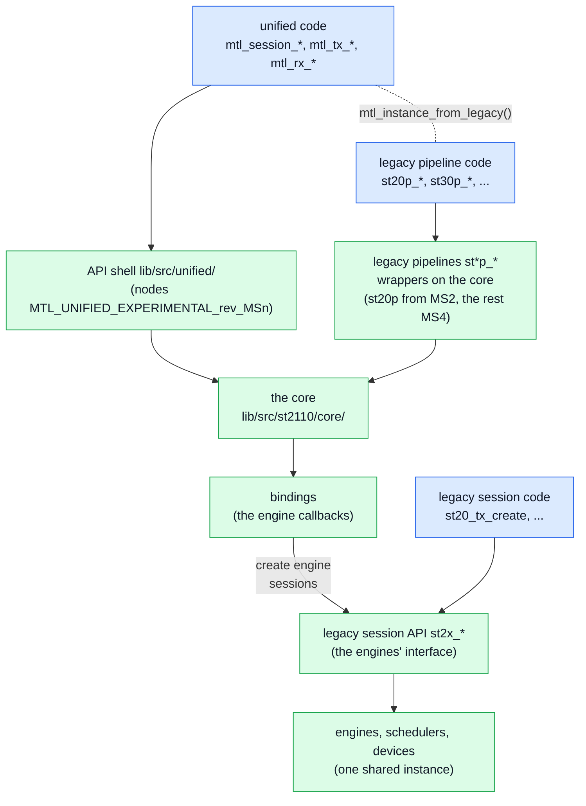
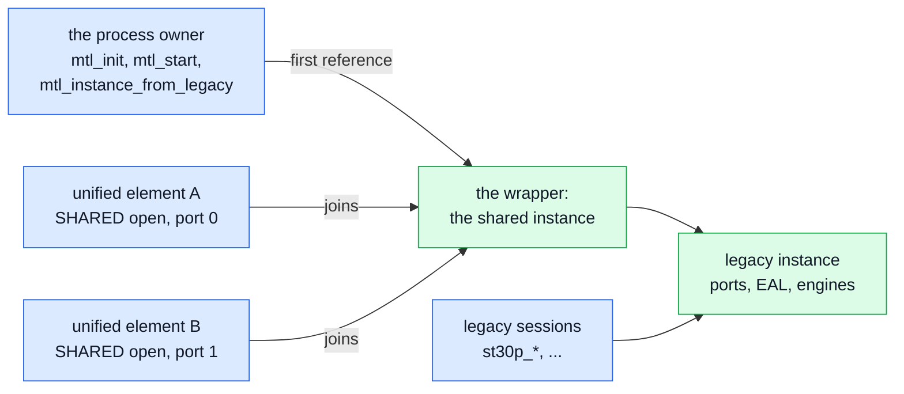
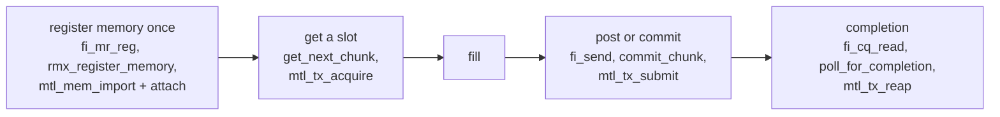

# Migration: legacy MTL API to the unified API

| | |
|---|---|
| Status | The porting guide, and the map the legacy wrappers on the core implement. The headers in [sketch/include/mtl/experimental/](sketch/include/mtl/experimental/) are normative: where this page and a header disagree, the header wins |
| Audience | application authors, codec plugin authors, binding maintainers, implementers of the legacy pipeline wrappers |

This page moves code from today's MTL API to `mtl.h` and its optional headers. Today's API is
`mtl_api.h`, `st_pipeline_api.h` and the session headers (`st20_api.h` … `st41_api.h`). The legacy
`st*p_*` pipelines implement the same maps when they become wrappers on the core (§6.3): a legacy
`ops` struct is translated field by field as §4 says. Read [concepts.md](concepts.md) for the model
and [contract.md](contract.md) for the normative behaviour;
[concepts.md §12](concepts.md#12-coming-from-the-legacy-api) shows an st20p program side by side
with the unified one.

**Start here.**

| Job | Sections |
|---|---|
| port an application | [§1](#1-what-changes-for-an-application), [§2](#2-call-map-per-legacy-family), [§4](#4-field-maps), [§5](#5-enum-tables); find your mode in [§4.16](#416-coverage-of-todays-modes) |
| port a framework plugin (GStreamer, FFmpeg, OBS) | [frameworks.md](frameworks.md) |
| port a codec plugin | [§7](#7-codec-plugin-abi-v2-mtl_pluginh) |
| maintain a language binding | [§8](#8-language-bindings) |
| implement a legacy pipeline wrapper | [§6.3](#63-shared-engines-separate-wire-defaults), [§6.5](#65-the-legacy-behaviour-ledger) |
| package or distribute libmtl: versions, ABI, the legacy headers | [abi.md](abi.md) |

## 1. What changes for an application

### 1.1 Concepts

| Legacy | Unified |
|---|---|
| `mtl_handle` from `mtl_init()` | `mtl_instance_h` from `mtl_instance_open(&ip, &mt)` |
| one handle type per family (`st20p_tx_handle`, `st30_rx_handle`, …) | one `mtl_session_h` for every essence, direction and unit kind |
| one `ops` struct per family | one `struct mtl_session_config` (`sc`): `direction`, `essence`, `unit`, `flows[]`, a few timing and pool fields, one member per essence (`video`, `cvideo`, `audio`, `anc`, `fastmeta`, `rtp`) |
| pipeline, session and RTP-level APIs | one verb set; the unit kind says what moves: `MTL_UNIT_FRAME`, `MTL_UNIT_ROWS` (slice), `MTL_UNIT_PACKETS` (RTP level); pipeline conversion is `video.app_format` |
| session ports P and R | legs `sc.flows[0]`, `sc.flows[1]` (ST 2022-7) |
| `struct st_frame`, frame index | `struct mtl_unit`: lease (access), slot (stable buffer identity), planes, meta area, per-use fields |
| ext frames | an attached pool (`MTL_SESSION_POOL_ATTACHED`, `mtl_session_attach()`) over a region (`mtl_mem.h`) |
| create = live; `*_free()` | create (`CREATED`), then start, or `mtl_session_open()` for both; `mtl_session_close(s, timeout)` drains, destroys and waits for retirement, is null-safe, always consumes the handle, and polls when called again |
| `tfmt` + `timestamp` + flag bits | `sc.media_mode` + `unit.media_index` or `unit.media_tai_ns`; RTP is derived (`RTP = floor(M × rate)`); every time is TAI ns, `MTL_TIME_NONE` when it has none, as [contract.md R5](contract.md#r5-times) says |
| flag bits and tuning fields | typed fields for what most programs set, `MTL_SESSION_*` flags, `MTL_OPT_*` options for the rest |
| callbacks (`notify_*`, `get_next_frame`, `query_*`) | calls on the application's thread: acquire, submit, reap, dequeue, release, wait |
| stats structs + reset; `notify_event` | one registry of named, cumulative values (`mtl_observe.h`); the events of a session and of an instance (`mtl_events.h`), waited on with a timeout (`mtl_wait`) or through a queue (`mtl_queue_arm`, MS2a) |
| sessions started one by one | `mtl_session_start(s, n, when, &t0)` starts an array, all or none; every session runs on the SMPTE epoch, and `MTL_WHEN_ORIGIN` puts media index 0 of each at the start's T0 |

### 1.2 Typed configuration

- Input structs start with `uint32_t struct_size`; `MTL_INIT(&s)` zero-fills and sets it, and
  zero in every other field is the default (`struct_size` 0 is `-MTL_EINVAL`). No per-struct init functions, no spec strings
  (D-97). Pointers in input structs are deep-copied during the call.
- Set `sc.direction`, `sc.essence`, `sc.flows[0]` (`mtl_flow_ipv4()`) and the essence's required
  fields; everything else defaults. The other essence members must stay zero.
- New enums keep the legacy order: value + 1 where 0 must mean "not set" (`mtl_fps`,
  `mtl_video_format`, `mtl_audio_format`, `mtl_ptime`, `mtl_app_format`, `mtl_cvideo_quality`),
  the same values where 0 is a real default (`mtl_packing`, `mtl_sender_type`). Porting an `ops`
  struct is mostly a field-by-field copy (§4); convert every legacy enum with the inline
  `mtl_*_from_legacy()` of `mtl_legacy.h` (§5), never by adding 1 by hand; the trap is the interlaced rate: legacy `fps` counts
  fields, `raster.fps` frames (§5.1).
- Tuning knobs are options: one `struct mtl_option {key, scope, value, str}` per knob in
  `sc.options` or `ip.options`. Absent means the documented default; present is literal (0 means
  0); `scope` 0 means every port, leg or scheduler, else `MTL_INDEX(i)` (i + 1). A session key set on the
  instance is the default for that instance's sessions, so a legacy instance-wide setting stays one
  setting. Every key has a name (`"rx.skew_budget_ns"`), listable with `mtl_option_list()`, so
  framework properties can expose every knob without code per knob.

### 1.3 Errors

| Legacy | Unified |
|---|---|
| create returns NULL | an `int` result; the out handle is null on failure; `mtl_last_error()` gives the reason and the field or option at fault |
| `get_frame` returns NULL for timeout, stop and destroy alike | `-MTL_EAGAIN` (nothing now, or by the timeout), `-MTL_ECANCELED` (interrupted), `-MTL_ESHUTDOWN` (you stopped or closed it), `-MTL_EIO` (the session is in `ERROR`) |
| POSIX errno, differing by OS | `MTL_E*` constants with the Linux errno values on every OS |
| a stale handle is undefined behaviour | `-MTL_EBADF`; a returned lease is `-MTL_ESTALE`; handles are never reissued |
| a failed `put_frame` keeps the frame with the caller | a failed first submit returns the slot to the pool, without a result (`-MTL_EBADF` and `-MTL_ESTALE` change no state) |
| `-ETIMEDOUT` from blocking gets | `-MTL_EAGAIN` for every data call; `-MTL_ETIMEDOUT` only for a control-plane deadline: a DRAIN stop that missed it (the rest became FLUSHED), or (MS3–MS4) a FLOWS update in ARMED or RUNNING whose unicast neighbour did not resolve within `port.arp_timeout_s` (`WAITING_NEIGHBOUR`, nothing changed) |
| `*_free()`, `mtl_uninit()` return codes | `mtl_session_close()` returns 0 (retired) or 1 (still retiring: call it again, with a timeout, until it returns 0); `mtl_instance_close()` returns 0, 1 (quiesced, memory still referenced) or `-MTL_EIO` (`QUEUE_QUARANTINED`: a port could not be stopped; exit the process) |
| errno-style text | `mtl_last_error()` (kept until the thread's next failing call: a call that succeeds never writes it), `mtl_error_name()`, `mtl_reason_name()` |

### 1.4 Threads

- **No application code runs on an MTL tasklet.** Every legacy callback becomes a call on the
  application's thread. The library calls application code only from the one log thread that
  runs the log sinks (`mtl_log_add_sink()`, MS2a) and, for codec plugins, from their own threads; those threads may not open, close
  or shut down the instance (`-MTL_EDEADLK`).
- **Call classes**: CP (may allocate and block), DP (O(1), no allocation, no lock a tasklet takes,
  no logging, no syscall except one wake when it makes a target ready for a sleeper), DPC (copy or
  conversion in the caller), WT (waits; DP with timeout 0),
  AS (async-signal-safe). Debug builds enforce them (from MS3, D-05).
- **Blocking.** `*_FLAG_BLOCK_GET` and `*_set_block_timeout()` become the `timeout_ns` argument (0 =
  do not wait, `MTL_FOREVER`); `*_wake_block()` becomes `mtl_session_interrupt(s, 1)`, sticky until
  `(s, 0)`. Event loops use `mtl_queue_create` and `mtl_queue_arm` (MS2a): one queue for any
  number of sessions. The protocol (arm, serve each report with timeout-0 calls, sleep only after
  `-MTL_EAGAIN`, wake the loop with `mtl_queue_post`) is [contract.md §7.2](contract.md#72-queues-ms2).
- **Several threads.** `mtl_rx_release()` and `mtl_tx_acquire()` work from any thread. Set
  `MTL_SESSION_MT_SUBMIT` when several threads submit (frameworks.md §6).
- **Latency parity** with today's tasklet callbacks (MXL bridge, fwd samples, slice users) comes
  from busy polling with timeout 0; `mtl_session_set_inline_notify()` stays under `MTL_LATER` and
  is added only if a measurement shows busy polling misses the target (D-04). **Signals**: the library installs no
  handler; a handler may call only AS functions (`mtl_instance_interrupt(mt, 1)`,
  `mtl_instance_abort()`, `mtl_session_interrupt(s, 1)`).

### 1.5 Results

- **Exactly one result per accepted submit**, in submission order, from `mtl_tx_reap()`: `status`
  (`MTL_TX_ON_TIME`, `_DROPPED`, `_FLUSHED`, `_FAILED`), `reason`, `slot`, `cookie`,
  `media_index`, `media_tai_ns`, `margin_ns`, `sent_tai_ns`, `rtp`, `session`.
  `mtl_tx_reap_full()` (`mtl_observe.h`) reads the full timing record.
- **When.** A library pool produces results only with `MTL_SESSION_RESULTS` (lateness is still
  counted and raised as events). A pool of application memory always does: a unit's result says
  that its memory is no longer read (rule MEM3,
  [contract.md §6.1](contract.md#61-when-there-are-results)). This replaces `notify_frame_done`,
  `notify_frame_late`, `EXT_FRAME_MANUAL_RELEASE` and `st20p_tx_notify_ext_frame_free()`.
- **Back-pressure.** When unread results fill the results ring, acquire returns `-MTL_EAGAIN` with
  `status.blocked_on = MTL_BLOCKED_RESULTS`. Reap every ready result before each submit, and no
  acquire waits on results; with `MTL_SESSION_MT_SUBMIT` a blocking acquire uses a finite timeout
  and reaps on `-MTL_EAGAIN` instead (frameworks.md §6). The ring's size and the rule:
  [contract.md §5.5](contract.md#55-back-pressure).
- **RX.** `unit.status` is `MTL_RX_COMPLETE` or `MTL_RX_INCOMPLETE`; `unit.flags` carries
  `MTL_UNITF_*`; `unit.missed_before` counts units the pool could not take. Detail:
  `mtl_rx_get_detail()`; ST 2110-21 measures: its `timing[]` per leg.

### 1.6 Behaviour a migrating application notices

| Change | Legacy | Unified |
|---|---|---|
| default video RTP | TX cursor: media time plus the first-packet offset | the frame epoch (D-10); approximate the legacy value with a positive `tx.rtp_trim_ns` (TRO − VRX0 × TRS; `MTL_INFO_RTP_OFF_GRID`) |
| incomplete RX frames | dropped unless `RECEIVE_INCOMPLETE_FRAME` | delivered with `MTL_RX_INCOMPLETE`; `MTL_OPT_RX_INCOMPLETE = MTL_RX_DISCARD` restores the legacy behaviour. Attached RX pools are never filled, so with the default `rx.incomplete` = DELIVER the lost ranges of an attached slot show the stale bytes of its last use: set `MTL_RX_DISCARD`, or read only complete units |
| ST 2110-22 rate | the size `get_next_frame` gives | CBR, padded to `codestream_bytes` (D-32); `MTL_CVIDEO_VBR_MAX` keeps the legacy wire |
| packet units | the session rewrites the RTP timestamp | verbatim (D-82); `sc.packet.set_fields` names what the library writes |
| UDP port | `udp_port = 0` derives a port from the session index, and TX and RX disagree (below) | `udp_port = 0` is `-MTL_EINVAL` unless the leg is reserved: pass the old value to keep the wire |
| TX SSRC | deterministic: `idx + 0x123450` video, `+ 0x223450` audio, `+ 0x323450` ANC and fastmeta (`st_tx_video_session.c:966`, `st_tx_audio_session.c:188`, `st_tx_ancillary_session.c:246`, `st_tx_fastmetadata_session.c:189`) | random (RFC 3550 §8): set `sc.ssrc` to keep one, or capture filters keyed on the SSRC break silently |
| time without PTP | any reader accepted | `ip.time_source` 0 is `MTL_TIME_SOURCE_AUTO`, which never starts the built-in PTP client; how it picks its source is [timing.md §2.2](timing.md#22-time-sources). An estimated source is accepted, but times are flagged ESTIMATED with a timing warning (`TIME_ESTIMATED`) |
| interlaced rate | `ops.fps` is the field rate | `raster.fps` is the frame rate: `mtl_raster_from_legacy()` halves it; above 30 frames per second interlaced is `-MTL_EINVAL` (§5.1) |
| audio `ST31_PTIME_80US` | 4 samples at 48 kHz every 80 µs: a 50 kHz RTP rate (SF-35) | 4 samples every 83⅓ µs, as ST 2110-31 Table 1 defines; `info.ptime_ps` reports it ([timing.md](timing.md) §8) |
| user-paced video launch (`USER_PACING`) | paced from the epoch nearest the user's time | TAI media mode derives the launch from the media time, so TX moves by TROFFSET − VRX0 × TRS, about 604–619 µs at 1080p59.94 ([timing.md](timing.md) §14.1); `MTL_SUBMIT_NOT_BEFORE` keeps the "send at t" reading |
| late frames with `USER_TIMESTAMP` | slip: sent at the next epoch | dropped (`MTL_TX_DROPPED`, `TOO_LATE`): INDEX and TAI drop a late unit; only AUTO defers |
| unknown struct bytes or flag bits | ignored | `-MTL_EINVAL` (`NONZERO_TAIL`, `UNKNOWN_BITS`) |

The legacy derived ports: video 10000 + 2·idx on both sides (`st_tx_video_session.c:3390`,
`st_rx_video_session.c:3377`); audio TX 10100 + 2·idx against RX 20000 + 2·idx
(`st_tx_audio_session.c:2127`, `st_rx_audio_session.c:997`); ANC and fastmeta TX 10200 + 2·idx
against RX 30000 + 2·idx (`st_tx_ancillary_session.c:1697`, `st_rx_ancillary_session.c:1007`,
`st_tx_fastmetadata_session.c:1442`, `st_rx_fastmetadata_session.c:435`). A TX
`*_update_destination()` with port 0 derives the RX base instead (`st_tx_audio_session.c:2262`,
`st_tx_ancillary_session.c:1872`).

## 2. Call map per legacy family

### 2.1 Instance and core utilities (`mtl_api.h`, `mtl_sch_api.h`)

| Legacy | Unified |
|---|---|
| `mtl_init(&p)` | `mtl_instance_open(&ip, &mt)`; `MTL_INSTANCE_SHARED` for plugins sharing one instance (frameworks.md §3); `ip` NULL reads `MTL_PORTS` |
| `mtl_start()`, `mtl_stop()` | none: open starts the devices, close stops them |
| `mtl_uninit()`, `mtl_abort()` | `mtl_instance_close(mt, timeout)` (or `mtl_instance_shutdown()` with flags and a report); `mtl_instance_abort(mt)` (AS) |
| `mtl_ptp_read_time()`, `_raw()` | `mtl_time_now(mt, &tai, NULL, NULL)` (returns `MTL_TIMEF_*`; the last two take CLOCK_MONOTONIC and CLOCK_REALTIME of the same instant); `mtl_time_convert()` (`mtl_sync.h`) |
| `mtl_get_port_stats()`, `mtl_reset_port_stats()` | `mtl_stat_read()` / `mtl_stat_get()` on `MTL_OBJ_OF_PORT(mt, p)`, keys `port.*`; no reset |
| `mtl_port_ip_info()`, `mtl_p_sip_addr()`, `mtl_p_port()` and the R twins | `mtl_port_get_spec()` (the port as granted, DHCP included); `mtl_port_find()` |
| `mtl_pmd_by_port_name()`, `mtl_pmd_is_af_xdp()`, `mtl_get_simd_level()`, `mtl_get_fix_info()`, `mtl_get_var_info()` | stats: `caps.backend` (`enum mtl_backend`), `instance.simd_level` (`enum mtl_simd`), `caps.*`, `port.*`, `sched.*` |
| `mtl_set_log_level()` | `mtl_instance_params.log_level` at open, or the bridged legacy level (MS1); a sink's `min_severity` (MS2a) |
| `mtl_iova_mode_get()`, `mtl_rss_mode_get()` | `mtl_set_option()` / `mtl_get_option()` with `MTL_OPT_IOVA_MODE`, `MTL_OPT_RSS_MODE` |
| `mtl_set_log_printer()`, `mtl_openlog_stream()` | `mtl_log_add_sink(&p, &h)` (MS2a); one per component, removed with `mtl_log_remove_sink(h, timeout)` |
| `mtl_sch_enable_sleep()`, `mtl_sch_set_sleep_us()` | `MTL_INSTANCE_TASKLET_SLEEP`; `MTL_OPT_SCHED_SLEEP_US` (scope = scheduler + 1) |
| `mtl_is_manager_alive()` | `mtl_instance_get_health()` flag `MTL_HEALTH_MANAGER_LOST`; `MTL_EVENT_MANAGER_LOST` |
| `mtl_hp_malloc()`, `mtl_dma_mem_alloc()`; `mtl_dma_map()`; `*_free()`, `mtl_dma_unmap()`; `mtl_hp_virt2iova()`, `mtl_dma_mem_iova()` | `mtl_mem_alloc()`; `mtl_mem_import()`; `mtl_mem_close()` (retires at the last reference); no IOVA call: MTL maps a region into every port and DMA engine a session needs, and `mtl_session_attach()` takes regions; `mtl_mem_get_info()` |
| `mtl_version()`; `mtl_memcpy_action()` (Python) | `mtl_library_version()`, `mtl_library_version_num()`; `mtl_unit_copy_in()`, `mtl_unit_copy_out()`, `mtl_unit_copy_plane_in()`, `_out()` (stride-aware) |
| `mtl_para_*()`, `st_txp_para_*()`, `st_rxp_para_*()` | not needed: the structs bind cleanly (§8.1) |
| `mtl_get_lcore()`, `mtl_bind_to_lcore()`, `mtl_udma_*`, `mtl_memcpy()`, `mtl_sleep_us()`, `mtl_delay_us()`, `mtl_thread_setname()`, `mtl_get_if_ip()`, `mtl_size_page_align()` | removed; sessions request DMA with `MTL_OPT_DMA` |
| `mtl_sch_create()`, `mtl_sch_register_tasklet()` | removed |
| `mtl_lcore_shm_print()`, `_clean()` (`mtl_lcore_shm_api.h`, the `app/tools/lcore_shmem_mgr.c` tool) | an internal admin tool. With EK6 ([engine.md](engine.md); also for legacy users) the SysV lcore table is gone: these calls report nothing and leave at the freeze; `doc/shm_lcore.md` and `docker/README.md:121-134` are rewritten for `MTL_CPUARB_LOCKS` with a shared `MTL_OPT_RUNTIME_DIR` |

### 2.2 Video pipeline (`st20p_*`)

`sc.essence = MTL_VIDEO`, `sc.unit = MTL_UNIT_FRAME`, `sc.video.app_format` = `input_fmt` /
`output_fmt` + 1 (0 = no conversion). The other pipelines (`st22p`, `st30p`, `st40p`) map the same
way (§2.3).

| Legacy | Unified |
|---|---|
| `st20p_tx_create()`, `st20p_rx_create()` | `mtl_session_open(mt, &sc, &s)`, or `mtl_session_create()` + `mtl_session_start(&s, 1, when, &t0)` |
| `st20p_tx_get_frame()`, `put_frame()`, `put_frame_abort()` | `mtl_tx_acquire(s, &u, timeout)`, `mtl_tx_submit(s, &u)`, `mtl_tx_release(s, u.lease)` |
| `st20p_tx_put_ext_frame()`, `notify_ext_frame_free()` | an attached pool + `mtl_tx_acquire_slot(s, slot, &u, timeout)`; the result says the frame is no longer read; a new address per frame is `mtl_tx_acquire_layout()`; until a frame can be attached, `mtl_tx_acquire()` + submit with `MTL_SUBMIT_SRC_PLANES` and `u.plane[]` naming the frame (one copy, or the conversion, during the call) |
| `st20p_rx_get_frame()`, `put_frame()`, `put_frame_abort()` | `mtl_rx_dequeue(s, &u, timeout)`, `mtl_rx_release(s, u.lease)` |
| `*_get_fb_addr()`, `*_frame_size()` | `mtl_session_get_slot(s, slot, &u)`; `info.unit_bytes` (`mtl_session_get_info()` or `mtl_session_query()`) |
| `*_set_block_timeout()`, `*_wake_block()` | the timeout argument; `mtl_session_interrupt(s, 1)`, later `(s, 0)` |
| `*_get_sch_idx()`, `st20p_tx_get_pacing_params()` | `info.sched_index`; stat keys `info.*` (`info.trs_ps`, …) |
| `*_get_session_stats()`, `*_reset_session_stats()` | `mtl_stat_read()` / `mtl_stat_get()` on `MTL_OBJ_OF_SESSION(s)`; no reset (§4.14) |
| `st20p_tx_update_destination()`, `st20p_rx_update_source()` | `mtl_session_update(s, &sc, MTL_UPDATE_FLOWS, &when, &planned)`, atomic across legs (running: `when` NULL from MS3, at the next unit boundary instead of legacy's next burst; at an instant MS5) |
| `st20p_rx_pcapng_dump()`; `st20p_rx_timing_parser_critical()` | `mtl_session_capture()`; `mtl_rx_get_detail(s, lease, &d, size)`, `d.timing[leg]` |
| `st20p_rx_get_queue_meta()` | removed |
| `st20p_tx_free()`, `st20p_rx_free()` | `mtl_session_close(s, timeout)` |

| `struct st_frame` | `struct mtl_unit` or call |
|---|---|
| `addr[]`, `linesize[]`; `iova[]` | `u.plane[i].addr`, `.stride` (with `row_bytes`, `rows`); no IOVA (MTL maps the region) |
| `fmt`, `width`, `height`, `interlaced`; `buffer_size` | the session config; `info.unit_bytes` |
| `data_size` | `u.used`: rows for video; bytes for cvideo, audio, fastmeta; table entries for ANC |
| `tfmt`, `timestamp`, `epoch` | `u.media_index`, `u.media_tai_ns` (TX by `sc.media_mode`; RX: `MTL_TIME_NONE` when unknown, and the bridge maps a legacy 0 without a valid `tfmt` to NONE); the legacy epoch is the index on the epoch |
| `rtp_timestamp`; `second_field` | `u.rtp` (TX only with `MTL_SUBMIT_RTP_TS`); `MTL_UNITF_SECOND_FIELD` |
| `status` | `COMPLETE` → `MTL_RX_COMPLETE`; `RECONSTRUCTED` → `MTL_RX_COMPLETE` + `MTL_UNITF_USED_REDUNDANCY`; `CORRUPTED` → `MTL_RX_INCOMPLETE`; `DROPPED` → not delivered, counted in the next unit's `missed_before` |
| `user_meta`, `user_meta_size` | a `MTL_META_USER` record in the meta area (`u.meta`; at most 1332 B for video) |
| `pkts_total`, `pkts_recv[]`, `receive_timestamp`, `tp[]` | `mtl_rx_get_detail()` (`pkts_expected`, `pkts_received[]`, `arrival_first_tai_ns[]`, `delivered_tai_ns`, `timing[]`) |
| `opaque` | TX: `u.cookie`, returned in the result; RX: the application's table indexed by `u.slot` |

### 2.3 Other families: what differs from st20p

| Family | Unified |
|---|---|
| all sessions (`st20_`, `st22_`, `st30_`, `st40_`, `st41_*_create`) | `mtl_session_open()`; `type` picks `sc.unit`: `FRAME_LEVEL` → `MTL_UNIT_FRAME`, `SLICE_LEVEL` → `MTL_UNIT_ROWS`, `RTP_LEVEL` → `MTL_UNIT_PACKETS` |
| `get_next_frame` + `notify_frame_done`; `notify_frame_ready` + `*_rx_put_framebuff()` | acquire + submit + reap; dequeue + release, on the application's thread |
| `*_tx_get_framebuffer(h, idx)`, `st22_*_get_fb_addr()`; `*_get_framebuffer_count()`, `_size()` | `mtl_session_get_slot()`; `info.pool_count`, `info.unit_bytes` |
| `st20_tx_set_ext_frame()` | attached pool + `mtl_tx_acquire_slot()` |
| `*_get_mbuf()` / `*_put_mbuf()` (TX) | `mtl_tx_acquire()` lends a chunk of packet slots; write the packets, the packet table and `u.used`; submit (`mtl_packet.h`) |
| `*_get_mbuf()` / `*_put_mbuf()` (RX) | `mtl_rx_dequeue()` returns a chunk of 1..N packets, one table entry each; release |
| `query_frame_lines_ready` (slice TX) | submit the same lease again with a larger `u.used`; deadlines from `mtl_tx_row_deadline()` |
| `notify_slice_ready` (slice RX) | the unit is dequeued with `MTL_UNITF_PARTIAL`; `mtl_rx_wait_rows()` waits for more rows |
| `st20_rx_dma_enabled()` | stat `rx.pkts_dma`; `mtl_rx_get_detail().path == MTL_PATH_DIRECT_DMA` |
| `uframe_pg_callback`; `st20rc_*` | removed; an `st20rc` receiver becomes one RX session with two legs |
| `st22p_*`, `st22_*` | `MTL_CVIDEO`; a codec plugin runs when `c.app_format` is not 0; `u.used` = codestream bytes |
| `st30p_tx_put_frame()` with re-framing in the caller | `mtl_tx_write(s, data, bytes, how, timeout)` splits arbitrary input at the unit capacity |
| `st30_calculate_framebuff_size()`, `st30_get_packet_size()` | `info.unit_bytes`; `mtl_audio_bytes(&sc.audio, samples, &bytes)` |
| `notify_timing_parser_result` (audio, every 200 ms per port) | `mtl_rx_detail.timing[]` per unit and leg (`dpvr_max_ns`, `ipt_max_ns`, `tsdf_ns`); stats `tp.*` |
| `st40p_*_get_udw_buff_addr()`, `*_max_udw_buff_size()`; `struct st40_frame_info`, `struct st40_meta`; `st40_tx_get_framebuffer()` | `u.plane[1].addr` and `u.plane[1].rows` (`sc.anc.max_udw_words`); the entries of `u.plane[0]` (`mtl_anc_table`), `u.used` = `meta_num`; `mtl_session_get_slot()` ([contract.md](contract.md) §5.7) |
| `st41_rx_*` (RTP level only today) | `MTL_UNIT_PACKETS` reproduces it; frame units on RX are new |
| `st22_encoder_register()`, `st_plugin_register()` | plugin ABI v2 (§7) |

### 2.4 Shared helpers (`st_api.h`, `st_pipeline_api.h`, `st_convert_api.h`, `st40_api.h`)

| Legacy | Unified |
|---|---|
| `st_frame_rate()`, `st_frame_rate_to_st_fps()`, `st_name_to_fps()` | `mtl_fps_rational()` (exact; no fps name parser) |
| `st10_tai_to_media_clk()`, `st10_media_clk_to_tai()`, `st10_get_tai()` | `mtl_media_ticks()`, `mtl_media_tai(near_tai, ticks, rate)` (exact, unwraps near a TAI); `mtl_time_now()` |
| `st_frame_fmt_name()`, `st_frame_name_to_fmt()`, `st20_fmt_name()`, `st_name_to_codec()` | `mtl_format_describe()` (names), `mtl_format_parse()`; codecs with `MTL_FORMAT_CODEC` |
| `st_frame_size()`, `st_frame_plane_size()`, `st_frame_least_linesize()`, `st20_frame_size()`, `st20_get_pgroup()`, `st20_get_bandwidth_bps()` | `mtl_format_describe()` (`plane_bytes[]`, `row_bytes[]`, `rows[]`, `pg_bytes`, `pg_pixels`); for a session, `mtl_session_query()` with `struct mtl_buffer_requirements`, and `info.wire_bps` (one leg, headers included) |
| `st_frame_fmt_to_transport()`, `st_frame_fmt_from_transport()` | `mtl_convert()` with `MTL_CONVERT_CHECK` (0 or `-MTL_ENOTSUP`) |
| `st_frame_convert()`, ≈ 105 per-pair converters; `st31_am824_to_aes3()` | `mtl_convert(&desc)` (the per-pair functions become internal); AM824 ↔ AES3 is `mtl_convert` with `MTL_AM824` and `MTL_AES3` (`MTL_FORMAT_AUDIO`) |
| `st40_get_udw()`, `st40_set_udw()`, parity, checksum, RFC 8331 helpers | `mtl_anc_udw_get()`, `_set()`, `mtl_anc_parity()`, `mtl_anc_parity_ok()`, `mtl_anc_checksum()` on `struct mtl_anc_packet`; the exported `mtl_anc_rfc8331_decode()` and `_encode()` (`mtl_packet.h`); `ST40_RFC8331_DECODE_*` results become `mtl_anc_decode_info.skipped` (below) |
| `st40_rfc8331_*` on the tasklet | nothing: submit encodes, dequeue decodes, in the caller's thread |
| `st40_tx_test_config` | `mtl_debug_inject(obj, MTL_FAULT_TX_MUTATE, &p)` (debug builds) |
| `st_draw_logo()` | removed |

`st40_rfc8331_decode_packet`'s `ST40_RFC8331_DECODE_*` results become
`struct mtl_anc_decode_info.skipped`: one total; per cause the stats key `anc.pkts_skipped{cause}`.

## 3. Field map conventions

§4 lists every field of every legacy `ops` struct. `sc` = `struct mtl_session_config`, `ip` =
`struct mtl_instance_params`; `v` = `sc.video`, `c` = `sc.cvideo`, `a` = `sc.audio`, `n` =
`sc.anc`, `f` = `sc.fastmeta`. `MTL_OPT_X = v` means one `struct mtl_option` in `sc.options` (or
`ip.options`); "(port i)" means scope i + 1. Leg i is legacy session port i
(`MTL_SESSION_PORT_P` = 0, `_R` = 1), `sc.flows[i]`. Conversion words: **same**, **+1**, **flag →
option**, **callback → call**, **removed** (D-87; no unified home, coverage.md §4.5), **`MTL_LATER`**
(declared in the sketch only: Phase 7, created timelines), **not carried**. "§4.1"
means the row converts as in §4.1; each struct table starts by listing those fields, then gives the
rest.

A legacy 0 that means "no time" becomes `== MTL_TIME_NONE` in ported code: a truthiness test such
as `if (!u.media_tai_ns)` lets NONE through, because NONE is not 0 (and 0 is a real time).

## 4. Field maps

### 4.1 Fields and flags every session `ops` shares

| Legacy field | New field or option | Conversion |
|---|---|---|
| `dip_addr[i]` (TX), `ip_addr[i]` (RX) | `sc.flows[i].ip` | `mtl_flow_ipv4(&sc.flows[i], a, b, c, d, udp_port[i])`; RX: a group, or the port's own address (or zero) for unicast |
| `sip_addr[i]` (RX alias) | `sc.flows[i].ip` | removed (deprecated alias) |
| `udp_port[i]` | `sc.flows[i].udp_port` | same; 0 is `-MTL_EINVAL` unless the leg is reserved |
| `num_port` | which `sc.flows[]` exist | a leg exists when its `udp_port` is not 0; 2 = ST 2022-7 |
| `port[i]` (session port name) | `sc.flows[i].port` | 0 = instance port i (legacy P/R order); else `mtl_port_find(mt, port[i], &p)` and `mtl_flow_on_port(&sc.flows[i], p)` |
| `udp_src_port[i]` | `sc.flows[i].udp_src_port` | same (0 = `udp_port`) |
| `payload_type` | `sc.payload_type` | same; one value for every leg (ST 2022-7); TX 0 = essence default, RX 0 = no check |
| `ssrc` | `sc.ssrc` | same; one SSRC for every leg; TX 0 = random, RX 0 = no check |
| `mcast_sip_addr[i]` | `sc.flows[i].source_filter` | same bytes (IPv4 in 0..3) |
| `tx_dst_mac[i]`, `*_TX_FLAG_USER_P_MAC`, `_USER_R_MAC` | `sc.flows[i].dst_mac`, `flow_flags \|= MTL_FLOWF_USER_MAC` | flag → per-leg flag: P → leg 0, R → leg 1 |
| `name` | `sc.name` | copied into `char[MTL_NAME_MAX]`; NULL → "" (generated) |
| `priv` | — | removed: nothing calls back; `u.cookie` returns in the result, `mtl_tx_result.session` names the stream |
| `framebuff_cnt` | `sc.pool_count` | same (0 = by essence) |
| `socket_id`, `*_FLAG_FORCE_NUMA` | `MTL_OPT_NUMA = socket_id` | flag + field → option |
| `type` | `sc.unit` | `mtl_unit_kind_from_legacy()`: `FRAME_LEVEL` → `MTL_UNIT_FRAME`, `RTP_LEVEL` → `MTL_UNIT_PACKETS`, `SLICE_LEVEL` → `MTL_UNIT_ROWS` |
| `fps` | `raster.fps`, `raster.scan` | `mtl_raster_from_legacy(fps, interlaced, &raster)` (`mtl_legacy.h`): +1 and, interlaced, halved (§5.1) |
| `interlaced` | `raster.scan` | set by the same call |
| `get_next_frame` (TX session) | `mtl_tx_acquire` + `mtl_tx_submit` | callback → call; `u.slot` replaces `frame_idx` |
| `notify_frame_done` | `mtl_tx_reap` (library pools: `MTL_SESSION_RESULTS`) | callback → result; `slot` and `cookie` name the frame |
| `notify_frame_late(epoch_skipped)` | AUTO (`MTL_LATE_DEFER`): `MTL_TX_ON_TIME` with `MTL_TXR_DEFERRED` and `mtl_tx_result_full.indices_skipped_before` = `epoch_skipped` (`mtl_tx_reap_full()`); INDEX and TAI: `MTL_TX_DROPPED` + `reason` | callback → result; counters `tx.indices_empty` (AUTO defer; as `stat_epoch_drop`, §4.14), `tx.units_dropped{reason=too_late}` (INDEX and TAI) |
| `notify_frame_available` | `mtl_session_wait` with `MTL_WAIT_ACQUIRE` / `MTL_WAIT_DEQUEUE`, or a queue report (`mtl_queue_arm` of those targets, MS2a) | callback → a wait or a queue report |
| `notify_frame_ready` (RX session), `*_rx_put_framebuff` | `mtl_rx_dequeue`, `mtl_rx_release` | callback → call |
| `notify_event` | `mtl_session_read_events` | `ST_EVENT_VSYNC` → `MTL_EVENT_EPOCH_TICK`; `ST_EVENT_RECOVERY_ERROR` → `MTL_EVENT_RECOVERY`; `ST_EVENT_FATAL_ERROR` → `MTL_EVENT_SESSION_STATE` to `MTL_STATE_ERROR` |
| `rtp_ring_size` (TX / RX, RTP level) | `sc.pool_count` × `sc.packet.packets_per_chunk` / `sc.packet.rx_ring_packets` | TX: packets → chunks; RX: same (0 = 512) |
| `notify_rtp_done`, `notify_rtp_ready` | `mtl_tx_reap` (one result per chunk), `mtl_rx_dequeue` (a chunk of 1..N packets) | callback → call |
| `rtp_timestamp_delta_us` | `MTL_OPT_RTP_TRIM_NS` (`tx.rtp_trim_ns`) | × 1000: legacy adds the delta to the RTP instant, and so does the option (RTP = floor((M + trim) × rate)); AUTO and INDEX, the launch unchanged |
| `*_TX_FLAG_USER_PACING` | `sc.media_mode = MTL_MEDIA_TAI` + `u.media_tai_ns`, or per unit `MTL_SUBMIT_NOT_BEFORE` + `u.launch_tai_ns` | flag → mode; TAI media time snaps to the grid (`MTL_OPT_SNAP_MODE`) |
| `*_TX_FLAG_EXACT_USER_PACING` | `MTL_SESSION_EXACT_LAUNCH` in `sc.flags` at create, then per unit `MTL_SUBMIT_EXACT` + `u.launch_tai_ns` | flag → session flag + per-unit flag (without the session flag `MTL_SUBMIT_EXACT` is `-MTL_EINVAL`); reported with `MTL_INFO_NON_COMPLIANT` |
| `*_TX_FLAG_USER_TIMESTAMP` | `MTL_SUBMIT_RTP_TS` + `u.rtp`: `FMT_TAI`: the user's TAI in ticks, rounded to nearest (`st10_tai_to_media_clk`), with `MTL_MEDIA_TAI` and `u.media_tai_ns` = that TAI; `FMT_MEDIA_CLK`: the value | MS3; the legacy RTP bytes. TAI mode alone if the snapped, floored RTP is fine (MS1). Needs INDEX or TAI (`RTP_TS_AUTO`); a late unit drops, not slips (§1.6) |
| `*P_TX_FLAG_DROP_WHEN_LATE` | `MTL_OPT_LATE_POLICY = MTL_LATE_DROP` | the INDEX/TAI default; inert without USER_PACING, as today; the legacy slip has no INDEX/TAI equivalent (DEFER is AUTO only, [timing.md](timing.md) §6.3) |
| `*_FLAG_ENABLE_VSYNC` | `MTL_OPT_EPOCH_TICK = 1` | `MTL_EVENT_EPOCH_TICK` per unit period |
| `*P_*_FLAG_BLOCK_GET`, `*_set_block_timeout()` | the `timeout_ns` argument | no flag = 0; `*_wake_block()` → `mtl_session_interrupt(s, 1)` |
| `*_RX_FLAG_RECEIVE_INCOMPLETE_FRAME` | `MTL_OPT_RX_INCOMPLETE` | the unified default delivers incomplete units; without the legacy flag set `MTL_RX_DISCARD` |
| `*_RX_FLAG_DATA_PATH_ONLY` | — | removed (with queue meta) |
| `*_RX_FLAG_SIMULATE_PKT_LOSS` | `mtl_debug_inject(obj, MTL_FAULT_DROP_PKTS, &p)`: `leg`, `drop_every`, `drop_count`, `drop_offset` | debug builds; a pattern |
| `rtcp.sim_loss_rate`, `rtcp.burst_loss_max` | `mtl_debug_inject(obj, MTL_FAULT_DROP_RANDOM, &p)`: `drop_ppm`, `drop_count` (the burst) | debug builds; a random rate |
| `ST20*_`, `ST22*_FLAG_ENABLE_RTCP` | `MTL_OPT_RTX = 1` | MTL's NACK retransmission; the `rtcp` members in §4.4, §4.5 |
| `ST30*_`, `ST40*_`, `ST41*_FLAG_ENABLE_RTCP` | — | removed (no effect today) |
| `*_TX_FLAG_DEDICATE_QUEUE` | `MTL_OPT_TX_QUEUE = MTL_TXQ_DEDICATED` | flag → option |

### 4.2 `mtl_init_params`, `mtl_port_init_params`

`ip.ports` points at `ip.port_count` entries of `struct mtl_port_spec`, indexed by legacy port i.

| Legacy field | New field or option | Conversion |
|---|---|---|
| `port[i]`, `pmd[i]` | `ports[i].name` | same string; the backend is the prefix: a PCI BDF, `kernel:<if>`, `native_af_xdp:<if>`, `null:<n>`, `env:<VAR>[#n]` (§5.2) |
| `num_ports` | `ip.port_count` | same |
| `net_proto[i]` | DPDK: `MTL_OPT_DHCP = 1` (port i); kernel backends: `ports[i].sip` all zero | `MTL_PROTO_STATIC` = default |
| `sip_addr[i]`, `gateway[i]` | `ports[i].sip`, `ports[i].gateway` | same bytes 0..3 |
| `netmask[i]` | `ports[i].prefix_len` | mask → length (255.255.255.0 → 24; 0 = 24) |
| `tx_queues_cnt[i]`, `rx_queues_cnt[i]` | `ports[i].tx_queues`, `.rx_queues` | same (0 = auto) |
| `port_packet_loss[i]` (`tx_stream_loss_id`, `_divider`) | `MTL_FAULT_DROP_PKTS` on a session: `leg`, `drop_every`, `drop_offset` | debug; instance-wide → per session and leg |
| `flags` | `ip.flags` and options | §4.3 |
| `priv` | — | removed |
| `log_level` | `mtl_instance_params.log_level` | +1 (`MTL_LOG_LEVEL_DEBUG` 0 → `MTL_SEV_DEBUG` 1 … `CRIT` 5 → 6; process-wide, mismatch rule) |
| `lcores`, `main_lcore` | `ip.lcores`, `MTL_OPT_MAIN_LCORE` | same |
| `dma_dev_port[]`, `num_dma_dev_port` | `MTL_OPT_DMA_DEVICES` | array → comma-separated string |
| `rss_mode` | `MTL_OPT_RSS_MODE` | +1 |
| `iova_mode` | `MTL_OPT_IOVA_MODE` | `AUTO` = absent; `VA` 1, `PA` 2: same |
| `nb_tx_desc`, `nb_rx_desc` | `MTL_OPT_TX_DESC`, `MTL_OPT_RX_DESC` | same; scope 0 |
| `ptp_get_time_fn` | `ip.time_source = MTL_TIME_SOURCE_USER` + `mtl_time_set_reference(mt, 0, &ref)` with `MTL_TIMEREF_USER_PAIR` and `ref.user_tai_ns`, `ref.user_monotonic_ns` | pull → push; a `CLOCK_TAI` reader → `MTL_TIME_SOURCE_CLOCK_TAI` |
| `ptp_sync_notify` | stats `time.offset_ns`, `time.utc_offset_s`, `time.last_sync_age_ns`; `MTL_EVENT_TIME_STATE`, `_TIME_STEP` | callback → stats and events |
| `kp`, `ki` | `MTL_OPT_PTP_PI_KP`, `MTL_OPT_PTP_PI_KI` | double → integer × 1e9 |
| `dump_period_s`; `stat_dump_cb_fn` | `MTL_OPT_STAT_DUMP_S`; `mtl_stat_list` + `mtl_stat_read` | same; callback → the application's loop (frameworks.md §11) |
| `pacing`, `pkt_udp_suggest_max_size` | `MTL_OPT_PACING` (a session key set on the instance); `MTL_OPT_MAX_UDP_PAYLOAD` (`instance.max_udp_payload`, the default of every TX session's `max_udp_payload` field; RX takes the sender's SDP) | §5.2; same |
| `data_quota_mbs_per_sch`, `tasklets_nb_per_sch` | `MTL_OPT_SCHED_QUOTA_MBS`, `MTL_OPT_TASKLETS_PER_SCHED` | same |
| `tx_audio_sessions_max_per_sch`, `rx_…` | `MTL_OPT_SCHED_TX_AUDIO_MAX`, `MTL_OPT_SCHED_RX_AUDIO_MAX` | same |
| `rx_pool_data_size`, `memzone_max`, `arp_timeout_s` | `MTL_OPT_RX_POOL_DATA_SIZE`, `MTL_OPT_MEMZONE_MAX`, `MTL_OPT_ARP_TIMEOUT_S` | same |
| `rss_sch_nb[i]` | `MTL_OPT_RSS_SCHEDS` (port i) | same |
| `nb_rx_hdr_split_queues`, `tx_sessions_cnt_max`, `rx_sessions_cnt_max` | — | removed |
| `port_params[i].flags` `MTL_PORT_FLAG_FORCE_NUMA` (bit 0), `.socket_id` | `ports[i].numa` | `socket_id + 1` (0 = the device's socket) |
| `port_params[i].flags` `MTL_PORT_FLAG_ALLOW_DOWN_INITIALIZATION` (bit 1) | — | removed: the default; open never waits for links (`mtl_instance_get_health()`) |
| `port_params[i].rl_burst_size` | `MTL_OPT_RL_BURST` (port i) | same |

### 4.3 `enum mtl_init_flag`, bit by bit

| Legacy flag (bit) | New field or option |
|---|---|
| `BIND_NUMA` (0), `UDP_LCORE` (10) | removed |
| `PTP_ENABLE` (1) | `ip.time_source = MTL_TIME_SOURCE_PTP_BUILTIN`; on a VF it works as today (below). Without the flag and without `ptp_get_time_fn`: leave `time_source` 0 (AUTO, §1.6) |
| `RX_SEPARATE_VIDEO_LCORE` (2), `TX_VIDEO_MIGRATE` (3), `RX_VIDEO_MIGRATE` (4) | `MTL_OPT_RX_SEPARATE_VIDEO_LCORE = 1` (an instance key: every shared open must agree, frameworks.md §3); `MTL_OPT_MIGRATE = 1` (`session.migrate`) set on the instance, the default of its sessions, one key for TX and RX |
| `TASKLET_THREAD` (5), `TASKLET_SLEEP` (6), `ENABLE_HW_TIMESTAMP` (8) | `MTL_INSTANCE_TASKLET_THREAD` (0x4), `MTL_INSTANCE_TASKLET_SLEEP` (0x8), `MTL_INSTANCE_HW_TIMESTAMP` (0x10) |
| `RXTX_SIMD_512` (7), `PTP_PI` (9) | `MTL_OPT_SIMD_512 = 1`, `MTL_OPT_PTP_PI = 1` |
| `RANDOM_SRC_PORT` (11), `MULTI_SRC_PORT` (12) | `MTL_OPT_SRC_PORT_MODE` = `MTL_SRC_PORT_RANDOM` / `MTL_SRC_PORT_MULTI` (a session key) |
| `SHARED_TX_QUEUE` (13), `SHARED_RX_QUEUE` (14) | `MTL_OPT_TX_QUEUE = MTL_TXQ_SHARED` on the instance (the default of its sessions; a session's own wins), `MTL_OPT_SHARED_RX_QUEUE = 1` |
| `PHC2SYS_ENABLE` (15), `VIRTIO_USER` (16) | `MTL_OPT_PHC2SYS = 1`, `MTL_OPT_VIRTIO_USER = 1` |
| `DEV_AUTO_START_STOP` (17), `ALLOW_DOWN_PORTS` (48) | removed: the default; unified sessions never prune legs (`sc.legs_disabled` + `MTL_UPDATE_LEGS`) |
| `ALLOW_ACROSS_NUMA_CORE` (18), `NO_MULTICAST` (19) | `MTL_OPT_ACROSS_NUMA_CORES = 1`, `MTL_OPT_NO_MULTICAST = 1` |
| `DEDICATED_SYS_LCORE` (20), `NOT_BIND_NUMA` (21) | `MTL_OPT_SYS_LCORE = MTL_SYS_DEDICATED`, `MTL_OPT_NO_BIND_NUMA = 1` |
| `CNI_THREAD` (32), `CNI_TASKLET` (33) | `MTL_OPT_CNI` = `MTL_CNI_THREAD` / `MTL_CNI_TASKLET` |
| `NIC_RX_PROMISCUOUS` (34), `PTP_UNICAST_ADDR` (35) | `MTL_OPT_PROMISCUOUS = 1`, `MTL_OPT_PTP_UNICAST = 1` |
| `RX_MONO_POOL` (36), `TX_MONO_POOL` (40), `TASKLET_TIME_MEASURE` (38) | `MTL_OPT_RX_MONO_POOL`, `MTL_OPT_TX_MONO_POOL`, `MTL_OPT_TASKLET_TIME_MEASURE` = 1 |
| `AF_XDP_ZC_DISABLE` (39), `DISABLE_SYSTEM_RX_QUEUES` (41), `PTP_SOURCE_TSC` (42) | `MTL_OPT_AF_XDP_COPY`, `MTL_OPT_NO_SYSTEM_RX_QUEUES`, `MTL_OPT_PTP_SOURCE_TSC` = 1 |
| `TX_NO_CHAIN` (43) | `MTL_OPT_TX_COPY = 1` (a session key: payload copied into the packet) |
| `TX_NO_BURST_CHK` (44), `RX_USE_CNI` (45), `RX_UDP_PORT_ONLY` (46), `NOT_BIND_PROCESS_NUMA` (47) | `MTL_OPT_TX_NO_BURST_CHECK`, `MTL_OPT_RX_USE_CNI`, `MTL_OPT_RX_UDP_PORT_ONLY`, `MTL_OPT_NO_BIND_PROCESS_NUMA` = 1 |
| `REDUNDANT_SIMULATE_PACKET_LOSS` (63) | `mtl_debug_inject(…, MTL_FAULT_DROP_PKTS, …)` (debug builds) |

`PTP_BUILTIN` steers the port's PHC on a PF. On a port without timesync (a VF) it runs as today
in software mode (`ptp->no_timesync`, `lib/src/mt_ptp.c:1390-1393`): it disciplines MTL's own time
base only and never the VF's PHC, so RxTxApp `--ptp` and the nightly `ptp` group keep working on
VFs. `CLOCK_NOT_OWNED` is only for a request to steer a PHC MTL does not own.

### 4.4 `st20p_tx_ops`, `ST20P_TX_FLAG_*`

`sc.direction = MTL_TX`, `sc.essence = MTL_VIDEO`, `sc.unit = MTL_UNIT_FRAME`.

| Converted as §4.1 | Legacy names |
|---|---|
| fields | `port` (`struct st_tx_port`), `fps`, `interlaced`, `framebuff_cnt`, `name`, `priv`, `socket_id`, `tx_dst_mac`, `rtp_timestamp_delta_us`, the four `notify_*` callbacks |
| flags (bit) | `USER_P_MAC` (0), `USER_R_MAC` (1), `USER_PACING` (3), `USER_TIMESTAMP` (4), `ENABLE_VSYNC` (5), `ENABLE_RTCP` (7), `EXACT_USER_PACING` (8), `FORCE_NUMA` (11), `DROP_WHEN_LATE` (12), `BLOCK_GET` (15) |

| Legacy field | New field or option | Conversion |
|---|---|---|
| `width`, `height` | `v.raster.width`, `.height` | same |
| `input_fmt` | `v.app_format` | `mtl_app_format_from_legacy()` (§5.1); 0 when it is the transport layout itself |
| `transport_fmt`, `transport_pacing`, `transport_packing` | `v.format`, `v.sender_type`, `v.packing` | `mtl_video_format_from_legacy()`, `mtl_sender_type_from_legacy()`, `mtl_packing_from_legacy()` |
| `transport_linesize` | library pools: `v.linesize[]` (0 = packed); attached pools: `mtl_attach.stride[]` | same |
| `device` | `MTL_OPT_VIDEO_CONVERT_DEVICE` | §5.2 (`st_plugin_device`) |
| `rtcp.buffer_size` | `MTL_OPT_RTX_BUFFER_PKTS` | same (with `MTL_OPT_RTX = 1`) |
| `start_vrx`, `pad_interval` | `MTL_OPT_VIDEO_START_VRX`, `MTL_OPT_VIDEO_PAD_INTERVAL` | same |
| `tx_hang_detect_ms` | `MTL_OPT_TX_HANG_DETECT_NS` | × 1000000 |
| `EXT_FRAME` (2), `st20p_tx_put_ext_frame()` | `MTL_SESSION_POOL_ATTACHED` + `mtl_session_attach()`, then `mtl_tx_acquire_slot()` | fixed app slots; a new address per frame: `mtl_tx_acquire_layout()`; a copy from the frame: `MTL_SUBMIT_SRC_PLANES` (§2.2) |
| `ENABLE_STATIC_PAD_P` (6), `DISABLE_BULK` (10) | `MTL_OPT_VIDEO_STATIC_PAD_P = 1`, `MTL_OPT_VIDEO_DISABLE_BULK = 1` | flag → option |
| `RTP_TIMESTAMP_EPOCH` (9) | — | removed: the unified default RTP is the epoch (D-10) |
| `EXT_FRAME_MANUAL_RELEASE` (13), `st20p_tx_notify_ext_frame_free()` | `mtl_tx_reap()`, `mtl_tx_acquire_slot()` | removed as a flag: app memory always produces results (rule MEM3); the result says the memory is no longer read, and `mtl_tx_acquire_slot()` takes the slot again once it is done and every older unit is (D-214) |

### 4.5 `st20p_rx_ops`, `ST20P_RX_FLAG_*`

`sc.direction = MTL_RX`, `sc.essence = MTL_VIDEO`, `sc.unit = MTL_UNIT_FRAME`.

| Converted as §4.1 or §4.4 | Legacy names |
|---|---|
| fields | `port` (`struct st_rx_port`), `width`, `height`, `fps`, `interlaced`, `transport_linesize`, `device`, `framebuff_cnt`, `name`, `priv`, `socket_id`, `notify_frame_available`, `notify_event` |
| flags (bit) | `ENABLE_VSYNC` (1), `ENABLE_RTCP` (4), `SIMULATE_PKT_LOSS` (5), `FORCE_NUMA` (6), `BLOCK_GET` (15), `RECEIVE_INCOMPLETE_FRAME` (16, inverted default) |

| Legacy field | New field or option | Conversion |
|---|---|---|
| `transport_fmt`, `output_fmt` | `v.format`, `v.app_format` | `mtl_video_format_from_legacy()`, `mtl_app_format_from_legacy()`; `app_format` 0 = no conversion |
| `rx_burst_size` | `MTL_OPT_RX_BURST` | same |
| `ext_frames` (`struct st_ext_frame[]`: `addr[]`, `iova[]`, `linesize[]`, `size`, `opaque`) | `mtl_session_attach()` with `count`, `slot_offset[]`, `plane_offset[]`, `stride[]` | one attach; `iova` dropped (MTL maps the region); `opaque` → the app's table by `u.slot` |
| `rtcp` (`nack_interval_us`, `seq_bitmap_size`, `seq_skip_window`; `burst_loss_max`, `sim_loss_rate`) | `MTL_OPT_RTX_NACK_INTERVAL_US`, `MTL_OPT_RTX_SEQ_BITMAP`, `MTL_OPT_RTX_SEQ_SKIP`; `MTL_FAULT_DROP_RANDOM` | same; loss: §4.1 |
| `query_ext_frame`; `EXT_FRAME` (2) with it | `mtl_rx_provide()` | callback → call; fixed frames: `MTL_SESSION_POOL_ATTACHED` + attach |
| `notify_detected` (meta `width`, `height`, `fps`, `packing`, `interlaced`; reply `slice_lines`, `uframe_size`) | `MTL_EVENT_RX_FORMAT` + stats `rx.detected.*` (`rx.detected.packing` included) | callback → event; `slice_lines` → `MTL_OPT_RX_ROWS_STEP`; `uframe_size` removed |
| `gpu_context`, `USE_GPU_DIRECT_FRAMEBUFFERS` (24) | `mtl_mem_open()` with `MTL_MEM_DEVICE` | MS6 (`NOT_IMPLEMENTED` until then) |
| `DATA_PATH_ONLY` (0), `HDR_SPLIT` (19) | — | removed |
| `PKT_CONVERT` (3) | `MTL_OPT_RX_CONVERT_PER_PACKET = 1` | flag → option; transport `MTL_YUV422_10` only, app formats `YUV422P10LE`, `Y210`, `UYVY`, `YUV422P16LE` (`lib/src/st2110/pipeline/st20_pipeline_rx.c:523-537`), no DMA offload; the library converts each packet on the RX tasklet as it lands, the one exception to "no conversion on a tasklet" (library code only, never application code) |
| `DMA_OFFLOAD` (17) | `MTL_OPT_DMA = MTL_REQ_PREFER` | falls back to the CPU, as today |
| `AUTO_DETECT` (18) | `v.detect = MTL_DETECT_ON` | flag → typed field |
| `DISABLE_MIGRATE` (20) | `MTL_OPT_MIGRATE = 0` | the default comes from `session.migrate` set on the instance |
| `TIMING_PARSER_STAT` (21), `TIMING_PARSER_META` (22) | `MTL_OPT_RX_TIMING_PARSER = 1`; META adds `mtl_rx_detail.timing[leg]` | stats `tp.*` |
| `USE_MULTI_THREADS` (23) | `MTL_OPT_RX_THREADS = 2` | flag → option (absent: 2 above 40 Gb/s); today's engine rejects 2 with two legs or with rows units |

### 4.6 `st20_tx_ops`, `ST20_TX_FLAG_*`

`sc.essence = MTL_VIDEO`, `v.app_format = 0`.

| Converted as §4.1 or §4.4 | Legacy names |
|---|---|
| fields | the flow fields, `type`, `fps`, `interlaced`, `name`, `priv`, `framebuff_cnt`, `socket_id`, `rtp_timestamp_delta_us`, `rtcp.buffer_size`, `start_vrx`, `pad_interval`, `tx_hang_detect_ms`, `linesize` (as `transport_linesize`), the callbacks |
| flags (bit) | `USER_P_MAC` (0), `USER_R_MAC` (1), `EXT_FRAME` (2), `USER_PACING` (3), `USER_TIMESTAMP` (4), `ENABLE_VSYNC` (5), `ENABLE_STATIC_PAD_P` (6), `ENABLE_RTCP` (7), `EXACT_USER_PACING` (8), `RTP_TIMESTAMP_EPOCH` (9, removed), `DISABLE_BULK` (10), `FORCE_NUMA` (11) |

| Legacy field | New field or option | Conversion |
|---|---|---|
| `pacing`, `packing`, `fmt` | `v.sender_type`, `v.packing`, `v.format` | `mtl_sender_type_from_legacy()`, `mtl_packing_from_legacy()`, `mtl_video_format_from_legacy()` |
| `width`, `height` | `v.raster` | same |
| `query_frame_lines_ready` (slice) | `mtl_tx_submit()` of the same lease again with a larger `u.used` (rows) | deadlines `mtl_tx_row_deadline()`; late rows `MTL_OPT_ROWS_LATE` |
| `rtp_frame_total_pkts` | `sc.packet.packets_per_unit` | same; the chunk that ends a frame carries `MTL_SUBMIT_UNIT_END` |
| `rtp_pkt_size` | `sc.packet.slot_bytes` | same (bytes from the RTP header on) |
| RTP header rewrites at the RTP level (implicit) | `sc.packet.set_fields` | `MTL_PKT_SET_TIMESTAMP`; with `USER_TIMESTAMP`: 0 (verbatim). Two changes: the API writes `floor(M × rate)` of the unit's media time, where legacy rewrites from its TX cursor; a frame ends with `MTL_SUBMIT_UNIT_END` on its last chunk, where legacy sees the RTP timestamp change |

### 4.7 `st20_rx_ops`, `ST20_RX_FLAG_*`

| Converted as §4.1 or §4.5 | Legacy names |
|---|---|
| fields | the flow fields, `type`, `width`, `height`, `fps`, `interlaced`, `name`, `priv`, `framebuff_cnt`, `socket_id`, `rx_burst_size`, `ext_frames` (below), `rtcp`, `linesize`, `notify_detected`, `query_ext_frame`, `gpu_context`, `gpu_direct_framebuffer_in_vram_device_address` (`MTL_MEM_DEVICE`, MS6), `rtp_ring_size`, the callbacks |
| `ext_frames` | `struct st20_ext_frame[]`: `buf_addr`, `buf_iova`, `buf_len`, `opaque` |
| flags (bit) | every flag: `DATA_PATH_ONLY` (0), `ENABLE_VSYNC` (1), `ENABLE_RTCP` (2), `SIMULATE_PKT_LOSS` (3), `FORCE_NUMA` (4), `RECEIVE_INCOMPLETE_FRAME` (16), `DMA_OFFLOAD` (17), `AUTO_DETECT` (18), `HDR_SPLIT` (19), `DISABLE_MIGRATE` (20), `TIMING_PARSER_STAT` (21), `TIMING_PARSER_META` (22), `USE_MULTI_THREADS` (23) |

| Legacy field | New field or option | Conversion |
|---|---|---|
| `fmt` | `v.format` | +1 |
| `pacing`, `packing` | — | removed ("not in use now") |
| `uframe_size`, `uframe_pg_callback` | — | removed |
| `slice_lines` | `MTL_OPT_RX_ROWS_STEP` | same (rows between wake-ups) |
| `notify_slice_ready` | `mtl_rx_dequeue()` (unit with `MTL_UNITF_PARTIAL`), then `mtl_rx_wait_rows()` | callback → call |

### 4.8 `st22p_tx_ops`, `st22p_rx_ops`, `ST22P_*_FLAG_*`

`sc.essence = MTL_CVIDEO`, `sc.unit = MTL_UNIT_FRAME`; a codec plugin runs when `c.app_format` is
not 0.

| Converted as §4.1, §4.4 or §4.5 | Legacy names |
|---|---|
| fields | `port`, `width`, `height`, `fps`, `interlaced` (into `c.raster`), `framebuff_cnt`, `name`, `priv`, `socket_id`, `tx_dst_mac`, the callbacks, `rtcp`, `query_ext_frame` (`mtl_rx_provide()`) |
| flags (bit) | TX `USER_P_MAC` (0), `USER_R_MAC` (1), `USER_PACING` (3), `USER_TIMESTAMP` (4), `ENABLE_VSYNC` (5), `ENABLE_RTCP` (6), `EXT_FRAME` (8), `FORCE_NUMA` (9), `DROP_WHEN_LATE` (12), `BLOCK_GET` (15); RX `DATA_PATH_ONLY` (0, removed), `ENABLE_VSYNC` (1), `ENABLE_RTCP` (2), `SIMULATE_PKT_LOSS` (3), `EXT_FRAME` (4), `FORCE_NUMA` (5), `BLOCK_GET` (15), `RECEIVE_INCOMPLETE_FRAME` (16) |

| Legacy field | New field or option | Conversion |
|---|---|---|
| `input_fmt` (TX), `output_fmt` (RX) | `c.app_format` | +1 for a raw format (the plugin's input or output); a codestream format (56–60) → 0: the app gives or takes the codestream |
| `pack_type` | `MTL_OPT_CVIDEO_PACK` | +1 (`MTL_CVIDEO_PACK_CODESTREAM` 1; `SLICE` 2 reserved, `-MTL_ENOTSUP`) |
| `codec` | `c.codec`, `c.rate_mode` | §5.2 |
| `device` | `MTL_OPT_VIDEO_CONVERT_DEVICE` | §5.2; the `video.*` keys apply to cvideo, where it chooses the codec device |
| `quality` (TX) | `MTL_OPT_CVIDEO_QUALITY` | +1 (`MTL_CVIDEO_QUALITY_SPEED` 1, `_QUALITY` 2); passed to the plugin as `mtl_plugin_session_req.quality` |
| `codestream_size` (TX), `max_codestream_size` (RX) | `c.codestream_bytes` | same (per field when interlaced); RX 0 → now required |
| `codec_thread_cnt` | `MTL_OPT_CVIDEO_THREADS` | same |
| `ST22P_TX_FLAG_DISABLE_BOXES` (2), `ST22P_RX_FLAG_DISABLE_BOXES` (6) | — | removed |
| `ST22P_TX_FLAG_DISABLE_BULK` (7) | `MTL_OPT_VIDEO_DISABLE_BULK = 1` | flag → option (a `video.*` key, which applies to cvideo) |

### 4.9 `st22_tx_ops`, `st22_rx_ops`, `ST22_*_FLAG_*`

`sc.essence = MTL_CVIDEO`, `c.codec = MTL_CODEC_JPEGXS` (implied today: RFC 9134), `c.app_format =
0`. The legacy session sends what `get_next_frame` sizes; `c.rate_mode = MTL_CVIDEO_VBR_MAX` keeps
that on the wire, the unified default CBR pads each unit.

| Converted as §4.1, §4.6 or §4.7 | Legacy names |
|---|---|
| fields | the flow fields, `type`, `width`, `height`, `fps`, `interlaced`, `name`, `priv`, `framebuff_cnt`, `socket_id`, `rtcp`, the callbacks, the RTP-level fields (`rtp_ring_size`, `rtp_frame_total_pkts`, `rtp_pkt_size`, `notify_rtp_*`) |
| flags (bit) | TX `USER_P_MAC` (0), `USER_R_MAC` (1), `USER_PACING` (3), `USER_TIMESTAMP` (4), `ENABLE_VSYNC` (5), `ENABLE_RTCP` (6), `FORCE_NUMA` (8); RX `DATA_PATH_ONLY` (0, removed), `ENABLE_VSYNC` (1), `ENABLE_RTCP` (3), `SIMULATE_PKT_LOSS` (4), `FORCE_NUMA` (5), `RECEIVE_INCOMPLETE_FRAME` (16) |

| Legacy field | New field or option | Conversion |
|---|---|---|
| `pacing` (TX); `pacing` (RX) | `c.sender_type`; — | same; removed (not read) |
| `pack_type` | `MTL_OPT_CVIDEO_PACK` | +1 |
| `fmt` | — | removed: today's library overwrites it with `ST20_FMT_YUV_422_10BIT`, and `mtl_cvideo_config` has no sampling or depth |
| `framebuff_max_size` | `c.codestream_bytes` | same; per unit `u.used` = the real size |
| `ST22_TX_FLAG_DISABLE_BOXES` (2), `ST22_RX_FLAG_DISABLE_BOXES` (2) | — | removed |
| `ST22_TX_FLAG_DISABLE_BULK` (7) | `MTL_OPT_VIDEO_DISABLE_BULK = 1` | flag → option (a `video.*` key) |

### 4.10 `st30p_tx_ops`, `st30p_rx_ops`, `st30_tx_ops`, `st30_rx_ops`

`sc.essence = MTL_AUDIO`; pipeline and session map alike. Audio media indices count samples.

| Converted as §4.1 | Legacy names |
|---|---|
| fields | the flow fields (or `port` of the pipelines), `type`, `framebuff_cnt`, `name`, `priv`, `socket_id`, `rtp_timestamp_delta_us`, the callbacks and RTP-level fields |
| flags (bit) | `USER_P_MAC` (0), `USER_R_MAC` (1), `USER_PACING` (3), `ST30_TX_FLAG_USER_TIMESTAMP` (4), `DEDICATE_QUEUE` (7), TX `FORCE_NUMA` (8), RX `FORCE_NUMA` (2), `BLOCK_GET` (15), `ST30P_TX_FLAG_DROP_WHEN_LATE` (16), RX `DATA_PATH_ONLY` (0, removed), `SIMULATE_PKT_LOSS` (3), `RECEIVE_INCOMPLETE_FRAME` (4), `ENABLE_RTCP` (TX 6, RX 1, removed) |

| Legacy field | New field or option | Conversion |
|---|---|---|
| `fmt`, `channel` | `a.format`, `a.channels` | `mtl_audio_format_from_legacy()`, same |
| `sampling` | `a.sample_rate` | `mtl_sample_rate_from_legacy()` |
| `ptime` | `a.ptime` | `mtl_ptime_from_legacy()`, the 44.1 kHz values included |
| `pacing_way` (TX) | `MTL_OPT_PACING` | `AUTO` = absent, `RL` → `MTL_PACING_HW_RATE`, `TSC` → `MTL_PACING_SW` |
| `framebuff_size` | `a.unit_samples` | bytes → samples per channel: `framebuff_size / (channels × bytes per sample)`; `mtl_audio_bytes()` converts back |
| `fifo_size` (TX) | `MTL_OPT_AUDIO_FIFO_MS` | packets → ms: `fifo_size × ptime` |
| `rl_accuracy_ns`, `rl_offset_ns` (TX) | `MTL_OPT_AUDIO_RL_ACCURACY_NS`, `MTL_OPT_AUDIO_RL_OFFSET_NS` | same |
| `notify_timing_parser_result` (session RX) | `mtl_rx_detail.timing[]` + stats `tp.*` | every 200 ms per port → per unit and leg |
| `sample_size`, `sample_num` (session) | — | removed (deprecated) |
| `ST30_TX_FLAG_BUILD_PACING` (5) | `MTL_OPT_AUDIO_BUILD_PACING = 1` | flag → option |
| `ST30_RX_FLAG_TIMING_PARSER_STAT` (16), `_META` (17) | `MTL_OPT_RX_TIMING_PARSER = 1` (+ `mtl_rx_detail.timing[]`) | flag → option |

### 4.11 `st40_tx_ops`, `st40_rx_ops`, `st40p_tx_ops`, `st40p_rx_ops`

`sc.essence = MTL_ANC`. Legacy RX has no `fps`; `n.video` is now required, or all zero to take the
raster and launch delay of the first video session of its start array (MS6).

| Converted as §4.1 | Legacy names |
|---|---|
| fields | the flow fields (or `port`), `type`, `name`, `priv`, the callbacks and RTP-level fields |
| flags (bit) | `USER_P_MAC` (0), `USER_R_MAC` (1), `USER_PACING` (3), `USER_TIMESTAMP` (4), `DEDICATE_QUEUE` (6), `EXACT_USER_PACING` (ST40 7, ST40P 9), `ST40P_TX_FLAG_DROP_WHEN_LATE` (7), `BLOCK_GET` (15), RX `DATA_PATH_ONLY` (0, removed), `ENABLE_RTCP` (TX 5, RX 1, removed) |

| Legacy field | New field or option | Conversion |
|---|---|---|
| `fps` (TX), `interlaced` | `n.video.fps`, `n.video.scan` | +1, interlaced: halve (§5.1); RX scan is the initial value, detection per `n.detect` |
| `max_udw_buff_size` (pipelines), `framebuff_size` (session RX) | `n.max_udw_words` | the same number with 8-bit words; 0 = max(255, 32 × `max_packets`) |
| `ST40_MAX_META` (20) | `n.max_packets` | 20 keeps today's slot size; 0 = 32 |
| `framebuff_cnt` | `sc.pool_count` | same |
| `test` (`st40_tx_test_config`: `pattern`, `frame_count`, `paced_pkt_count`, `paced_gap_ns`) | `mtl_debug_inject(obj, MTL_FAULT_TX_MUTATE, &p)`: `mutation`, `unit_count`, `paced_pkts`, `paced_gap_ns` | debug; `pattern` same values (`NONE` = no call) |
| `rtp_ring_size` (`st40p_rx_ops`) | — | removed: documented as mandatory (`include/st40_pipeline_api.h:233-234`), read by no pipeline since `d74cd1e0`. Its readers go with it: the GStreamer `rtp-ring-size` property, the st40p sample, two acceptance tests of the check (`test_anc_format.py:1871`, `:1971`) ([engine.md](engine.md) §7.2, DD-16) |
| `SPLIT_ANC_BY_PKT` (ST40 8, ST40P 10) | `MTL_ANCF_NEW_RTP` in `flags` of every entry | flag → per-entry flag |
| `ST40P_TX_FLAG_FORCE_NUMA` (8), `ST40P_RX_FLAG_FORCE_NUMA` (2) | — | removed ("NOT SUPPORTED YET") |
| `DISABLE_AUTO_DETECT` (ST40_RX 2, ST40P_RX 3) | `n.detect = MTL_DETECT_OFF` | flag → field (0 = `MTL_DETECT_AUTO`, on for ANC) |

| `st40_meta` (`include/st40_api.h:284-303`) | `mtl_anc_packet` | Conversion |
|---|---|---|
| `c` | `flags & MTL_ANCF_C` | bit |
| `line_number` | `line` | same, literal (0 stays 0) |
| `hori_offset` | `hoffset` | same |
| `s`, `stream_num` | `MTL_ANCF_S` in `flags`, `stream` | bit; same |
| `did`, `sdid` (`uint16_t`, masked to 8 bits by `st40_add_parity_bits`) | `did`, `sdid` (`uint8_t`) | the 8-bit value; MTL adds the parity |
| `udw_size` | `udw_count` (`uint8_t`) | same (≤ 255 already) |
| `udw_offset` (`uint16_t`, bytes) | `udw_offset` (`uint32_t`, words) | same number with 8-bit words |
| `st40_frame.meta_num`, `st40_frame_info.meta_num` | `u.used` | same |
| `st40_frame.data`, `st40_frame_info.udw_buff_addr` | `u.plane[1].addr` | same bytes with 8-bit words |
| `udw_buffer_fill`, `data_size` | — | Σ `udw_count` |
| RX `st40_rx_frame_meta.second_field`, `interlaced`, `rtp_marker`, `seq_lost`, `seq_discont`, `pkts_total`, `pkts_recv[]`, `timestamp_first_pkt`, `status` | `MTL_UNITF_SECOND_FIELD`; `info`/detection; `mtl_rx_detail.marker_seen`, `missing_ranges`, `pkts_received[]`, `arrival_first_tai_ns[]`; `u.status` | as §2.2 |
| `st40_tx_frame_meta.second_field` | the index parity (`n.video.scan` interlaced) | — |

### 4.12 `st41_tx_ops`, `st41_rx_ops`

`sc.essence = MTL_FASTMETA`.

| Converted as §4.1 | Legacy names |
|---|---|
| fields | the flow fields, `type` (TX), `interlaced` (`f.video.scan`), `name`, `priv`, `framebuff_cnt` (TX), the callbacks and RTP-level fields |
| flags (bit) | `USER_P_MAC` (0), `USER_R_MAC` (1), `USER_PACING` (3), `USER_TIMESTAMP` (4), `DEDICATE_QUEUE` (6), `ENABLE_RTCP` (TX 5, RX 1, removed), `ST41_RX_FLAG_DATA_PATH_ONLY` (0, removed) |

| Legacy field | New field or option | Conversion |
|---|---|---|
| `fps` (TX) | `f.video.fps` | +1; interlaced: halve |
| `fmd_dit` | `f.data_item_type` | same; RX 0xffffffff (no check) → leave `MTL_FASTMETA_RX_MATCH_DIT` unset in `f.fastmeta_flags`, else set it |
| `fmd_k_bit` | `f.k_bit` | same; RX 0xff (no check) → leave `MTL_FASTMETA_RX_MATCH_K` unset, else set it |

### 4.13 `st_api.h` address structs and ST 2110-10 helpers

| Legacy | New | Conversion |
|---|---|---|
| `st_tx_dest_info` (`dip_addr[]`, `udp_port[]`) with `*_tx_update_destination()` | `sc.flows[i]` + `mtl_session_update(s, &sc, MTL_UPDATE_FLOWS, when, NULL)` | the application keeps its `sc`: edit the flows, update (update reads only the members its parts name); while running, `when` NULL from MS3, at an instant MS5 |
| `st_rx_source_info` (`ip_addr[]` / `sip_addr[]`, `udp_port[]`, `mcast_sip_addr[]`) with `*_rx_update_source()` | the same flow fields + `source_filter` | as above |
| `enum st10_timestamp_fmt` (`TAI` 0, `MEDIA_CLK` 1) | `u.media_tai_ns`, or `u.rtp` + `MTL_SUBMIT_RTP_TS` | the format picks the field |
| `st10_tai_to_media_clk()`, `st10_media_clk_to_tai()` | `mtl_media_ticks()`, `mtl_media_tai()` | exact |

### 4.14 Legacy stats fields

Stats are cumulative for the life of the object, with no reset; compute deltas from your own
previous snapshot. The key catalogue is [contract.md](contract.md) §11.3. The ported gtests and RxTxApp
read these counters, so each row below says what the legacy counter counts today: a key of a
different meaning would make a ported test pass or fail for the wrong reason.

**TX** (`st_tx_user_stats`, in every `st2x_tx_user_stats.common`):

| Legacy | What it counts today | Key |
|---|---|---|
| `port[i].packets`, `.bytes` | packets and bytes sent on port i | `leg.pkts{leg=i}`, `leg.bytes{leg=i}` |
| `port[i].frames` | frames sent on port i | no per-leg key; session-wide `tx.units_on_time` |
| `stat_epoch_drop` | epochs **skipped** because a frame came after its slot; the frame is still sent, in the current epoch (`st_tx_video_session.c:680`, `st_tx_ancillary_session.c:390`; audio and fastmeta beyond their late window) | `tx.indices_empty`; per unit (AUTO, `MTL_LATE_DEFER`) `MTL_TX_ON_TIME` with `MTL_TXR_DEFERRED` and `indices_skipped_before`. Not `tx.units_dropped` |
| `stat_epoch_onward` | epochs given up when the cursor ran over 1 s ahead (`max_onward_epochs`, `st_tx_video_session.c:670` and the ANC and audio twins) | **no key.** An AUTO cursor cannot run ahead of its queued units (beyond the horizon is `-MTL_ERANGE`); a time step keeps every media time ([timing.md](timing.md) §12, `time.step_count`) |
| `stat_epoch_mismatch` | units whose epoch start had passed when they were paced, sent at once (audio, ANC, fastmeta; never written for video) | `tx.units_dropped{reason=too_late}` (INDEX and TAI), `tx.indices_empty` (AUTO defer) |
| `stat_exceed_frame_time` | frames whose build ended after packet 0's target (`st_tx_video_session.c:2138`): a builder symptom, not wire lateness | `tx.build_overrun` |
| `stat_error_user_timestamp` | user times in the past, more than 1 s ahead, or a `MEDIA_CLK` time with user pacing (`st_tx_video_session.c:621-636`, `:1774-1801`) | **no key.** Refused at submit (`-MTL_ERANGE`: `BEYOND_HORIZON`, `LAUNCH_IN_PAST`; a time below 0: `-MTL_EINVAL`, `FIELD_REQUIRED`) or at create (`-MTL_EINVAL`), or reported in the result (`MTL_TX_DROPPED` + reason) |
| `stat_recoverable_error`, `stat_unrecoverable_error` | TX queue recoveries that worked, that needed a restart | `tx.recoveries_ok`, `tx.recoveries_failed` |
| `stat_frames_sent` (pipelines) | frames whose last packet was committed; today frames in flight during a recovery count here too (SF-12; [legacy-internals.md](legacy-internals.md)) | `tx.units_on_time`; the recovery gap's units are `MTL_TX_DROPPED` with reason `RECOVERY`, never on time |
| `stat_frames_dropped` (pipelines) | frames dropped as late (`DROP_WHEN_LATE`, `pipeline/st20_pipeline_tx.c:148`) **and** frames returned by `put_frame_abort()` (`:921`) | late drops: `tx.units_dropped{reason=too_late}`; an aborted frame is `mtl_tx_release()` of an unsubmitted lease, which has no result and no counter |
| `st20_tx_user_stats.stat_epoch_troffset_mismatch` | nothing: never written | none |

**RX** (`st_rx_user_stats`, in every `st2x_rx_user_stats.common`):

| Legacy | What it counts today | Key |
|---|---|---|
| `port[i].packets`, `.bytes`, `.lost_packets`, `.reordered_packets`, `.duplicates_same_port` | per port, before redundancy | `leg.pkts`, `leg.bytes`, `leg.pkts_lost`, `leg.pkts_reordered`, `leg.pkts_duplicate_same_leg` (label `leg=i`) |
| `stat_pkts_received`, `stat_pkts_redundant` | accepted packets, filtered duplicates (after redundancy) | `rx.pkts_received`, `rx.pkts_redundant` |
| `stat_lost_packets` | **before** redundancy: the sum of `port[].lost_packets`, recovered packets included (`st_api.h:405-413`) | the sum over legs of `leg.pkts_lost{leg=i}`. Not `rx.pkts_lost_est` |
| `stat_pkts_unrecovered` | **after** redundancy: packets no leg delivered; video infers them from the bytes an incomplete frame lacks (`st_rx_video_session.c:958-961`) | `rx.pkts_lost_est` (flagged `MTL_STAT_ESTIMATE` where inexact) |
| `stat_pkts_wrong_pt_dropped`, `_wrong_ssrc_dropped` | packets rejected by the header checks | `rx.pkts_rejected{cause=pt}`, `{cause=ssrc}` |
| `stat_frames_received` (pipelines) | frames delivered, whatever their status | `rx.units_delivered` |
| `stat_frames_dropped` (pipelines) | frames lost because no user slot was free: back-pressure, not packet loss (`st_api.h:443-450`, `pipeline/st20_pipeline_rx.c:127`) | `rx.units_missed_pool_full`; per unit, the next unit's `unit.missed_before`. Not `rx.units_incomplete_discarded` |
| `stat_frames_corrupted` (pipelines) | frames delivered with `ST_FRAME_STATUS_CORRUPTED` | `rx.units_incomplete_delivered` |
| `st20_rx_user_stats.stat_frames_incomplete`, `st30_rx_user_stats.stat_frames_incomplete` | frames not fully assembled from the wire, delivered or not (`st_rx_video_session.c:956`) | `rx.units_incomplete_delivered` + `rx.units_incomplete_discarded` |
| `st20_rx_user_stats.stat_slot_get_frame_fail`, `st30_rx_user_stats.stat_slot_get_frame_fail` | session layer: no free frame for a new slot (`st_rx_video_session.c:1247`) | `rx.units_missed_pool_full` |
| `st20_rx_user_stats.frames_partial[i]` | frames port i could not complete alone | no per-leg key; session-wide `rx.units_used_redundancy` |
| `st20_rx_user_stats.stat_bytes_received`, `stat_pkts_no_slot`, `stat_pkts_dma` | | `leg.bytes` (summed), `rx.pkts_rejected{cause=no_slot}`, `rx.pkts_dma` |
| `st20_rx_user_stats.stat_pkts_wrong_len_dropped`, `_wrong_interlace_dropped`, `stat_pkts_offset_dropped`; `st30_rx_user_stats.stat_pkts_len_mismatch_dropped`; `st40_rx_user_stats.stat_pkts_wrong_interlace_dropped` | packets rejected by the payload checks | `rx.pkts_rejected{cause=len}`, `{cause=interlace}`, `{cause=offset}`; `{cause=len}`; `{cause=interlace}` |
| `st20_rx_user_stats.stat_pkts_rtp_ring_full` | RTP-level packets lost to a full ring | `pkt.rx_ring_full` (packet units) |

**Port** (`mtl_port_status`): `rx_packets`, `tx_packets`, `rx_bytes`, `tx_bytes`, `rx_err_packets`,
`rx_hw_dropped_packets`, `rx_nombuf_packets`, `tx_err_packets` → `port.rx_pkts`, `port.tx_pkts`,
`port.rx_bytes`, `port.tx_bytes`, `port.rx_errors`, `port.rx_missed`, `port.rx_nombuf`,
`port.tx_errors`.

Debug counters of the engine (`stat_pkts_slice_merged`, the burst and header-split counters) stay
internal.

**Counters without a key (U-402).** These legacy counters have no key yet: `stat_epoch_onward` and
`stat_error_user_timestamp` (above: reported another way); TX `port[i].build` and
`port[i].frames` per leg; RX `port[i].frames`, `port[i].err_packets` and `frames_partial[i]` per
leg; and the remaining family-specific fields of `st20_tx_user_stats`, `st20_rx_user_stats` (about
20, such as `stat_slices_received`, `stat_pkts_idx_dropped`, `stat_vsync_mismatch`,
`stat_slot_query_ext_fail`, `stat_pkts_retransmit`, `stat_pkts_user_meta_err`, the interlace field
counts), `st30_tx_user_stats` (`stat_epoch_late`, the burst and warm-up counters),
`st40_rx_user_stats` and `st41_rx_user_stats` (`stat_pkts_enqueue_fail`, the gauges
`stat_last_time` and `stat_max_notify_rtp_us`; `st30_rx` and `st40_rx` `stat_pkts_dropped` are
never written today). The rule (OI-40): a counter that RxTxApp or a gtest reads gets a key in
contract.md §11.3 when its reader is ported; a debug-only counter gets none and stays internal.

### 4.15 Fields whose home is easy to miss

Nine legacy fields have a home that a quick port overlooks; the tables above already use it (the
stats key is in the catalogue): the 44.1 kHz packet times (`MTL_PTIME_1_09MS` 7 … 9), a
per-session migrate opt-out (`MTL_OPT_MIGRATE`: migration is ported, not dropped), a padded stride
for library pools (`mtl_video_config.linesize[]`), named codec quality values
(`enum mtl_cvideo_quality`), the detected packing (`rx.detected.packing`), random loss injection
(`MTL_FAULT_DROP_RANDOM`), `MTL_CODEC_DEVICE_TEST_INTERNAL`, and the renamed tags `enum mtl_severity`
and `enum mtl_simd` (§6.1). `st22_*_ops.fmt` is not carried (today's library ignores it).

Per-frame TX addresses (`mtl_tx_acquire_layout`), `query_ext_frame` (`mtl_rx_provide`) and GPU frame
buffers (`MTL_MEM_DEVICE` of `mtl_mem_open`) exist today, so they belong to the port, not to Phase 7
(U-185, U-209, U-117 in [coverage.md](coverage.md)).

### 4.16 Coverage of today's modes

The field maps above go field by field; this table goes mode by mode, so a mode cannot fall
between two fields. The milestone of each mode is in its U-rows in [coverage.md](coverage.md) §2,
the one home of a feature's milestone (D-137). Details: [legacy-internals.md](legacy-internals.md).

| Today's mode | Unified home | U-rows |
|---|---|---|
| frame units, every essence, TX and RX; ST 2022-7 | `MTL_UNIT_FRAME`; legs `sc.flows[0..1]` | U-120, U-126 |
| pipeline layer (`st20p`, `st22p`, `st30p`, `st40p`) vs session layer | one session: `video.app_format` or `cvideo.app_format` not 0 is the pipeline (conversion, codec); 0 is the session layer | U-360, U-230, U-232 |
| derive pipelines (no conversion, no codec) | `app_format = 0` | U-363 |
| slice TX and RX | `MTL_UNIT_ROWS`: resubmit with a larger `u.used`, `mtl_rx_wait_rows()` | U-191, U-218 |
| RTP level, every essence; ST 2022-6 and custom payloads | `MTL_UNIT_PACKETS`; the generic RTP essence `MTL_RTP` (D-82) | U-340…U-346 |
| callback-driven completion (session layer) vs get/put with optional notify (pipelines) | acquire, submit, reap; dequeue, release; calls with a timeout, and queues for event loops (MS2a) | U-173, U-174, U-181, U-201 |
| TX ext frames: per index (`st20_tx_set_ext_frame`), per frame (`st20p_tx_put_ext_frame`, optional manual release) | attached pool + `mtl_tx_acquire_slot()`; a new address per frame `mtl_tx_acquire_layout()`; a copy from caller memory `MTL_SUBMIT_SRC_PLANES` | U-184, U-185, U-186 |
| split forward (TX ext frame inside another session's RX frame, `app/sample/fwd/rx_st20_tx_st20_split_fwd.c:127-131`) | `mtl_session_get_pool_region()` on the RX session, `mtl_session_attach()` of each TX session over it with its own sub-rectangle layout, submit with `hold` = the RX lease ([contract.md](contract.md) §9.6) | U-189 |
| RX ext frames: fixed `ext_frames[]` vs `query_ext_frame` per frame | attached pool; `mtl_rx_provide()` | U-208, U-209 |
| GPU VRAM RX frames | `mtl_mem_open()` with `MTL_MEM_DEVICE` (`NOT_IMPLEMENTED` until then) | U-117 |
| RX per-pixel-group callback (`uframe_pg_callback`); per-packet conversion (`PKT_CONVERT`) | removed; `MTL_OPT_RX_CONVERT_PER_PACKET` (§4.5) | U-219, U-220 |
| `DATA_PATH_ONLY` (application-owned flows, queue meta) | removed | U-139 |
| header split | removed | U-213 |
| normal, user and exact user pacing | `MTL_MEDIA_AUTO`; `MTL_MEDIA_TAI` or `MTL_SUBMIT_NOT_BEFORE`; `MTL_SESSION_EXACT_LAUNCH` + `MTL_SUBMIT_EXACT` (`MTL_INFO_NON_COMPLIANT`) | U-150…U-152; other essences U-252, U-270, U-284 |
| epoch RTP, `rtp_timestamp_delta_us` | the default (D-10); `tx.rtp_trim_ns` | U-154, U-156 |
| pacing tuning (`DISABLE_BULK`, `TSC_NARROW`, `STATIC_PAD_P`, `start_vrx`, `pad_interval`) | options `MTL_OPT_VIDEO_*`, `MTL_PACING_SW_NARROW` | U-088, U-162 |
| two RX threads (auto above 40 Gb/s) | `MTL_OPT_RX_THREADS` | U-217 |
| field-as-frame interlace with library field parity | `MTL_INTERLACED`: the unit is a field (frameworks.md §8) | U-187 |
| ST 2110-40 split by packet, interlace auto-detect | `MTL_ANCF_NEW_RTP` per entry, `sc.anc.detect` | U-263, U-264 |
| ST 2110-30 build pacing, FIFO, RL warm-up | `MTL_OPT_AUDIO_BUILD_PACING`, `MTL_OPT_AUDIO_FIFO_MS`, `MTL_OPT_AUDIO_RL_*` | U-248…U-250 |
| ST 2110-22 codec threads, plugin blocking get | `MTL_OPT_CVIDEO_THREADS`; plugin ABI v2 `host->get_work(…, timeout)` (§7) | U-230, U-381 |
| transport layouts outside RFC 4175 (`YUV_422_PLANAR10LE`, `V210`, `*CUSTOM8`) | `mtl_video_format_ext` (`*_NONSTD`), `MTL_INFO_NON_COMPLIANT` | U-194, U-362 |
| debug knobs in public `ops` (loss simulation, `st40_tx_test_config`, `port_packet_loss[]`) | `mtl_debug_inject()` (debug builds) | U-090, U-223, U-267 |
| backends: DPDK PMD, native AF_XDP, kernel socket; DPDK AF_XDP and AF_PACKET PMDs | the port name prefix (§4.2); the two DPDK PMDs removed | U-092…U-095 |
| RX timing parser, DMA offload; video auto-detect; VSYNC; pcap dump, NACK retransmission | §4.5; `MTL_OPT_EPOCH_TICK`; `mtl_session_capture()`, `MTL_OPT_RTX` | U-214, U-215, U-211, U-212, U-159, U-140, U-141 |

Every legacy use case has a home in the headers or is on the cut list (D-87; [coverage.md](coverage.md)
§2, §4.5). Abort from a signal handler (U-006) is `mtl_instance_abort()` (AS); the IOVA of a
library-pool plane (U-111) is no longer needed: `mtl_session_attach()` takes regions and MTL maps
them, and `mtl_mem_info.va` gives a plane's offset. The small helpers without a full home (OI-42):
U-115, a general fast copy, is removed (`mtl_unit_copy_in()` / `_out()` and the stride-aware
`mtl_unit_copy_plane_in()` / `_out()` copy into and out of units; a public `mtl_memcpy` is gone);
U-348, the bit layouts of the RFC 4175 pixel groups, gets a home in `mtl_format.h` (today
`mtl_format_describe()` gives only bytes and pixels per group); R-7, a session-level cookie, stays
a per-unit cookie (`u.cookie`; the application maps `mtl_tx_result.session` to its context).
U-402, the unmapped stats fields, follows §4.14.

## 5. Enum tables

Each value was checked against both header sets. The inline converters of `mtl_legacy.h` implement
these tables: `mtl_video_format_from_legacy`, `mtl_app_format_from_legacy`,
`mtl_packing_from_legacy`, `mtl_sender_type_from_legacy`, `mtl_audio_format_from_legacy`,
`mtl_sample_rate_from_legacy`, `mtl_ptime_from_legacy`, `mtl_unit_kind_from_legacy` (and
`mtl_raster_from_legacy` for `fps`).

### 5.1 Media enums

**`enum st_fps` → `enum mtl_fps`** (+1): `ST_FPS_P59_94`, `P50`, `P29_97`, `P25`, `P119_88`,
`P120`, `P100`, `P60`, `P30`, `P24`, `P23_98` (0–10) → `MTL_FPS_59_94`, `_50`, `_29_97`, `_25`,
`_119_88`, `_120`, `_100`, `_60`, `_30`, `_24`, `_23_98` (1–11); new: `MTL_FPS_47_95` 12,
`MTL_FPS_48` 13. A raster carries only the rational: `raster.fps = mtl_fps_rational(MTL_FPS_59_94)`
for a named rate, any other as an exact rational (num ≤ 4194303, den ≤ 1023).

**Interlaced.** Legacy `fps` is the field rate (`frame_time` is a field period,
`st_tx_video_session.c:499-518`; the ST 2110-22 box header halves it back, `:865-866`);
`raster.fps` is the frame rate. Use
`mtl_raster_from_legacy()` (`mtl_legacy.h`), never a hand-made table:

- `P59_94` → 30000/1001, `P50` → 25, `P60` → 30.
- `P119_88`, `P120` and `P100` with `interlaced` have no unified equivalent (59.94, 60 and 50
  interlaced frames, `-MTL_EINVAL`, `FIELD_RATE`).
- `P29_97`, `P25`, `P30`, `P24` and `P23_98` with `interlaced` halve to 15000/1001, 25/2, 15,
  12 and 12000/1001: legal, the same wire as the legacy session (their field rates are rows of the
  legacy table, so MS1 takes them), but no format standard defines them; check that the legacy
  session really sent that field rate.

**`enum st20_fmt` → `enum mtl_video_format`** (+1): the order is kept, so `ST20_FMT_YUV_422_10BIT`,
`_8BIT`, `_12BIT`, `_16BIT` (0–3) → `MTL_YUV422_10`, `_8`, `_12`, `_16` (1–4); `YUV_420_*` (4–7) →
`MTL_YUV420_8`, `_10`, `_12`, `_16` (5–8); `RGB_*` (8–11) → `MTL_RGB_8` … `_16` (9–12);
`YUV_444_*` (12–15) → `MTL_YUV444_8` … `_16` (13–16). The two layouts outside RFC 4175 are `enum
mtl_video_format_ext` (`mtl_format.h`): `YUV_422_PLANAR10LE` 16 → `MTL_YUV422P10LE_NONSTD` 17,
`V210` 17 → `MTL_V210_NONSTD` 18, reported with `MTL_INFO_NON_COMPLIANT`.

**Same values:** `enum st20_packing` → `enum mtl_packing` (`BPM` 0, `GPM` 1, `GPM_SL` 2); `enum
st21_pacing` → `enum mtl_sender_type` (`NARROW` 0 → `MTL_SENDER_N`, `WIDE` 1 → `MTL_SENDER_W`,
`LINEAR` 2 → `MTL_SENDER_NL`).

**Audio.** `enum st30_fmt` → `enum mtl_audio_format` (+1): `PCM8` → `MTL_PCM8` 1, `PCM16` → 2,
`PCM24` → 3, `ST31_FMT_AM824` → `MTL_AM824` 4. `enum st30_sampling` → `sample_rate` in Hz: `48K`
→ 48000, `96K` → 96000, `ST31_SAMPLING_44K` → 44100. `enum st30_ptime` → `enum mtl_ptime` (+1;
0 = 1 ms): `ST30_PTIME_1MS`, `125US`, `250US`, `333US`, `4MS`, `ST31_PTIME_80US`, `ST31_PTIME_1_09MS`,
`_0_14MS`, `_0_09MS` (0–8) → `MTL_PTIME_1MS`, `_125US`, `_250US`, `_333US`, `_4MS`, `_80US`,
`_1_09MS`, `_0_14MS`, `_0_09MS` (1–9).

**`enum st_frame_fmt` → `enum mtl_app_format`** (+1; `mtl_format.h`):

| `ST_FRAME_FMT_*` | value | `MTL_APP_*` | value |
|---|---|---|---|
| `YUV422PLANAR10LE`, `V210`, `Y210`, `YUV422PLANAR8`, `UYVY` | 0–4 | `YUV422P10LE`, `V210`, `Y210`, `YUV422P8`, `UYVY` | 1–5 |
| `YUV422RFC4175PG2BE10`, `YUV422PLANAR12LE`, `YUV422RFC4175PG2BE12` | 5–7 | `YUV422_PG2_BE10`, `YUV422P12LE`, `YUV422_PG2_BE12` | 6–8 |
| `YUV444PLANAR10LE`, `YUV444RFC4175PG4BE10`, `YUV444PLANAR12LE`, `YUV444RFC4175PG2BE12` | 8–11 | `YUV444P10LE`, `YUV444_PG4_BE10`, `YUV444P12LE`, `YUV444_PG2_BE12` | 9–12 |
| `YUV420CUSTOM8`, `YUV422CUSTOM8`, `YUV420PLANAR8`, `YUV422PLANAR16LE` | 12–15 | `YUV420_CUSTOM8`, `YUV422_CUSTOM8`, `YUV420P8`, `YUV422P16LE` | 13–16 |
| — | — | `NV12` (new) | 17 |
| `ARGB`, `BGRA`, `RGB8` | 32–34 | `ARGB`, `BGRA`, `RGB8` | 33–35 |
| `GBRPLANAR10LE`, `RGBRFC4175PG4BE10`, `GBRPLANAR12LE`, `RGBRFC4175PG2BE12` | 35–38 | `GBRP10LE`, `RGB_PG4_BE10`, `GBRP12LE`, `RGB_PG2_BE12` | 36–39 |
| — | — | `RGBA` (new) | 40 |
| `JPEGXS_CODESTREAM`, `H264_CBR_CODESTREAM`, `H264_CODESTREAM`, `H265_CBR_CODESTREAM`, `H265_CODESTREAM` | 56–60 | no app format: `c.app_format = 0` and `c.codec` (§5.2) | — |

### 5.2 Other enums

| Legacy enum | New | Conversion |
|---|---|---|
| `enum st20_type` … `st41_type` | `enum mtl_unit_kind` | a table: `FRAME_LEVEL` 0 → `MTL_UNIT_FRAME` 0, `RTP_LEVEL` 1 → `MTL_UNIT_PACKETS` 2, `SLICE_LEVEL` 2 → `MTL_UNIT_ROWS` 1 |
| `enum st22_codec`: `JPEGXS` 0, `H264_CBR` 1, `H264` 2, `H265_CBR` 3, `H265` 4 | `c.codec`: `MTL_CODEC_JPEGXS` 1, `_H264` 2, `_H265` 3; `c.rate_mode` | `_CBR` → `MTL_CVIDEO_CBR`; H.264/H.265 without it → `MTL_CVIDEO_VBR_MAX`; JPEG XS → CBR |
| `enum st22_pack_type`, `enum st22_quality_mode` | `enum mtl_cvideo_pack`, `enum mtl_cvideo_quality` | +1 |
| `enum st_plugin_device`: `AUTO` 0, `CPU` 1, `GPU` 2, `FPGA` 3, `TEST` 4, `TEST_INTERNAL` 5 | `enum mtl_codec_device` | same values; `AUTO` = absent; `MTL_CODEC_DEVICE_TEST` is a device registered with `mtl_plugin_open(mt, NULL, &dev, &h)` |
| `enum st21_tx_pacing_way`: `AUTO` 0, `RL` 1, `TSC` 2, `TSN` 3, `PTP` 4, `BE` 5, `TSC_NARROW` 6 | `enum mtl_pacing` (`MTL_OPT_PACING`): absent, `MTL_PACING_HW_RATE` 2, `_SW` 4, `_HW_LAUNCH` 3, `_PTP` 6, `_BEST_EFFORT` 7, `_SW_NARROW` 5 | a table; `MTL_PACING_HW` 1 = any hardware class; `caps.pacing_req` = `MTL_REQ_REQUIRE` fails create instead of falling back |
| `enum st30_tx_pacing_way`: `AUTO`, `RL`, `TSC` | absent, `MTL_PACING_HW_RATE`, `MTL_PACING_SW` | a table |
| `enum mtl_log_level` (`mtl_api.h`): `DEBUG` 0 … `CRIT` 5 | `enum mtl_severity` (`mtl.h`): `MTL_SEV_DEBUG` 1 … `MTL_SEV_CRIT` 6, also the event severities | +1 |
| `enum mtl_rss_mode`: `NONE` 0, `L3` 1, `L3_L4` 2 | `enum mtl_rss`: `MTL_RSS_NONE` 1, `_L3` 2, `_L3_L4` 3 | +1 |
| `enum mtl_iova_mode`: `AUTO` 0, `VA` 1, `PA` 2 | `enum mtl_iova`: absent, `MTL_IOVA_VA` 1, `_PA` 2 | same |
| `enum mtl_pmd_type`: `DPDK_USER` 0, `NATIVE_AF_XDP` 4, `KERNEL_SOCKET` 17, `DPDK_AF_XDP` 19, `DPDK_AF_PACKET` 20 | `mtl_port_spec.name`: a BDF, `native_af_xdp:<if>`, `kernel:<if>` | enum → prefix; the two DPDK PMDs removed |
| `enum st40_tx_test_pattern`: `NONE` 0, `NO_MARKER` 1, `SEQ_GAP` 2, `BAD_PARITY` 3, `PACED` 4 | `enum mtl_tx_mutation`: `MTL_TX_MUTATE_NO_MARKER` 1 … `_PACED` 4 | same; `NONE` = no call |

## 6. Coexistence

One process may run legacy and unified sessions on one instance while the legacy headers are
installed (until F+2, abi.md §6.3), so a port can be gradual. Both APIs live in one library, libmtl, and
end in the same core and the same engines, as the picture below shows (blue: your code; green:
MTL):

Unified code reaches the engines through the core and its bindings, which create their engine
sessions through the legacy session API like any legacy session user. A legacy pipeline becomes a
wrapper on the core when its essence is on it; until then it runs on the legacy session API as it
does today. The legacy session API is never wrapped: it stays the engines' interface (§6.3), and
its headers are hidden from MS7 on (abi.md §6). The dotted line is the bridge of §6.2.

### 6.1 Both header sets in one file

The unified headers include no legacy header and redeclare nothing it declares: the clashing tags
were renamed (`enum mtl_severity`, `enum mtl_simd`, because `mtl_api.h` owns `enum mtl_log_level` and
`enum mtl_simd_level`), and `MTL_VERSION_NUM()` is defined identically in both. `sketch/check.sh`
proves it: when a configured build tree (`build/mtl_build_config.h`) exists, it compiles
`mtl_api.h`, `st_pipeline_api.h`, `st20_api.h`, `st30_api.h`, `st40_api.h`, `st41_api.h`,
`st30_pipeline_api.h`, `st40_pipeline_api.h` and every unified header in one translation unit.

### 6.2 The legacy bridge (`mtl_legacy.h`)

- `mtl_instance_from_legacy(legacy, &mt)` wraps a legacy instance; the legacy `mtl_handle` is named
  only as the opaque `struct mtl_main_impl*`, so no legacy header is needed. The wrapper's ports are
  the legacy ports in their order. `mtl_instance_close()` on the wrapper closes the unified sessions,
  queues and regions made through it but never stops the legacy devices or sessions; `mtl_uninit()`
  does that. The application keeps the legacy handle it wrapped for legacy calls on the same ports;
  there is no call back from the unified handle.

- **One shared instance** (MS2a). The wrapper is the process's shared instance, as the picture
  above shows. Another wrap of the same handle returns another reference. A unified component's
  `mtl_instance_open(MTL_INSTANCE_SHARED)` joins the wrapper and names only its own ports
  ([contract.md §2.3](contract.md#23-shared-instance)). So a product with legacy code can take a
  unified GStreamer element or FFmpeg device into its process, once it has wrapped its instance.
  The order is fixed: the legacy instance first. A legacy `mtl_init` after a unified instance fails,
  as a second `mtl_init` does today.
- The wrapper runs on the legacy clock (flagged `MTL_TIMEF_UTC` where it is UTC, with one WARNING
  in MS1; the user and PTP clocks from MS2a, when a `CLOCK_TAI` function gets `CLOCK_TAI`'s flags;
  [timing.md §2.2](timing.md#the-legacy-bridge-clock)); `mtl_uninit` returns `-EBUSY` while a reference to it is open; C instance keys
  are `-MTL_EBUSY`; from MS2a R keys act on the legacy sessions too and session defaults start from
  the legacy settings (the table below).
- **Options** on a wrapper:

| Class | MS1 | MS2a (C-BRIDGE) |
|---|---|---|
| instance keys marked C | `mtl_set_option` `-MTL_EBUSY` (`OPTION_STATE`), the general rule after open; `mtl_get_option` `-MTL_ENOTSUP` | `mtl_get_option` returns the legacy value where migration.md §4.2 or §4.3 maps one, else `-MTL_ENOTSUP` |
| instance keys marked R | `-MTL_ENOTSUP` on a wrapper | through the legacy setters, legacy sessions included: `instance.sched_sleep_us` scope 0 → `mtl_sch_set_sleep_us` + `mtl_sch_enable_sleep`; every other R key `-MTL_ENOTSUP` |
| session keys and typed defaults set on the instance | accepted (the general [contract.md](contract.md) §12.4 rule) for later unified sessions | the initial defaults come from the legacy settings: `pacing` → `caps.pacing`; `pkt_udp_suggest_max_size` → the instance default of the typed `sc.max_udp_payload` (a session's 0 takes it) |
| session keys and typed defaults, continued | | `SHARED_TX_QUEUE` → `session.tx_queue = MTL_TXQ_SHARED`; the migrate flags → `session.migrate`; the source-port flags → `session.src_port_mode`; `TX_NO_CHAIN` → `caps.tx_copy` |

- On a wrapped instance whose legacy `mtl_start()` has not run yet, unified sessions may be created,
  but `mtl_session_start` is `-MTL_EBUSY` (`WRONG_STATE`) until it has; RxTxApp and KahawaiTest
  start the legacy instance first, or set `MTL_FLAG_DEV_AUTO_START_STOP` (OI-2).
- It is CP and ships in MS1 (KahawaiTest's unified cases run on its global legacy instance through
  it; ex24 is the MS1 way onto a VF, [examples.md §26](examples.md#26-from-the-legacy-api)).
  It is legacy tier, not part of `MTL_1.0`: its own version node (abi.md §2), the header in
  `mtl/legacy/` from F, and both leave the public set with `mtl_init` (abi.md §6.3, D-190).

### 6.3 Shared engines, separate wire defaults

- **Engines first** (D-24): engine bugfixes reach legacy users by default, and every milestone
  passes a legacy KahawaiTest and acceptance gate ([implementation-plan.md](implementation-plan.md)
  §8.5).
- **Stats on a shared engine.** The legacy `*_reset_session_stats()` keep working on the legacy
  API. They clear only the legacy counters; the unified counters of the same engine session stay
  cumulative.
- **Wire-visible changes** (the RTP ±1 fixes, the default video RTP, ANC RTP, ST 2110-22 CBR) are
  default only in the unified API; legacy sessions get them behind an opt-in legacy flag (D-10,
  D-24).
- **The legacy pipelines are wrappers on the core** (D-99): st20p from MS2, st22p, st30p and st40p
  from MS4, each with its essence. `get_frame` is an acquire seen as `st_frame`, `put_frame` and
  `put_ext_frame` a submit, `put_frame_abort` a release, `BLOCK_GET` the core's wait, and one legacy
  notifier thread of the instance, sleeping on an internal queue, serves `notify_frame_done` and
  `notify_frame_available` once per published unit ([core.md](core.md) §1). The `ops` fields
  translate as §4 says, with the legacy defaults of §1.6 kept, so a wrapped pipeline's wire does not
  change. What else a legacy user can observe, and whether it stays, is the ledger of §6.5. A fix
  lands once, and the legacy pipeline suites become tests of the core.
  st40p stays on its engine path until MS4a2, then runs on the core with the legacy codec (decode
  at `get_frame`, encode at `put_frame`), checks, timing and RX parse, so its wire and reports do
  not change (DID 00h, line 0, any order); only SF-87 and SF-88 reach it, as bugfixes.
- **The legacy session API is not wrapped.** It stays the engines' interface, which the core's
  bindings call too, so session callbacks, slice and RTP-level users keep their latency. It is
  bugfix only from release F; the unified API reaches the same capabilities natively
  (`MTL_UNIT_ROWS`, `MTL_UNIT_PACKETS`).

### 6.4 Mixed-API RTP hazard

A legacy ST 2110-20 session on its default TX-cursor RTP stamps the media time plus the
first-packet offset (TRO − VRX0 × TRS); every epoch-based session (unified, or legacy ANC and audio)
stamps the media time. At 1080p59.94 the difference is about 604–619 µs depending on the granted
VRX0 ([timing.md](timing.md) §6.1), 54.4–55.7 ticks at 90 kHz. A legacy ST 2110-40 session next
to a unified ST 2110-20 session agrees within ±1 tick (legacy ANC stamps its epoch,
`st_tx_ancillary_session.c:420-427`, `:462`; only the rounding differs). So never mix a legacy
video session on its default RTP with anything else: every session of one programme must use the
same RTP rule. There is no legacy timeline helper ([timing.md](timing.md) §14.2). Set
`ST20(P)_TX_FLAG_RTP_TIMESTAMP_EPOCH` on the legacy video session, whose RTP is then the frame
epoch as a unified session's; or set `USER_TIMESTAMP` on every legacy session with timestamps the
application computes from one anchor (as RxTxApp does, `tests/tools/RxTxApp/src/rxtx_app.c:673-703`);
or move the whole programme to one API.

### 6.5 The legacy behaviour ledger

When a legacy pipeline becomes a wrapper on the core (st20p MS2b, st30p and st40p MS4a, st22p
MS4b), each behaviour a legacy user can observe either stays or changes on purpose. This ledger
lists them before each re-base starts. A kept behaviour lives in the wrapper where it can; one the
core must keep is a named mode, `ST_CORE_LEGACY_<NAME>` in `st_core.h`, whose comment cites its
row, and `check.sh` fails on a mode without a row. A change is a bugfix under D-24 or needs a
D-row. Every row has a test that pins it. At F+2 the wrappers and every mode of this ledger are
deleted.

| ID | Family | Behaviour a legacy user sees | Today | Verdict | Kept by | Pinned by |
|---|---|---|---|---|---|---|
| LB-01 | st20p TX | the frame is FREE before `notify_frame_done` runs, so `get_frame` may return it inside or before the callback | `st20_pipeline_tx.c:270`, `:286` | keep | the legacy notifier thread of the instance, on an internal queue, calls the session's notifier once per published unit (`pub_seq`), never on a tasklet; exactly once | to add: UB `St20pLegacy.notify_after_free` |
| LB-02 | st20p TX | frames are numbered at `get_frame`, and pick-up takes the oldest by that number, so send order is get order | `:807-808`, `:62-77` (SF-44) | open: get order or submit order (G-08) | — | T1 TX cases; to add: UB `St20pLegacy.send_order` |
| LB-03 | st20p TX | a converting session fires `notify_frame_done` at conversion, so the application's (ext) frame returns before transport done | `:380-385`, `:995-999` | keep | `ST_CORE_LEGACY_EARLY_RELEASE`: the notifier thread fires at the transform's done (XFORM → QUEUED) | frozen `St20p` convert cases; to add: UB `St20pLegacy.notify_at_convert` |
| LB-04 | st20p TX | interlaced: `get_frame` presets `second_field`, alternating per call; the application may override it | `:812-814` | keep | wrapper | frozen `St20p.digest_1080i_s2` |
| LB-05 | st20p TX, RX | `user_meta` is reset at `get_frame` (TX) and delivered with the frame (RX) | TX `:816-817`; RX `st20_pipeline_rx.c:910-916` | keep | wrapper (the meta area's `MTL_META_USER` record) | frozen `St20p.digest_user_meta_s2` |
| LB-06 | st20p TX, RX | `BLOCK_GET` waits up to the block timeout (default 1 s, `st20p_*_set_block_timeout`) and returns NULL on timeout or teardown | TX `:774-789`, `:1134`; RX the same | keep | wrapper: the core's wait with that timeout (fixes SF-15, SF-16); `wake_block` is LB-14 | frozen `St20p.tx_put_frame_abort`; to add: UB `St20pLegacy.block_timeout` |
| LB-07 | st20p TX, RX | the stat dump prints `TX_st20p(n), frame get try … succ … put … drop …` and resets those counters each dump; the acceptance parser reads it | TX `:680-686`; RX `st20_pipeline_rx.c:799-801` | keep | the compatibility log lines of `compat_log.c` (from stats-registry deltas), not the core | `application_base.py:424-436` regexes in a U test |
| LB-08 | st20p TX | frame status names (`free`, `ready`, `in_converting`, …) in the dbg queue dump | `:11-18`, `:675` | change: the dump shows core states (a dbg line no parser reads) | — | none needed (dbg only) |
| LB-09 | st20p RX | `frame->status` COMPLETE, RECONSTRUCTED, CORRUPTED, and CORRUPTED counted in the RX stats | `st20_pipeline_rx.c:919-920` | keep | wrapper (§2.2 status map) | T1 RX cases |
| LB-10 | st20p RX | `get_frame` scans the ring from the consumer index, not in ready order | `st20_pipeline_rx.c:857-858`, `:906` | open: ring order or `pub_seq` order | — | to add: UB `St20pLegacy.rx_order` |
| LB-11 | st20p TX, RX | the USDT probes `st20p_tx_frame_get`, `st20p_rx_frame_get` and the RX frame dump fire per frame | TX `:819`; RX `:921-930` | keep | wrapper | to add: a USDT smoke check in the nightly |
| LB-12 | st30p, st40p | done-flag order differs from st20p's; st40p keeps the legacy codec, checks and RX parse (D-149) | `st30_pipeline_tx.c`, `st40_pipeline_tx.c` | rows added before MS4a's re-base | — | frozen `St30p*`, `St40p*` |
| LB-13 | st22p | to be listed before MS4b's re-base | `st22_pipeline_tx.c`, `_rx.c` | rows added before MS4b | — | frozen `St22p*` |
| LB-14 | st20p TX, RX | `wake_block` makes a blocked `get_frame` return NULL once | `st20_pipeline_tx.c:781-788` (SF-16) | keep | wrapper: `kick` and EVENT(s, ACQUIRE) | to add: UB `St20pLegacy.wake_block_once` |

"Open" rows are decided in task RB0 (implementation-plan.md §6.1) before the re-base code starts;
a re-base commit that touches an open row is rejected.

## 7. Codec plugin ABI v2 (`mtl_plugin.h`)

**Today.** Plugins are `.so` files listed in the JSON config (`KAHAWAI_CFG_PATH`) and loaded at
`mtl_init` (`lib/src/mt_config.c:45-56`); the library resolves `st_plugin_get_meta`,
`st_plugin_create(mtl_handle)` and `st_plugin_free` (`include/st_pipeline_api.h:85-95`). Devices
carry 64-bit capability masks over `enum st_frame_fmt`, `notify_frame_available` runs on the
tasklet, and plugins link libmtl, so the plugin ABI is the whole libmtl ABI. `ST_PLUGIN_MAGIC`
shifts by 16 where 8 was meant (`include/st_pipeline_api.h:71`).

**Version 2** (`MTL_PLUGIN_ABI_VERSION` 2):

- One exported symbol, `MTL_PLUGIN_ENTRY_SYMBOL` (`"mtl_plugin_entry_v2"`), of type
  `mtl_plugin_entry_fn(host_abi, &plugin_abi, &devs, &count)`, returning < 0 if it cannot serve
  `host_abi`. The plugin never links libmtl: the host passes `struct mtl_plugin_host`.
- No tasklet callbacks: plugin threads wait in `host->get_work(host_session, &in, &out, timeout)`
  and hand back with `host->put_work(…, result)`; `host->log()` for log lines.
- Every struct starts with `struct_size`. Formats are explicit `struct mtl_plugin_format_pair`
  lists; a plugin format carries its number space: a transport format of `mtl.h` (below 0x10000),
  `MTL_PLUGIN_APP(app format)` or `MTL_PLUGIN_CODESTREAM(MTL_CODEC_*)`, never a bare app value.
- Kinds: `MTL_PLUGIN_ENCODER`, `MTL_PLUGIN_DECODER`, `MTL_PLUGIN_CONVERTER` (raw formats MTL does
  not convert itself). `struct mtl_plugin_session_req` carries the formats, size, rational `fps`,
  `scan`, `frame_count`, `threads` (`MTL_OPT_CVIDEO_THREADS`), `quality`
  (`MTL_OPT_CVIDEO_QUALITY`), `numa` (node + 1) and `codestream_bytes` (the CBR target).
  `struct mtl_plugin_frame` carries planes (address, IOVA, bytes, stride), `data_bytes`,
  `second_field` and `media_tai_ns`, passed through unchanged.
- `create_session` returns the session's latency in `int64_t* latency_ns`: the worst case from
  `get_work` to `put_work` (the host sets 0 first). Left 0, the host times one unit at create and
  logs one WARNING. MTL adds it to the session's pick-up lead (D-220).
- Host side: `mtl_plugin_open(mt, path, NULL, &p)` loads a `.so`, `mtl_plugin_open(mt, NULL, &dev,
  &p)` registers an in-process device (tests and embedded codecs), `mtl_plugin_unload(p)`
  (`mtl_close` on the plugin; `-MTL_EBUSY` while in use).
  In-process registration is used today by tests: `st22_decoder_register` and
  `st22_encoder_register` at `tests/integration_tests/st22p_test.cpp:356`, `:372`; these move to `mtl_plugin_open()` with a device.
  Plugin ABI v1 is frozen as a legacy interface, and v2 ships before release F; the v1 loader is
  removed at ≥ F+2 (abi.md §6.3). The v2 port of the in-tree plugins is mostly mechanical because the
  work loop keeps its shape. Converter plugins, codec plugins and the core's own conversion share
  one transform state on the slot (D-100).

| Plugin v1 | Plugin v2 |
|---|---|
| `st_plugin_get_meta`, `st_plugin_create`, `st_plugin_free`; JSON `plugins` array | `mtl_plugin_entry_v2`; `mtl_plugin_open()` with a path, per instance |
| `st22_encoder_register()`, `st22_decoder_register()`, `st20_converter_register()` | devices from the entry point; `mtl_plugin_open()` with a device, in-process |
| `st22_encoder_get_frame()` / `put_frame()`, `ST22_*_RESP_FLAG_BLOCK_GET`; `notify_frame_available` | `host->get_work(…, timeout)` / `host->put_work()` |
| caps masks over `st_frame_fmt`; `struct st_frame`; `st_plugin_device` | format pairs; `struct mtl_plugin_frame`; `MTL_CODEC_DEVICE_*` |

The loader accepts v1 and v2 until F+2; a v1 plugin needs the legacy headers to build, not to run.
The in-tree plugins (`plugins/sample/st22_plugin_sample.c`, `plugins/st22_avcodec/`,
`plugins/sample/convert_plugin_sample.c`, about 1.3 kLOC) port to v2 in MS4.

## 8. Language bindings

### 8.1 Rules the headers follow

Handles are `struct { uint64_t id; }`, 0 = null. `MTL_API_*` expand to nothing under `SWIG` and
`__bindgen`. `MTL_INIT` is a macro over the inline `mtl_struct_init(p, size)`: bindings zero-fill and set
`struct_size` themselves. The `static inline` functions (the typed wrappers of the object verbs,
`mtl_obj()`, `mtl_flow_ipv4()`, `mtl_fps_rational()`, the helpers of `mtl_util.h`) need bindgen's
`--wrap-static-fns` or a rewrite: a binding calls the exported object verb (`mtl_close`,
`mtl_wait`, `mtl_reap`, …) with a `struct mtl_object`. `MTL_ADDR(T)` is `uintptr_t` in bindings; `mtl_unit_copy_in()` / `_out()` copy
without touching the address. Result arrays take the record size per call (allocate `rec_size ×
max`, index by pitch). No unions, no anonymous members, no 2-D char arrays (ports are
`struct mtl_port_spec[]`), flags are plain literals. No callbacks into the binding language in the
core. Release the Python GIL around WT calls (SWIG `%thread`); for `asyncio`, `add_reader()` on a
queue's descriptor (MS2a), served as [contract.md §7.2](contract.md#72-queues-ms2) says.

### 8.2 Python

`pymtl` binds six installed headers, an internal convert header included
(`python/swig/pymtl.i:27-32`), holds the GIL in a blocking `get_frame`, and fills frames with
`ctypes.cast` plus `mtl_memcpy_action` (`python/example/misc_util.py:446-454`); the C headers carry
Python-only helpers (`mtl_para_*_set`, `st_frame_addr_cpuva`). **Reference wrapper, an MS6
deliverable:** `pymtl.unified` over the SWIG module, tested on the null backend (`null:1`) in CI:
context managers for instance and session, a result iterator that owns the record buffer,
`MTL_TIME_NONE` ↔ `None` for every int64 time, duration and index field (never for `time_error_ns`'s `INT64_MAX` or a timeout's `MTL_FOREVER`), `asyncio` through a queue's descriptor, `mtl_session_interrupt()` on
`KeyboardInterrupt`, buffers through `mtl_unit_copy_in()` / `_out()` or a `memoryview` over the
address for zero copy.

### 8.3 Rust

`imtl-rs` takes its `priv` pointer from a local inside a by-value `create(mut self)`, then the
`notify_frame_done` trampoline dereferences it (`rust/src/imtl/video.rs:427`, `:482-484`,
`:535-538`): undefined behaviour; `Mtl` derives `Clone` and implements `Drop` (a double
`mtl_uninit`). The rebind over `mtl.h` replaces the trampolines with reap and dequeue calls, which
removes the dangling pointer; the safe layer is rewritten in MS6, with `Option<i64>` for the fields Python maps to `None`.

## 9. In-tree consumers

Legacy call sites in-tree (`git grep` at `545a266a`), and the effort if the pipelines go with no
shim:

| Consumer | Call sites | Files | Effort | Note |
|---|---|---|---|---|
| RxTxApp | 156 | 19 | medium to large | plus a 3.5 kLOC JSON parser; the acceptance suite depends on it |
| KahawaiTest | 752 | 31 | very large (weeks) | about 306 distinct functions; it is also the regression net, so the legacy API stays alive meanwhile |
| `app/sample` | 260 | 35 | medium, mostly mechanical | many samples dropped or merged |
| FFmpeg | 61 | 6 | small | about 3 kLOC; a rewrite gains zero copy; vendored by directview-led |
| GStreamer | 58 | 8 | small to medium | a chance to add clock, latency, unlock, buffer pool |
| OBS | 10 | 2 | trivial | arguably unmaintained |
| Python | 48 | | small | SWIG regenerates; carry the Python-only helpers |
| Rust | 36 | | small | its safe layer has undefined behaviour and is rewritten anyway |
| MXL POC | 52 | 8 | medium | it stresses the buffer model, a good validation target |
| `plugins/` | 0 (plugin ABI) | | none while the plugin ABI is separate ([§7](#7-codec-plugin-abi-v2-mtl_pluginh)) | |
| unit tests | 78 | 30 | | |
| external users | | | unknown | pinned versions; for bobistudio the cost is its patches, not the API ([legacy-internals.md](legacy-internals.md)) |

About 1,500 call sites in all, half in KahawaiTest. About ten private downstream repositories were
not inspected; they are surveyed before the header freeze (MS7).

### 9.1 RxTxApp (`tests/tools/RxTxApp/`)

The first port target. RxTxApp stays frozen; `UnifiedRxTxApp` (`tests/tools/UnifiedRxTxApp/`) is
its copy on the unified API, with the same CLI, JSON and output lines, and runs `st20p` TX and RX
in MS1 ([implementation-plan.md](implementation-plan.md) §4.1, §5.4). The notes below are what the
copy changes.

- **Shape today.** Pipeline apps (`*_st20p_app.c`, `*_st22p_app.c`, `*_st30p_app.c`,
  `*_st40p_app.c`); session apps for ANC (`*_ancillary_app.c`) and fast metadata
  (`*_fastmetadata_app.c`) in the main tree; `legacy/` (video, audio, st22 sessions);
  `experimental/rx_st20r_app.c` (`st20rc`, removed with it).
- **JSON.** Keep the schema; change only the code that builds the configuration. The acceptance
  suite uses the kinds `video`, `st20p`, `st22p`, `st30p`, `audio`, `ancillary`, `st40p`,
  `fastmetadata` (`tests/acceptance/mtl_engine/rxtxapp_config.py:16-44`) and the RxTxApp in
  `.local_install`.
- **Fields.** `rtp_timestamp_delta_us` → `tx.rtp_trim_ns` (§4.1); `exact_user_pacing` →
  `MTL_SESSION_EXACT_LAUNCH` at create, `MTL_SUBMIT_EXACT` and `u.launch_tai_ns` per unit; `ST_EVENT_VSYNC` →
  `MTL_EVENT_EPOCH_TICK` with `MTL_OPT_EPOCH_TICK`; slice and RTP-level video → `MTL_UNIT_ROWS`,
  `MTL_UNIT_PACKETS`.
- **User time.** `st_app_user_time()` (`tests/tools/RxTxApp/src/rxtx_app.c:673`) builds "TAI of
  frame n" by hand; INDEX media mode with `u.media_index` replaces it (`mtl_epoch_index_at()` for
  the arithmetic; it gives the first unit at or after t).
- **Port setup**, copied in about 16 files, becomes `mtl_flow_ipv4()` on `sc.flows[]`; **RX
  latency**, computed in 4 files from `mtl_ptp_read_time() - frame->timestamp`, becomes
  `mtl_rx_get_detail()` and the latency stats; **stats** (`stat_dump_cb_fn`, per-session get and
  reset, with gaps for st22p TX, st30p, st40p, ANC and fastmeta) become the registry (frameworks.md §11), the
  same keys for every session; lcore and log hooks become `ip.lcores` and `mtl_log_add_sink()`.

### 9.2 KahawaiTest (`tests/integration_tests/`)

The plan also moves the gtests and the nightly onto the unified API
([implementation-plan.md](implementation-plan.md)). Patterns to drop: callbacks guarded with `if
(!ctx->handle) return -EIO` because they could fire before `*_create()` returned (37 times in 11
files; nothing calls back now, and nothing is sent before start); about 110 `sleep` calls standing
in for "live" or "all frames done" (wait on `mtl_session_get_state()`, `MTL_EVENT_SESSION_STATE`
and the results); `*_ops_init()` repeating the port block for `MTL_SESSION_PORT_R`
(`sc.flows[1]`). Pipeline cases stay, frozen, beside their copies on the new API until the legacy API is
removed (D-109); the session-level suite stays as the internal test of the session
engine the bindings use, and as the D-24 gate.

### 9.3 Other in-tree consumers

| Consumer | Port |
|---|---|
| MXL POC (`ecosystem/MTL_with_MXL/`) | `st20_rx` with `query_ext_frame` and an early `st20_rx_put_framebuff()` relying on an undocumented rule → an attached pool over the grains imported as one region, `MTL_SESSION_RX_BY_INDEX` (slot = media index mod pool), `MTL_ATTACH_META_IN_SLOT`; ST 2110-22 → `MTL_CVIDEO` |
| `app/v4l2_to_ip` | session TX with ext frames → video TX over an attached pool |
| `app/sample` | replaced by new samples on the new API that call every exported function (implementation-plan.md §4.2, D-138); each legacy sample goes in the commit that adds its replacement |
| `app/perf`, `app/tools`; unit and fuzz tests | the internal tier; unit and fuzz compile library sources directly |
| `manager/`, `ld_preload/` | no public-API use (`ld_preload/` has no sources since `2b182cd87`) |

## 10. If you know libfabric or Rivermax

The shared shape is: register memory, get a slot, fill, submit, read a completion. What only MTL
has is **time**: libfabric has no scheduled transmit, deadline or late completion; Rivermax has a
send time per chunk but no media time, RTP derivation, lateness or A/V alignment, so its
applications add TR_OFFSET and detect lateness themselves. Some Rivermax semantics are unknown
from public sources.

The picture below is that shared shape, with the call of each API at every step; the table after it
maps the rest.

| libfabric / Rivermax | Unified MTL |
|---|---|
| `fi_getinfo(hints)` | `mtl_session_query()`: requested against granted, before allocation; no provider list, no mode bits |
| fabric, domain, endpoint | instance, port, session (a stream with a clock, possibly on two ports) |
| `fi_mr_reg`; Rivermax managed / app-allocated / registered memory | library pool; `mtl_mem_alloc()` or `mtl_mem_import()` + `mtl_session_attach()`; one region for many sessions (`mtl_session_get_pool_region()`) |
| `context`; `mark_chunk_for_tracking` | `u.cookie`, returned in the result (`MTL_SESSION_RESULTS`; always for app memory): a plain 64-bit value returned verbatim; MTL never writes into application scratch memory (the `FI_CONTEXT` trap) |
| `fi_send`, `FI_INJECT`; `get_next_chunk` → `commit_chunk` | `mtl_tx_acquire()` → fill → `mtl_tx_submit()` (media time, optional launch time); `mtl_tx_write()` copies; commit sends the lease you committed |
| `FI_TRANSMIT_COMPLETE`; HW completion time | the TX result: slot reusable, with `sent_tai_ns`; `mtl_tx_result_full.observed_first_tai_ns[]` |
| `-FI_EAGAIN`; `RMX_NO_FREE_CHUNK`, `RMX_BUSY` | `-MTL_EAGAIN` (nothing now, or by the timeout) + `status.blocked_on` (`MTL_BLOCKED_APP_LEASES` names the leak) |
| `fi_cq_read`, `fi_cq_readerr`; CQ overrun fatal | `mtl_tx_reap()` (`mtl_reap()` with the record size per call), status inline; acquire reports `MTL_BLOCKED_RESULTS` when unread results fill the ring ([contract.md §5.5](contract.md#55-back-pressure)) |
| `FI_WAIT_FD` + `fi_trywait`; event channel fd | a queue's descriptor (`mtl_queue_create()`, `mtl_queue_arm()`, MS2a); `fi_trywait` ↔ `mtl_queue_wait(q, …, 0)` returned `-MTL_EAGAIN` |
| `fid_eq`; `fid_cntr` | `mtl_session_read_events()`, `mtl_instance_read_events()` (coalescing, every event has a getter); the stats registry |
| `rmx_stats_*` read from another process | none in v1: the registry is read in-process (`mtl_stat_read()`); an out-of-process reader is later, possibly through MtlManager shared memory |
| `FI_PROGRESS_AUTO` / `_MANUAL`; `FI_THREAD_*` | library schedulers (no manual progress: user schedulers are removed); `MTL_SESSION_MT_SUBMIT` |
| `fi_cancel`; `cancel_unsent_chunks` + `destroy_stream` retried while busy | `mtl_session_stop(…, MTL_STOP_FLUSH, …)`, `mtl_session_discard()` (queued units FLUSHED, the session keeps running), `mtl_session_interrupt()`; `mtl_session_close(s, timeout)`, 1 while leases are out, called again to poll |
| `fi_open_ops`; `FI_VERSION` | options (no extension tables); `MTL_API_VERSION`, `mtl_library_version_num()`, `struct_size` |
| `rmx_init`, CPU affinity; device by local IP | `mtl_instance_open()` (ports, `lcores`, time source); `mtl_port_find(mt, "192.168.1.10", &port)` |
| stream from SDP | the typed config; SDP parsing is `mtl_sdp_parse` in `mtl_sdp.h`, the companion library libmtl_sdp (Phase 7, or with NX-4) |
| chunks of lines | `MTL_UNIT_ROWS`, or app-built packets `MTL_UNIT_PACKETS` |
| commit time 0; commit time = first packet, app adds TRO | `MTL_MEDIA_AUTO`; the media time, MTL derives the launch; exact time: `MTL_SUBMIT_EXACT` + `u.launch_tai_ns` (`MTL_INFO_NON_COMPLIANT`) |
| commit fails near the deadline; `skip_chunks` | late policy (`MTL_OPT_LATE_POLICY`) with a per-unit result and margin; underrun policy, `mtl_tx_release()` |
| RX ring chunks valid until wrap; IPO leg merge | `mtl_rx_dequeue()` / `mtl_rx_release()` (packet units: `MTL_PKT_RX_LEND`); 2022-7 merged inside MTL (`MTL_OPT_RX_SKEW_BUDGET_NS`) |
| clock: system, user callback, NIC PTP | `ip.time_source`; every time is TAI |

A Rivermax sender loop computes `t0 + k × frame_period + TRO` and commits chunks; the unified loop
sets `sc.media_mode = MTL_MEDIA_INDEX` and only writes `u.media_index = k` between acquire and
submit, because packetisation, RTP headers, TRO and pacing are the library's job.

## Appendix A. Where the detail lives

| Topic | Where |
|---|---|
| the 74 session-only features with consumer citations, the removal evidence | [coverage.md](coverage.md) §4.2, §4.5; the gate: [abi.md](abi.md) §6.3–§6.4 |
| the ABI rules | [abi.md](abi.md) and, for bindings, [§8.1](#81-rules-the-headers-follow); the rationale per decision: [decisions.md](decisions.md) |
| consumer research: repeated boilerplate, GitHub issues by theme, downstream patches | [legacy-internals.md](legacy-internals.md) |
| the full libfabric and Rivermax comparison | §10 above |
| where the code goes; PR #1610 and what is taken from it (D-27) | [implementation-plan.md](implementation-plan.md) §4; [pr1610.md](pr1610.md) |
| the row-by-row coverage of every legacy capability against the headers, and the milestone of each, behind §4.16 | [coverage.md](coverage.md) §2–§3; today's modes: [legacy-internals.md](legacy-internals.md) |
