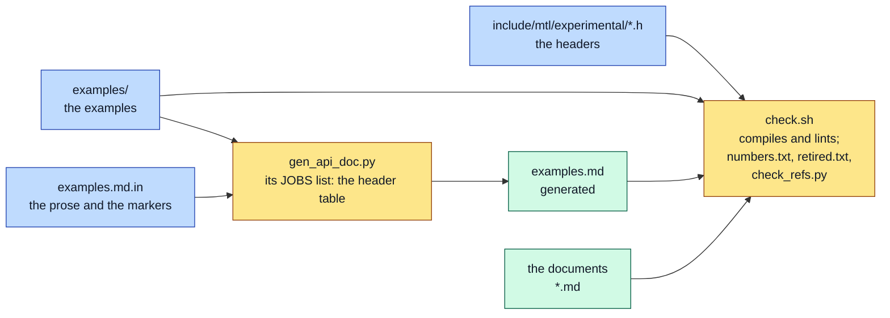

# Unified API sketch: headers and examples

| | |
|---|---|
| Status | Normative design sketch, experimental revision 0.2. Nothing is implemented |
| Reads with | [examples.md](../examples.md) (every example, generated from here), [concepts.md](../concepts.md), [contract.md](../contract.md) |

Users: read [examples.md](../examples.md). This page is for editing a header or an example.

This directory holds the normative header set of the unified MTL API and the worked examples as
files that compile. In task H1b of MS1 ([implementation plan §5.2](../implementation-plan.md#52-tasks))
the headers move to `include/mtl/experimental/`, and `check.sh` runs in CI.

## 1. What is here

| Path | What |
|---|---|
| `include/mtl/experimental/mtl.h` | the main header: everything a sender or receiver with MTL's buffers needs |
| `include/mtl/experimental/mtl_*.h` | the optional headers and their jobs ([examples.md §1](../examples.md)) |
| `examples/ex01_*.c` … `examples/ex24_*.c`, `examples/examples_cpp.cpp`, `examples/ex_common.h` | the examples |
| `examples.md.in` | the prose of [examples.md](../examples.md), with `@@EXAMPLE <file>@@` and `@@HEADER_TABLE@@` markers |
| `gen_api_doc.py` | writes [examples.md](../examples.md) from the template (every example copied verbatim; the header table from its own `JOBS` list), and from task H1b every marked table and enum block from its `.def` ([README §1, §4](../README.md)); `--check` only compares |
| `numbers.txt` | the load-bearing numbers and their homes, for the number lint ([README §1](../README.md)) |
| `retired.txt` | the names a decision retired, each with its D-row, for the retired-name lint (lint 12) |
| `check_refs.py` | the reference lint (lint 11): document-qualified section references, links and anchors |
| `check.sh` | the doc test, and the one source of the counts: exported functions per header, per call class and per milestone, and the number of frozen names |



`gen_api_doc.py` copies the examples into the template; `check.sh` compiles the headers and the
examples and checks them, the generated page and the documents (§4).

## 2. Adding or changing an example

1. Name a new file `examples/exNN_<name>.c`, with the next number (numbers run from 01, once
   each, with no gap). Its first line starts with its own number: `/* exNN —`.
2. End its header comment with a `Needs: MSn` line: the milestone from which every function and
   value it uses is exported. `check.sh` compiles the example at that milestone, so it fails if
   it calls a later function.
3. Show it in `examples.md.in` with an `@@EXAMPLE exNN_<name>.c@@` marker, in its section and
   its row of the at-a-glance table. `gen_api_doc.py` stops when the template does not show a
   file of `examples/`.
4. When you change ex01 or ex02, change their copies in concepts.md §3, §4 too.
5. When you add an exported function, call it from an example (G-114).
6. Run `python3 doc/unified-api/sketch/gen_api_doc.py`, then `doc/unified-api/sketch/check.sh`.

## 3. The headers and the library

There is one library, libmtl, with the unified functions in version nodes per milestone,
sealed at every release ([migration.md §7.2](../migration.md#72-the-unified-library)).
The sketch holds the whole design, and the installed header is the same file.

- **Milestone tags.** Every exported function carries its milestone twice: the tag that ends its
  comment, `(MS1)` to `(MS7)`, and the argument of its call-class macro, `MTL_API_DP(1)`. It is
  exported from that milestone on. A function's milestone is this tag. A value's milestone is its
  row in `availability.def`, `mtl_options.def` or `reasons.def`. A feature's milestone is its
  U-row in [coverage.md](../coverage.md), the latest milestone of what it names (D-137). An
  inline wrapper carries no tag: it works from the latest milestone it calls.
- **`MTL_LEVEL`.** `mtl.h` defines `MTL_LEVEL`, the last milestone whose exit passed. A call to a
  function of a later milestone fails to compile with GCC and Clang 14 or later, naming the
  milestone, and at link time elsewhere. `MTL_LEVEL` changes only in the exit commit of a
  milestone (implementation-plan.md §5.6).
- **`MTL_LATER`.** Everything of Phase 7 (functions, types, enum values, flags, option keys,
  events, reasons) and the features out of v1 (created timelines, the locked phase snap) are
  declared under `#if defined(MTL_LATER)`, with their values kept. A function tagged
  `(Phase 7)` or `(later)` is declared only there, with the argument `LATER`. `MTL_LATER` is for
  design checks, and a call to such a function never compiles. A Phase 7 name leaves
  `MTL_LATER` in the milestone that implements it (the RTCP sender-report keys in MS5,
  `MTL_TIME_SOURCE_FREERUN` in MS6, as their comments say).
- **Every other value** (enum values, flags, option keys, port prefixes, `when` kinds, wait
  masks, update parts) is declared unconditionally, so the freeze reserves it and a later
  milestone adds code, not layout.

## 4. Running the check

```bash
doc/unified-api/sketch/check.sh
python3 doc/unified-api/sketch/gen_api_doc.py   # after changing an example, a header or the template
```

`check.sh` compiles:

- every header alone: plain, with `-DMTL_LATER` for the declarations of later milestones, and as a
  binding generator sees it;
- all headers together in one file, in both orders, and as C++;
- the legacy headers and the new ones together, so a gradual port can mix them (with the
  build tree's `mtl_build_config.h`, or a stub of it); ex24, which includes `mtl_api.h` and
  `st_pipeline_api.h`, is compiled against the legacy headers too;
- every example, with `gcc -std=c99 -Wall -Wextra -Wpadded -Werror` (headers also with
  `-pedantic`) and `g++ -std=c++17 -Wall -Wextra -Werror`, and again with clang and clang++
  when installed; an example compiles to object code with `MTL_TARGET_LEVEL` set to the
  milestone of its `Needs: MSn` line, so it fails if it calls a later function;
- all headers together to object code at levels 0 and 7, and probes that a call to an MS3
  function, directly or through its inline wrapper, fails at level 2 naming MS3 and compiles at
  level 3 (with each compiler that has the `error` attribute).

It then runs the lints:

| Lint | Fails when |
|---|---|
| 1 | a public struct has no size check |
| 2 | `mtl.h` includes more than the C library, or another header more than its siblings (`mtl_util.h`, inline only, may also include `<string.h>`) |
| 3 | an identifier says "passthrough" (packet mode is `MTL_UNIT_PACKETS`) |
| 4 | `examples.md` does not show every example verbatim, or `concepts.md` its copies of ex01 and ex02 |
| 5 | the comment above an exported function does not end with a milestone tag (`(MS1)` to `(MS7)` outside `MTL_LATER`, `(Phase 7)` or `(later)` inside it), or the call-class argument is not the same milestone (`LATER` inside `MTL_LATER`) |
| 6 | the reasons of `mtl_reasons.h` do not ascend, or differ from contract.md §8.3's marked table. From task H1b, `gen_api_doc.py --check` replaces this lint and checks every marked table against its `.def` |
| 7 | a number of `numbers.txt` is stated outside its home |
| 8 | an `ST_CORE_LEGACY_*` name of `lib/src/st2110/core/` has no row in migration.md §6.5 |
| 9 | the examples do not call every exported function outside `MTL_LATER` and `mtl_debug.h` (G-114's method). Each example compiles at its `Needs` level, and `nm -u` of the objects is matched against `--tags`, so a call through an inline wrapper counts. An example that does not compile, or a host without `nm`, fails the lint |
| 10 | `examples/` holds a file other than `ex_common.h`, the C++ file and `exNN_<name>.c`, a number is used twice or missing, or an example's first line does not start with its own number (`/* exNN —`, the C++ file `// <name> —`) |
| 11 | a section reference qualified by a document ("contract.md §5.5", "README §1", a link then "§6.1", lists and ranges), a link or an `#anchor` names no file or heading; or, in a git work tree, a reference on a line not edited since the base revision (HEAD, or `CHECK_REFS_BASE`) names a heading whose title differs at the base. Bare "§n" references are not checked (`check_refs.py`) |
| 12 | a header defines a validity flag (`MTL_*_VALID`), `INT64_MIN` appears in a header outside `MTL_TIME_NONE`'s definition and its check, an example builds its own sentinel (a ternary that falls back to -1, 0 or `INT64_MIN`, or a time or index set to -1), or a name of `retired.txt` appears outside decisions.md in a document, the template, the sketch or the models (D-215) |
| 13 | a paragraph of a document or the template sets `min_tx_delay_ns` to a value that already holds the pick-up lead, which MTL adds itself, or an example or header reads `pickup_lead_ns` (D-218); decisions.md is skipped, its superseded rows keep the old recipe |
| 14 | a document writes a live sink's media time, the TAI of its presentation time ct, without the programme phase `+ δ` after it, also across a line break (D-221) |

From H1b, every enum constant and integer macro outside `MTL_LATER` also has exactly one row in
`reasons.def`, `mtl_options.def` or `availability.def`.

The examples only have to compile; they are never linked: application hooks such as `render()`
are declared, not defined. Every function in the pictures of examples.md exists in the headers.
Every configuration is typed (enums and defines, no strings). Return codes are always negative
`MTL_E*` constants with the Linux errno values; `0` is success, and reads that return a count
return at least 1.

`check.sh` prints the exported functions per header, call class and milestone. It also prints
the number of frozen names: exported functions, inline functions, enum constants, macros and
structs. Frozen names leave out `MTL_LATER`, `mtl_debug.h` and `mtl_legacy.h` (neither header is
part of `MTL_1.0`), and macros ending in `_` (internal). It exits non-zero on any failure.
`check.sh --tags` prints each exported function with its milestone and header, for the export
check of libmtl. Documents do not repeat these counts; they point here.

The candidate flags `-Wconversion -Wsign-conversion -Wcast-qual` are G-74's, for task H1b
([implementation-plan.md §5.2](../implementation-plan.md#52-tasks)). Every header was clean with
them on 2026-10-02, with and without `-DMTL_LATER`; `-Wcast-qual` catches an inline helper that
returns a writable pointer from a `const struct mtl_unit*`.

## 5. Rules for changing the sketch

- **Header wins over prose.** If a document and a header disagree about a name, a type, a
  layout or a call class, the header is right and the document is fixed. A design change that
  adds or renames a symbol is complete only when it is in a header and `check.sh` passes.
- **Not implemented yet** is `-MTL_ENOTSUP` with reason `NOT_IMPLEMENTED` for a known value of
  an exported call, and `-MTL_EINVAL` for an unknown value (mtl.h R1). A function that is not
  implemented is not exported.
- **Values follow the legacy enums** (D-97): legacy + 1 where 0 must mean "not set", the same
  values where 0 is a real default.
- **Sizes are checked.** Every public struct has `MTL_SIZE_CHECK`; padding is explicit
  (`-Wpadded`). Each essence member of `mtl_session_config` is 128 bytes, so an essence can grow
  inside its own member.
- **Export only what needs the library.** A function built only on public calls is `static
  inline` and exports no symbol (`mtl_session_open`, `mtl_stat_get`, `mtl_time_convert`,
  `mtl_flow_parse`, `mtl_util.h`).
- **One exception: a parser of network bytes.** It walks lengths, counts or offsets it reads
  from the data (an RTP payload, an RTCP block, SDP text). Such a parser is never inline. It is
  one exported function, so libmtl and every application run one implementation, a fix reaches
  them all by replacing the library, and one fuzz harness covers it (D-195). libmtl exports it
  when libmtl uses it too (`mtl_anc_rfc8331_decode`, `_encode`, `mtl_rtcp_mib_next`); a parser
  libmtl does not need lives in a companion library on public calls (SDP: `libmtl_sdp`,
  `mtl_sdp.h`). Fixed-offset accessors of a header the caller has bounded (`mtl_rtp_get_ts`,
  `mtl_anc_udw_get`) stay inline.
- **Shared verbs.** A verb several objects share is one exported function over
  `struct mtl_object` (`mtl_close`, `mtl_interrupt`, `mtl_wait`, `mtl_reap`,
  `mtl_read_events`; `mtl_release` over a lease), with `static inline` typed wrappers
  that keep each object's own name and pass the record size (`mtl_tx_reap`, `mtl_tx_reap_full`,
  `mtl_session_read_events`).
