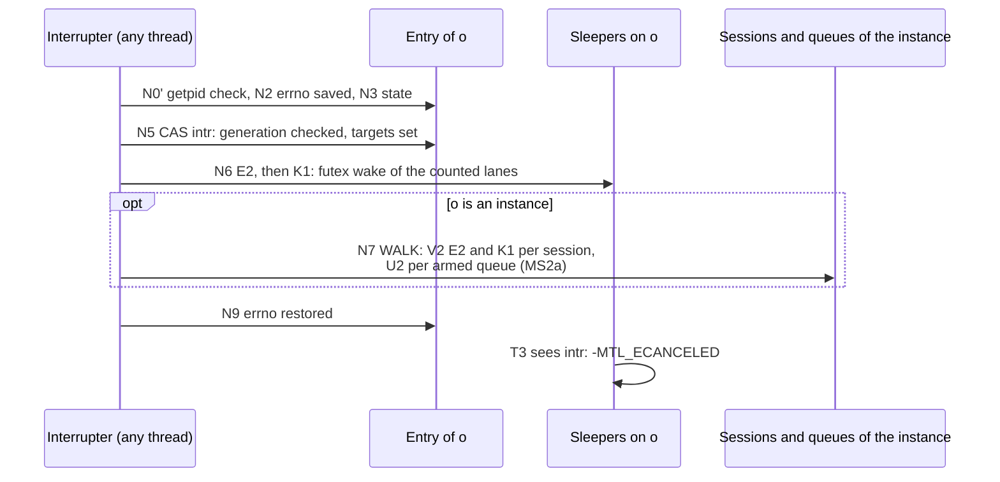
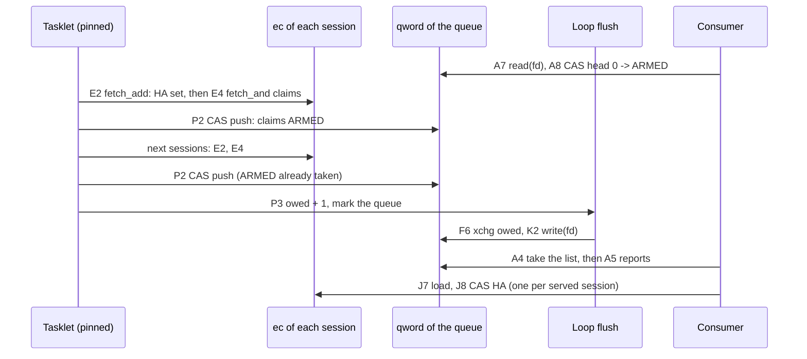

# The wait protocol: event words, waking, interrupts and queues

| | |
|---|---|
| Status | Maintained. The design of the core's wait protocol: its words, every step with its label, and why it is correct. Nothing here is implemented yet |

This document owns how the core wakes the threads that wait on a session, the instance or a
queue: the wait words, the object path, the deferred wake, interrupts, the close and reuse of an
entry, queues and posts, the correctness argument, and timeouts per platform. The summary is
[core.md](core.md) §6; what the calls promise is [contract.md](contract.md) §7; the model
cases, the mutants and the pause-hook tests that check the protocol are
[design/wait-tests.md](design/wait-tests.md). Internal names are indicative, as in core.md.

**Citations.** As in [core.md](core.md): every `path:line` is at `main` @ `545a266a`, with the
markers of [engine.md](engine.md).

**Start here.**

| Question | Read |
|---|---|
| Which words exist, where they live, and who writes them | [2. The words](#2-the-words) |
| What a producer, a waiter and a probe do, step by step | [3. The object path](#3-the-object-path) |
| Who makes the wake-up syscall, its bound and its cost | [4. The deferred wake](#4-the-deferred-wake) |
| How `mtl_interrupt` reaches the sleepers | [5. Interrupts](#5-interrupts) |
| What close, retire and reuse do to an entry's words | [6. Close, retire and reuse of an entry](#6-close-retire-and-reuse-of-an-entry) |
| How an event loop waits on many objects | [7. Queues (MS2a)](#7-queues-ms2a) |
| Why no wake-up is lost | [8. Why it is correct](#8-why-it-is-correct) |
| Timeouts, Windows and the legacy `wake_block` | [9. Timeouts and platforms](#9-timeouts-and-platforms) |

**IDs used here.** The step labels are defined in the listings; the full list of ID families is
[README §3](README.md#3-reading-the-ids).

| IDs | Kind | Defined in |
|---|---|---|
| E1–E4, M1, K1, K2, T1–T9, D1, D2, Q1–Q3, RW1, RW2 | steps of the object path | [3. The object path](#3-the-object-path) |
| F1–F8 | steps of the flush | [4. The deferred wake](#4-the-deferred-wake) |
| N0', N1–N9, V1, V2 | steps of an interrupt and of the instance walk | [5. Interrupts](#5-interrupts) |
| X1–X4, Y1 | steps of retire and reuse | [6. Close, retire and reuse of an entry](#6-close-retire-and-reuse-of-an-entry) |
| P1–P3, U1, U2, PS1–PS4, A1–A11, J1–J10, C1–C5, Y2, DV1–DV3 | steps of the queue path | [7. Queues (MS2a)](#7-queues-ms2a) |
| W0, W1, W2 | the wait options | the options table of [4. The deferred wake](#4-the-deferred-wake) |
| CP, DP, DPC, TK, WK, AD, WT, AS | execution contexts | [engine.md](engine.md) §1.2 |
| o1–o7, q1–q11, r1–r4, p1–p5; the mutants | model cases and mutants | [design/wait-tests.md](design/wait-tests.md) §1.1 |
| WH*n*, WC*n*, QW*n* | pause-hook tests | [design/wait-tests.md](design/wait-tests.md) |

## 1. Overview

Read the summary in [core.md](core.md) §6 first: the event word, the picture of who makes the
wake-up syscall, and what `mt_wake()` does in each calling context.

The syscalls of the whole subsystem, by context:

| Context | Syscalls of the wait subsystem |
|---|---|
| a tasklet handler | none (M1 marks) |
| a loop's flush, after its handlers | at most `wake_k` marked entries whose wake makes a syscall per iteration (D-142): per object one futex wake, per queue one `write()` |
| a probe (timeout 0) | none, except as a producer (release, reap, failed conversion): one futex wake or one `write()` |
| a call with a timeout | one `futex_wait` per sleep; beyond a full count on a target, one per ms |
| `mtl_queue_wait` | none on a `MTL_QUEUE_POLLED` queue; else one `read()` when it finds nothing, one `write()` when its read took a signal and it does not arm, `ppoll` with a timeout |
| `mtl_queue_arm` | none, or one `write()`, after its unlock, when it reports at once to an armed queue |
| `mtl_queue_post` | `getpid`, and one `write()` when its CAS claims `ARMED` |
| an AS interrupt | per object with a sleeper one futex wake, per armed queue one `write()`, plus `getpid` |
| the control plane | state changes wake directly; a queue's close writes once; no queue descriptor is closed while the process runs (D-161) |

## 2. The words

The register of these words is the table below; core.md §4.8's register lists the other words
of the core and links here.

| Lane | TX session | RX session | Instance |
|---|---|---|---|
| 0 | `MTL_WAIT_ACQUIRE` | `MTL_WAIT_DEQUEUE` | — |
| 1 | `MTL_WAIT_RESULTS` | rows (`mtl_rx_wait_rows`, MS2) | — |
| 2 | `MTL_WAIT_EVENTS` (MS3) | `MTL_WAIT_EVENTS` (MS3) | `MTL_WAIT_EVENTS` (MS3) |
| 3 | spare | `MTL_WAIT_RTCP` (Phase 7) | — |

An interrupt of RX `MTL_WAIT_DEQUEUE` selects lanes 0 and 1. A state change has F = every lane.

| Where | Word | Layout | Writers | Readers | Ordering | Reset |
|---|---|---|---|---|---|---|
| entry line A (never freed) | `ec` | `seq` in bits 32–63 (the futex word), `HA(0..3)` in bits 28–31, four 7-bit counts below (lane l at bit 7l) | E2 (every producer), E4, J4a, J5, X3, C4 (`fetch_and` of one `HA`), T7 (CAS + ONE), T9 (`fetch_sub` ONE), J8 (CAS \| HA) | T2, J7 (acquire), E2, K1 (relaxed), the kernel (`seq`) | RMW only (below) | `seq` never; counts and `HA` 0 at retire |
| line A | `fired` | u32 lanes marked for the loop's flush | M1 (`fetch_or` release) | F6 (`xchg` acquire) | release / acquire | Y1 |
| line A | `owner`, `kind` | u16, u8 | create | V2, the flush | seq_cst / const | Y1 |
| line A (MS2a) | `alink[4]` | u64 per slot `{next:20 \| qidx:16 \| qgen:16 \| lanes:4 \| fired:5}`; fired's fifth bit is STATE | the slot's owner: J6 (qidx, qgen, lanes), P2 (next, fired) | P1, A5 | relaxed atomics; published by the `HA` CAS (J8 release, E4 acquire) and by `qword` (P2 release, A4 acquire) | per use |
| entry in-flight line (application threads; read-mostly) | `inflight` | u64 | every data call (D1, T1, Q1, A1, J1) | X2, C2 | seq_cst add, release sub | never |
| in-flight line | `intr` | u64 `{gen:32 \| targets:32}` | N5 (CAS, the handle's generation checked), Y1 (`{new gen, 0}`) | T3, Q2 (relaxed: ordered by `ec`), A9 for the instance's queues (seq_cst) | seq_cst CAS | Y1 |
| entry line C (MS2a; application threads) | `astate[4]`, `user[4]` | u8 `{state:2 (FREE, IDLE, ARMED, DEAD) \| want:4}`; u64 | under the queue's lock: J4a–J6, A5, X3, C3, C4. Without it, only P2's stale path (FREE; the node is the claimer's) | the same | relaxed atomics | Y1 (FREE; a DEAD slot stays busy until its pop) |
| slot line (MS2) | `progress` | u64 `{rows:31 \| ended:1 \| want:32}` | RW1 (the binding: `fetch_add`, `fetch_or`, `fetch_and`), RW2 (the reader: CAS) | RW1, RW2, TX `query_frame_lines_ready` (rows only) | RMW only | per use |
| queue entry line A (MS2a; never freed) | `qword` | u64 `{head:20 \| qgen:16 \| ARMED:1 \| CLOSED:1 \| post:24}`; head = node (index(o) << 2 \| i) + 1, 0 = empty; post = bits not yet taken | P2 (CAS), PS2 (CAS), A4 (CAS head and post → 0), A8 (CAS ARMED), U1 (`fetch_or` CLOSED), U2 (CAS ARMED → 0), C3, Y2 | everything on the queue path | acq_rel; A8 and U2's load seq_cst | Y2 |
| queue line A | `intr` | u64 `{gen:32 \| ON:1}` | N5 | A3, A9 (seq_cst) | seq_cst CAS | Y2 |
| queue line A | `owed` | u32 writes owed by library loops | P3 on a loop (`fetch_add`) | F6 (`xchg`) | release / acquire | Y2 |
| queue line B (application threads) | `local`, `lock`, `fd` | u32 head of the consumer chain; a TTAS spinlock, never held across a syscall; i32, open while the process runs (a forked child closes it) | A4, A5 (under the lock); create of a fresh entry (`fd`) | the same | plain under the lock | Y2 (`local`); `fd` kept |
| queue line B | `dlv[2]`, `dph` | u32 deliveries in progress per phase; the phase bit | A5 (`fetch_add` under the lock), A10 (`fetch_sub` release, the call's last step); DV1–DV3 flip `dph` under the lock | DV1–DV3 (acquire) | as stated | never; `dph` Y2 |
| loop | `L0`–`L2`, `cursor`, `wake_k` | today's bitmap and D-142's bound | the loop | the loop | relaxed | never |

`ec` is written only by RMWs: producers release, arms acquire; `seq` is at byte offset 4 on
little-endian, and a carry out of bit 63 is discarded. Line A is written by tasklets and by
sleeping or arming threads, never by probes.

Line A of a session is 48 bytes: `ec` 8, `fired` 4, `owner/kind` 4, `alink` 32. There is no line B: `fired`
sits on line A and `intr` on the in-flight line, so probes never touch line A.
Queue entries come from their own never-freed table (one per type, R4), on the node of the
instance's main lcore (D-182).

## 3. The object path

The steps, with the labels the model (`design/models/final_model.py`), `st_core_wait.c` and the
tests use (`check_labels.py` compares them). Interrupts, close and retire are explained in §5, §6,
the flush in §4, the queue path in §7.

```text
Notation: SEQ = 1 << 32; ONE(L) = sum of 1 << 7l over the lanes L; CNT(a, F) = the lanes of F
with a count > 0 in a; HA(i) = 1 << (28 + i). "enter"/"leave" = the in-flight counter of data
calls. Every syscall of a DP, WT or AS call is a raw syscall().

EVENT(o, F): after every change that can make a target of the lanes F ready
E1  publish (release is enough): the completion's PUBLISHED or FREE store, W or not (D-209),
    and a TX HELD -> PUBLISHED or FREE store (a pin release, the last repeat use) | a release's
    APP -> FREE CAS | store(reap_seq) | RW1's progress RMW | an event's pending state |
    store(state) (F = every lane) | N5's CAS of intr (F = its lanes) | MS5: the ring-RX
    enqueue crossing packet.rx_min_packets or a marker, and the tick that sees
    packet.rx_max_wait_ns pass (both TK, through st_core_event)
E2  a = fetch_add(ec(o), SEQ, acq_rel)
E3  w = CNT(a, F); if (w) mt_wake(o, w)
E4  (MS2a) unless E1 is an interrupt or CLOSING: for each slot i with HA(i) in a and
    (E1 a state change, or lanes(alink[i]) & F):
        if (fetch_and(ec(o), ~HA(i), acquire) & HA(i)) PUSH(o, i, F, E1 a state change)

mt_wake(x, w): x an object (w its lanes) or a queue (w = 1, a write owed)
M1  a library loop (a scheduler, the null loop, the RX packet lcore, any loop that registers
    the instance context's flush hook): an object: if (fetch_or(fired(x), w, release) == 0)
    mark index(x); a queue: if (fetch_add(owed(x), 1) == 0) mark index(x); the loop flushes
    after its handlers
    any other thread: WAKE_NOW(x, w)

WAKE_NOW(x, w): no in-flight count; returns the syscalls made
K1  an object: w &= CNT(load(ec(x), relaxed), w);
    if (w) futex(&seq(x), FUTEX_WAKE_BITSET|FUTEX_PRIVATE_FLAG, INT_MAX, w)
K2  (MS2a) a queue: write(fd(x), 1)         // fd is open while the entry exists
    a failed K1 or K2 syscall counts instance.wake_errors and is not retried (unreachable for
    a private futex and an eventfd that stays open)

FLUSH(Lp): F1-F8 of §4 with D-142's bound, and
F6  an object: F = xchg(fired(entry(i)), 0, acquire); a queue: F = xchg(owed(entry(i)), 0)
F7  if (F) { if (WAKE_NOW(entry(i), F) > 0) n++; else z++ }

WT(o, M, timeout): every data call with timeout != 0; L = lanes(M)
T1  deadline = timeout == MTL_FOREVER ? NONE : now(CLOCK_MONOTONIC) + timeout; enter
T2  e = load(ec(o), acquire)        (mtl_rx_wait_rows: also p = load(progress, acquire), RW2)
T3  c = the state's code for M; if none and (bits(intr(o)) | bits(intr(I))) & M:
    c = -MTL_ECANCELED (intr(I) loaded seq_cst); if (c) { leave; return c }
T4  r = ATTEMPT(o, M) (mtl_wait: the ready subset; the predicate's loads first, the reaper
    lock only when it is READY); if (r >= 0) { the call's own sources; leave; return r }
T5  if (deadline passed) { leave; return -MTL_EAGAIN }
T6  if (a lane of L counts 127 in e) { futex(&seq(o), FUTEX_WAIT_BITSET|FUTEX_PRIVATE_FLAG,
    seq(e), min(deadline, now + 1 ms), L); goto T2 }        // uncounted: it re-checks
T7  if (!CAS(ec(o), e, e + ONE(L), acq_rel)) goto T2
T8  futex(&seq(o), FUTEX_WAIT_BITSET|FUTEX_PRIVATE_FLAG, seq(e), deadline (absolute), L)
T9  fetch_sub(ec(o), ONE(L), release); goto T2

DP(o, T): timeout 0
D1  enter; CLOSING: leave, -MTL_ESHUTDOWN; RETIRED: C-sources' column (-MTL_EBADF self-closed,
    -MTL_ESHUTDOWN closed by the instance)
D2  r = ATTEMPT(o, T); if (r >= 0) the call's own sources (EVENT); leave; return r

WAIT0(o, M): mtl_wait with timeout 0
Q1  enter; c = the state's code for M; if (c) { leave; return c }
Q2  if ((bits(intr(o)) | bits(intr(I))) & M) { leave; return -MTL_ECANCELED }
Q3  R = the lanes of M that are READY; leave; return R ? R : -MTL_EAGAIN

ROWS (MS2): the second word of a row wait
RW1 the RX binding, per rows step d (the unit's end: fetch_or(progress, ended)):
    old = fetch_add(progress, d, acq_rel); w = want(old);
    if (w && (rows(old) + d >= w || ended)) { fetch_and(progress, ~WANT); EVENT(s, lane 1) }
RW2 mtl_rx_wait_rows, between T4 and T7: CAS(progress, p, p with want = want(p) ?
    min(want(p), min_rows) : min_rows), else goto T2
```

The call's own sources:

- a reap that advanced `reap_seq` runs EVENT(o, ACQUIRE);
- a release of an APP TX lease runs EVENT(o, ACQUIRE);
- a failed in-caller conversion, or submit's own flush (D-121), runs EVENT(o, RESULTS | ACQUIRE).

In MS1, E4, K2, POST, the queue branches of N6, V2 and CLOSE, and X3 are not built (their steps are in §3 and §5–§7): `HA` is always 0. RW1–RW2
land in MS2.

## 4. The deferred wake

The picture of the deferred wake and the per-context table of `mt_wake()` are
[core.md](core.md) §6.

**The flush.** Each scheduler calls the environment's wake flush hook (core.md §2.4) once per iteration.
In `sch_tasklet_func` (`mt_sch.c:155-242`) the call sits after the handler loop (`:210`), inside
the `time_measure` window, and before the sleep check (`:211`); its return is added to `pending`.
On loop exit the flush runs with no bound (after the `ops->stop` loop, `mt_sch.c:231-236`).

```text
FLUSH(Lp)
F1  if (load(Lp.L2, relaxed) == 0) return 0
F2  n = 0; z = 0; k = load(Lp.wake_k, relaxed)       // D-142
F3  for each set bit i of Lp.L0, ascending from Lp.cursor, wrapping once:
F4      if (n >= k || z >= 32) { Lp.cursor = i; sched.wake_carried += the bits left; return 1 }
F5      clear bit i (and its summary bits once their word is 0)
F6      an object: F = xchg(fired(entry(i)), 0, acquire); a queue: F = xchg(owed(entry(i)), 0)
F7      if (F) { if (WAKE_NOW(entry(i), F) > 0) n++; else z++ }
F8  Lp.cursor = 0; return 0
```

- **The bound is a count**: `wake_k` objects or queues whose wake made a syscall, and a fixed
  number whose wake had nothing to do, per iteration (the values: [D-142](decisions.md)). The
  control plane sets `wake_k` per loop at every attach and detach of a session's tasklets: the
  strict bound under software-paced video TX, which tolerates no loop stall, and S1's larger bound
  elsewhere (`sched.wake_k`).
- **Entries beyond it** stay marked. Later completions merge into their `fired` lanes or `owed`
  count, and the next flush resumes at the cursor, so an entry marked with F others is woken
  within F iterations. A return of 1 keeps the loop from sleeping.
- **Counters:** `sched.wake_carried`, `sched.wake_syscalls` and `instance.wake_errors`.

**Layout.**
- One bitmap per library loop, indexed by the entry's process-wide index (sessions and the
  instance in the handle table, queues in their own table), with two summary levels.
- The loop's own thread is the only writer, using relaxed loads and stores; the notifier, if
  built, switches to RMWs.
- A completion by another scheduler's tasklet (a shared TX queue, core.md §4.3) marks the object in that
  other loop. `fired` is one word per object, so whichever loop flushes first takes every lane.

**Cost** (S1 measures it; the budgets are implementation-plan.md §8.4's).
- Per completion with nothing armed: E2, one `lock xadd` on line A, which stays local while no
  thread sleeps or arms on the object.
- With a WT sleeper counted: also M1's `fetch_or` and the bitmap.
- With an attachment armed: also E4's `fetch_and` and P2's CAS on `qword`; line A comes back from
  the arming thread once per unit (one transfer in an aligned burst), and `qword` too under
  staggered arrivals (two).
- That transfer is the price of exact per-object readiness with single-location arming. The
  per-object handle and counters designs paid ≈ 25 ns per armed completion and packed claim bits
  ≈ 50–70 ns [inferred]; D-166 keeps the packed bits for aligned bursts.
- Per iteration with nothing marked: one load.
- Per woken entry: about 0.2 µs of bitmap and `xchg` work [inferred], plus one futex wake per
  object with a counted sleeper on a fired lane, or one `write()` per queue, once per consumer
  cycle.
- A flush therefore stalls the pinned core by at most `wake_k` wakes of one syscall each. That
  fits rate-limit pacing and TSC pacing at 1080p. At 2160p under TSC pacing it may not, so S1b
  decides the slack gate or the notifier (D-165).
- W2 fits while Σ(armed objects and queues × their wake rate) × the cost per wake ≤ 2 % of a core
  per scheduler, about 13 k wakes/s, where a queue counts once per consumer cycle. Dense audio
  (hundreds of sessions per scheduler) polls a `MTL_QUEUE_POLLED` queue or the sessions on its
  own timer (D-170); `MTL_UNIT_ROWS` at a small `rx.rows_step` reads `progress` (W0).
- A thread per session with a timeout does not scale to dense audio. Genlocked sessions are
  woken `wake_k` per iteration, so at `wake_k` = 1 the 512th of 512 sessions wakes ≈ 6–14 ms
  late [inferred], later than its 1 ms unit.
- The estimates MS4a1 measures the dense shapes against (OI-80) [inferred]: the W0 sweep costs the
  application 1024 × ≈ 25 ns per ms (≈ 2.5 % of a core) and the scheduler nothing. Armed queues
  cost the scheduler ≈ 8–13 % of a core under staggered RX. Sleeping queues add a `write()` per
  consumer cycle, up to 100–200 k/s per scheduler, at 1–3 µs each when it wakes an epoll sleeper.
  TX is mostly unarmed: a gateway acquires with a frame in hand.
- Waiting threads run on CPUs disjoint from the schedulers' ([deployment.md](deployment.md)):
  otherwise the kernel's wake-affine placement can put a woken thread on a scheduler's CPU.
- The waker does not pay the wakee's C-state exit, but the wake latency does (C6: about
  100–300 µs on Xeon), so `info.expected_wake_latency_ns` comes from S1 per C-state policy.

| Option | Cost on the tasklet side | Added latency | Use |
|---|---|---|---|
| W0 application busy-polls with timeout 0, or polls a `MTL_QUEUE_POLLED` queue on its own timer | E2 per completion; with a queue, E4 and P2 per armed unit | 0, or the timer | lowest latency; 125 µs and 1 ms audio, dense loads, `MTL_UNIT_ROWS` (line mode) |
| W1 application spins then sleeps with back-off | E2 per completion | up to the back-off | fallback |
| W2-deferred (the design) | E2 per completion; a mark when armed; per iteration up to `wake_k` wakes (D-142) | ≤ the marked entries' iterations plus the wake-up | every session, every mode, from MS1 (queues from MS2a) |
| the notifier thread (contingency, D-165) | as W2 without the flush's syscalls | a hop of 2–20 µs, about 130 µs at C6 | built only by D-142's rules (MS2a), in place of the earlier W3 (D-165) |
| predictive sleep (considered, not built) | none: the call arms only codes and interrupts | timer slack (50 µs) plus a guard | a WT call whose readiness time is known (TX: the oldest launch plus its transmit time; RX: the due time) sleeps until then and arms its lane only if the unit is late |

**The notifier, if built (D-165).** It is one thread per instance on `instance.main_lcore`,
`SCHED_OTHER`, every signal blocked, not an EAL thread. A loop only marks. After its handlers it
kicks the notifier (one futex wake) only if the notifier has announced SLEEPING. The notifier
announces SLEEPING with a seq_cst store and then re-checks every loop's summary word; the loop
does a seq_cst bitmap RMW and then loads the notifier state. That is a store-buffering pair, and
a CAS elects one kicker per sleep. After a pass that woke something, the notifier spins `spin_ns`
(50 µs), so a burst costs one kick. A TSC-paced quiet loop never kicks a napping notifier, which
then sleeps with a timeout of about 100 µs. Under the test clock the notifier parks and ADVANCE
runs its pass. A stalled notifier raises `MTL_EVENT_SCHED_STALLED`. There is one per instance, not
one per NUMA node, because per node needs a free CPU on every node.

Its price keeps it a contingency: a thread, the hop above, one point of failure for every
loop-caused wake, a latency-sensitive main lcore, the two option keys it
would add (`instance.notify_spin_ns`, `instance.notify_lcore`) and a ceiling of about 250–600 k wakes/s [inferred]. With queues the
flush already writes once per queue per consumer cycle. It is adopted only by D-142's rules: SR2
(a slow guest futex) and SR3 (pacing still failing after D-170's patterns and the slack gate),
[engine.md](engine.md) §6.1.

## 5. Interrupts

Interrupts (`mtl_interrupt(o, mode, targets)`; the checks and codes are contract.md §8.4's;
the steps N1–N9 and WALK V1–V2 are §5's). The interrupting thread, which may be a signal
handler, works only on never-freed words: it sets the sticky targets in `intr` with a CAS that
checks the handle's generation, then runs E2 on the object and wakes its counted sleepers
directly (K1, never through a loop's bitmap); for an instance it then walks the session table and
the queue table. No in-flight count is taken. The picture shows the shape (MTL_INTR_ON):



```text
INTERRUPT(o, mode, targets): AS with ON and ABORT, CP with OFF
N1  the mode and target checks, pure, without mtl_last_error
N0' if (syscall(SYS_getpid) != load(mt_pid, relaxed)) return -MTL_EBADF
N2  saved = errno; x = entry(o) (chunk acquire); g = the handle's generation
N3  st = load(state(x), seq_cst): a session CLOSING or RETIRED, a queue closed, an instance
    closing: r = 0 (R4), goto N9
N4  pm = targets ? targets : every target
N5  CAS loop on intr(x) (seq_cst): gen(intr) != g: r = -MTL_EBADF, goto N9;
    ON: targets |= pm; OFF: targets &= ~pm, r = 0, goto N9
N6  a session or the instance: E2 on x, then K1 directly with the lanes of pm (never M1:
    no thread-local state, no loop's bitmap); a queue (MS2a): U2(x, load(qword(x), seq_cst))
N7  an instance: WALK(x, pm)
N8  ABORT: the instance's abort flag (core.md §5)
N9  errno = saved; return r
WALK(I, pm)
V1  h = load(session_table.hw, seq_cst)
V2  for each entry e < h (chunk pointers acquire) with load(owner(e), seq_cst) == index(I):
        a session: E2, then K1 with the interrupt lanes of pm; a queue (MS2a): U2(e, ...)
```

- **Sleepers and the walk.** A WT sleeper reads `intr` and the instance's `intr` (seq_cst) after
  its T2 load, so either it sees the interrupt, or its T7 fails, or N6's E2 sees its count. An
  entry's `hw` and `owner` are stored (`seq_cst`) before its handle is returned, so a walk that
  misses an entry cannot miss its sleeper's view of the instance's `intr`.
- **Queues** (MS2a). A queue's interrupt and its sleepers are the one store-buffering pair of the
  design (N5 then U2, A8 then A9, §7). A session's interrupt does not reach the queues it is armed
  on; the instance's interrupt does, through the walk. A session interrupt that also reports its
  armed slots with `-MTL_ECANCELED` was considered for multi-session framework elements and not
  taken: an element that sleeps on a queue interrupts that queue.
- **Cost.** O(`hw`) loads (≤ 65 536), plus one RMW and one syscall per object with a counted
  sleeper, and one `write()` per armed queue; the budget is ST8 (implementation-plan.md §8.4).
- **AS-safety.**
  - Atomics, raw `futex` and `write`; `errno` saved and restored; no TLS (no `mtl_last_error()`,
    no debug class, no `mt_in_busy_loop`).
  - Only never-freed memory is read, and a queue's descriptor is never closed while the process
    runs (§7). In a forked child the call returns at N0': `mt_pid` is stored at the first
    instance open, before any handle exists.
  - From MS2a MTL blocks asynchronous signals around `rte_eal_init` and in the threads it creates
    on a direct open. A bridged instance keeps the legacy behaviour.
- **Precedence.** Close wins over an interrupt.

## 6. Close, retire and reuse of an entry

The states of an entry and their picture are [core.md](core.md) §7.2. The steps:

```text
CLOSE(s): store(state, CLOSING, seq_cst); E2 and K1 directly with every lane (no E4: a
          closing object is never reported); (MS2a) for each slot i of s not FREE:
          DRAIN_DLV(the queue of alink[i]) (§7); then wait for the in-flight counter
RETIRE(s): only on the control plane (a worker, the closer's poll, the orphan drain), never in
          the data call that made s retirable, which only performs X1 and posts the rest
X1  store(state(s), RETIRED, seq_cst)
X2  while (load(inflight(s), seq_cst) != 0) sched_yield()   // data calls only, never its own
X3  (MS2a) for each slot i of s not FREE, under its queue's lock: IDLE -> FREE; ARMED: the
    fetch_and of HA(i) won -> FREE, lost (listed) -> DEAD, freed by its pop
X4  tombstone (core.md §4.7); the words stay
Y1  create on a reused entry, before the handle is returned: the generation + 1;
    intr = {generation, 0}; fired = 0; slots not DEAD -> FREE; owner, kind (seq_cst);
    the state RETIRED -> CREATED (release), last; hw (seq_cst) if it grows. seq is never
    reset; the counts and HA are already 0.
```

## 7. Queues (MS2a)

A queue tells an event loop, or a pool of threads, which of its objects changed (contract.md §7.2,
D-159–D-162). It is an entry of its own never-freed table on the node of the instance's main lcore
(D-182): one word `qword`, an intrusive list through the objects' attachment slots (`alink` on line A, `astate` and `user` on
line C of §2's table), and an eventfd that lives as long as the process (a forked child closes it). The
first change of an armed target claims the attachment bit `HA` in the object's event word and
pushes the object once; a report disarms it. An application's post (`mtl_queue_post`, D-206) ORs
its bits into the `post` field of `qword` by the same CAS, with the same checks; the consumer
takes the field with the list and reports it first. Tasks C1q1 and C1q2 build it. A session on another
node's scheduler pays a remote `qword` transfer per push (≈ 200–400 ns [inferred]); a consumer
per node with its own queue avoids it, and S1a measures it on two sockets.

The push runs in the completing context (E4, P2), not in the loop's flush. The flush handles at
most 32 entries without a syscall per iteration (F4), so a dense burst pushed from there would be
carried 32 objects per iteration.

**Why queues (D-159).** The per-object wait handle they replace needed a descriptor per session, a
`read()` per missed probe, wait groups with an O(members + hw) sweep for dense audio, and an
in-flight count on every wake. Its sweep also spun a source-limited sender (ex03), because a free
slot kept ACQUIRE ready. A queue is one descriptor for any number of objects, its consumer visits
only the ready ones, and a burst costs one write; it reports the objects armed on it and the
application's posts (D-206), so a loop on a queue needs no descriptor of its own. `mtl_queue_wait` is its own export, not a kind of `mtl_reap`: its timeout 0 arms the
descriptor and its `-MTL_ECANCELED` applies at any timeout. MS1 has no descriptor because no MS1
consumer sleeps on one (`UnifiedRxTxApp` and `UnifiedKahawaiTest` use a thread per session) and S1
measures the wake costs first (MS2a); a stop-gap MS1 loop, a WT thread writing an application
pipe, was rejected as the wrong pattern to teach.

**Why posts are a field of `qword` (D-206).** A post is then one more RMW in the chain that the
consumer's arm (A8) compares, so the push's argument covers it with no new ordering pair, and the
CAS that posts also checks CLOSED and the generation. The field coalesces, so it needs no node, no
arm and no capacity. A 64-bit mask in a word of its own would need its own generation and a
store-buffering pair with A8, the interrupt's shape; a count tells the loop nothing it can act on;
one entry per post (io_uring's `IORING_OP_MSG_RING`, IOCP's `PostQueuedCompletionStatus`) needs
a capacity or an allocation. The field has the bits the word has left; kqueue's `EVFILT_USER`
coalesces the same number of flag bits by OR.

```text
PUSH(o, i, F, st): by the winner of HA(i) (E4), or by an arm that found o ready (J8)
P1  a = alink[i]; q = qidx(a); f = (F & lanes(a)) | (st ? STATE : 0)
P2  v = load(qword(q), relaxed); loop:
        if ((v & CLOSED) || qgen(v) != qgen(a)) { astate[i] = FREE; return }   // stale queue
        alink[i].next = head(v); alink[i].fired = f                         // the node is ours
        n = v with head = node(o, i); if (v & ARMED) n &= ~ARMED
        if (CAS(qword(q), v, n, acq_rel)) break                             // else v reloaded
P3  if (v & ARMED) mt_wake(q, 1)        // one write owed: the loop's flush, or K2 now

SIGNAL OF A QUEUE: its close or an interrupt; never on a library loop
U1  close: v = fetch_or(qword(q), CLOSED, seq_cst)
U2  U2(q, v): while (v & ARMED) { if (CAS(qword(q), v, v & ~ARMED, acq_rel)) { K2(q); break };
        v = load(qword(q), seq_cst) }

POST(q, b): mtl_queue_post, AS; never on a library loop
PS1 b == 0 or b & ~MTL_QUEUE_POST_MASK: -MTL_EINVAL (pure, without mtl_last_error); N0';
    saved = errno; x = entry(q) (chunk acquire; none: r = -MTL_EBADF, goto PS4)
PS2 v = load(qword(x), relaxed); loop:
        if ((v & CLOSED) || qgen(v) != low16(gen(handle))) { r = -MTL_EBADF; goto PS4 }
        n = v | post(b); if (v & ARMED) n &= ~ARMED
        if (CAS(qword(x), v, n, acq_rel)) break      // also when n == v: the CAS is the release
PS3 r = 0; if (v & ARMED) K2(x)                        // the claim's one write, directly (never M1)
PS4 errno = saved; return r

QWAIT(q, out, r_size, max, timeout): mtl_queue_wait
A1  N0'; a MTL_QUEUE_POLLED queue and timeout != 0: -MTL_EINVAL; deadline; enter q (a
    closed handle: -MTL_EBADF); got = 0; pb = 0
A2  lock(q)        // a TTAS spinlock of application threads, held for memory operations only
A3  v = load(qword(q), acquire); if (qgen(v) != low16(gen(handle))) { r = -MTL_EBADF; goto A10 }
    if (v & CLOSED) { r = -MTL_ESHUTDOWN; goto A10 }   // a reused entry is never drained
    if (bits(intr(q)) | bits(intr(I))) { r = -MTL_ECANCELED; goto A10 }
A4  if (local(q) == 0 && (head(qword(q)) != 0 || post(qword(q)) != 0)): CAS qword: head -> 0,
    post -> 0, flags kept (acq_rel); local(q) = the list taken, reversed (oldest first);
    pb = the post bits taken
A5  n = 0; if (pb) { p = dph(q); fetch_add(dlv[p](q), 1, relaxed);       // the report of posts,
        out[n++] = {MTL_OBJ_NONE, pb, 0}; pb = 0 }                // first
    while (n < max && local(q) != 0): (o, i) = pop local(q);
        if (astate[i] == DEAD) { astate[i] = FREE; continue }
        if (load(state(o), seq_cst) is CLOSING or RETIRED) { astate[i] = IDLE; continue }
        if (n == 0) { p = dph(q); fetch_add(dlv[p](q), 1, relaxed) }   // the delivery count
        out[n++] = {o, user[i], alink[i].fired & (want(astate[i]) | STATE)}; astate[i] = IDLE
A6  if (n) { r = n; goto A10 }; MTL_QUEUE_POLLED: { r = -MTL_EAGAIN; goto A10 }
A7  unlock(q); if (read(fd(q)) returned a count) got = 1; lock(q)    // the reset, unlocked
A8  CAS qword: {head 0, post 0} -> {head 0, post 0, ARMED} (seq_cst), only while local(q) == 0;
    CLOSED: goto A3; head != 0, post != 0 or local(q) != 0: goto A4 (got is kept)
A9  if (bits(intr(q)) | bits(intr(I)), seq_cst loads) goto A3     // the interrupt pair
    r = -MTL_EAGAIN; got = 0                            // this call armed: it keeps the signal
A10 unlock(q); if (got) write(fd(q), 1)                 // the write-back rule
    if (r != -MTL_EAGAIN || timeout == 0 || deadline passed) {
        leave; if (n) fetch_sub(dlv[p](q), 1, release); return r }      // the last step
A11 ppoll(fd(q), the time left); got = 0; lock(q); goto A3
    // with timeout 0 the application's own epoll_wait is this step

ARM(q, o, M, user): mtl_queue_arm, DP
J1  N0'; enter o; enter q; lock(q)
J2  v = load(qword(q)); if (qgen(v) != low16(gen(handle))) { r = -MTL_EBADF; goto J10 }
    if (v & CLOSED) { r = -MTL_ESHUTDOWN; goto J10 }
J3  i = o's slot on q; none: M == 0: r = 0, goto J10; a lane of M in another slot of o:
    r = -MTL_EBUSY, goto J10; else a FREE slot (none: r = -MTL_ENOSPC, goto J10)
J4  o CLOSING or RETIRED: J4a; r = D1's code; goto J10.  M == 0: J4a; r = 0; goto J10
J4a DETACH: IDLE -> FREE; ARMED: the fetch_and of HA(i) won -> FREE, lost -> DEAD; DEAD stays;
    then DRAIN_DLV(q) after J10's unlock, before the call returns (also for M == 0 and CLOSING)
J5  astate[i] == ARMED: if (fetch_and(ec(o), ~HA(i)) & HA(i)) astate[i] = IDLE  // won: re-arm
        else { user[i] = user; want = lanes(M); r = 1; goto J10 }   // its report is coming
    astate[i] == DEAD: { astate[i] = ARMED; user[i] = user; want = lanes(M); r = 1; goto J10 }
J6  alink[i] = {qidx q, qgen(qword(q)), lanes(M)}; user[i] = user; astate[i] = {ARMED, lanes(M)}
J7  e = load(ec(o), acquire); R = the lanes of M whose predicate is READY (loads only; a state
    code is never READY)
J8  if (R) PUSH(o, i, R, 0) with its write owed until J10; else if (!CAS(ec(o), e, e | HA(i),
    release)) goto J7
J9  r = 0
J10 unlock(q); the owed write, if any (K2); leave q, o; return r

QCLOSE(q): mtl_close on a queue, CP; returns 0
C1  U1, then U2 (a sleeper inside mtl_queue_wait or epoll gets a write)
C2  wait until q's in-flight counter is 0 (its waits woke on C1's write; it yields)
C3  lock(q); CAS head -> 0 and post -> 0 (the pending posts are dropped); every node of the list
    and of local(q): its astate -> FREE; unlock
C4  for each entry e < hw, each slot i of e with qidx q and qgen(q): lock(q); IDLE -> FREE;
    ARMED: the fetch_and of HA(i) won -> FREE (lost: its claimer's P2 sees CLOSED and frees
    it); unlock (the lock is taken per slot)
C5  tombstone; fd stays open for the next queue on the entry (C2 has waited out every call,
    deliveries included)
Y2  mtl_queue_create on a reused queue entry: the generation + 1; owed = 0; local = 0;
    intr = {generation, 0}; read(fd) (the reset; nothing on a fresh entry, which creates the
    eventfd); qword = {head 0, post 0, qgen = the generation's low 16 bits} (release); the state,
    last.
    No queue descriptor is closed while the process runs, not at the last mtl_instance_close
    either: the kernel closes them at exit, a later instance reuses them, and a forked child
    closes them (R8). So an AS write that U2 or V2 owes after any close lands on a live
    eventfd of the same table
DRAIN_DLV(q): waits out the deliveries in progress, two phases so new ones never starve it
DV1 lock(q); while (load(dlv[dph ^ 1]) != 0) { unlock(q); spin until it is 0 (acquire); lock(q) }
DV2 old = dph; dph ^= 1; unlock(q)      // new deliveries count in the other phase
DV3 spin until load(dlv[old], acquire) == 0    // bounded: A5 to A10, no sleep, one write()
```

The picture shows a burst on one queue: many objects, one write.



The correctness of the queue path is argued in §8.2's list (the queue, the write-back rule,
interrupts of a queue, detach and `user`, posts, state changes, no busy loop, no overflow) and in
§8.3 (close);
the model's cases q1–q11, r1–r4 and p1–p5 check it, and QW1–QW22 pin it (design/wait-tests.md).

## 8. Why it is correct

Why it is correct (the model checks every interleaving of its cases, D-158; weak memory is
argued).

### 8.1 Why the object path is correct

**The single-location lemma (WT).**

- Take a producer that publishes (E1, any ordering) and then RMWs `ec` (E2, release). Take a
  waiter that loads `ec` (T2, acquire, reading e), attempts (T4), and arms with `CAS(ec, e, e +
  ONE)` (T7).
- Every write of `ec` is an RMW, so every RMW after E2 continues E2's release sequence.
- Suppose E2 precedes T7's read in `ec`'s modification order. Then e is E2's value or a later one,
  T2 synchronises with E2, T4 sees the publish, and the waiter does not sleep.
- Otherwise E2 follows T7. It reads T7's count, because nothing but the waiter itself removes that
  count (T9), so E3 sees it and wakes.
- The futex closes the gap between T7 and T8. E2 changes `seq`, so either T8's compare fails, or
  the waiter is queued when the wake comes.
- Arms by other threads change only the low half, so they never make T8 return early.

**No producer ever clears an arming.** With bits cleared by a second RMW, a waiter's CAS can be a
no-op that the clear then erases, and the wake precedes its sleep. That is why a sleeper is a
count it removes itself, not a sleeper bit a producer clears (D-158). The model's mutant `bits` is
LOST in o1.

**Row waits (MS2)** are a two-word arm:

- RW2's CAS on `progress` follows T2's load of it. RW1 clears `want` and *then* runs E2 on `ec`,
  so a reader whose CAS was a no-op before that clear has loaded `ec` before E2. Its T7 then fails,
  or E2 sees its count.
- Several readers share the smallest `want`. The others wake early and arm again.
- Case o6 checks it; the mutant `want_store` (a plain store, no minimum) is LOST.

**The wrap bound.**

- The 32-bit `seq` repeats after 2³² EVENTs on one object.
- A waiter stopped between T7 and T8 for exactly k · 2³² EVENTs (at 30 k/s, 40 h: a SIGSTOP, a
  debugger, a paused VM) can compare equal after the wakes passed. It then sleeps until the next
  EVENT.
- The 64-bit CAS at T7 and J8 sees the same wrap only with identical counts and bits.
- This bound is accepted and stated; no timer guards it. A periodic re-check cap (the counters
  design's 1 s) was rejected: it turned that design's lost wake-up (mutant `bits`) into a silent
  1 s stall instead of a failing test.

**A sleeper beyond a full count** (T6) sleeps uncounted and re-checks every 1 ms, so its latency is bounded and
it never busy-loops.

**Interrupts and state changes.**

- Both are publishes followed by E2. T3 reads `intr` and the state after T2, so either T3 sees
  them, or T7 fails, or E3 sees the count. The model's mutant `intr_no_bump` is LOST in o4.
- `intr(I)` reaches existing sessions through V2. Sessions created after V1 are covered by
  today's argument: `hw` and `owner` are stored seq_cst before the handle is returned, and T3
  loads `intr(I)` seq_cst.
- The generation inside `intr` makes a late interrupt on a reused entry fail its CAS (N5), so the
  AS path needs no in-flight count.
- N6 and V2 wake directly (K1) and never touch a loop's bitmap.

**Lifetime.**

- The futex word and every word of line A live as long as the process.
- A queue's descriptor stays open while its entry exists (C5, Y2). A late write, from a flush
  carrying `owed` or from a claimer that pushed before CLOSED, therefore lands on a live eventfd:
  at worst one spurious wake of the next queue on that entry.
- So no wake takes an in-flight count, and there is no `INSIDE` and no use-after-close class.
- Descriptors are never closed while the process runs (Y2), so an AS interrupt preempted between
  U2's CAS and its `write()` across the last instance close still writes its own eventfd, never a
  descriptor number the application reused.
- The descriptor count is bounded by the peak number of live queues.
- `futex_waitv` (Linux ≥ 5.16, missing from the RHEL 9 and Ubuntu 22.04 GA kernels) is not used:
  every sleeper sleeps on one 32-bit word, and a wait on many objects is a queue.

### 8.2 Queues and posts

**A stale claimer.**

- A claimer can sit between E4 and P2 for milliseconds (thread mode, or a preempted application
  thread releasing a lease). Meanwhile its queue can close and the entry can be reused.
- `alink[i]` stores the queue's 16-bit generation (J6), and P2 compares it with `qword`'s in the
  same CAS that pushes. A mismatch is treated as CLOSED, and the claimer frees its own node.
- Case r3 checks it; the mutant `no_qgen` pushes onto the new queue (XQ).
- The ABA bound: 65 536 reuses of one entry while one claimer is stopped.
- A call on the old handle cannot reach the new queue: A1 and J1 check the handle's generation,
  and close waits for every call already inside (C2), so no call spans a reuse.
- The mutant `close_no_wait` lets the new queue's reset (Y2) take the close's write from a sleeper
  inside `mtl_queue_wait`, which is LOST in r4.

**The queue: no lost report.**

1. **The object.**
   - J7 loads `ec` before the predicates, and J8's CAS from that value is the arming. A change
     after J7 fails the CAS. A change after J8 runs E2, sees `HA(i)`, and its E4 is the only
     `fetch_and` that gets it back.
   - `HA` is set only by J8, and only while it is clear (the slot is IDLE, owned by the arming
     thread under the lock), so the no-op arm of a producer-cleared bit cannot occur.
   - Mutants `arm_no_validate` (LOST) and `claim_by_load` (OVER) are killed.
2. **The queue word.**
   - A8's `CAS(head == 0 → ARMED)`, taken under the lock with `local` empty, is the consumer's
     arming.
   - Every push after it in `qword`'s order sees `ARMED`; the first claims it and owes one write
     (P2, P3). That write follows A7's reset: program order, then the CAS chain.
   - A push before A8 makes `head != 0`, so A8 fails and the consumer takes the list.
   - Mutants `arm_store` and `reset_after_arm` are LOST.
3. **The write-back rule.**
   - A7 runs only when the list and `local` were empty under the lock. A7 may take a signal owed to
     another sleeper: a push, a close, or an interrupt that claimed `ARMED` and wrote.
   - Every exit of the call except its own `-MTL_EAGAIN` (A9) writes that signal back (A10). This
     covers A8 finding work, a CLOSED seen at A8 then A3, and an interrupt seen at A9 then A3.
   - The other sleepers therefore still wake, even if this caller leaves for good.
   - Cases q3, r1 and r2; mutants `no_resignal` (q3) and `no_exit_resignal` (r1, r2) are LOST.
4. **Interrupts of a queue** are the one store-buffering pair.
   - N5's seq_cst CAS of `intr` is followed by U2's seq_cst load of `qword`.
   - A8's seq_cst CAS is followed by A9's seq_cst loads.
   - In the total order S, either U2 sees `ARMED` and writes, or A9 sees the interrupt.
   - Mutants `intr_no_claim` and `no_intr_recheck` are LOST in q6.

**Detach and `user`.**

- A5 reads `astate` and `user` under the lock, which J4a, J5 and X3 also hold. So once a detach
  returns, the node is FREE (its `HA` won back) or DEAD (dropped at its pop), and no pop after
  that carries its `user`. The mutant `no_dead` is RPT in q10.
- After `o`'s close returned, A5's seq_cst load of `o`'s state sees CLOSING and drops the node.
- A pop is not a return: a consumer that popped `o` before the detach may still be between A5
  and its return. A5 counts the delivery under the lock, and the detach (J4a) and `o`'s CLOSE run
  DRAIN_DLV, so they return only after every delivery that started before them has returned. A
  delivery that starts after the flip counts in the other phase and cannot carry `o` (its node is
  FREE or DEAD, or `o` is CLOSING). DV1 waits out the phase a previous drainer left, so a phase
  being waited on never takes new deliveries, and a stream of consumers never starves a drainer.
  The spin is bounded by one delivery (no sleep, at most one `write()`); a preempted deliverer
  makes it spin as a preempted reaper-lock holder does (D-183).
- **A stale caller.** A call that passed A1 after C2 and before Y2 is not waited
  for. Under the lock, A3 and J2 compare the handle's generation with `qgen`, so it returns
  `-MTL_EBADF` and never drains or arms a reused queue.
- J5's lost branch stores the new `user` under the same lock and returns 1, so the report already
  on its way carries the new `user`.

**Posts (D-206).**

- `post` is a field of `qword`, so a post is one more RMW in the chain that A8's CAS compares. A
  post before A8 makes A8 fail, and the consumer takes it at A4. A post after A8 sees `ARMED` and
  claims it (PS2), then owes the one write (PS3), as a push does. The argument of "the queue
  word" therefore covers posts, with no new ordering pair. Mutants `post_no_claim` and
  `arm_ignores_post` are LOST in p1 and p2.
- PS2 checks CLOSED and `qgen` in the CAS that posts, so a post never lands on a closed or
  reused queue (mutant `post_no_check`, PAC in p5). A poster preempted between its CAS and its
  write writes a kept eventfd: at most one spurious wake of the next queue on the entry, as a
  stale claimer.
- **Release.** PS2's CAS (acq_rel) and A4's (acquire) are in `qword`'s release sequence, so what
  the poster wrote before the post is visible to the thread that gets its report. PS2 makes the
  CAS even when its bits are already pending: a load that found them would not order the
  poster's earlier stores (store buffering), and the consumer could serve the source before the
  frame the post announces is visible. The model is sequentially consistent and cannot show it;
  the herd7 item of MS2a covers it.
- The application's rule is "publish, then post"; the mutant `post_before_publish` is LOST in
  p1.
- Coalescing makes the field one place: no node, no capacity, nothing to overflow.
- **AS.** PS1–PS4 take no lock and no in-flight count, allocate nothing and touch no
  thread-local state: `getpid`, loads, one CAS loop and at most one `write()`, with `errno` kept.
  A handler that interrupts a thread inside the queue lock never waits for it. The CAS loop is
  lock-free: it fails only when another write of `qword` succeeded.
- A3 returns an interrupt before A4 runs, so posts stay pending while the queue is interrupted
  and are reported after `MTL_INTR_OFF` (p4). C3 drops them at close.

**State changes.**

- A state change is an EVENT with every lane, so E4 claims every armed slot and the report
  carries STATE.
- J7 never counts a state code as ready, so an ERROR session reports once per change, never on
  every arm.
- Arming succeeds in every state but CLOSING and RETIRED, so a DRAIN stop, an update and a start
  (an IS-05 activation), or an ERROR, stop and start recovery, keep the session armed.

**No busy loop.**

- Writes happen only in K2 (owed by a claim of `ARMED`, at most one per arm) and in A10's
  write-back (at most one per taken signal).
- Every `-MTL_EAGAIN` with a descriptor resets first (A7).
- The model checks the whole state graph for cycles: the design has none, and the mutant
  `no_reset` has one (SPIN).
- The arm carries the mask, so a source-limited sender sleeps.

**The queue never overflows.**

- Each attachment slot has one link and is in exactly one place: armed, claimed, listed, local,
  reported (IDLE), or free.
- E4's `fetch_and` makes the claim exclusive, and a node is armed again only after its report. So
  no node is pushed twice (OVER is checked in every state).
- Nothing is allocated, so there is no capacity and no full queue.

### 8.3 Close, fork, threads and weak memory

**Close and retire.**

- A session's CLOSING runs E2 and K1 with every lane (no E4): sleepers return `-MTL_ESHUTDOWN`,
  and no queue reports it.
- X2 waits for the data calls. RETIRE runs only on the control plane, so X2 never waits for its
  own caller (a self-deadlock). The session's producers are gone by then, so an
  ARMED slot without `HA` is listed, becomes DEAD, and is freed at its pop.
- A queue's close sets CLOSED (pushes then free their own node), wakes and waits out its calls,
  frees the listed nodes, frees the armed slots by the walk, and keeps its descriptor.

**Fork.**

- Every queue call and every AS call starts with the `getpid` check and returns `-MTL_EBADF` in a
  child.
- The queue descriptors are among the tracked descriptors closed there.
- Futexes are private.

**Threads.**

- WT: the bitset keeps lanes apart (G-95, case o2).
- Queues: the lock serialises A3–A6, A8–A9 and J2–J9, and never covers a syscall. Each report
  leaves the queue once. Any thread may make one call and leave (q3, q8, q9, r1).

**Weak memory.** The model is sequentially consistent. The orderings are argued:

- the WT path, `HA` and `qword` are one location each;
- the queue-interrupt pair is seq_cst on both sides;
- the model's write-backs happen at the decision point, while the text delays them past the
  unlock (A10, J10), which can only wake other sleepers later, never lose a wake.

On x86 every RMW is a full barrier; on Arm64 they are `LDADDAL`, `CASAL` and `LDAR`. A herd7 run of
the interrupt pair joins MS2a's weak-memory item.

## 9. Timeouts and platforms

**Timeouts.**
- A timeout is a duration on `CLOCK_MONOTONIC`, turned into one absolute deadline at entry.
  `FUTEX_WAIT_BITSET` takes it as is, so a TAI step or PTP loss never changes it.
- Timer slack (50 µs by default) can lengthen a timeout; it never delays a wake.
- DP, WT and AS calls are not cancellation points; a call with a timeout is not ended by
  `pthread_cancel` (contract.md §7.1). A call with a timeout is ended with `mtl_interrupt`.
- Neither `longjmp` out of any MTL call nor asynchronous cancellation of a thread inside one is
  allowed.

**Windows (from MS2a).**
- `WaitOnAddress` loops on a QPC deadline. Sub-millisecond timeouts round up to 1 ms, and the 15.6
  ms tick applies unless `timeBeginPeriod` is set.
- `WakeByAddressAll` has no bitset: sleepers of other lanes wake, re-check and sleep again.
- A queue's descriptor is a manual-reset event (`SetEvent`/`ResetEvent`, `WaitForSingleObject`).
  An auto-reset event would be consumed by the application's own wait.
- One queue serves any number of sessions, so `WaitForMultipleObjects`' limit of 64 handles counts
  queues, not sessions.
- The console control handler runs on its own thread.
- In MS1 the unified library and its waits are Linux only.

Today `*_wake_block()` does not make `get_frame` return early: the predicate loop sleeps again
until the deadline (`st20_pipeline_tx.c:781-788`, SF-16), so shutdown takes up to the 1 s block
timeout. From the MS2b re-base `wake_block` increments the wrapper's `kick` and runs
EVENT(s, ACQUIRE), and the legacy wait's T3 also returns when `kick` moved, so a blocked
`get_frame` returns NULL once (migration.md §6.5, LB-14).
