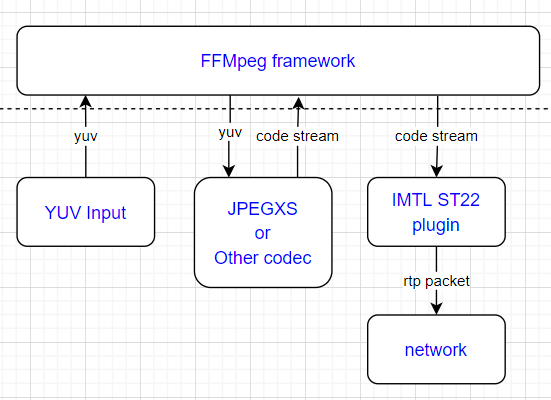

# The MTL Plugin for FFmpeg

## Notice

FFmpeg is an open source project licensed under LGPL and GPL. See <https://www.ffmpeg.org/legal.html>. You are solely responsible for determining if your use of FFmpeg requires any additional licenses. Intel is not responsible for obtaining any such licenses, nor liable for any licensing fees due, in connection with your use of FFmpeg.

## 1. Build

You can use the ./build.sh that will build the script for you automatically,

``` bash
apt-get install wget patch unzip
# in the  ecosystem/ffmpeg_plugin/ folder
./build.sh
```

The manual way of building is described below

### 1.1. Build openh264

Before building, check which openh264 is already installed, if any:

```bash
pkg-config --modversion openh264
```

If it prints the `OPENH264_VER` from `versions.env` or a later version, skip the build step below. An older openh264 has known vulnerabilities, so build the pinned version.

> Note: `$mtl_source_code` should be pointed to top source code tree of Media Transport Library.

```bash
. $mtl_source_code/versions.env

git clone https://github.com/cisco/openh264.git
cd openh264
git checkout "v${OPENH264_VER}"
make -j "$(nproc)"
sudo make install
sudo ldconfig
cd ../
```


### 1.2. Build FFmpeg with MTL patches

> Note: `$mtl_source_code` should be pointed to top source code tree of Media Transport Library.

```bash
. $mtl_source_code/versions.env

git clone https://github.com/FFmpeg/FFmpeg.git
cd FFmpeg
git checkout release/${FFMPEG_VERSION}
# apply the build patch
git am $mtl_source_code/ecosystem/ffmpeg_plugin/${FFMPEG_VERSION}/*.patch
# copy the mtl in/out implementation code
cp $mtl_source_code/ecosystem/ffmpeg_plugin/mtl_*.c -rf libavdevice/
cp $mtl_source_code/ecosystem/ffmpeg_plugin/mtl_*.h -rf libavdevice/
# build with --enable-mtl, customize the option as your setup
./configure --enable-shared --disable-static --enable-pic --enable-libopenh264 --enable-encoder=libopenh264 --enable-mtl
make -j
sudo make install
sudo ldconfig
```

> Note: For FFmpeg version 4.4 or 6.1, export `FFMPEG_VERSION=4.4` or 6.1.

In order to build the FFmpeg in a non-default path, use `--prefix="<path>"` within the `./configure` command to point to an empty installation folder.

## 2. ST20P raw video run guide

The MTL ST20P plugin is implemented as an FFmpeg input/output device, enabling direct reading from or sending raw video via the ST 2110-20 stream.

> **Note:** The default `payload_type` value for Media Transport Library raw video is 112. Below, it is changed to 96 - a commonly used number for raw video transmissions.

### 2.1. St20p input

Reading a ST 2110-20 10-bit YUV422 stream on 239.168.85.20:20000 with payload_type 96:

```bash
ffmpeg -p_port 0000:af:01.0 -p_sip 192.168.96.2 -p_rx_ip 239.168.85.20 -udp_port 20000 -payload_type 96 -fps 59.94 -pix_fmt yuv422p10le -video_size 1920x1080 -f mtl_st20p -i "k" -f rawvideo /dev/null -y
```

Following error indicates that MTL cannot detect a video stream on the listening address.

```text
[mtl_st20p @ 0x55634f8b3c80] mtl_st20p_read_packet(0), st20p_rx_get_frame timeout
[in#0/mtl_st20p @ 0x55634f8b3b40] Error during demuxing: Input/output error
[in#0/mtl_st20p @ 0x55634f8b3b40] Error retrieving a packet from demuxer: Input/output error
[vost#0:0/rawvideo @ 0x55634f8bcc80] No filtered frames for output stream, trying to initialize anyway.
```

Reading two ST 2110-20 10-bit YUV422 stream, one on 239.168.85.20:20000 and the second on 239.168.85.20:20002:

<!-- markdownlint-disable line-length -->
```bash
ffmpeg -p_port 0000:af:01.0 -p_sip 192.168.96.2 -p_rx_ip 239.168.85.20 -udp_port 20000 -payload_type 96 -fps 59.94 -pix_fmt yuv422p10le -video_size 1920x1080 -f mtl_st20p -i "1" -p_port 0000:af:01.0 -p_rx_ip 239.168.85.20 -udp_port 20002 -payload_type 96 -fps 59.94 -pix_fmt yuv422p10le -video_size 1920x1080 -f mtl_st20p -i "2" -map 0:0 -f rawvideo /dev/null -y -map 1:0 -f rawvideo /dev/null -y
```

Reading a ST 2110-20 10-bit YUV422 stream on 239.168.85.20:20000 with payload_type 96, and use libopenh264 to encode the stream to out.264 file:

```bash
ffmpeg -p_port 0000:af:01.0 -p_sip 192.168.96.2 -p_rx_ip 239.168.85.20 -udp_port 20000 -payload_type 96 -fps 59.94 -pix_fmt yuv422p10le -video_size 1920x1080 -f mtl_st20p -i "k" -c:v libopenh264 out.264 -y
```

### 2.2. St20p output

Reading from a yuv stream from a local file and sending a ST 2110-20 10-bit YUV422 stream on 239.168.85.20:20000 with payload_type 96:

```bash
ffmpeg -stream_loop -1 -video_size 1920x1080 -f rawvideo -pix_fmt yuv422p10le -i yuv422p10le_1080p.yuv -filter:v fps=59.94 -p_port 0000:af:01.1 -p_sip 192.168.96.3 -p_tx_ip 239.168.85.20 -udp_port 20000 -payload_type 96 -f mtl_st20p -
```

### 2.2.1 Additional NIC port options (multi-BDF)

The TX path supports additional NIC bindings beyond primary/redundant by using:

1. `-p2_port` / `-p2_sip`
1. `-p3_port` / `-p3_sip`
1. `-p4_port` / `-p4_sip`
1. `-p5_port` / `-p5_sip`
1. `-p6_port` / `-p6_sip`
1. `-p7_port` / `-p7_sip`

Each `*_port` expects a PCI BDF (for example `0000:af:01.2`) and each `*_sip` is the
source IP bound to that NIC.

Example with two additional NICs:

```bash
ffmpeg -stream_loop -1 -video_size 1920x1080 -f rawvideo -pix_fmt yuv422p10le -i yuv422p10le_1080p.yuv -filter:v fps=59.94 -p_port 0000:af:01.1 -p_sip 192.168.96.3 -p2_port 0000:af:01.2 -p2_sip 192.168.97.3 -p3_port 0000:af:01.3 -p3_sip 192.168.98.3 -p_tx_ip 239.168.85.20 -udp_port 20000 -payload_type 96 -f mtl_st20p -
```

### 2.3. Supported pixel formats

The `mtl_st20p` plugin maps the following FFmpeg `pix_fmt` values to MTL frame
formats. The same `-pix_fmt` must be used on TX and RX.

| `-pix_fmt`    | Wire format                   | ST 2110-20:2022 §6.2 compliant |
| ------------- | ----------------------------- | ------------------------------ |
| `yuv422p10le` | YUV 4:2:2 10-bit RFC 4175 PG2BE10 | yes (Table 2)              |
| `yuv444p10le` | YUV 4:4:4 10-bit RFC 4175 PG4BE10 | yes (Table 1)              |
| `yuv422p12le` | YUV 4:2:2 12-bit RFC 4175 PG2BE12 | yes (Table 2)              |
| `yuv444p12le` | YUV 4:4:4 12-bit RFC 4175 PG2BE12 | yes (Table 1)              |
| `y210le`      | YUV 4:2:2 10-bit RFC 4175 PG2BE10 | yes (Table 2)              |
| `uyvy422`     | YUV 4:2:2 8-bit RFC 4175          | yes (Table 2)              |
| `gbrp10le`    | RGB 4:4:4 10-bit RFC 4175 PG4BE10 | yes (Table 1)              |
| `gbrp12le`    | RGB 4:4:4 12-bit RFC 4175 PG2BE12 | yes (Table 1)              |
| `yuv420p`     | Planar I420 passthrough (`ST_FRAME_FMT_YUV420CUSTOM8`) | **no** — MTL-to-MTL only, not interoperable with third-party receivers |

## 3. ST22 compressed video run guide

A typical workflow for processing an MTL ST22 compressed stream with FFmpeg is outlined in the following steps: Initially, FFmpeg reads a YUV frame from the input source, then forwards the frame to a codec to encode the raw video into a compressed codec stream. Finally, the codec stream is sent to the MTL ST22 plugin.
The MTL ST22 plugin constructs the codec stream and transmits it as ST 2110-22 RTP packets, adhering to the standard. In addition to the JPEG XS stream, the MTL ST22 plugin is capable of supporting various other common compressed codecs, including H.264 (AVC), and H.265 (HEVC), among others.

> **Note:** The default `payload_type` value for Media Transport Library compressed video is 112. Below, it is changed to 98 - a commonly used number for compressed video transmissions.



### 3.1. St22 output

Reading from a yuv stream from local source file, encode with h264 codec and sending a ST 2110-22 codestream on 239.168.85.20:20000 with payload_type 98:

```bash
ffmpeg -stream_loop -1 -video_size 1920x1080 -f rawvideo -pix_fmt yuv420p -i yuv420p_1080p.yuv -filter:v fps=59.94 -c:v libopenh264 -p_port 0000:af:01.1 -p_sip 192.168.96.3 -p_tx_ip 239.168.85.20 -udp_port 20000 -payload_type 98 -f mtl_st22 -
```

### 3.2. St22 input

Reading a ST 2110-22 codestream on 239.168.85.20:20000 with payload_type 98, decode with FFmpeg h264 codec:

```bash
ffmpeg -p_port 0000:af:01.0 -p_sip 192.168.96.2 -p_rx_ip 239.168.85.20 -udp_port 20000 -payload_type 98 -fps 59.94 -video_size 1920x1080 -st22_codec h264 -f mtl_st22 -i "k" -f rawvideo /dev/null -y
```

### 3.3. SVT JPEG XS

Make sure the FFmpeg is build with both MTL and SVT JPEG XS plugin:

```bash
# start rx
ffmpeg -p_port 0000:af:01.0 -p_sip 192.168.96.2 -p_rx_ip 239.168.85.20 -udp_port 20000 -payload_type 98 -fps 59.94 -video_size 1920x1080 -st22_codec jpegxs -timeout_s 10 -f mtl_st22 -i "k" -vframes 10 -f rawvideo /dev/null -y
# start tx
ffmpeg -stream_loop -1 -video_size 1920x1080 -f rawvideo -pix_fmt yuv420p -i yuv420p_1080p.yuv -filter:v fps=59.94 -c:v libsvt_jpegxs -p_port 0000:af:01.1 -p_sip 192.168.96.3 -p_tx_ip 239.168.85.20 -udp_port 20000 -payload_type 98 -f mtl_st22 -
```

### 3.4. SVT HEVC

Make sure the FFmpeg is build with both MTL and SVT HEVC plugin:

```bash
# start rx
ffmpeg -p_port 0000:af:01.0 -p_sip 192.168.96.2 -p_rx_ip 239.168.85.20 -udp_port 20000 -payload_type 98 -fps 59.94 -video_size 1920x1080 -st22_codec h265 -timeout_s 10 -f mtl_st22 -i "k" -vframes 10 -f rawvideo /dev/null -y
# start tx
ffmpeg -stream_loop -1 -video_size 1920x1080 -f rawvideo -pix_fmt yuv420p -i yuv420p_1080p.yuv -filter:v fps=59.94 -c:v libsvt_hevc -p_port 0000:af:01.1 -p_sip 192.168.96.3 -p_tx_ip 239.168.85.20 -udp_port 20000 -payload_type 98 -f mtl_st22 -
```

### 3.5. St22p support

Another option involves utilizing the MTL built-in ST22 codec plugin, where FFmpeg can directly send or retrieve the YUV raw frame to/from the MTL ST22P plugin. MTL will then internally decode or encode the codec stream.

Reading a ST 2110-22 pipeline jpegxs codestream on 239.168.85.20:20000 with payload_type 98:

```bash
ffmpeg -p_port 0000:af:01.0 -p_sip 192.168.96.2 -p_rx_ip 239.168.85.20 -udp_port 20000 -payload_type 98 -st22_codec jpegxs -fps 59.94 -pix_fmt yuv422p10le -video_size 1920x1080 -f mtl_st22p -i "k" -f rawvideo /dev/null -y
```

Reading from a yuv file and sending a ST 2110-22 pipeline jpegxs codestream on 239.168.85.20:20000 with payload_type 98:

```bash
ffmpeg -stream_loop -1 -video_size 1920x1080 -f rawvideo -pix_fmt yuv422p10le -i yuv422p10le_1080p.yuv -filter:v fps=59.94 -p_port 0000:af:01.1 -p_sip 192.168.96.3 -p_tx_ip 239.168.85.20 -udp_port 20000 -payload_type 98 -st22_codec jpegxs -f mtl_st22p -
```

## 4. ST30P audio run guide

> **Note:** The default `payload_type` value for Media Transport Library raw audio is 111. Below, it is changed to 97 - a commonly used number for raw audio transmissions.

### 4.1. St30p input

Reading a ST 2110-30 stream (pcm24, 1ms packet time, 2 channels) on 239.168.85.20:30000 with payload_type 97 and encoded to a wav file:

```bash
ffmpeg -p_port 0000:af:01.0 -p_sip 192.168.96.2 -p_rx_ip 239.168.85.20 -udp_port 30000 -payload_type 97 -pcm_fmt pcm24 -ptime 1ms -channels 2 -f mtl_st30p -i "0" dump.wav -y
```

### 4.2. St30p output

Reading from a wav file and sending a ST 2110-30 stream (pcm24, 1ms packet time, 2 channels) on 239.168.85.20:30000 with payload_type 97:

```bash
ffmpeg -stream_loop -1 -i test.wav -p_port 0000:af:01.1 -p_sip 192.168.96.3 -p_tx_ip 239.168.85.20 -udp_port 30000 -payload_type 97 -ptime 1ms -f mtl_st30p -
```

### 4.3. St30p pcm16 example

For pcm16 audio, use `mtl_st30p_pcm16` muxer, set `pcm_fmt` to `pcm16` for demuxer.

```bash
ffmpeg -stream_loop -1 -i test.wav -p_port 0000:af:01.1 -p_sip 192.168.96.3 -p_tx_ip 239.168.85.20 -udp_port 30000 -payload_type 97 -ptime 1ms -f mtl_st30p_pcm16 -

ffmpeg -p_port 0000:af:01.0 -p_sip 192.168.96.2 -p_rx_ip 239.168.85.20 -udp_port 30000 -payload_type 97 -pcm_fmt pcm16 -ptime 1ms -channels 2 -f mtl_st30p -i "0" dump_pcm16.wav -y
```

## 5. ST40P ancillary and fast metadata run guide

The `mtl_st40p` device sends and receives ST 2110-40 ancillary data (RFC 8331). With `-fast_metadata 1`, it sends and receives ST 2110-41 fast metadata. The data is raw bytes: the muxer takes a data stream or u8 audio, and the demuxer gives one data stream.

1. TX cuts each input packet into frames. An ANC frame is one ANC packet of at most 255 user data words, with the `-did` and `-sdid` IDs (default 0x43 and 0x02). A fast metadata frame is one data item of at most 1436 bytes, with the `-fmd_dit` Data Item Type and the `-fmd_k_bit` K-bit.
1. RX gives one packet per frame: the user data words of the frame, or one data item with its zero padding to a 32-bit word.
1. After the first frame, RX ends the stream when no frame comes in `-timeout_s` (default 1 s). If the first frame does not come in `-init_retry` + 1 tries, RX fails.
1. `-frame_info_path` writes one line per frame. It is the line of the `frame-info-path` property of the GStreamer `mtl_st40p_rx`.

> **Note:** The default `payload_type` value is 112. Fast metadata needs a dynamic payload type (96-127). Below, ANC uses 113 and fast metadata uses 115.

### 5.1. St40p output

Reading a file in a loop as 1024-byte packets and sending it as ST 2110-40 on 239.168.85.40:40000 with payload_type 113. Each packet becomes five frames of at most 255 bytes:

```bash
ffmpeg -stream_loop -1 -f u8 -ar 10240 -ac 1 -i anc.bin -map 0 -c copy -p_port 0000:af:01.1 -p_sip 192.168.96.3 -p_tx_ip 239.168.85.40 -udp_port 40000 -payload_type 113 -fps 59.94 -did 0x43 -sdid 0x02 -f mtl_st40p -
```

`-f u8 -ar 10240 -ac 1` reads the file as 1024-byte packets, and `-stream_loop` can loop it. `-f data` cannot loop. FFmpeg 4.4 and 6.1 read 1024-byte packets with `-ar 25600`.

Sending the same file as ST 2110-41 fast metadata, one 1024-byte data item per frame, with payload_type 115:

```bash
ffmpeg -stream_loop -1 -f u8 -ar 10240 -ac 1 -i fmd.bin -map 0 -c copy -p_port 0000:af:01.1 -p_sip 192.168.96.3 -p_tx_ip 239.168.85.40 -udp_port 40000 -payload_type 115 -fps 59.94 -fast_metadata 1 -fmd_dit 1234567 -fmd_k_bit 0 -f mtl_st40p -
```

### 5.2. St40p input

Receiving ST 2110-40 on 239.168.85.40:40000 with payload_type 113 and writing the user data words to a file. FFmpeg does not select a data stream by itself, so `-map 0` is necessary:

```bash
ffmpeg -p_port 0000:af:01.0 -p_sip 192.168.96.2 -p_rx_ip 239.168.85.40 -udp_port 40000 -payload_type 113 -init_retry 20 -f mtl_st40p -i "0" -map 0 -c copy -f data anc_out.bin -y
```

Receiving ST 2110-41 fast metadata with payload_type 115, and writing one line of frame info per data item:

```bash
ffmpeg -p_port 0000:af:01.0 -p_sip 192.168.96.2 -p_rx_ip 239.168.85.40 -udp_port 40000 -payload_type 115 -fast_metadata 1 -frame_info_path fmd_out.info -init_retry 20 -f mtl_st40p -i "0" -map 0 -c copy -f data fmd_out.bin -y
```

A frame info line for fast metadata. For ANC, the line has no `fmd_dit` and `fmd_k_bit`:

```text
ts=4137576201 meta=0 rtp_marker=0 seq_discont=0 seq_lost=0 pkts_total=1 pkts_recv_p=1 pkts_recv_r=0 fmd_dit=1234567 fmd_k_bit=0
```

## 6. St20 GPU direct guide

The MTL_GPU_DIRECT experimental feature aims at enhancing FFmpeg's performance by allowing direct access to GPU memory, which can be particularly beneficial when working with high-throughput video streams such as those handled by the MTL ST20 codec plugin.

### 6.1. Enabling experimental MTL_GPU_DIRECT in FFmpeg with ST20p Support

To take advantage of the MTL_GPU_DIRECT feature FFmpeg has to be built with this option enabled. Here’s how to do it:

```bash
./configure --enable-shared --disable-static --enable-pic --enable-libopenh264 --enable-encoder=libopenh264 --enable-mtl --extra-cflags="-DMTL_GPU_DIRECT_ENABLED"
```

or use

```bash
./build_ffmpeg_plugin.sh -g
```

Reading a ST 2110-20 10-bit YUV422 stream on 239.168.85.20:20000 with payload_type 96 and
enabled gpu_direct:

```bash
./ffmpeg -p_port 0000:af:01.0 -p_sip 192.168.96.2 -p_rx_ip 239.168.85.20 -udp_port 20000 -payload_type 96 -fps 59.94 -pix_fmt yuv422p10le -video_size 1920x1080 -gpu_direct 1 -gpu_driver 0 -gpu_device 0 -f mtl_st20p -i "k" -f rawvideo /dev/null -y
```

### 6.2. Additional Notes

**GPU Direct Flag:** When compiling FFmpeg with the MTL_GPU_DIRECT feature enabled, ensure that your system's GPU drivers and hardware support direct GPU memory access.  
GPU device IDs and GPU driver IDs are printed during initialization.

**Options:**

1. `-gpu_device`
1. `-gpu_driver`

Both default to 0, but if your device doesn't initialize, adjust it using the information printed during initialization.

**Example:**

```text
Drivers count: 1
Driver: 0: Device: 0: Name: Intel(R) Data Center GPU Flex 170, Type: 1, VendorID: 8086, DeviceID: 22208
```


[GPU Documentation](../../doc/gpu.md)

By following these steps, you can effectively build and utilize FFmpeg with the MTL_GPU_DIRECT feature enabled.
