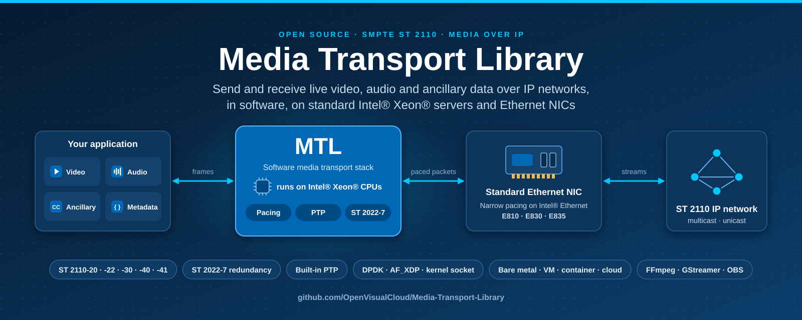
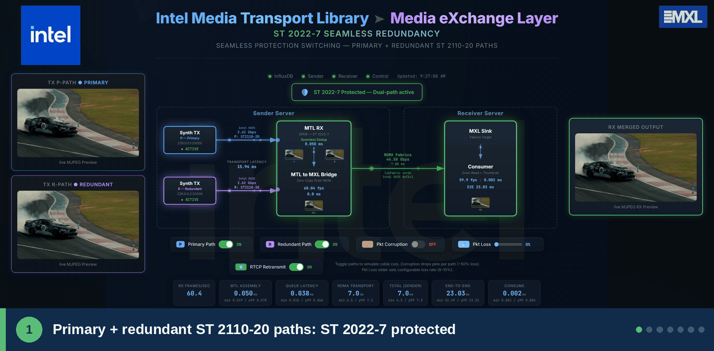

.. Media Transport Library documentation master file, created by
   skolelis
   You can adapt this file completely to your liking, but it should at least
   contain the root `toctree` directive.

   SPDX-License-Identifier: BSD-3-Clause
   Copyright(©) 2025 Intel Corporation
   Media Transport Library

Media Transport Library
======================================================

The demo below shows SMPTE ST 2022-7 seamless redundancy with the
:doc:`MTL with MXL <ecosystem/MTL_with_MXL/README>` bridge. MTL receives an
ST 2110-20 stream over a primary and a redundant path on Intel E835 NICs,
merges the two copies and hands the frames to the Media eXchange Layer (MXL)
over RDMA. While one path is cut or loses packets, or both paths drop
different packets, the merged output keeps playing.

.. toctree::
   :maxdepth: 1

   Introduction <README.md>
   security.md
   CHANGELOG.md
   Licensing <ATTRIBUTION.md>

Contents
---------

.. toctree::
   :maxdepth: 1
   :caption: Contents:

   doc/design.md
   doc/rl_pacing.md
   MTL Manager <manager/README.md>
   doc/build.md
   Build Guide on Windows <doc/build_WIN.md>
   doc/run.md
   doc/e800_series_drivers.md
   doc/run_WIN.md
   doc/vm.md
   doc/vm_WIN.md
   doc/aws.md
   doc/kernel_socket.md
   doc/asan.md
   doc/convert.md
   doc/dma.md
   doc/external_frame.md
   doc/gpu.md
   gpu_direct/README.md
   doc/isolation.md
   doc/plugin.md
   doc/rtcp.md
   doc/sdm_appliance.md
   doc/shm_lcore.md
   doc/stats_guide.md
   doc/usdt.md
   doc/xdp.md
   ST2110 Compliance Result <doc/compliance.md>
   doc/performance.md

Sample Application
-------------------

.. toctree::
   :maxdepth: 1
   :caption: Sample Application:

   app/sample/README.md
   app/sample/msvc/README.md
   app/v4l2_to_ip/README.md
   doc/configuration_guide.md

Ecosystem
----------

.. toctree::
   :maxdepth: 1
   :caption: Ecosystem:

   Ffmpeg Plugin <ecosystem/ffmpeg_plugin/README.md>
   GStreamer Plugin <ecosystem/gstreamer_plugin/README.md>
   plugins/st22_avcodec/README.md
   OBS Studio <ecosystem/obs_mtl/README.md>
   MTL with MXL <ecosystem/MTL_with_MXL/README.md>

Development and Testing
------------------------

.. toctree::
   :maxdepth: 1
   :caption: Development and Testing:

   doc/coding_standard.md
   doc/acceptance_quickstart.md
   doc/acceptance-design.md
   doc/ci_runner_setup.md
   doc/perf_compare.md
   doc/perf_compare_metrics.md
   doc/cicd_setup_proposition.md

Doxygen
--------

.. toctree::
   :maxdepth: 1
   :caption: Doxygen:

   doc/doxygen.md
   doc/doxygen/solution_overview.md
   doc/doxygen/main_page.md
   doc/doxygen/api.md
   doc/doxygen/programmers_guide.md

Other
------

.. toctree::
   :maxdepth: 1
   :caption: Other:

   Python Support <python/README.md>
   Rust Support <rust/README.md>
   docker/README.md
   tools/ebpf/README.md
   tools/set_tai_offset/README.md
   doc/sphinx/build_docs.md

Experimental features
----------------------

.. toctree::
   :maxdepth: 1
   :caption: Experimental features:

   doc/experimental/af_packet.md
   doc/experimental/af_xdp.md
   doc/experimental/header_split.md
   doc/experimental/performance_optimizations.md

