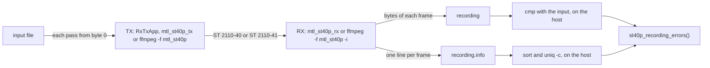

# Validation Test Modules

This directory contains the test modules for the Media Transport Library validation test suite. The tests are organized into categories based on test scope and functionality.

## Test Categories

### Single Flow Tests (`single/`)

Tests for single-flow scenarios, where a single source transmits to a single destination:

- **dma/**: Tests for Direct Memory Access functionality
  - Memory allocation and management
  - DMA transfer performance and reliability
  - Error handling and recovery

- **ffmpeg/**: Tests for FFmpeg integration
  - FFmpeg plugin functionality
  - Encoding and decoding with FFmpeg
  - Format conversion and compatibility

- **gstreamer/**: Tests for GStreamer integration
  - GStreamer plugin functionality
  - Pipeline creation and management
  - Element functionality and compatibility

- **kernel_socket/**: Tests for kernel socket backend
  - Socket creation and management
  - Packet transmission and reception
  - Performance and reliability

- **performance/**: Performance benchmarking tests
  - Throughput measurements
  - Latency tests
  - CPU and memory usage analysis

- **ptp/**: Precision Time Protocol tests
  - Clock synchronization
  - Timestamp accuracy
  - PTP profile compatibility

- **rss_mode/**: Tests for Receive Side Scaling modes
  - RSS configuration
  - Multi-queue performance
  - Load balancing effectiveness

- **rx_timing/**: Tests for reception timing compliance
  - Packet timing analysis
  - Compliance with ST2110-21 timing specifications
  - Jitter measurements

- **st20p/**: Tests for ST2110-20 video transport
  - Uncompressed video transmission and reception
  - Format compatibility
  - Video quality verification

- **st22p/**: Tests for ST2110-22 compressed video transport
  - Compressed video transmission and reception
  - Encoder/decoder plugin functionality
  - Compression quality and performance

- **st30p/**: Tests for ST2110-30 audio transport
  - Audio transmission and reception
  - Format compatibility
  - Audio quality verification

- **st40p/**: Tests for the ST2110-40 ancillary pipeline
  - Ancillary data transmission and reception
  - ST2110-41 fast metadata DIT, K-bit, frame rate, and payload type
  - Byte-exact data item delivery, multicast, and ST 2022-7 redundancy
  - ST 2110-41 validation for reserved DITs and static payload types
  - FFmpeg and GStreamer at both ends, and RxTxApp with GStreamer in each direction (see [st40p Streamer Integrity Check](#st40p-streamer-integrity-check))

- **udp/**: Tests for UDP functionality
  - UDP packet transmission and reception
  - MTU handling
  - UDP-specific features

- **virtio_user/**: Tests for virtio-user functionality
  - Virtual device creation and management
  - Performance in virtual environments
  - Compatibility with virtualization platforms

- **xdp/**: Tests for Express Data Path functionality
  - XDP program loading and execution
  - Packet filtering and processing
  - Performance comparison with other backends

### Dual Flow Tests (`dual/`)

Tests involving dual connections or flows, typically for redundancy or multi-stream scenarios:

- Redundant path tests (ST2022-7)
- Multi-stream synchronization
- Load balancing and failover

### Invalid Tests (`invalid/`)

Tests for error handling and negative test cases:

- Invalid configuration handling
- Error recovery
- Resource exhaustion scenarios

## st40p Streamer Integrity Check

When FFmpeg or GStreamer is at RX, `st40p_recording_errors()` in `mtl_engine/integrity.py` gives the verdict, for RFC 8331 ancillary data and for ST 2110-41 fast metadata. When RxTxApp is at RX, RxTxApp checks the data items itself.

- Each TX starts each pass over the input at byte 0. It cuts the pass into frames of at most 255 bytes (RFC 8331), or into data items of 1024 bytes (fast metadata). The last frame of a pass is shorter.
- RX writes the bytes of each frame to the recording, and one line per frame to `<recording>.info`. RX pads each data item with zeros to a 32-bit word.
- The host compares the recording with the input in two or three `cmp` calls. The recording must be the passes in order, and only the last pass can be cut.
- The host reduces the log with `sort | uniq -c`. Each frame must have `seq_discont=0 seq_lost=0`. Each data item must also have `rtp_marker=0`, and the `fmd_dit=` and `fmd_k_bit=` that the test sets.



## Running Tests

### Running Specific Test Categories

To run all single flow tests:

```bash
pytest tests/single/
```

To run specific test types:

```bash
pytest tests/single/st20p/
```

### Test Markers

Tests are marked with categories that can be used for selective execution:

```bash
# Run smoke tests
pytest -m smoke

# Run nightly tests
pytest -m nightly
```

## Adding New Tests

To add a new test:

1. Create a new test file in the appropriate directory
2. Use the pytest fixture pattern for setup and teardown
3. Add appropriate markers for test categorization
4. Document the test purpose and expectations

Example test structure:

```python
import pytest
from common.nicctl import Nicctl
from mtl_engine.RxTxApp import RxTxApp

# Mark test as part of the smoke test suite
@pytest.mark.smoke
def test_st20_basic_transport():
    """
    Test basic ST2110-20 video transport functionality.
    
    This test verifies that a simple video stream can be
    transmitted and received with proper formatting.
    """
    # Test implementation
    # ...
    
    # Assertions to verify test results
    assert result == expected_result, "Transport failed"
```

## License

BSD-3-Clause License
Copyright (c) 2024-2025 Intel Corporation
